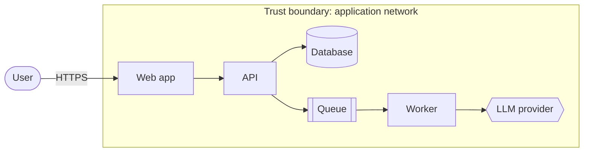

# Threat model: <system or feature>

## 1. Scope
<What is in scope and out of scope. Version.>

## 2. Assets
| Asset | Classification | Location | Why it matters |
|---|---|---|---|

## 3. Data flow diagram and trust boundaries

## 4. Threats (STRIDE)
| ID | Element | Category | Threat | Existing control (file) | Likelihood | Impact | Residual risk | Owner |
|---|---|---|---|---|---|---|---|---|
| T-001 | <element> | Spoofing | <threat> | <control and path> | L/M/H | L/M/H | <level> | @<owner> |

## 5. OWASP Top 10 for LLM Applications (2025) mapping
| ID | Risk | Applies? | Where in this system | Controls | Tests | Residual risk |
|---|---|---|---|---|---|---|
| LLM01 | Prompt injection | | | | | |
| LLM02 | Sensitive information disclosure | | | | | |
| LLM03 | Supply chain | | | | | |
| LLM04 | Data and model poisoning | | | | | |
| LLM05 | Improper output handling | | | | | |
| LLM06 | Excessive agency | | | | | |
| LLM07 | System prompt leakage | | | | | |
| LLM08 | Vector and embedding weaknesses | | | | | |
| LLM09 | Misinformation | | | | | |
| LLM10 | Unbounded consumption | | | | | |
