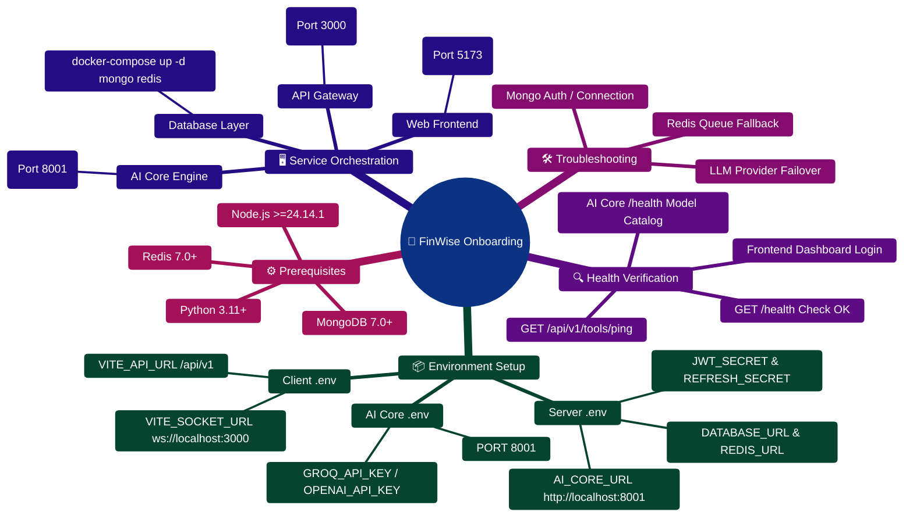

# 01 — Getting Started

> Everything you need to set up FinWise locally and start contributing.

## Current Release Notes

Before using the setup steps below, note the following changes from the latest platform update:

- The server now declares Node `>=24.14.1 <25` in `server/package.json`.
- The current release added heavier AI runtime behavior, so local development is more reliable when the Node server, MongoDB, Redis, and AI Core are all available.
- New dashboard and transaction-review features depend on the expanded backend route surface and summary services.

### Practical onboarding guidance

- Prefer aligning your local Node version with `server/.node-version` and `server/.nvmrc`.
- If you are touching AI, chat, command center, or transaction review flows, run the Python AI Core locally as part of your normal setup.
- Treat `/api/v1/*` as the canonical route surface for new development work.
- Consult the [**Master Developer Handbook (Building on This Project)**](../docs/BUILDING_ON_THIS_PROJECT.md) for complete end-to-end blueprints on adding database models, Zod validation schemas, Express controllers, React views, and LangGraph subagents.

---

---

## Table of Contents

- [1. Prerequisites](#1-prerequisites)
- [2. Project Structure Overview](#2-project-structure-overview)
- [3. Step-by-Step Local Setup](#3-step-by-step-local-setup)
- [4. Environment Variables](#4-environment-variables)
- [5. Build Instructions](#5-build-instructions)
- [6. Running the Project](#6-running-the-project)
- [7. Docker Setup](#7-docker-setup)
- [8. First-Time Setup Flow](#8-first-time-setup-flow)
- [9. Verifying the Setup](#9-verifying-the-setup)

---

## 1. Prerequisites

Ensure the following tools are installed before proceeding. Version numbers listed are the minimum supported.

| Tool | Minimum Version | Required For | Install Link |
|---|---|---|---|
| **Node.js** | `>=24.14.1 <25` | Server + Client runtime | [nodejs.org](https://nodejs.org/) |
| **npm** | `>=11.0.0` | Package management | Bundled with Node.js 24 |
| **Git** | 2.30+ | Version control | [git-scm.com](https://git-scm.com/) |
| **MongoDB** | 6.0+ (7.0+ recommended) | Primary datastore | [mongodb.com](https://www.mongodb.com/try/download/community) |
| **Redis** | 7.0+ | Queues, rate limiting, caching | [redis.io](https://redis.io/docs/install/) |
| **Python** | 3.11+ (<3.13 for PaddleOCR) | AI Core multi-agent engine | [python.org](https://www.python.org/downloads/) |
| **Docker** | 24+ | Containerized services | [docker.com](https://www.docker.com/) |
| **Docker Compose** | 2.20+ | Multi-container orchestration | Bundled with Docker Desktop |

> **Note:** MongoDB and Redis can be run natively or via Docker (see [Docker Setup](#7-docker-setup)). The server includes an in-memory MongoDB fallback (`mongodb-memory-server`) for development when no live MongoDB instance is available.

### Verify Your Environment

```bash
node -v        # >= v24.14.1
npm -v         # >= 11.0.0
git --version  # >= 2.30
python --version  # >= 3.11
docker --version  # >= 24.0 (optional)
docker compose version  # >= 2.20 (optional)
```

---

## 2. Project Structure Overview

FinWise is organized as a multi-tier monorepo. The three primary services communicate over HTTP and SSE.

```
personal-finance/
├── client/                     # React 18 + Vite 7 SPA (Port 5173)
│   ├── src/
│   │   ├── components/         # 36+ reusable UI components (Radix primitives)
│   │   ├── features/           # Feature modules (chat, journaling, workflows)
│   │   ├── hooks/              # 13 custom React hooks (useAIStream, useRealtimeEvents)
│   │   ├── lib/                # API client layer (14 domain modules + v1 APIs)
│   │   ├── pages/              # 35 route-level page components (FinanceOS, Dashboard)
│   │   ├── stores/             # 6 Zustand state stores
│   │   ├── routes/             # Wouter router definitions
│   │   ├── context/            # Auth context provider
│   │   ├── layouts/            # AppShell and ChatLayout
│   │   └── types/              # Shared TypeScript types
│   ├── vite.config.ts          # Vite config with PWA + proxy
│   ├── tailwind.config.ts      # Tailwind CSS configuration
│   └── tsconfig.json           # TypeScript configuration
│
├── server/                     # Express 5 + TypeScript API (Port 3000)
│   ├── src/
│   │   ├── config/             # 6 config modules (env, DB, Redis, passport)
│   │   ├── controllers/        # 16 root + 32 v1 controllers (newsletter, pdf)
│   │   ├── middleware/         # 13 middleware modules (authAny, orgScope)
│   │   ├── models/             # 52 Mongoose models (HealthScore, chunks)
│   │   ├── routes/             # 18 route files (100+ endpoints + /v1/*)
│   │   ├── schemas/            # 13 root + 29 v1 Zod validation schemas
│   │   ├── services/           # 60 business-logic services (retrieval, newsletter)
│   │   ├── modules/            # Domain modules (plugins, queue, realtime)
│   │   ├── connectors/         # External service connectors
│   │   ├── worker/             # BullMQ background worker
│   │   ├── scripts/            # Migration, chunk backfill, and seed scripts
│   │   └── test/               # 34 integration test files (in-memory Mongo)
│   ├── AI_Core/                # Python FastAPI AI Core (Port 8001)
│   │   ├── agents/             # TaskDecomposer, SubAgentManager, Aggregator, Specialists
│   │   ├── contracts/          # Pydantic V2 agent output contracts
│   │   ├── evals/              # Evaluation test harness and invariant runner
│   │   ├── lora/               # Fine-tuning dataset and training pipeline
│   │   ├── graph/              # LangGraph workflow orchestration
│   │   ├── tools/              # Deterministic financial calculators and plan builder
│   │   ├── memory/             # SQLite FTS5 conversation memory & facts
│   │   ├── vision/             # PaddleOCR receipt & handwriting parser
│   │   ├── api_service.py      # FastAPI HTTP entry point
│   │   └── requirements.txt    # Python dependencies
│   ├── Dockerfile              # Production Dockerfile for Express API
│   └── tsconfig.json           # TypeScript configuration
│
├── packages/contracts/         # Shared OpenAPI specs and typed contracts
├── docs/                       # Project documentation (59 detailed reference guides)
├── documentation/              # Numbered, structured master guide (chapters 01-12)
├── compose.yaml                # Production Docker Compose orchestration
├── research_references/        # Academic papers and reference models
└── research_survey/            # User research and empirical data
```

### Service Summary

| Service | Technology | Port | Role |
|---|---|---|---|
| **Client** | React 18 + Vite 7 + TypeScript | 5173 | Single-page application with PWA support |
| **Server** | Express 5 + TypeScript | 3000 | REST API, authentication, background workers, SSE |
| **AI Core** | Python 3.11+ + FastAPI + LangGraph | 8001 | Multi-agent DAG orchestration, RAG, subagents, OCR |
| **MongoDB** | MongoDB 7+ | 27017 | Primary datastore (52 models, GridFS) |
| **Redis** | Redis 7+ | 6379 | Rate limiting, BullMQ queues, DLQ, caching |

---

## 3. Step-by-Step Local Setup

### Step 1: Clone the Repository

```bash
git clone <repository-url>
cd personal-finance
```

### Step 2: Install Dependencies

The project uses npm workspaces. Install all dependencies from the repository root:

```bash
# Install server dependencies
cd server
npm install

# Install client dependencies
cd ../client
npm install
```

> **Note:** There is no root `package.json` with workspaces configured. Each workspace is installed independently.

### Step 3: Set Up Environment Variables

Create `.env` files for each service by copying the examples:

```bash
# Server environment
cp server/.env.example server/.env

# Client environment
cp client/.env.example client/.env
```

Edit each `.env` file with your configuration values. See [Environment Variables](#4-environment-variables) for the complete reference.

**Minimum required for the server to start:**

```env
MONGO_URI=mongodb://localhost:27017/finwise
JWT_SECRET=<generate-a-secure-random-string>
COOKIE_SECRET=<generate-a-secure-random-string>
```

**Minimum required for the client:**

```env
VITE_API_BASE_URL=/api
VITE_API_PROXY_TARGET=http://localhost:3000
VITE_APP_NAME=FinWise
```

### Step 4: Start Infrastructure Services

Start MongoDB and Redis. You can run them natively or via Docker (see [Docker Setup](#7-docker-setup)):

```bash
# Option A: Using Docker Compose (recommended)
docker compose up -d mongo redis

# Option B: Start services natively (if installed locally)
# mongod --dbpath /data/db
# redis-server
```

### Step 5: Start the AI Core (Optional)

The AI Core is optional — the server will function without it, but AI-powered features (chat, file analysis, insights) will be unavailable.

```bash
cd server/AI_Core

# Create and activate a virtual environment
python -m venv .venv

# Windows
.venv\Scripts\activate

# macOS / Linux
source .venv/bin/activate

# Install Python dependencies
pip install -r requirements.txt

# Start the AI Core
python api_service.py
```

The AI Core will be available at `http://localhost:8001`.

### Step 6: Start All Services

Open **three terminals** (or use a process manager) and start each service:

```bash
# Terminal 1: Server
cd server
npm run dev

# Terminal 2: Client
cd client
npm run dev

# Terminal 3: AI Core (optional)
cd server/AI_Core
.venv\Scripts\activate   # Windows
# source .venv/bin/activate  # macOS/Linux
python api_service.py
```

Alternatively, if a root-level `npm run dev` script is configured to run all services concurrently:

```bash
npm run dev
```

### Step 7: Open the Application

Navigate to **http://localhost:5173** in your browser. The Vite dev server proxies `/api` requests to the Express server automatically.

---

## 4. Environment Variables

### Server (`server/.env`)

| Variable | Required | Default | Description |
|---|---|---|---|
| `PORT` | No | `3000` | Port the Express server listens on |
| `MONGO_URI` | **Yes** | — | MongoDB connection string (e.g., `mongodb://localhost:27017/finwise`) |
| `JWT_SECRET` | **Yes** | — | Secret for signing JWT tokens (use a 64+ char random string) |
| `COOKIE_SECRET` | **Yes** | — | Secret for signing HTTP-only cookies (use a 64+ char random string) |
| `GOOGLE_CLIENT_ID` | No | — | Google OAuth 2.0 client ID for social login |
| `GOOGLE_CLIENT_SECRET` | No | — | Google OAuth 2.0 client secret |
| `GOOGLE_CALLBACK_URL` | No | `http://localhost:3000/api/auth/google/callback` | Google OAuth callback URL |
| `EMAIL_HOST` | No | `smtp.gmail.com` | SMTP server hostname |
| `EMAIL_PORT` | No | `587` | SMTP server port |
| `EMAIL_USER` | No | — | SMTP authentication username |
| `EMAIL_FROM` | No | — | Sender email address (e.g., `FinWise <app@example.com>`) |
| `EMAIL_PASSWORD` | No | — | SMTP authentication password or app-specific password |
| `PYTHON_API_URL` | No | `http://localhost:8001` | URL of the AI Core FastAPI service |
| `CLIENT_URL` | No | `http://localhost:5173` | Origin URL of the frontend (for CORS and redirect) |
| `CORS_ORIGINS` | No | `http://localhost:5173` | Comma-separated list of allowed CORS origins |
| `REDIS_URL` | No | `redis://localhost:6379` | Redis connection string (uncomment to enable) |
| `GEMINI_API_KEY` | No | — | Google Gemini API key for AI features |
| `OPENROUTER_API_KEY` | No | — | OpenRouter API key (alternative LLM provider) |
| `GROQ_API_KEY` | No | — | Groq API key (alternative LLM provider) |
| `XAI_API_KEY` | No | — | xAI (Grok) API key (alternative LLM provider) |
| `TOGETHER_API_KEY` | No | — | Together AI API key (alternative LLM provider) |
| `LLM_PROVIDER` | No | Auto-detected | Preferred LLM provider: `gemini`, `openrouter`, `groq`, `grok`, `together`, `mistral` |
| `STRIPE_SECRET_KEY` | No | — | Stripe secret key for billing integration |
| `STRIPE_WEBHOOK_SECRET` | No | — | Stripe webhook signing secret |

> **Generating secure secrets:** Use `node -e "console.log(require('crypto').randomBytes(64).toString('hex'))"` to generate cryptographically secure random strings for `JWT_SECRET` and `COOKIE_SECRET`.

### Client (`client/.env`)

| Variable | Required | Default | Description |
|---|---|---|---|
| `VITE_API_BASE_URL` | No | `/api` | Base path for API requests (proxied by Vite in dev) |
| `VITE_API_PROXY_TARGET` | No | `http://localhost:3000` | Dev proxy target for `/api` requests |
| `VITE_APP_NAME` | No | `FinWise` | Application display name (used in PWA manifest, page titles) |

> **Note:** All client env vars must be prefixed with `VITE_` to be exposed to the browser bundle. These variables are baked into the build at compile time — changing them requires a rebuild.

### AI Core (`server/AI_Core/.env`)

| Variable | Required | Default | Description |
|---|---|---|---|
| `GEMINI_API_KEY` | No | — | Google Gemini API key |
| `OPENROUTER_API_KEY` | No | — | OpenRouter API key |
| `GROQ_API_KEY` | No | — | Groq API key |
| `XAI_API_KEY` | No | — | xAI (Grok) API key |
| `TOGETHER_API_KEY` | No | — | Together AI API key |
| `LLM_PROVIDER` | No | Auto-detected | Primary LLM provider: `gemini`, `openrouter`, `groq`, `grok`, `together`, `mistral` |
| `LLM_PROVIDER_PRIORITY` | No | `gemini,openrouter,groq,grok,together` | Comma-separated failover priority list |
| `LLM_MODEL` | No | Provider default | Override the default model for the selected provider |
| `LLM_TEMPERATURE` | No | `0.1` | LLM sampling temperature (0.0–1.0) |
| `LLM_MAX_TOKENS` | No | `4096` | Maximum tokens per LLM response |
| `LLM_TIMEOUT_SECONDS` | No | `30` | Timeout for LLM API calls |
| `LLM_MAX_RETRIES` | No | `0` | Max retries on LLM failure (retries handled by rate limiter) |
| `VISION_MAX_IMAGE_BYTES` | No | `10485760` | Maximum image size for OCR (10 MB) |
| `VISION_LANG_ALLOWED` | No | `en` | Allowed OCR language codes |
| `VISION_LANG_DEFAULT` | No | `en` | Default OCR language |
| `FINWISE_MEMORY_DB_PATH` | No | In-memory | Path to SQLite memory database file |
| `FINWISE_MEMORY_TOP_K` | No | `8` | Number of memory records to retrieve per query |
| `LOG_LEVEL` | No | `INFO` | Logging level: `DEBUG`, `INFO`, `WARNING`, `ERROR` |

---

## 5. Build Instructions

### Client

```bash
cd client
npm run build
```

This runs TypeScript type-checking (`tsc`) followed by a Vite production build. Output is written to `client/dist/`.

```bash
# Preview the production build locally
npm run preview
```

### Server

```bash
cd server
npm run build
```

Compiles TypeScript to JavaScript in `server/dist/`. The compiled output is executed with `tsx` in production mode.

```bash
# Type-check without emitting files
npm run check
```

### AI Core

The AI Core is a Python application and does not require a build step. Ensure dependencies are installed:

```bash
cd server/AI_Core
pip install -r requirements.txt
```

### Build All Workspaces

```bash
# Build client
npm run build --workspace=client

# Build server
npm run build --workspace=server
```

---

## 6. Running the Project

### Development Mode

#### All Services Concurrently

If a root-level dev script is available:

```bash
npm run dev
```

#### Individual Services

```bash
# Server (with hot reload via tsx watch)
cd server
npm run dev

# Client (Vite dev server with HMR)
cd client
npm run dev

# AI Core (with hot reload)
cd server/AI_Core
python api_service.py

# Background Worker (BullMQ processor)
cd server
npm run worker:dev
```

### Production Mode

```bash
# Build both workspaces first
npm run build --workspace=client
npm run build --workspace=server

# Start the server in production mode
cd server
npm start

# Serve the client build with a static file server
npx serve ../client/dist -l 5173
```

### Useful Server Scripts

| Command | Description |
|---|---|
| `npm run dev` | Start with hot reload (`tsx watch src/server.ts`) |
| `npm run start` | Start in production mode (`node dist/server.js`) |
| `npm run build` | Compile TypeScript (`tsc --noEmit && node scripts/build.mjs`) |
| `npm run check` | Type-check without emitting (`tsc --noEmit`) |
| `npm run worker:dev` | Start BullMQ background worker with hot reload |
| `npm run worker:start` | Start BullMQ background worker in production mode |
| `npm test` | Run tests with Vitest |
| `npm run test:watch` | Run tests in interactive watch mode |
| `npm run test:ci` | Run tests once (CI mode: `vitest run`) |
| `npm run backfill:retrieval` | Backfill workspace text documents into RAG Phase 2 knowledge chunks |
| `npm run migrate:transactions` | Run transaction migration script |
| `npm run migrate:orgids` | Run organization ID migration script |
| `npm run seed:content` | Seed mock content and educational data |
| `npm run generate:openapi` | Generate OpenAPI path specifications |

### Useful Client Scripts

| Command | Description |
|---|---|
| `npm run dev` | Start Vite dev server with HMR |
| `npm run build` | Type-check + production build (`tsc && vite build`) |
| `npm run preview` | Preview production build locally |
| `npm test` | Run client tests with Vitest (`vitest run`) |
| `npm run test:watch` | Run client tests in watch mode |
| `npm run lint` | ESLint check with strict rules |

### Useful AI Core Scripts

| Command | Description |
|---|---|
| `uvicorn api_service:app --host 0.0.0.0 --port 8001 --reload` | Start AI Core FastAPI server with hot reload |
| `pytest tests/ -v` | Run full test suite for agents, tools, memory, and failover |
| `python -m evals.runner` | Run invariant evaluation suite (determinism, latency, number safety) |
| `python lora/train.py` | Run LoRA fine-tuning training job |

---

## 7. Docker Setup

Docker Compose provides the simplest way to run MongoDB and Redis locally without native installation.

### docker-compose.yml

Create a `docker-compose.yml` file at the repository root:

```yaml
services:
  mongo:
    image: mongo:7
    container_name: finwise-mongo
    restart: unless-stopped
    ports:
      - "27017:27017"
    volumes:
      - mongo-data:/data/db
    environment:
      MONGO_INITDB_DATABASE: finwise

  redis:
    image: redis:7-alpine
    container_name: finwise-redis
    restart: unless-stopped
    ports:
      - "6379:6379"
    volumes:
      - redis-data:/data

volumes:
  mongo-data:
  redis-data:
```

### Commands

```bash
# Start MongoDB and Redis in the background
docker compose up -d

# View logs
docker compose logs -f mongo
docker compose logs -f redis

# Stop services
docker compose down

# Stop and remove volumes (resets all data)
docker compose down -v
```

### Connection Strings

Once the containers are running, use these connection strings in your `.env` files:

```env
# server/.env
MONGO_URI=mongodb://localhost:27017/finwise
REDIS_URL=redis://localhost:6379
```

### In-Memory MongoDB Fallback

If you do not have MongoDB running (neither natively nor via Docker), the server's test suite uses `mongodb-memory-server` to spin up an ephemeral in-memory MongoDB instance. This is useful for running tests without external dependencies but is **not** recommended for development — use a real MongoDB instance for the best experience.

---

## 8. First-Time Setup Flow

When you start FinWise for the first time, follow this flow to initialize your workspace:

### 1. Register an Account

Navigate to **http://localhost:5173** and you will see the registration/login screen.

- **Email/Password:** Create an account with a valid email address and password.
- **Google OAuth:** If `GOOGLE_CLIENT_ID` and `GOOGLE_CLIENT_SECRET` are configured, you can sign in with your Google account.

### 2. Create an Organization

After registration, you will be prompted to create an organization. Organizations are the top-level workspace container in FinWise — all financial data (transactions, budgets, goals) belongs to an organization.

- Enter an organization name (e.g., "My Finances" or your family/team name).
- You will be assigned the **owner** role automatically.

### 3. Complete Onboarding

The onboarding wizard guides you through initial setup:

1. **Connect Accounts** — Add bank, savings, credit, or investment accounts (manual entry; bank connectors are stub implementations).
2. **Set Up Budgets** — Create your first budget with category allocations.
3. **Add Transactions** — Import transactions via CSV or add them manually.
4. **Configure AI** — If LLM provider keys are set, the AI assistant will be available immediately.

### 4. Seed Demo Data (Optional)

To populate the application with sample data for exploration:

```bash
cd server
npm run seed:content
```

This creates mock transactions, budgets, merchants, and other entities so you can explore the UI without entering data manually.

---

## 9. Verifying the Setup

After starting all services, verify each component is running correctly.

### Health Check Endpoints

| Service | URL | Expected Response |
|---|---|---|
| **Client** | http://localhost:5173 | React SPA loads with login/registration screen |
| **Server** | http://localhost:3000/api/health | JSON with status, uptime, and service info |
| **AI Core** | http://localhost:8001/health | JSON with provider status and model info |
| **MongoDB** | `mongosh` or Compass | Connect to `mongodb://localhost:27017/finwise` |
| **Redis** | `redis-cli ping` | Returns `PONG` |

### What to Look For

**Client (port 5173):**
- The login/registration page renders without errors.
- Browser console shows no CORS errors.
- Vite HMR indicator appears in the bottom-left corner (dev mode).

**Server (port 3000):**
- Terminal shows `Server running on port 3000` (or your configured port).
- MongoDB connection is confirmed in startup logs.
- If Redis is configured, queue initialization logs appear.
- No unhandled promise rejections or TypeScript compilation errors.

**AI Core (port 8001):**
- Terminal shows Uvicorn startup message with the listening address.
- At least one LLM provider key is detected (check logs for provider selection).
- No import errors for LangChain or LangGraph.

**MongoDB (port 27017):**
- Connection succeeds without authentication errors.
- The `finwise` database is created automatically on first write.
- Collections appear as you register and create data.

**Redis (port 6379):**
- `redis-cli ping` returns `PONG`.
- Server logs confirm Redis connection for rate limiting and queues.

### Quick Smoke Test

```bash
# Test server health
curl http://localhost:3000/api/health

# Test AI Core health
curl http://localhost:8001/health

# Test Redis
redis-cli ping

# Test MongoDB connection
mongosh --eval "db.adminCommand('ping')"
```

### Common Issues

| Symptom | Likely Cause | Fix |
|---|---|---|
| `ECONNREFUSED` on port 27017 | MongoDB not running | Start MongoDB or Docker container |
| `ECONNREFUSED` on port 6379 | Redis not running | Start Redis or Docker container |
| CORS errors in browser | `CORS_ORIGINS` mismatch | Ensure `CLIENT_URL` matches the dev server URL |
| `JWT_SECRET` errors | Missing or empty secret | Generate a secure random string |
| AI features not working | AI Core not started or no LLM keys | Start AI Core and set at least one API key |
| Port already in use | Another process on the port | Kill the process or change the `PORT` variable |

---

*Next: [02 — Architecture](./02-architecture.md)*

## Onboarding & System Setup Mindmap



## Local Development Lifecycle ASCII Flow

```text
┌────────────────────────────────────────────────────────────────────────┐
│ 🟢 STEP 1: HOST PREREQUISITES VERIFICATION                             │
│    Node.js >= 24.14.1 • Python 3.11+ • Docker Engine • Git             │
└───────────────────────────────────┬────────────────────────────────────┘
                                    │
                                    ▼
┌────────────────────────────────────────────────────────────────────────┐
│ 🟡 STEP 2: INFRASTRUCTURE BOOTSTRAP                                   │
│    $ docker-compose up -d mongodb redis                               │
│    ► Mongo: localhost:27017 (Data & Audit Logs)                        │
│    ► Redis: localhost:6379 (BullMQ Queues & Caching)                   │
└───────────────────────────────────┬────────────────────────────────────┘
                                    │
                                    ▼
┌────────────────────────────────────────────────────────────────────────┐
│ 🟣 STEP 3: ENVIRONMENT CONFIGURATION (.env)                           │
│    ► server/.env ── JWT_SECRET, DATABASE_URL, REDIS_URL, AI_CORE_URL  │
│    ► client/.env ── VITE_API_URL=/api/v1                               │
│    ► server/AI_Core/.env ── GROQ_API_KEY / GEMINI_API_KEY / OLLAMA     │
└───────────────────────────────────┬────────────────────────────────────┘
                                    │
                  ┌─────────────────┴─────────────────┐
                  ▼                                   ▼
┌──────────────────────────────────┐┌────────────────────────────────────┐
│ 🔷 STEP 4A: SERVER & AI ENGINE   ││ 🔶 STEP 4B: FRONTEND WEB APP       │
│    $ cd server && npm install    ││    $ cd client && npm install      │
│    $ npm run dev (Port 3000)     ││    $ npm run dev (Port 5173)       │
│    $ cd AI_Core && venv/activate ││    ► Vite Hot Module Reloading     │
│    $ uvicorn api_service:app     ││    ► Proxied /api/v1 calls         │
└─────────────────┬────────────────┘└─────────────────┬──────────────────┘
                  │                                   │
                  └─────────────────┬─────────────────┘
                                    │
                                    ▼
┌────────────────────────────────────────────────────────────────────────┐
│ 🟢 STEP 5: END-TO-END HEALTH VERIFICATION                              │
│    ├─► Node Gateway: GET http://localhost:3000/api/health (200 OK)         │
│    ├─► AI Core Engine: GET http://localhost:8001/health (200 OK)       │
│    └─► Client Portal: http://localhost:5173 (Auth & Dashboard Ready)   │
└────────────────────────────────────────────────────────────────────────┘
```


---

## Production Implementation Blueprints

### 1. Rapid Development Multi-Terminal Launch Script (`scripts/dev.sh`)

```bash
#!/usr/bin/env bash
# Spins up infrastructure, AI Core, Express API, and React Frontend in development mode

echo "1. Bootstrapping MongoDB and Redis..."
docker compose up -d mongo redis

echo "2. Launching Python AI Core..."
(cd server/AI_Core && source .venv/bin/activate && uvicorn api_service:app --host 0.0.0.0 --port 8001 --reload) &

echo "3. Launching Express API Gateway..."
(cd server && npm run dev) &

echo "4. Launching Vite Frontend..."
(cd client && npm run dev) &

wait
```

### 2. Environment Variable Validation Schema (`server/src/schemas/envSchema.ts`)

```typescript
// Zod schema enforcing strict environment variable validation at server boot
export const envSchema = z.object({
  NODE_ENV: z.enum(["development", "production", "test"]).default("development"),
  PORT: z.coerce.number().default(3000),
  MONGO_URI: z.string().min(1, "MONGO_URI is required"),
  REDIS_URL: z.string().min(1, "REDIS_URL is required"),
  JWT_SECRET: z.string().min(32, "JWT_SECRET must be at least 32 characters"),
  AI_CORE_URL: z.string().url().default("http://localhost:8001"),
  AI_CORE_INTERNAL_TOKEN: z.string().min(16)
});
```

### 3. Windows PaddleOCR Environment Check & Fallback (`server/AI_Core/scripts/check_paddleocr.py`)

```python
"""
Verifies PaddleOCR native dependencies, C++ runtimes, and falls back to
pytesseract / deterministic regex extraction when compiled binaries fail to load.
"""
import sys
import logging

logging.basicConfig(level=logging.INFO)
logger = logging.getLogger("paddle_check")

def verify_ocr_subsystem():
    logger.info("Python version: %s", sys.version)
    if sys.version_info >= (3, 13):
        logger.warning("PaddleOCR is incompatible with Python >= 3.13. Please use Python 3.11 or 3.12.")
    
    try:
        import paddle
        logger.info("PaddlePaddle core installed: v%s (CUDA available: %s)", paddle.__version__, paddle.is_compiled_with_cuda())
    except ImportError as e:
        logger.error("PaddlePaddle core missing: %s. Run: pip install paddlepaddle", e)
        return False
        
    try:
        from paddleocr import PaddleOCR
        ocr = PaddleOCR(use_angle_cls=True, lang="en", show_log=False)
        logger.info("PaddleOCR successfully initialized with native C++ runtimes.")
        return True
    except Exception as e:
        logger.error("Failed initializing PaddleOCR: %s", e)
        logger.info("Windows Troubleshooting Guide:")
        logger.info("  1. Install Microsoft Visual C++ 2015-2022 Redistributable (x64).")
        logger.info("  2. If using Python 3.13+, recreate virtual environment with Python 3.11 or 3.12.")
        logger.info("  3. Server will automatically fallback to Tesseract or pure LLM vision parser.")
        return False

if __name__ == "__main__":
    verify_ocr_subsystem()
```

### 4. Node Engine & Pre-flight Diagnostics (`server/src/scripts/checkNodeEngine.ts`)

```typescript
// Enforces Node >=24.14.1 <25 and validates environment connectivity before starting server
import semver from "semver";
import { logger } from "../config/logger";

export function checkNodeEngine(): void {
  const currentVersion = process.version;
  const expectedRange = ">=24.14.1 <25";

  if (!semver.satisfies(currentVersion, expectedRange)) {
    logger.error(
      { currentVersion, expectedRange },
      "[FATAL] Unsupported Node.js version. FinWise requires Node >=24.14.1 <25 for ES2024 features and high-throughput crypto."
    );
    process.exit(1);
  }

  logger.info({ currentVersion }, "[OK] Node.js engine version verified.");
}

if (require.main === module) {
  checkNodeEngine();
}
```
