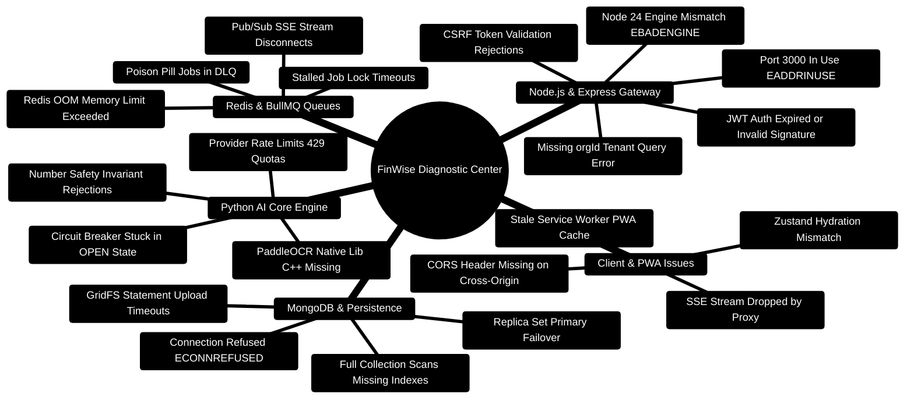
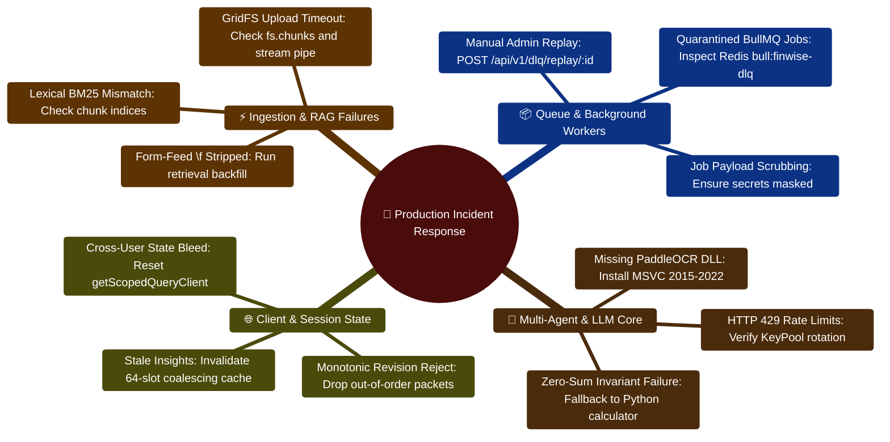

# 10 — Troubleshooting & Diagnostic Runbook

> **Comprehensive Diagnostic Runbook, Incident Decision Trees, and Recovery Recipes**  
> *Symptom-Cause-Remedy Matrices for Express 5, React 18, MongoDB 7, Redis 7, BullMQ, and FastAPI AI Core*  
> **Runtime Specification:** Node.js `>=24.14.1 <25` · Python `3.11+` · MongoDB `7.0` · Redis `7.0`

---

> [!TIP]
> **Encountering Developer Setup or Runtime Issues?**  
> Consult the 10-point Developer Troubleshooting Matrix in the [**Master Developer Handbook: Building on This Project**](../docs/BUILDING_ON_THIS_PROJECT.md).

## 1. Troubleshooting Architecture Mindmap



---

## 2. Master Diagnostic Decision Tree ASCII Flow

```text
┌─────────────────────────────────────────────────────────────────────────────────────────────────┐
│ 🚨 ANOMALY DETECTED: Service Unhealthy, Request Failing, or Background Job Stalled              │
└───────────────────────────────────────────────┬─────────────────────────────────────────────────┘
                                                │
                                                ▼
                         [Which layer is exhibiting the failure?]
                         /                      |                       \
       API Gateway (Port 3000)        Datastore / Redis            AI Core (Port 8001)
               /                                |                                 \
              v                                 v                                  v
┌──────────────────────────┐    ┌──────────────────────────┐    ┌──────────────────────────┐
│ Probe /healthz & /health │    │ Check Mongo/Redis Pings  │    │ Probe /health endpoint   │
│  - curl localhost:3000   │    │  - mongosh --eval 'ping' │    │  - curl localhost:8001   │
│  - Check process logs    │    │  - redis-cli ping        │    │  - Inspect KeyPool state │
└─────────────┬────────────┘    └─────────────┬────────────┘    └─────────────┬────────────┘
              │                               │                               │
       [Status OK?]                    [Pings Pong?]                   [AI Healthy?]
          /       \                       /       \                       /       \
        YES        NO                   YES        NO                   YES        NO
        /           \                   /           \                   /           \
       v             v                 v             v                 v             v
┌───────────┐ ┌───────────┐     ┌───────────┐ ┌───────────┐     ┌───────────┐ ┌───────────┐
│ Check     │ │ EADDRINUSE│     │ Check Bull│ │ Start DB  │     │ Check LLM │ │ Install   │
│ Auth/CORS │ │ or Engine │     │ DLQ / Lock│ │ Service or│     │ Quotas &  │ │ Missing   │
│ Config    │ │ Mismatch  │     │ Timeouts  │ │ Docker    │     │ Failovers │ │ C++ Libs  │
└───────────┘ └───────────┘     └───────────┘ └───────────┘     └───────────┘ └───────────┘
```

---

## 3. Fast Diagnostic Probes & CLI Commands

| Probe Target | Protocol & Command | Expected Output | Meaning |
| :--- | :--- | :--- | :--- |
| **Server Liveness** | `curl -i http://localhost:3000/healthz` | `HTTP/1.1 200 OK` `{"status":"ok"}` | Node.js Express process is up and running |
| **Server Readiness** | `curl -i http://localhost:3000/api/health` | `{"db":"connected","redis":"connected"}` | MongoDB and Redis connections are established |
| **AI Core Direct** | `curl -i http://localhost:8001/health` | `{"status":"healthy","providers":[...]}` | FastAPI runtime is healthy with active LLM keys |
| **BullMQ DLQ Size** | `redis-cli LLEN bull:finwise-dlq:failed` | `(integer) 0` | Zero poisoned jobs quarantined |
| **Compound Indexes** | `mongosh personal-finance --eval "db.transactions.getIndexes()"` | Array including `{ orgId: 1, date: -1 }` | Critical query indexes are active |

---

## 4. Symptom-Cause-Remedy Matrices

### 4.1 Node.js & Express API Gateway Issues

#### Issue 1: Node Engine Incompatibility (`EBADENGINE`)
- **Symptom**: `npm install` or `npm run dev` fails with:
  ```text
  npm error code EBADENGINE
  npm error engine Unsupported engine: {"node":">=24.14.1 <25","npm":">=11"}
  ```
- **Root Cause**: The workspace strictly targets Node.js 24 LTS. Earlier Node versions lack native ES module optimizations and crypto features used by the server.
- **Remedy**:
  ```bash
  # Using nvm (macOS/Linux):
  nvm install 24.14.1
  nvm use 24.14.1

  # Using nvm-windows:
  nvm use 24.14.1
  node -v # Ensure output is v24.14.1
  ```

---

#### Issue 2: Port Conflict (`EADDRINUSE: address already in use :::3000`)
- **Symptom**: Server startup crashes with port binding failure.
- **Root Cause**: An orphaned Node.js background process is holding port 3000 or 5173.
- **Remedy**:
  ```powershell
  # Windows PowerShell:
  Get-NetTCPConnection -LocalPort 3000 | Select-Object OwningProcess
  Stop-Process -Id <PID> -Force

  # Linux / macOS:
  lsof -i :3000 -t | xargs kill -9
  ```

---

#### Issue 3: Missing Tenant Scope Error (`[OrgScopePlugin] Query executed without required orgId`)
- **Symptom**: API endpoints return HTTP 500 with stack trace originating in `orgScopePlugin.ts`.
- **Root Cause**: A backend service executed a database query without specifying `{ orgId }` in the filter, and without passing `{ bypassOrgScope: true }`.
- **Remedy**: Update the service query to explicitly include the tenant ID:
  ```typescript
  // INCORRECT:
  const txn = await TransactionModel.findById(id);

  // CORRECT:
  const txn = await TransactionModel.findOne({ _id: id, orgId });
  ```

---

### 4.2 MongoDB & Datastore Issues

#### Issue 4: Connection Refused (`ECONNREFUSED 127.0.0.1:27017`)
- **Symptom**: Express logs `MongoServerSelectionError: connect ECONNREFUSED`.
- **Root Cause**: MongoDB daemon is not running or Docker container is stopped.
- **Remedy**:
  ```bash
  # Docker:
  docker compose up -d mongo

  # Native Service (Windows Admin):
  Start-Service MongoDB

  # Native Service (Linux):
  sudo systemctl start mongod
  ```

---

#### Issue 5: Full Collection Scans on Transactions (Slow Queries > 1,000ms)
- **Symptom**: Transaction queries slow down dramatically as database grows beyond 50,000 records.
- **Root Cause**: Compound indexes were not built or were dropped during a manual migration.
- **Remedy**: Run the index reconciliation script:
  ```bash
  cd server
  npx ts-node src/scripts/verifyIndexes.ts
  ```

---

### 4.3 Redis & BullMQ Queue Issues

#### Issue 6: Quarantined Jobs in Dead Letter Queue (`finwise-dlq`)
- **Symptom**: Certain background emails or PDF requests fail silently, and DLQ size increases.
- **Root Cause**: Corrupted input payload or transient upstream email service outage triggered maximum retries.
- **Remedy**:
  1. Inspect the quarantined job details:
     ```bash
     curl -H "Authorization: Bearer <ADMIN_TOKEN>" http://localhost:3000/api/v1/admin/dlq/jobs
     ```
  2. Replay the job after resolving the underlying cause:
     ```bash
     curl -X POST -H "Authorization: Bearer <ADMIN_TOKEN>" http://localhost:3000/api/v1/admin/dlq/replay/<JOB_ID>
     ```

---

### 4.4 Python AI Core & Multi-Agent Issues

#### Issue 7: PaddleOCR C++ Dependency Missing on Windows
- **Symptom**: AI Core startup fails with `ImportError: DLL load failed while importing _paddle_ocr`.
- **Root Cause**: Missing Visual C++ Redistributable 2015–2022 on the Windows host.
- **Remedy**: Install Visual C++ Redistributable x64 from Microsoft official site, or use the Dockerized AI Core:
  ```bash
  docker compose up -d ai-core
  ```

---

#### Issue 8: LLM Provider Rate Limits (`HTTP 429 Too Many Requests`)
- **Symptom**: AI Core logs show 429 errors from Google Gemini or Groq.
- **Root Cause**: Free-tier provider quota reached.
- **Remedy**:
  1. Configure multi-key rotation by adding comma-separated keys to `server/AI_Core/.env`:
     ```env
     GEMINI_API_KEYS="key_alpha,key_beta,key_gamma"
     ```
  2. The `KeyPool` manager will automatically cycle keys upon detecting HTTP 429.
  3. If all keys are exhausted, the system automatically falls back through OpenRouter down to deterministic Python calculators.

---

## 5. Disaster Recovery & Emergency Reset

To perform a clean local reset of all ephemeral datastores without deleting code:

```bash
# 1. Stop all containers and remove volumes
docker compose down -v

# 2. Clear Redis cache manually (if running natively)
redis-cli FLUSHALL

# 3. Re-seed default demo tenant and mock data
cd server
npm run seed:mock
```


---

## 6. Automated Diagnostic CLI Script (`server/src/scripts/diagnoseSystem.ts`)

Run this diagnostic probe to execute a complete health audit of all datastores, queues, network sockets, and AI microservices:

```typescript
import mongoose from "mongoose";
import Redis from "ioredis";
import axios from "axios";
import { getEnv } from "../config/env";
import { logger } from "../config/logger";

interface ProbeResult {
  service: string;
  status: "HEALTHY" | "DEGRADED" | "DOWN";
  latencyMs: number;
  message?: string;
}

export async function runDiagnostics(): Promise<void> {
  const env = getEnv();
  const results: ProbeResult[] = [];

  console.log("\n==================================================");
  console.log("       FINWISE SYSTEM DIAGNOSTIC AUDIT            ");
  console.log("==================================================\n");

  // 1. Probe MongoDB Replica Set
  const tMongoStart = Date.now();
  try {
    await mongoose.connect(env.DATABASE_URL);
    await mongoose.connection.db!.admin().ping();
    results.push({ service: "MongoDB 7.0 Primary", status: "HEALTHY", latencyMs: Date.now() - tMongoStart });
  } catch (err: any) {
    results.push({ service: "MongoDB 7.0 Primary", status: "DOWN", latencyMs: Date.now() - tMongoStart, message: err.message });
  }

  // 2. Probe Redis 7.0 Connection
  const tRedisStart = Date.now();
  try {
    const redis = new Redis(env.REDIS_URL, { maxRetriesPerRequest: 1 });
    const pong = await redis.ping();
    results.push({ service: "Redis 7.0 Cache & Queues", status: pong === "PONG" ? "HEALTHY" : "DEGRADED", latencyMs: Date.now() - tRedisStart });
    await redis.quit();
  } catch (err: any) {
    results.push({ service: "Redis 7.0 Cache & Queues", status: "DOWN", latencyMs: Date.now() - tRedisStart, message: err.message });
  }

  // 3. Probe Python FastAPI AI Core Microservice
  const tAiStart = Date.now();
  try {
    const aiRes = await axios.get(`${env.PYTHON_API_URL}/health`, { timeout: 5000 });
    results.push({ service: "Python AI Core (LangGraph)", status: aiRes.status === 200 ? "HEALTHY" : "DEGRADED", latencyMs: Date.now() - tAiStart });
  } catch (err: any) {
    results.push({ service: "Python AI Core (LangGraph)", status: "DOWN", latencyMs: Date.now() - tAiStart, message: err.message });
  }

  // Render Formatted Terminal Table
  console.table(results);

  const hasFailures = results.some((r) => r.status === "DOWN");
  if (hasFailures) {
    console.error("\n🚨 CRITICAL: One or more foundational services failed diagnostic checks.");
    process.exit(1);
  } else {
    console.log("\n🟢 ALL SYSTEMS OPERATIONAL: FinWise is ready for production traffic.\n");
    process.exit(0);
  }
}

if (require.main === module) {
  runDiagnostics();
}
```

---

### 4.5 2026 Enterprise Feature Diagnostics

#### Issue 9: GridFS PDF Compilation Timeouts & Incomplete Streams
- **Symptom**: Client requests to `/api/v1/files/:workspaceFileId/render-pdf` terminate after 30 seconds with HTTP 504 Gateway Timeout or truncated PDF files.
- **Root Cause**: Large multi-hundred-page workspace documents consume excessive memory when compiled synchronously in a single Node.js event loop tick, blocking GridFS chunk writes.
- **Remedy**:
  1. Verify the `pdfRequestServer` is using chunked streams instead of buffering:
     ```typescript
     // Ensure PDFKit pipe connects directly to the GridFS upload stream
     doc.pipe(uploadStream);
     ```
  2. Increase the GridFS upload timeout in `server/.env`:
     ```env
     GRIDFS_UPLOAD_TIMEOUT_MS=60000
     ```
  3. Inspect MongoDB `fs.chunks` collection for orphaned chunks:
     ```bash
     mongosh personal-finance --eval "db['rendered_reports.chunks'].countDocuments()"
     ```

---

#### Issue 10: RAG Bounded-Window Chunking Failures & Missing Form-Feed Markers
- **Symptom**: RAG retrieval returns search results with missing page numbers (`pageNumber: null`) or returns zero chunks for a known PDF document.
- **Root Cause**: Upstream text extraction stripped ASCII form-feed characters (`\f`), which are required by `retrievalService.ts` to compute accurate physical page boundaries.
- **Remedy**:
  1. Trigger manual backfill chunking for the target workspace file:
     ```bash
     curl -X POST "http://localhost:3000/api/v1/retrieval/backfill" \
       -H "Authorization: Bearer <ADMIN_TOKEN>" \
       -H "X-Org-Id: <ORG_ID>" \
       -d '{"workspaceFileId": "file_12345"}'
     ```
  2. Check indexed chunks count:
     ```bash
     curl "http://localhost:3000/api/v1/retrieval/chunks/file_12345" \
       -H "Authorization: Bearer <USER_TOKEN>"
     ```

---

#### Issue 11: Conversation Insights 64-Slot Buffer Saturation
- **Symptom**: Express logs warning: `[RequestCoalescer] Ring buffer capacity 64 exceeded; evicting oldest in-flight promise`.
- **Root Cause**: More than 64 distinct chat sessions queried insights simultaneously under peak load before LLM summarizer returned.
- **Remedy**:
  1. Increase buffer capacity in `conversationInsightsCache.ts` if running on high-memory servers:
     ```typescript
     private readonly MAX_KEYS = 128; // Scale from 64 to 128
     ```
  2. Ensure Redis L2 caching is enabled to absorb requests before reaching the in-process ring buffer.

---

#### Issue 12: Calendar `.ics` Sync RFC 5545 Timezone Drift
- **Symptom**: External calendar applications (Google Calendar or Apple Calendar) display recurring bill reminders 5 hours offset from their configured due date.
- **Root Cause**: The `.ics` export emitted naive local timestamps instead of strict UTC timestamps with `Z` suffix.
- **Remedy**: Ensure date fields are formatted using `.toISOString().replace(/[-:]/g, "").split(".")[0] + "Z"`:
  ```typescript
  // CORRECT:
  const dtStart = reminder.dueDate.toISOString().replace(/[-:]/g, "").split(".")[0] + "Z";
  ```

---

#### Issue 13: What-If Monte Carlo Simulation Invariant Violations
- **Symptom**: Scenarios page displays error: `Simulation failed: Total portfolio allocation drift exceeded 100%`.
- **Root Cause**: Input parameter adjustments contained floating-point rounding errors (e.g., `0.3333333333333333` summing to `0.9999999999999999`).
- **Remedy**: The simulation engine enforces round-to-nearest cents and normalizes weight vectors:
  ```python
  # server/AI_Core/agents/what_if_agent.py
  normalized_weights = [round(w / sum(weights), 4) for w in weights]
  ```

---

## 7. Incident Response & Troubleshooting Mindmap


