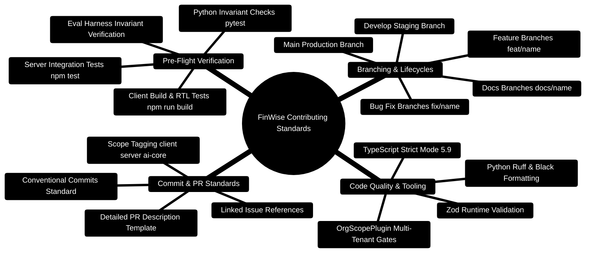

# 11 — Contributing & Engineering Standards

> **Engineering Guidelines, Branching Strategy, Code Standards, and PR Quality Rubric**  
> *Conventional Commits, TypeScript & Python Style Enforcement, Review Rubrics, and CI/CD Verification*  
> **Target Audience:** Core Contributors, Full-Stack Engineers, AI Specialists, and Open-Source Collaborators

---

> [!TIP]
> **Looking to build or extend features?**  
> Consult the [**Master Developer Handbook: Building on This Project**](../docs/BUILDING_ON_THIS_PROJECT.md) for end-to-end full-stack blueprints, Mongoose models, Zod validation schemas, Express 5 controllers, React Query hooks, and Python LangGraph subagents.

## 1. Contributor Workflow Mindmap



---

## 2. Branching & PR Lifecycle ASCII Architecture

```text
┌─────────────────────────────────────────────────────────────────────────────────────────────────┐
│ 🚀 LOCAL FEATURE WORK: git checkout -b feat/your-feature-name                                    │
└───────────────────────────────────────────────┬─────────────────────────────────────────────────┘
                                                │
                                                ▼
┌─────────────────────────────────────────────────────────────────────────────────────────────────┐
│ 💻 CODE IMPLEMENTATION & LOCAL VERIFICATION                                                     │
│    ├─► Server: npm run check && npm run test:ci                                                 │
│    ├─► Client: npm run build && npm test                                                        │
│    └─► AI Core: pytest tests/ -v && python -m evals.runner                                      │
└───────────────────────────────────────────────┬─────────────────────────────────────────────────┘
                                                │
                                                ▼
┌─────────────────────────────────────────────────────────────────────────────────────────────────┐
│ 📝 COMMIT WITH CONVENTIONAL COMMITS                                                              │
│    git commit -m "feat(ai-core): add topological concurrency to subagent manager"               │
└───────────────────────────────────────────────┬─────────────────────────────────────────────────┘
                                                │
                                                ▼
┌─────────────────────────────────────────────────────────────────────────────────────────────────┐
│ 🌐 PUSH & CREATE PULL REQUEST                                                                   │
│    ├─► Automated GitHub Actions CI Matrix runs across Node 24 and Python 3.11                   │
│    ├─► Peer review by at least one maintainer                                                   │
│    └─► Squash and Merge into develop ──► Tagged release to main                                 │
└─────────────────────────────────────────────────────────────────────────────────────────────────┘
```

---

## 3. Conventional Commit Standards

Every commit in the FinWise repository must adhere to the [Conventional Commits](https://www.conventionalcommits.org/) specification:

```text
<type>(<scope>): <subject in present tense>

[optional body providing technical context and architectural rationale]

[optional footer referencing issues, e.g. Closes #142]
```

### 3.1 Allowed Commit Types

| Type | Purpose | Example |
| :--- | :--- | :--- |
| `feat` | New functionality or endpoint | `feat(server): add newsletter preference scheduler` |
| `fix` | Bug fix or calculation patch | `fix(ai-core): fix zero-sum budget invariant rounding` |
| `perf` | Performance optimization | `perf(database): add compound index for transactions` |
| `refactor`| Code change without behavioral alteration | `refactor(client): extract circular health gauge` |
| `docs` | Documentation updates | `docs(api): document canonical /api/v1 endpoints` |
| `test` | Adding or updating tests | `test(server): add tenant isolation integration tests` |
| `chore` | Build tasks, configs, dependency updates | `chore(docker): bump Node.js base image to 24-alpine` |

### 3.2 Canonical Scopes

- `client`: React 18 frontend (`client/src/*`)
- `server`: Express 5 backend gateway (`server/src/*`)
- `ai-core`: Python LangGraph AI Core (`server/AI_Core/*`)
- `database`: MongoDB models, migrations, or indexes
- `docker`: Docker Compose and container Dockerfiles
- `docs`: Markdown documentation and architectural guides
- `ci`: GitHub Actions workflows

---

## 4. Code Standards & Style Guidelines

### 4.1 TypeScript Standards (Server & Client)
- **Strict Mode Enabled**: `strict: true` is strictly enforced. No implicit `any`.
- **Runtime Validation**: Every external input (HTTP body, query param, route param) must be parsed through a **Zod** schema.
- **Tenant Boundary**: Never write un-scoped database queries. Always ensure `{ orgId }` is included in the query filter or passed through `orgContext`.

```typescript
// ✅ RECOMMENDED: Validated and Tenant-Scoped
export async function getTransactionById(orgId: string, transactionId: string) {
  const validatedId = objectIdSchema.parse(transactionId);
  const txn = await TransactionModel.findOne({ _id: validatedId, orgId });
  if (!txn) {
    throw new HttpError(404, "Transaction not found within active tenant.");
  }
  return txn;
}
```

---

### 4.2 Python Standards (AI Core)
- **Python 3.11+ Target**: Utilize modern union syntax (`int | str`), `typing.TypedDict`, and Pydantic V2 models.
- **Number Safety Conservation**: Any function proposing budget adjustments must preserve total sum equality ($\sum \Delta B = 0$).
- **Exception Containment**: Thread pool tasks must handle exceptions locally so that one subagent failure does not crash the DAG.

```python
# ✅ RECOMMENDED: TypedDict State & Error Containment
from pydantic import BaseModel, Field

class BudgetDelta(BaseModel):
    category: str
    amount_change: float = Field(..., description="Positive for increase, negative for reduction")

def verify_budget_delta_neutrality(deltas: list[BudgetDelta]) -> bool:
    total_delta = sum(d.amount_change for d in deltas)
    return abs(total_delta) < 1e-6 # Floating point tolerance
```

---

## 5. Pre-Flight Verification Checklist

Before submitting a Pull Request, execute this single verification run:

```bash
# 1. Verify Client Build and Tests
cd client
npm test
npm run build

# 2. Verify Server Type Check and Tests
cd ../server
npm run check
npm run test:ci

# 3. Verify AI Core Unit Tests and Evaluation Harness
cd ../server/AI_Core
pytest tests/ -v
python -m evals.runner
```


---

## 6. Automated GitHub Actions CI/CD Pipeline (`.github/workflows/ci.yml`)

Every Pull Request must pass the automated GitHub Actions quality gate before approval:

```yaml
name: FinWise CI/CD Quality Pipeline

on:
  push:
    branches: [main, develop]
  pull_request:
    branches: [main, develop]

jobs:
  server-verification:
    runs-on: ubuntu-latest
    services:
      mongodb:
        image: mongo:7.0
        ports:
          - 27017:27017
      redis:
        image: redis:7.0-alpine
        ports:
          - 6379:6379
    steps:
      - uses: actions/checkout@v4
      - name: Setup Node.js 24 LTS
        uses: actions/setup-node@v4
        with:
          node-version: 24.14.1
          cache: "npm"
          cache-dependency-path: server/package-lock.json

      - name: Install Server Dependencies
        run: cd server && npm ci

      - name: TypeScript Compiler Typecheck
        run: cd server && npm run check

      - name: Run Supertest Integration Suites
        run: cd server && npm run test:ci
        env:
          DATABASE_URL: "mongodb://127.0.0.1:27017/finwise_test"
          REDIS_URL: "redis://127.0.0.1:6379"
          JWT_SECRET: "test-secret-at-least-32-characters-long"

  client-verification:
    runs-on: ubuntu-latest
    steps:
      - uses: actions/checkout@v4
      - name: Setup Node.js 24 LTS
        uses: actions/setup-node@v4
        with:
          node-version: 24.14.1
          cache: "npm"
          cache-dependency-path: client/package-lock.json

      - name: Install Client Dependencies
        run: cd client && npm ci

      - name: ESLint & Style Checks
        run: cd client && npm run lint

      - name: Vitest Component Tests
        run: cd client && npm test

      - name: Production SPA Build
        run: cd client && npm run build

  ai-core-verification:
    runs-on: ubuntu-latest
    steps:
      - uses: actions/checkout@v4
      - name: Setup Python 3.11
        uses: actions/setup-python@v5
        with:
          python-version: "3.11"
          cache: "pip"
          cache-dependency-path: server/AI_Core/requirements.txt

      - name: Install Python Dependencies
        run: |
          python -m pip install --upgrade pip
          pip install -r server/AI_Core/requirements.txt

      - name: Ruff Linter & Formatting
        run: cd server/AI_Core && ruff check .

      - name: Pytest Invariants & Multi-Agent Evals
        run: cd server/AI_Core && pytest tests/ evals/ -v
```
