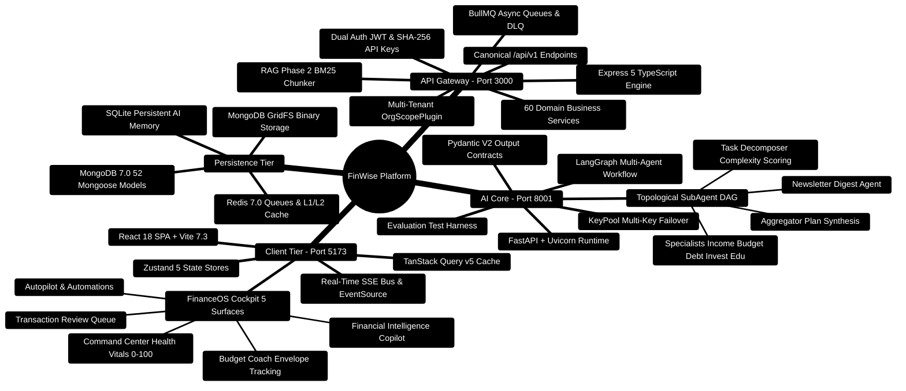

# FinWise — AI-Powered Autonomous Personal Finance Platform

> Your intelligent, local-first financial workspace. Track, analyze, optimize, and automate your finances with deterministic mathematical rigor and multi-agent AI intelligence.

## 2026 Platform Release Update

This documentation suite provides complete coverage for the latest FinWise architecture, reflecting major enhancements across all tiers:

### What Changed in the Latest Release

- **SubAgent DAG Orchestration**: Multi-agent task decomposition (`TaskDecomposerAgent`), Kahn's topological parallel execution (`SubAgentManager`), unified deterministic plan synthesis with Number Safety verification (`AggregatorAgent`), and automated weekly digest generation (`NewsletterAgent`).
- **Pydantic V2 Agent Output Contracts**: Strict boundary schemas (`contracts/agent_outputs.py`) for income analysis, budget planning, debt optimization, investment advice, and financial education.
- **RAG Phase 2 Bounded Window Grounding**: Bounded window document chunking (1800 characters / ~500 tokens with 260-character overlaps) persisted in MongoDB (`workspaceKnowledgeChunkModel.ts`), BM25 lexical scoring, and Grounding Confidence Score calculation ($G = 0.60 \cdot R_{\text{lexical}} + 0.40 \cdot S_{\text{semantic}}$).
- **Financial Health Score System**: Dynamic composite scoring (0–100) aggregating savings rate, debt-to-income balance, emergency runway, and budget adherence (`HealthScore.ts`, `healthScoreService.ts`), backed by trend and chart visualization routes.
- **Automated Newsletter Engine**: Preference-driven scheduled newsletter dispatches (`newsletterPreferenceModel.ts`, `newsletterRoutes.ts`, `newsletterService.ts`, `newsletterScheduler.ts`) featuring spending summaries, budget alerts, 7-day bill horizons, health score metrics, and LLM-crafted tips.
- **Server-Side PDF Document Generation**: High-fidelity PDF compilation from workspace text files or direct prompts (`pdfController.ts`, `pdfRequestServer.ts`, `PDFKit`) streamed directly from GridFS.
- **Resilience & Queue Isolation**: BullMQ queue orchestration paired with Dead Letter Queue (`deadLetterQueue.ts`) for poison-pill job quarantining and administrative inspection.
- **FinanceOS Cockpit & Review Workflows**: Command Center, Budget Health vitals, and Transaction Review Queue with batch approval and one-click "always categorize" rule creation.
- **Strict Node 24+ Runtime**: Server engine specification aligned with Node `>=24.14.1 <25` and npm `>=11` across native and Docker environments (`compose.yaml`).
- **Custom CSV Export Column Selection**: Interactive column selection chips in Exports preserving user-defined projection order (`Exports.tsx`, `exports.ts`).
- **Financial Calendar Recurring Bill Sync & RFC 5545 Export**: Auto-detection of recurring payment cadences with `.ics` calendar sync and reminder alarms (`FinancialCalendar.tsx`).
- **Multi-Goal Portfolio Rebalancing & Windfall Redistribution**: Priority, urgency, and velocity algorithms to optimize multiple financial targets and lump-sum windfalls (`GoalsAndDebts.tsx`).
- **Portfolio Target Models & Drift Rebalance Planner**: 60/40, 80/20, and All-Weather presets with tax-efficient Smart Cash Inflow rebalancing (`Portfolio.tsx`).
- **Tasks Multi-Select Batch Actions & Calendar Sync**: Multi-select floating action bar for batch complete, dismiss, and calendar reminders (`Tasks.tsx`).
- **Finance OS Auto-Budget Roll-Forward & Predictive Spending Caps**: Month-stepping navigator with inflation buffers (+5%, +10%) and live envelope burn bars (`FinanceOS.tsx`).
- **What-If Multi-Scenario Comparison Matrix & Monte Carlo Bounds**: 4-scenario side-by-side comparison with stochastic volatility simulation ($P_{10}, P_{50}, P_{90}$) and progressive marginal tax estimation (`Scenarios.tsx`).
- **Private Session Boundaries & Cache Coalescing**: Per-user QueryClient lifecycle, stream abort on context change, and MongoDB snapshot caching with request coalescing (`AuthContext.tsx`, `conversationInsightsCache.ts`).

### Recommended Reading Paths

- **Feature Builders & Extenders**: Read [**Master Developer Handbook: Building on This Project**](../docs/BUILDING_ON_THIS_PROJECT.md) for end-to-end recipes, Mongoose models, Zod contracts, React Query hooks, and Python LangGraph agents.
- **New Developers & Onboarding**: Start with [01 — Getting Started](./01-getting-started.md) and [02 — Architecture](./02-architecture.md).
- **Frontend Engineers**: Read [02 — Architecture](./02-architecture.md) and examine client-side pages and components.
- **Backend & Integration Engineers**: Read [03 — API Reference](./03-api-reference.md), [04 — Database Schema](./04-database-schema.md), and [06 — Security](./06-security.md).
- **AI / ML Engineers**: Dive deep into [05 — AI System](./05-ai-system.md) for LangGraph orchestration, subagent DAGs, and evaluation harnesses.
- **DevOps & SRE**: Consult [08 — Deployment](./08-deployment.md), [07 — Performance](./07-performance.md), and [10 — Troubleshooting](./10-troubleshooting.md).

---

[](../LICENSE)
[](https://nodejs.org/)
[](https://www.python.org/)
[](https://www.mongodb.com/)
[](https://react.dev/)
[](https://www.typescriptlang.org/)

---

## Table of Contents

- [Project Overview](#project-overview)
- [System Architecture Mindmap](#system-architecture-mindmap)
- [End-to-End System Topology](#end-to-end-system-topology)
- [Features](#features)
- [Tech Stack](#tech-stack)
- [Quick Start](#quick-start)
- [Complete Documentation Catalog](#complete-documentation-catalog)
- [API Route Inventory](#api-route-inventory)
- [Database Overview](#database-overview)
- [AI Core & SubAgent System](#ai-core--subagent-system)
- [Security Architecture](#security-architecture)
- [Performance & Caching](#performance--caching)
- [Deployment & Operations](#deployment--operations)
- [Testing & Quality Verification](#testing--quality-verification)
- [License](#license)

---

## Project Overview

FinWise is a production-grade, local-first personal finance platform and workspace that bridges the gap between manual spreadsheets and opaque automated banking aggregators. Built as a full-stack monorepo, FinWise pairs an Express 5 TypeScript API gateway with a Python 3.11+ LangGraph AI Core and a React 18 SPA (FinanceOS).

### Core Philosophy

1. **Deterministic-First Financial Calculations**: All budget limits, interest schedules, debt amortization curves, and tax estimations are computed using pure mathematical functions. LLMs are never allowed to invent or alter financial quantities.
2. **Number Safety Invariant**: Every recommendation synthesized by AI agents must strictly satisfy:
   $$\sum \Delta \text{Budgets} = 0, \quad \forall i: B_i \ge 0$$
   Budget reallocations must be zero-sum and non-negative.
3. **Multi-Tenant Data Isolation**: Every database query and cache key is automatically scoped to an organization ID (`orgId`) through the Mongoose `OrgScopePlugin`.
4. **Local-First & Multi-Tier Resilience**: If external LLM APIs experience rate limits or downtime, the system falls back through a 6-tier provider chain down to deterministic Python calculators.

---

## System Architecture Mindmap



---

## End-to-End System Topology

```text
┌─────────────────────────────────────────────────────────────────────────────────────────────────┐
│ 🟢 PRESENTATION TIER: React 18 SPA (Vite - Port 5173)                                           │
│    FinanceOS Cockpit • Command Bar (Cmd+K) • Review Queue • Budget Coach • Real-time SSE Streams│
└────────────────────────────────────────────────┬────────────────────────────────────────────────┘
                                                 │ 🌐 HTTPS 1.1 / TLS 1.3 / SSE Streaming
                                                 ▼
┌─────────────────────────────────────────────────────────────────────────────────────────────────┐
│ 🔷 API GATEWAY TIER: Express 5 + TypeScript (Server - Port 3000)                                │
│    ├─► 🛡️ Security Edge: Helmet • Strict CORS • Sliding Window Rate Limiter (200 req/min)        │
│    ├─► 🔑 Auth Guard (authAny): JWT Bearer Cookie OR SHA-256 Hashed API Key                     │
│    ├─► 🏢 Multi-Tenant Scoping: OrgScopePlugin automatically injects { orgId }                  │
│    ├─► 📋 Zod Validation: Strict payload validation & input sanitization                       │
│    ├─► 🔍 RAG Phase 2: Bounded Window Chunking (500 tokens) & Lexical BM25 Retrieval Engine     │
│    ├─► 📰 Newsletter Engine: Scheduled digest generation, preference management, email dispatch  │
│    ├─► 📄 PDF Generation: Server-side text-to-PDF rendering with PDFKit via GridFS streaming     │
│    └─► ⚙️ Async Queues: BullMQ + Redis for exports, workflows, newsletters, and DLQ             │
└───────────────────────┬─────────────────────────────────────────┬───────────────────────────────┘
                        │                                         │
        💾 Read / Write Operations                       ⚡ Internal IPC / HTTP
                        ▼                                         ▼
┌──────────────────────────────────────────────┐  ┌──────────────────────────────────────────────┐
│ 🗄️ PERSISTENCE TIER                          │  │ 🧠 AI CORE ENGINE (FastAPI - Port 8001)      │
│  ├─► MongoDB 7.0 (Replica Set)               │  │  ├─► LangGraph DAG & SubAgentManager         │
│  │   • 52 Scoped Domain Collections          │  │  ├─► Task Decomposer (Complexity Scoring)    │
│  │   • Workspace Knowledge Chunks (RAG)      │  │  ├─► Specialist Agents (Income, Budget, etc.)│
│  │   • Compound B-Tree Query Indexes         │  │  ├─► Aggregator (Number Safety Synthesis)    │
│  ├─► Redis 7.0                               │  │  ├─► Newsletter Agent (Weekly Digest Engine) │
│  │   • Distributed Rate Limiting             │  │  ├─► KeyPool Multi-Key Provider Failover     │
│  │   • BullMQ Queues & Dead Letter Queue     │  │  ├─► Pydantic V2 Output Contracts            │
│  │   • L1/L2 Cache with TTL Invalidation     │  │  ├─► Deterministic Financial Calculators     │
│  └─► GridFS & SQLite                         │  │  ├─► Resumable Sessions & SQLite Memory      │
│      • Large Document & PDF Blob Storage     │  │  └─► Evaluation Harness & LoRA Fine-Tuning   │
│      • AI Core Session Memory & FTS5 Facts   │  └──────────────────────────────────────────────┘
└──────────────────────────────────────────────┘
```

---

## Features

### User-Facing Features

| Feature | Description |
|---|---|
| **FinanceOS Cockpit** | Comprehensive operating dashboard with 5 specialized operational surfaces |
| **Command Center** | Real-time Financial Health Score (0–100), monthly savings rate, active runway, and quick actions |
| **Transaction Review Queue** | Machine-assisted classification queue with rule-based auto-categorization and bulk approval |
| **Budget & Envelopes** | Envelope budgeting (50/30/20 and zero-based), spending pace tracking, and deficit warnings |
| **Goals & Debts** | Target savings timelines and mathematical debt payoff schedules (Snowball vs. Avalanche) |
| **AI Financial Copilot** | Dual-mode conversational copilot with RAG Phase 2 document grounding and verified citations |
| **Financial Health Score** | Composite score tracking with trend direction, monthly history, and category breakdowns |
| **Weekly Financial Newsletter**| Automated digest with spending summaries, budget alerts, 7-day bill horizons, and tips |
| **PDF Document Compilation** | Text-to-PDF rendering and document compilation with PDFKit streamed via GridFS |
| **Investment Portfolio** | Asset allocation tracking, portfolio breakdown, and historical return projections |
| **Scenario Planning** | What-if financial simulations (income changes, major purchases, interest rate shifts) |
| **Receipt Scanning** | OCR receipt parsing powered by PaddleOCR, extracting merchant, date, tax, and line items |
| **Financial Calendar** | Interactive calendar for recurring bills, subscription renewals, and task milestones |
| **Workflows & Automation** | Autonomous rule triggers and cron schedules for recurring financial tasks |
| **Task Management** | 7/30/365-day bucket task system for actionable financial habits |
| **Analytics & Heatmaps** | Multi-dimensional spending heatmaps, category trend lines, and cash-flow comparisons |
| **Data Exports** | High-throughput asynchronous exports in CSV, PDF, and XLSX formats via BullMQ |
| **Financial Journaling** | Reflective financial entries with mood ratings, tags, and handwriting scan ingestion |
| **Multi-Tenant Organizations**| Role-based workspace sharing (Owner, Admin, Member, Viewer) with seat management |
| **PWA & Offline Support** | Progressive Web App installable on desktop and mobile with Workbox offline caching |

### Developer & Platform Features

| Feature | Description |
|---|---|
| **Canonical REST API** | 100+ endpoints structured under `/api/v1/*` with strict Zod request validation |
| **SubAgent DAG Execution** | Kahn's topological sort for parallel specialist agent execution with thread pooling |
| **RAG Phase 2 Grounding** | Bounded-window document chunking (500 tokens) with BM25 lexical search scoring |
| **Dead Letter Queue (DLQ)** | Quarantined poison-pill job management with administrative inspection and replay |
| **Scoped API Keys** | SHA-256 peppered API keys with granular scopes and per-organization rate limits |
| **OpenTelemetry & Prometheus**| Distributed W3C trace propagation, Pino structured logging, and `/api/metrics` endpoint |
| **Sliding Window Rate Limiter**| Redis-backed rate limiter (200 req/min general, 20 req/min auth) with IP/Org fallback |
| **Feature Flagging** | Runtime feature enablement per tenant, user, or organization |
| **Sandbox Plugin System** | Isolated VM plugin architecture for custom financial widgets and automations |

---

## Tech Stack

### Frontend (`client/`)

| Component | Technology | Version / Notes |
|---|---|---|
| Framework | React | 18.3.1 with TypeScript 5.9 |
| Build Tool | Vite | 7.3.1 with hot module replacement |
| Routing | Wouter | 3.9.0 lightweight declarative client routing |
| Server State | TanStack Query | 5.90.21 with automated cache invalidation |
| Client State | Zustand | 5.0.11 modular reactive stores |
| UI Primitives | Radix UI | 30+ accessible, unstyled headless primitives |
| Styling | Tailwind CSS | 3.4.6 with CSS custom properties and dark mode |
| Charts | Recharts | 2.12.7 interactive SVGs for financial charts |
| Form Validation | React Hook Form + Zod | 7.71 + Zod 4 for client-side schema checks |
| Animation | Framer Motion | 11.3 for fluid layout transitions |
| PWA Engine | vite-plugin-pwa | 1.2 with Workbox caching strategies |
| Testing | Vitest + Testing Library + MSW | Comprehensive component and mock service tests |

### Backend API Gateway (`server/`)

| Component | Technology | Version / Notes |
|---|---|---|
| Framework | Express | 5.2.1 with TypeScript |
| Runtime | Node.js | `>=24.14.1 <25` (executed with `tsx`) |
| Primary Datastore | MongoDB | 7.0 via Mongoose 8.2.3 (52 models) |
| Cache & Queue | Redis | 7.0 via `ioredis` 5.10 and `bullmq` 5.70 |
| Validation | Zod | Zod 4 with strict schemas on body, query, params |
| Authentication | Passport.js | JWT Bearer cookies + Google OAuth 2.0 + TOTP 2FA |
| Security | Helmet | Content Security Policy, rate limiting, NoSQL sanitizer |
| Logging | Pino | Structured JSON logging with request ID correlation |
| Observability | Prometheus + OpenTelemetry | `prom-client` metrics + distributed spans |
| Document Gen | PDFKit, PapaParse, XLSX, Mammoth | Asynchronous file parsing and report compilation |
| Binary Storage | MongoDB GridFS | Receipt image, document, and PDF binary storage |

### AI Core (`server/AI_Core/`)

| Component | Technology | Version / Notes |
|---|---|---|
| Framework | FastAPI + Uvicorn | 0.115.6 + Uvicorn 0.32.1 async HTTP runtime |
| Orchestration | LangGraph + LangChain | LangGraph 0.2.53 + LangChain 0.3.9 DAG workflow |
| Language Models | Multi-Provider KeyPool | Gemini 1.5/2.0, OpenRouter, Groq, Grok, Together |
| Vision / OCR | PaddleOCR + OpenCV | Text and tabular receipt extraction (Python < 3.13) |
| Data Processing | Pandas + NumPy + Pydantic 2 | High-speed data manipulation and strict contracts |
| Memory Storage | SQLite (FTS5) | Local session checkpoints, facts, and conversation memory |
| Evaluation Suite | Pytest + Custom Evals | Latency, determinism, routing, and number safety tests |

---

## Quick Start

### Prerequisites

- **Node.js**: `v24.14.1` or higher (tested on Node 24 LTS)
- **npm**: `v11.x` or higher
- **Python**: `v3.11` or higher (Python < 3.13 if using optional PaddleOCR)
- **MongoDB**: `v6.0` or `v7.0` (Native or Docker)
- **Redis**: `v7.0` or higher (Native or Docker)

### 1. Clone & Install Dependencies

```bash
git clone https://github.com/your-org/personal-finance.git
cd personal-finance

# Install backend dependencies
cd server
npm install

# Install frontend dependencies
cd ../client
npm install

# Setup Python AI Core virtual environment
cd ../server/AI_Core
python -m venv .venv

# Activate virtual environment
# Windows:
.venv\Scripts\activate
# Linux/macOS:
source .venv/bin/activate

pip install -r requirements.txt
```

### 2. Configure Environment Variables

```bash
# In server/
cp .env.example .env

# In client/
cp .env.example .env

# In server/AI_Core/
cp .env.example .env
```

Ensure `AI_CORE_INTERNAL_TOKEN` is set to the same shared secret in both `server/.env` and `server/AI_Core/.env`.

### 3. Launch Development Services

Open three separate terminals:

```bash
# Terminal 1: Python AI Core (Port 8001)
cd server/AI_Core
.venv\Scripts\activate
uvicorn api_service:app --host 0.0.0.0 --port 8001 --reload

# Terminal 2: Express API Gateway & Worker (Port 3000)
cd server
npm run dev

# Terminal 3: React Vite Frontend (Port 5173)
cd client
npm run dev
```

Open `http://localhost:5173` to access FinanceOS.

---

## Production Implementation Blueprints

### 1. Multi-Agent DAG Execution (`server/AI_Core/agents/sub_agent_manager.py`)
```python
# Kahn's algorithm concurrency scheduler
levels = self._topological_sort(subtasks)
for level_idx, level_subtasks in enumerate(levels):
    with ThreadPoolExecutor(max_workers=min(4, len(level_subtasks))) as executor:
        futures = {
            executor.submit(copy_context().run, self._run_single_subtask, t, profile, query, results): t["id"]
            for t in level_subtasks
        }
        for f in futures:
            results[futures[f]] = f.result()
```

### 2. Multi-Tenant Query Scoping Invariant (`server/src/utils/orgScopePlugin.ts`)
```typescript
// Enforce strict tenant isolation across all Mongoose operations
export function orgScopePlugin(schema: Schema) {
  schema.add({ orgId: { type: String, required: true, index: true } });
  ["find", "findOne", "findOneAndUpdate", "countDocuments", "deleteOne", "deleteMany"].forEach((method) => {
    schema.pre(method as any, function (this: Query<any, any>) {
      if (this.getOptions().bypassOrgScope) return;
      if (!this.getFilter().orgId) {
        throw new Error(`[Security Violation] Query on ${schema.get("collection")} missing required orgId`);
      }
    });
  });
}
```

### 3. Number Safety Invariant Guard (`server/AI_Core/agents/aggregator.py`)
```python
# Zero-hallucination guard: ensures LLM narrative contains only deterministic figures
def _numbers_are_subset(self, candidate: str, reference: str) -> bool:
    pattern = r"\b\d+(?:\.\d+)?\b"
    cand_numbers = set(re.findall(pattern, candidate))
    ref_numbers = set(re.findall(pattern, reference))
    return cand_numbers.issubset(ref_numbers)
```

---

## Complete Documentation Catalog

The FinWise platform provides 12 comprehensive chapters covering every dimension of design, implementation, and operations:

| Chapter | Document | Description | Key Focus Areas |
|---|---|---|---|
| **01** | [**Getting Started**](./01-getting-started.md) | Setup, onboarding, and environment configuration | Prerequisites, env vars, Docker compose, verification |
| **02** | [**Architecture**](./02-architecture.md) | Full-stack monorepo system design | 3 tiers, data flow, SubAgent DAG, RAG Phase 2, DLQ |
| **03** | [**API Reference**](./03-api-reference.md) | Exhaustive REST API playbook | 100+ endpoints, schemas, newsletter, health score, PDF |
| **04** | [**Database Schema**](./04-database-schema.md) | All 52 Mongoose models and stores | Models, compound indexes, multi-tenancy, GridFS, SQLite |
| **05** | [**AI System**](./05-ai-system.md) | Multi-agent LangGraph engine | Task decomposer, subagents, aggregator, evals, contracts |
| **06** | [**Security**](./06-security.md) | Authentication, authorization, and defense | JWT, TOTP, OrgScope, rate limiting, DLQ, audit logs |
| **07** | [**Performance**](./07-performance.md) | Caching, optimization, and scaling | 4-layer cache, BM25 indexing, BullMQ, virtual lists |
| **08** | [**Deployment**](./08-deployment.md) | Production Docker, cloud, and runbooks | Compose specs, reverse proxy, SSL, health checks, backups |
| **09** | [**Testing**](./09-testing.md) | Testing strategies across all three tiers | Vitest, Supertest, Pytest, eval harness, invariants |
| **10** | [**Troubleshooting**](./10-troubleshooting.md) | Diagnostics, common errors, and runbook fixes | DB connection errors, AI timeouts, OCR issues, auth debugging |
| **11** | [**Contributing**](./11-contributing.md) | Code standards, branching, and pull requests | Conventional commits, TypeScript strictness, Ruff styling |
| **12** | [**Future Improvements**](./12-future-improvements.md) | Strategic evolution and roadmap | Plaid/Tink bank feeds, multi-currency, mobile app |

---

## Database Overview

FinWise uses **MongoDB** as its primary datastore with **52 Mongoose models** partitioned across 5 functional domains:

```text
┌────────────────────────────────────────────────────────────────────────┐
│                      52 MONGOOSE MODELS BY DOMAIN                      │
├────────────────────────────────┬───────────────────────────────────────┤
│ Domain                         │ Models                                │
├────────────────────────────────┼───────────────────────────────────────┤
│ 👤 User & Organization (4)     │ User, Organization, OrgMember,        │
│                                │ OrgInvite                             │
├────────────────────────────────┼───────────────────────────────────────┤
│ 💰 Finance (10)                │ Transaction, Account, BudgetAllocation│
│                                │ Merchant, RecurringRule, MonthClose,  │
│                                │ CategoryRule, FinancialProfile,       │
│                                │ HealthScore, NewsletterPreference     │
├────────────────────────────────┼───────────────────────────────────────┤
│ 🧠 AI & Knowledge (6)          │ ChatSession, ChatMessage, AgentOutput,│
│                                │ AiResponseCache, MemoryRecord,        │
│                                │ WorkspaceKnowledgeChunk (RAG Phase 2) │
├────────────────────────────────┼───────────────────────────────────────┤
│ 🛠️ Features & Workflows (13)   │ Workflow, WorkflowRun, Task, Receipt, │
│                                │ JournalEntry, ExportJob, WorkspaceFile│
│                                │ Comment, ShareLink, Notification,     │
│                                │ CalendarReminder, GrowthStory,        │
│                                │ BlogPost                              │
├────────────────────────────────┼───────────────────────────────────────┤
│ 🏢 Platform & Monetization (19)│ Subscription, BillingAccount,         │
│                                │ Entitlement, UsageLedger, UsageEvent, │
│                                │ ApiKey, FeatureFlag,                  │
│                                │ IntegrationConnection,                │
│                                │ IntegrationSyncRun, PluginInstall,    │
│                                │ MarketplacePlugin, ReferralCode,      │
│                                │ ReferralRedemption, AuditEvent,       │
│                                │ AuditLog, AutopilotRun, ToolExecution,│
│                                │ DomainEvent, CreditGrant              │
└────────────────────────────────┴───────────────────────────────────────┘
```

See [04 — Database Schema](./04-database-schema.md) for full attribute schemas, compound indexes, and relationship diagrams.

---

## AI Core & SubAgent System

The Python AI Core operates as an asynchronous, deterministic-first intelligence engine:

1. **Task Decomposer (`task_decomposer.py`)**: Analyzes query complexity (0.0 to 1.0) using domain breadth, planning horizon, and financial profile factors. If complexity exceeds `0.5`, the query is decomposed into a structured DAG of discrete subtasks.
2. **Topological SubAgent Manager (`sub_agent_manager.py`)**: Uses Kahn's algorithm to partition subtasks into independent execution levels ($L_0, L_1, \dots, L_n$). Executes independent specialists concurrently via a thread pool with dynamic worker clamping (`max_concurrency = 4`), propagating upstream outputs to downstream dependents.
3. **Specialist Subagents**:
   - `IncomeExpenseAnalyzer`: Cash-flow anomalies, savings rate, and volatility analysis.
   - `BudgetPlanner`: Zero-based and envelope allocation adjustments.
   - `DebtOptimizer`: Mathematical avalanche vs. snowball payoff projections.
   - `InvestmentAdvisor`: Asset class balancing, SIP trajectories, risk alignment.
   - `FinancialEducator`: Contextual financial explanations and tax bracket clarity.
   - `NewsletterAgent`: Automated synthesis of weekly digests and market context.
4. **Result Aggregator (`aggregator.py`)**: Normalizes specialist results, executes deterministic `build_plan()` logic, validates that the Number Safety Invariant is preserved, and applies optional LLM narrative polish.
5. **Output Contracts (`contracts/agent_outputs.py`)**: Pydantic V2 schemas enforce strict type validation at the agent boundary, preventing schema drift.
6. **KeyPool & Provider Failover**: Automatic rotation of multiple API keys per vendor and automated cross-vendor fallback (Gemini $\to$ OpenRouter $\to$ Groq $\to$ Grok $\to$ Together $\to$ Deterministic Calculators).

See [05 — AI System](./05-ai-system.md) for detailed flowcharts, code examples, and prompt templates.

---

## Quality Verification & Tests

```bash
# Run backend integration & unit tests (34+ test files with in-memory Mongo)
cd server
npm test

# Run frontend test suite
cd ../client
npm test

# Run AI Core unit tests and evaluation harness
cd ../server/AI_Core
pytest tests/ -v
python -m evals.runner
```

---

<p align="center">
  <b>FinWise Platform</b> — Autonomous, Transparent, and Mathematically Grounded Financial Intelligence.
</p>
