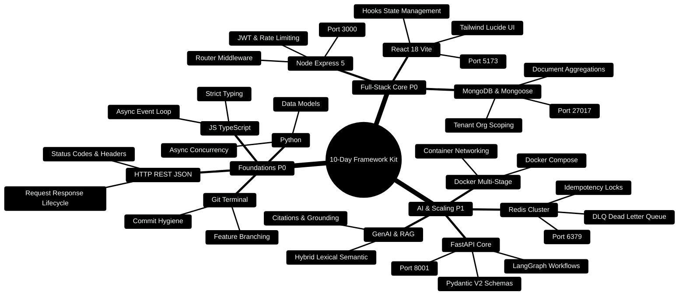

# Ganesh's 10-Day Fast-Track Framework Learning Kit

> **Goal:** Learn the **35% of frameworks used in 85% of real-world projects** — FAST.
> **Style:** Beginner-friendly, C++/Python background, Telugu words sprinkled in, ASCII diagrams, mind maps, MCQs every ~100 lines.
> **Target Project:** Personal Finance Copilot & Multi-Tenant Financial Analytics Engine.

---

> [!TIP]
> **Looking to Build Real Features on the FinWise Codebase?**  
> Check out the [**Master Developer Handbook: Building on This Project**](../docs/BUILDING_ON_THIS_PROJECT.md) for full-stack blueprints, Mongoose models, Express controllers, and Python LangGraph subagents.

## 0. Curriculum Architecture Mindmap



---

## 1. Why only 35% of frameworks? (Pareto rule)

```
100% of frameworks in the world
      │
      ▼
┌────────────────────────────┐
│  TOP 35%  │  REMAINING 65% │
│  used in  │  rarely used   │
│  85% of   │  (nice-to-have)│
│  projects │                │
└────────────────────────────┘
```

Learn the 35% deeply. The other 65% become easy to pick up later
because the *thinking patterns* are the same. (Telugu: *moolakaalu* = roots —
learn the roots, and every new tree feels familiar.)

---

## 1.1 Full-Stack Topology Mapping to Personal Finance

```
┌─────────────────────────────────────────────────────────────────────────────┐
│                       PERSONAL FINANCE ARCHITECTURE                         │
├─────────────────────────────────────────────────────────────────────────────┤
│                                                                             │
│  [React 18 Client] (:5173) ──HTTP / REST──► [Express 5 Gateway] (:3000)     │
│         │                                          │                        │
│         │ SSE Events                               │ Internal Proxy / RPC   │
│         ▼                                          ▼                        │
│  [Zustand & TanStack]                       [FastAPI AI Core] (:8001)       │
│                                                    │                        │
│                                                    ▼                        │
│                                             [LangGraph Workflows]           │
│                                                    │                        │
│  ┌──────────────────────────────┐                  ▼                        │
│  │   Redis 7 Cache (:6379)      │◄──Idempotency──► [OpenAI / Gemini / LLaMA]│
│  │   - Token bucket rate-limits │                                           │
│  │   - DLQ job dead-letters     │                                           │
│  └──────────────────────────────┘                                           │
│                 ▲                                                           │
│                 │ Mongoose ORM                                              │
│  ┌──────────────────────────────┐                                           │
│  │   MongoDB 7 Engine (:27017)  │                                           │
│  │   - Multi-tenant orgId scope │                                           │
│  │   - FinancialLedger records  │                                           │
│  └──────────────────────────────┘                                           │
└─────────────────────────────────────────────────────────────────────────────┘
```

---

## 1.2 Full-Stack Integration Blueprint

```typescript
// Production Architecture Blueprint: Multi-tier service resolution
// client (5173) -> express (3000) -> python fastapi (8001)

export interface SystemServiceEndpoints {
  clientPort: 5173;
  gatewayPort: 3000;
  aiCorePort: 8001;
  mongoPort: 27017;
  redisPort: 6379;
}

export const CANONICAL_PORTS: SystemServiceEndpoints = {
  clientPort: 5173,
  gatewayPort: 3000,
  aiCorePort: 8001,
  mongoPort: 27017,
  redisPort: 6379,
};
```

## 2. The 35% list (your priority order)

| Priority | Stack | Why it's in the 35% |
|----------|-------|---------------------|
| P0 | Git + Terminal | Every project on earth uses it |
| P0 | HTTP, REST, JSON | Every app talks over it |
| P0 | JavaScript + TypeScript | The language of the web |
| P0 | Python | Your strongest tool + AI world |
| P0 | React | #1 frontend framework |
| P0 | Node.js + Express | #1 backend runtime |
| P0 | MongoDB | #1 NoSQL database |
| P0 | Docker | #1 way to ship apps |
| P1 | Redis | #1 cache + queues |
| P1 | FastAPI | #1 Python API framework (your resume!) |
| P1 | JWT Auth | Every real app needs login |
| P2 | LangChain/LangGraph + RAG | Your AI edge (GenAI minor!) |

## 3. File order (follow this exact order)

| Day | File | Topic | Est. time |
|-----|------|-------|-----------|
| 1 | `03_GIT_AND_TERMINAL.md` | Git + terminal basics | 1.5 hrs |
| 1 | `04_HTTP_REST_API_BASICS.md` | HTTP, REST, JSON | 1.5 hrs |
| 2 | `05_JS_TYPESCRIPT_ESSENTIALS.md` | JavaScript + TS | 2 hrs |
| 2 | `06_PYTHON_ESSENTIALS.md` | Python crash course | 2 hrs |
| 3-4 | `07_REACT_FRONTEND.md` | React | 4 hrs |
| 5-6 | `08_NODE_EXPRESS_BACKEND.md` | Node + Express | 4 hrs |
| 7 | `09_FASTAPI_BACKEND.md` | FastAPI (your resume!) | 3 hrs |
| 8 | `10_MONGODB_REDIS_DATABASES.md` | MongoDB + Redis | 3 hrs |
| 9 | `11_DOCKER_DEPLOYMENT.md` | Docker | 2.5 hrs |
| 10 | `12_GENAI_LLM_STACK.md` | LangChain, RAG, prompt basics | 3 hrs |
| 10 | `13_FINAL_MCQ_MASTER_TEST.md` | Full exam | 1 hr |

## 4. How to use this kit

1. Read one file fully. Every `## MCQ` block = 4 questions.
2. Write your answer BEFORE looking at the answers (the answers are at the bottom of each file).
3. After each file, build the mini-project in the file. **Code > reading.**
4. At the end, take `13_FINAL_MCQ_MASTER_TEST.md` (50 questions).

## 5. The learning loop (use this for EVERY topic)

```
LEARN ──> CODE ──> BREAK ──> RECALL ──> TEACH
  |                                    |
  +----------- loop until "sari" ------+
```

- **LEARN:** read the file section
- **CODE:** type the example yourself (never copy-paste)
- **BREAK:** 5 min walk (your brain files memories during breaks)
- **RECALL:** close the file, write the code from memory
- **TEACH:** explain the concept out loud as if teaching a friend

## 6. Golden rules for a fast learner

1. **20-minute sprints:** study 20 min, break 5 min. Cramming kills retention.
2. **Type, don't paste.** Muscle memory = real memory.
3. **Break things on purpose.** Change a value, break it, fix it. That's learning.
4. **One new concept per project.** Don't mix React + Docker + Redis in your first build.
5. **Errors are clues, not failures.** Every error message teaches you the system's brain.

> Telugu: *"Nerchukovadam kante, chetho chesi nerchuko."* — Learn by doing, not just reading.
