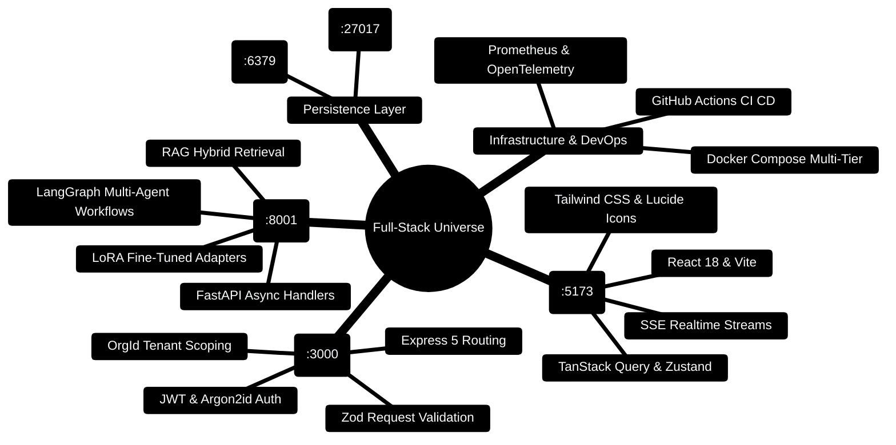

# 02 — Roadmap & Mind Maps (The Big Picture First)

> Telugu: *modata "motham" chudu* = first see the WHOLE picture.
> Never learn a leaf before seeing the tree. This file is your tree.

---

> [!TIP]
> **Hands-On Project Architecture & Implementation:**  
> To see how these concepts are realized in production code, consult the [**Master Developer Handbook: Building on This Project**](../docs/BUILDING_ON_THIS_PROJECT.md).

## 0. Full-Stack Landscape Mindmap



---

## 1. The Full-Stack Universe (Master Mind Map)

```
                        FULL-STACK WEB APP
                               │
        ┌──────────────────────┼──────────────────────┐
        │                      │                      │
     FRONTEND               BACKEND               DEVOPS/INFRA
   (user sees)          (business logic)        (runs the app)
   Port 5173              Port 3000 & 8001        Docker & Compose
        │                      │                      │
    ┌───┴───┐              ┌───┴───┐              ┌───┴───┐
    │ React │              │ Node  │              │ Docker│
    │ +Vite │              │ +Exp  │              │ +Git  │
    │ +TS   │              │ FastAPI│             │ +CI/CD│
    └───┬───┘              └───┬───┘              └───┬───┘
        │                      │
    ┌───┴───┐              ┌───┴───┐
    │ talks │              │ Mongo │            <- databases
    │ to API│              │ +Redis│               (:27017 / :6379)
    │ fetch │              └───────┘
    └───────┘
```

**Key insight:** ALL frameworks do ONE of three jobs — show things (frontend),
compute things (backend), or move/store things (infra/database). Pick a job,
pick a framework, learn the pattern. The pattern is ALWAYS the same.

---

## 1.1 Multi-Service Health Orchestrator Blueprint

```typescript
// Production Code Snippet: Full-stack service verification script
import http from 'http';

interface HealthCheckTarget {
  service: string;
  url: string;
  port: number;
}

const TARGETS: HealthCheckTarget[] = [
  { service: 'Vite Frontend', url: 'http://localhost:5173', port: 5173 },
  { service: 'Express Gateway', url: 'http://localhost:3000/api/health', port: 3000 },
  { service: 'FastAPI AI Core', url: 'http://localhost:8001/health', port: 8001 },
];

export async function pingServices(): Promise<Record<string, boolean>> {
  const results: Record<string, boolean> = {};
  for (const target of TARGETS) {
    try {
      const res = await fetch(target.url, { method: 'GET' });
      results[target.service] = res.ok;
    } catch {
      results[target.service] = false;
    }
  }
  return results;
}
```

## 2. The Universal Pattern (every framework, every time)

```
REQUEST  ──>  ROUTE  ──>  LOGIC  ──>  DATA  ──>  RESPONSE
 (browser)   (which URL)  (what to do) (fetch/save) (send back)
```

Compare with C++:
```
main() ──> function call ──> compute ──> return value
```

In web, instead of `main()`, we have `ROUTES`. Instead of `return`, we have
`HTTP responses`. Everything else is the same logic you already know.

## 3. Your 10-Day Mind Map (follow arrows, no skipping)

```
DAY 1                     DAY 2                  DAY 3-4
[Git] --> [HTTP/JSON] --> [JavaScript] --> [Python] --> [React]
   |           |              |               |
   +-----------+--------------+---------------+
                    (foundations = 4 hours)

DAY 5-6                DAY 7              DAY 8
[Node+Express] ---> [FastAPI] ---> [MongoDB + Redis]
     |                  |                |
     +-----------+------+----------------+
                 (build: Budget API!)

DAY 9                    DAY 10
[Docker] --> [LangChain + RAG basics] --> [FINAL EXAM]
     |                  |
     +-- ship your ----+
         Budget API in Docker
```

## 4. Priority Matrix (what to master vs. what to skim)

```
                 HIGH IMPACT  |  LOW IMPACT (for now)
         +---------------------+----------------------+
 LEARN   | Git, HTTP, React,   | Java, Scala, AWS     |
 DEEPLY  | Node, MongoDB,      | deep-dive            |
 (P0)    | Docker, JS, Python  |                      |
         +---------------------+----------------------+
         | TypeScript, Redis,  | Next.js, Three.js,   |
 SKIM    | FastAPI, JWT,       | GraphQL, Kubernetes  |
 (P1/P2) | LangChain, RAG      | (mention only)       |
         +---------------------+----------------------+
```

## 5. Time-box Plan (85/15 rule)

- 85% of your time: build the mini-projects (code!)
- 15% of your time: read theory (these files)

## 6. The "Knowledge Snowball" concept

```
First week feels slow:   ●
Second week:             ●●
Third week:              ●●●●
Fourth week:             ●●●●●●●●   <- doubles every week!
```

Frameworks are like vocabulary: the first 100 words are hard, the next 1000
are easy because patterns repeat. Don't quit in week 1. (Telugu: *"Talupu
gudutundi"* = the grind continues — but results compound.)

## 7. Glossary

1. **Framework** (Telugu: *sadhanam* = tool) = pre-written code that does the boring
   80% of work so you only write the interesting 20%.
2. **Full-stack** = you can build frontend + backend + database for one app.
3. **API** = a menu of URLs that tells apps what requests they can make.
4. **P0/P1/P2** = priority levels (0 = learn now, 1 = soon, 2 = later).
5. **Mini-project** = tiny real app to practice a framework (to-do list, budget tracker).

## 8. Mini-Project 0 (10 minutes, no code — draw it)

Take a blank paper. Draw the mind map from section 1. Then close your eyes and
redraw it from memory. If you can redraw it, you own the map.

> This is the only file with no MCQs — it's your map, not your lesson.
> MCQ marathon starts in the next file!
