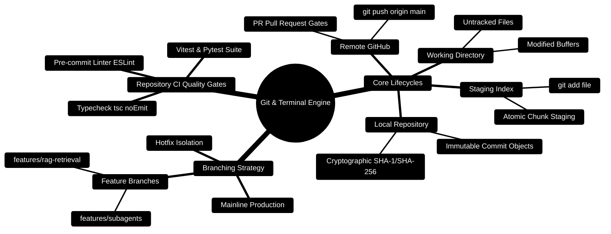

# 03 — Git + Terminal (Day 1, Part 1) [Total: 90 min]

> Telugu: *Git = nuvvu rasina code ki "save game" cheyyadam* = Git is the
> "save game" feature for your code. You can rewind any mistake.

---

> [!TIP]
> **Hands-On Project Architecture & Implementation:**  
> To see how these concepts are realized in production code, consult the [**Master Developer Handbook: Building on This Project**](../docs/BUILDING_ON_THIS_PROJECT.md).

## 0. Git & Terminal Topology Mindmap



---

## 0.05 Git Lifecycle & CI Promotion Pipeline ASCII Flow

```text
┌─────────────────────────────────────────────────────────────────────────────┐
│ 💻 WORKING DIRECTORY (Local edits to .ts, .py, .tsx files)                   │
│    git status ──► Identifies unstaged modifications                         │
└──────────────────────────────────────┬──────────────────────────────────────┘
                                       │ git add <files>
                                       ▼
┌─────────────────────────────────────────────────────────────────────────────┐
│ 📦 STAGING AREA / INDEX (Prepared atomic changeset)                          │
│    git diff --cached ──► Verifies clean changeset                           │
└──────────────────────────────────────┬──────────────────────────────────────┘
                                       │ git commit -m "feat(...): ..."
                                       ▼ (Triggers Pre-Commit Hook Gate)
┌─────────────────────────────────────────────────────────────────────────────┐
│ 🛡️ PRE-COMMIT HOOK GATE                                                     │
│    ├─► Client TypeScript check: npm run build -- --noEmit                   │
│    ├─► Server Vitest test pass: npm test                                    │
│    └─► AI Core Invariant check: pytest evals/                               │
└──────────────────────────────────────┬──────────────────────────────────────┘
                                       │ On Hook Success ✅
                                       ▼
┌─────────────────────────────────────────────────────────────────────────────┐
│ 🏛️ LOCAL COMMIT OBJECT & REPOSITORY (features/subagents)                     │
│    git push origin features/subagents ──► Remote Pull Request & CI Matrix   │
└─────────────────────────────────────────────────────────────────────────────┘
```

---

## 0.1 Production Git Pre-Commit Hook Blueprint

```bash
#!/usr/bin/env bash
# .husky/pre-commit or .git/hooks/pre-commit
# Enforces clean compilation, zero lint errors, and test pass before commit

echo "🔍 Running pre-commit validation for Personal Finance..."

# 1. Check TypeScript client compilation
cd client && npm run build -- --noEmit
if [ $? -ne 0 ]; then
  echo "❌ Client TypeScript compilation failed!"
  exit 1
fi
cd ..

# 2. Check Express server compilation
cd server && npm run build
if [ $? -ne 0 ]; then
  echo "❌ Server compilation failed!"
  exit 1
fi
cd ..

echo "✅ All pre-commit quality checks passed successfully!"
exit 0
```

---

## 1. Why Git? [5 min]

**The problem:** You write 200 lines of code. You change 50 lines. Everything
breaks. You want to go back — but you saved over the old version. 😭

**The solution:** Git takes a SNAPSHOT (photo) of your code every time you ask.
You can jump back to any snapshot anytime. Like checkpoints in a game.

```
WITHOUT Git:  code_v1.py, code_v2.py, code_FINAL.py, code_REAL_FINAL.py...
WITH Git:     one folder + infinite time travel
```

**C++ analogy:** think of Git commits like savepoints in a competitive
programming editor's undo history — but permanent and shared.

## 2. Git flow — the 3 steps you'll use daily [10 min]

```
WORKING DIR      STAGING AREA        REPOSITORY (local)        GITHUB (cloud)
(files you      (files marked        (snapshots saved         (backup + share
 edit)           "I want to save")    in .git folder)          with team)
     |                 |                    |                        |
     |  git add .      |   git commit       |   git push             |
     +---------------->+  "message"         +----------------------->+
                     (the box in middle    (this is the "photo")
                      is called STAGING)
```

One-line meanings:
- `git init` = create the save-game system in this folder (once).
- `git add <file>` = put a file in the staging box.
- `git commit -m "msg"` = take the photo + write a label.
- `git push` = upload your photos to GitHub (cloud backup).
- `git pull` = download the newest photos from GitHub (team updates).
- `git status` = "what's changed?" — your daily best friend.
- `git log` = list of all photos (commits) in history.

## 3. First-time setup + commands (Windows) [15 min]

```bash
# Run these ONCE after installing Git (https://git-scm.com)

git config --global user.name "Ganesh172919"          # who you are
git config --global user.email "kumarreddyganesh126@gmail.com"
git config --global init.defaultBranch main           # name the main branch

# Now inside ANY project folder:
git init                    # 1. turn this folder into a repo (creates .git/)
git add .                   # 2. stage ALL changed files ("." means everything)
git commit -m "first version"  # 3. take the snapshot with a label
git log --oneline           # 4. see history:  a1b2c3d first version
```

## 4. Branching — parallel worlds [20 min]

**Problem:** You want to try a new feature but not break the working app.

**Solution:** branches = parallel copies (like a fork in your game path).

```
        main:  A ----- B ----- C ----- D   <- stable, working
                                 \
feature branch:                    E ----- F   <- experiments here
                                             \
                                   merge F back to main when ready
```

```bash
git branch feature-login       # create new branch named feature-login
git switch feature-login       # jump into it (old: git checkout)
# ...make changes...
git add . && git commit -m "login done"
git switch main                # back to safe main
git merge feature-login        # bring feature changes into main
```

**C++ analogy:** a branch is like a `class` — you can extend it, test it,
and only then use it in `main()`.

## 5. GitHub — your cloud backup [20 min]

1. Create account at github.com (username: Ganesh172919 — already yours!)
2. Click **New repository** → name it `budget-app` → create.
3. Copy the URL (looks like `https://github.com/Ganesh172919/budget-app.git`).
4. In your terminal:

```bash
git remote add origin https://github.com/Ganesh172919/budget-app.git
git push -u origin main
```

**Practical flow for a full day of work:**

```
MORNING:  git pull                      # get team's latest changes
EDIT:     write code all day
CHECK:    git status                    # see what changed
STAGE:    git add .
COMMIT:   git commit -m "added budget category filter"
NIGHT:    git push                      # backup + share
```

## 6. Common errors table [5 min]

| Error you see | Meaning | Fix |
|---|---|---|
| `nothing to commit` | No changes detected | you forgot to save the file! |
| `fatal: not a git repository` | You're in wrong folder | run in project folder, or `git init` |
| `Please tell me who you are` | Name/email not set | run the `git config` from section 3 |
| `rejected - non-fast-forward` | Your push is old | `git pull` first, then `git push` |
| `up to date` on pull | No new changes | normal! nothing to do |

## 7. Terminal essentials (Windows PowerShell) [10 min]

```bash
pwd                 # print working directory = "where am I?"
ls                  # list files here
cd budget-app       # change directory (enter folder)
cd ..               # go up one folder
mkdir newfolder     # make a new folder
rm file.txt         # delete a file
code .              # open this folder in VS Code (the best editor!)
```

**Why this matters:** Git lives in the terminal. Every framework tutorial
starts with terminal commands. If terminal scares you, it ends here — it's
just "a text box where you give the computer commands".

## 8. Mini-Project: Your first repo [10 min]

```bash
mkdir my-first-repo
cd my-first-repo
git init
# create a file:  echo "Hello Ganesh" > hello.txt   (or use VS Code)
git add .
git commit -m "my first commit"
git log --oneline        # you should see:  xxxxxxx my first commit
```

**Stretch challenges:**
1. Make a branch, add a second file there, merge it back.
2. Commit, change a file, commit again — then `git log` to see both photos.
3. `git checkout <commit-id> -- hello.txt` to restore an old version.

## 9. ❌ Mistakes to avoid

1. Committing secrets (passwords, .env files) → use a `.gitignore` file.
2. Huge commit messages with no meaning → short, clear: "fix: total sum bug".
3. `git add .` when unsure → always `git status` first.
4. Committing `node_modules` → add it to `.gitignore` (huge folder).
5. Never committing at all → commit small and often, like savegames.

## 10. Glossary

1. **Repository (repo)** = a folder Git watches over.
2. **Commit** (Telugu: *marcha* = change) = a saved snapshot with a message.
3. **Branch** = a parallel copy of your code for experiments.
4. **Merge** = bring branch changes into main.
5. **Remote** = a repo not on your computer (e.g., GitHub).
6. **`.gitignore`** = a file listing things Git should never save.
7. **Push/Pull** = upload/download snapshots to/from cloud.

---

## MCQ — Git & Terminal

**1. (L1)** What does `git add .` do?
- a) Saves a snapshot of your code
- b) Moves all changed files into the staging area
- c) Deletes all untracked files
- d) Uploads code to GitHub

**2. (L1)** After `git init`, which folder appears inside your project?
- a) `node_modules/`  b) `src/`  c) `.git/`  d) `build/`

**3. (L2)** You get `Please tell me who you are` on commit. What did you forget?
- a) `git init`  b) `git config --global user.name` + `user.email`
- c) `git add .`  d) creating a GitHub account

**4. (L2)** You pushed, then your teammate pushed newer changes. You type
`git push` and get `rejected`. What's the fix order?
- a) `git push --force`  b) `git pull` then `git push`  c) `git merge` then `git push`  d) `git init` again

**5. (L3)** `git status` shows `nothing to commit, working tree clean`.
You JUST edited a file. Most likely cause?
- a) Git is broken  b) You didn't save the file in your editor
- c) You are on the wrong branch  d) The file is in `.gitignore`

**6. (L4)** Write the command sequence to: save everything, create a branch
called `testing`, switch to it. (Answer in words.)

---

## MCQ ANSWERS (don't peek!)

1. **b** — `add` stages files; the snapshot happens at `commit`.
2. **c** — `.git/` is the hidden folder holding all history.
3. **b** — Git needs to know who authored commits (set once globally).
4. **b** — your local copy is behind; pull the new history, then push.
5. **b** — "clean" means Git sees no change; unsaved editor changes are invisible to Git.
6. `git add .` → `git branch testing` → `git switch testing`
