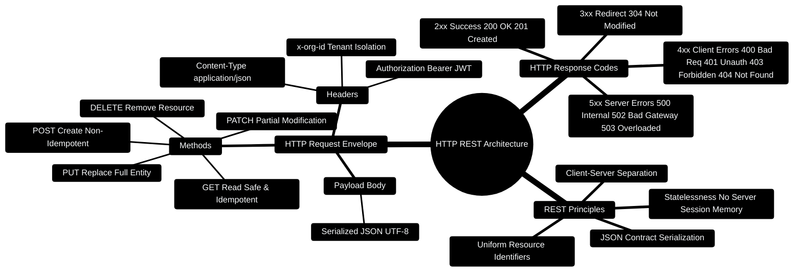

# 04 — HTTP, REST & JSON (Day 1, Part 2) [Total: 90 min]

> Telugu: *HTTP = internet lo "matladukovadam"* = HTTP is how programs
> TALK to each other on the internet. Like a post office.

---

> [!TIP]
> **Hands-On Project Architecture & Implementation:**  
> To see how these concepts are realized in production code, consult the [**Master Developer Handbook: Building on This Project**](../docs/BUILDING_ON_THIS_PROJECT.md).

## 0. HTTP & REST Protocol Mindmap



---

## 0.1 HTTP Request-Response Lifecycle Flow

```
┌─────────────────────────────────────────────────────────────────────────────┐
│                       HTTP REQUEST-RESPONSE LIFECYCLE                       │
├─────────────────────────────────────────────────────────────────────────────┤
│                                                                             │
│  [Client: React :5173] ────POST /api/transactions ──────► [Gateway :3000]   │
│         │              Headers: { Authorization, x-org-id }       │         │
│         │              Body: { amount: 500, category: "Food" }    │         │
│         │                                                         ▼         │
│         │                                              [Zod Validator]      │
│         │                                                         │         │
│         │                                                         ▼         │
│         │                                              [MongoDB Write]      │
│         │                                                         │         │
│         │ ◄──── HTTP/1.1 201 Created ─────────────────────────────┘         │
│         ▼       Body: { id: "txn_91", status: "recorded" }                  │
│  [Update UI Cache]                                                          │
│                                                                             │
└─────────────────────────────────────────────────────────────────────────────┘
```

---

## 0.2 Production HTTP Client Blueprint

```typescript
// Production Snippet: Robust fetch client with auth & exponential backoff
export async function apiRequest<T>(endpoint: string, options: RequestInit = {}): Promise<T> {
  const token = localStorage.getItem('token');
  const headers: Record<string, string> = {
    'Content-Type': 'application/json',
    ...(token ? { Authorization: `Bearer ${token}` } : {}),
    ...(options.headers as Record<string, string> || {}),
  };

  const response = await fetch(`http://localhost:3000${endpoint}`, {
    ...options,
    headers,
  });

  if (!response.ok) {
    const errorBody = await response.json().catch(() => ({}));
    throw new Error(errorBody.message || `HTTP ${response.status} Error`);
  }

  return response.json();
}
```

---

## 1. The problem [5 min]

Your React app (frontend) needs data from your Express server (backend).
How do they communicate? Like two humans who don't speak the same language —
they need a PROTOCOL (a shared set of rules). That protocol = **HTTP**.

**C++ analogy:** you call `scanf`/`printf` to talk to the terminal. Websites
call HTTP to talk to servers. Same idea — a fixed way to exchange data.

## 2. HTTP request anatomy [15 min]

A request is a LETTER you send to a server. It has:

```
POST /api/transactions HTTP/1.1        <- LINE 1: METHOD + PATH + VERSION
Host: myapp.com                        <- HEADERS: who, what format
Content-Type: application/json         <-   "I'm sending JSON"
Authorization: Bearer abc123           <-   "I am logged in"

{"amount": 500, "category": "food"}    <- BODY: the actual data (optional)
```

And the server replies:

```
HTTP/1.1 201 Created                   <- STATUS LINE
Content-Type: application/json

{"id": "67a1b2c3", "amount": 500, "category": "food"}   <- response body
```

**The 4 most common METHODS (verbs):**

| Method | Meaning | C++ analogy | Used for |
|--------|---------|-------------|----------|
| `GET` | "give me this" | read-only function | fetch data |
| `POST` | "please create this" | constructor | add new item |
| `PUT` | "replace this" | assignment `=` | full update |
| `DELETE` | "remove this" | `delete` keyword | remove item |

**Easy memory:** **CRUD** = Create(POST) Read(GET) Update(PUT) Delete(DELETE).
Every database app is 80% CRUD. Learn this and you know most of web dev.

## 3. Status codes — the server's emotional state [15 min]

```
1xx: hold on... (rare)
2xx: ✅ SUCCESS         200 OK, 201 Created
3xx: go somewhere else  301/302 redirect
4xx: ❌ YOUR fault      400 bad request, 401 unauthenticated,
                       403 forbidden, 404 not found, 429 too many requests
5xx: 💥 SERVER fault    500 internal error, 503 unavailable
```

**Memory trick:** *"4xx = client chetulu"* (your hands, client's fault),
*"5xx = server sanka"* (server's problem). Client = the one requesting
(4 = you messed up), Server = the one responding (5 = it messed up).

## 4. JSON — the data language [20 min]

JSON = **J**ava**S**cript **O**bject **N**otation. It's how data travels.
It looks like a C++ struct written as text:

```json
{
  "user": {
    "name": "Ganesh",
    "age": 20,
    "skills": ["Python", "C++", "React"],
    "isStudent": true,
    "cgpa": 8.35
  }
}
```

**Rules (compare with C++):**
- Keys MUST be in double quotes `"name"` (C++ doesn't need them).
- Values can be: string `"Ganesh"`, number `8.35`, boolean `true/false`,
  array `[...]`, object `{...}`, or `null`.
- No trailing commas, no comments allowed. (JSON is strict!)
- `JSON.stringify(obj)` = convert JS object → text (send over network).
- `JSON.parse(text)` = convert text → JS object (use received data).

**C++ analogy:** JSON.stringify is like converting a struct to a `string`
for serialization; JSON.parse is like deserializing it back.

## 5. REST — the URL design rules [20 min]

REST is not a framework. It's a STYLE of naming URLs so humans and machines
understand them. Same actions, cleaner design:

```
BAD (no pattern):              GOOD (REST style):
  /getTransactions             GET    /api/transactions
  /deleteTransaction?id=5      DELETE /api/transactions/5
  /addTransaction              POST   /api/transactions
  /updatetransaction           PUT    /api/transactions/5
```

**REST rules (the 85% version):**
1. Resources are NOUNS (transactions, users), never verbs (getTransactions).
2. Use HTTP methods for actions (GET/POST/PUT/DELETE).
3. `/api/transactions/5` = "the transaction with id 5".
4. Plural names: `/transactions` not `/transaction`.
5. Nested: `/api/users/7/transactions` = "transactions of user 7".

**Practical flow (full request journey):**

```
Browser/React app
     │
     │ 1. fetch("GET /api/transactions")
     ▼
   Express Server
     │
     │ 2. find route "/api/transactions"
     ▼
   Route handler (a function)
     │
     │ 3. MongoDB query: db.transactions.find()
     ▼
   MongoDB returns array of documents
     │
     │ 4. JSON.stringify(data)
     ▼
   HTTP 200 OK + JSON body
     │
     │ 5. response.json() in React
     ▼
   React renders list on screen
```

## 6. Test your first API (no code!) [10 min]

Use **Postman** (free app) or your browser:

1. Open Postman → New Request.
2. URL: `https://jsonplaceholder.typicode.com/todos/1` (free test API).
3. Method: GET → click Send.
4. You'll see JSON data + status code 200.

```json
{ "userId": 1, "id": 1, "title": "delectus aut autem", "completed": false }
```

That's it — you just used HTTP, REST, and JSON! Now you understand
what frameworks (React, Express, FastAPI) are actually doing under the hood.

## 7. Common errors table [5 min]

| Error | Meaning | Fix |
|---|---|---|
| `404 Not Found` | wrong URL or route doesn't exist | check the path spelling |
| `401 Unauthorized` | no/wrong login token | add `Authorization` header |
| `400 Bad Request` | body doesn't match what server wants | check field names/types |
| `CORS error` | browser blocked cross-site call | server must enable CORS |
| `500 Internal Server Error` | server code crashed | look at server logs |

## 8. Mini-Project: Draw your own REST API [5 min]

Design a REST API for your **Personal Finance Assistant** (you built this!).
Write the 6 endpoints by hand:

```
GET    /api/transactions          -> list all my transactions
POST   /api/transactions          -> add one (body: {amount, category, date})
GET    /api/transactions/:id      -> see one transaction
PUT    /api/transactions/:id      -> edit it
DELETE /api/transactions/:id      -> delete it
GET    /api/budgets/summary       -> total spent this month
```

**Stretch challenge:** add endpoints for "categories" and "alerts".

## 9. ❌ Mistakes to avoid

1. Using verbs in URLs (`/getUsers` → use `GET /users`).
2. Forgetting to send `Content-Type: application/json` when POSTing.
3. Hard-coding IDs instead of using path params (`:id`).
4. Returning plain text when the app expects JSON (or vice versa).
5. Ignoring status codes — always check the response code, not just the body.

## 10. Glossary

1. **HTTP** = protocol for client-server communication on the web.
2. **Method** = the verb of a request (GET/POST/PUT/DELETE).
3. **Status code** = 3-digit summary of the result (200 = ok, 404 = missing).
4. **JSON** (Telugu: *datha rupaalu* = data formats) = text format for data exchange.
5. **REST** = design style for predictable, noun-based URLs.
6. **Body** = the data payload of a request/response.
7. **CORS** = browser security rule; servers must explicitly allow other domains.
8. **Endpoint** = one URL+method combo (`DELETE /api/transactions/5`).

---

## MCQ — HTTP, REST & JSON

**1. (L1)** Which HTTP method creates a new resource?
- a) GET  b) POST  c) PUT  d) DELETE

**2. (L1)** Status code **404** means:
- a) Server crashed  b) You're not logged in  c) Resource not found  d) Success

**3. (L2)** Your React app gets a `401` when calling `GET /api/profile`.
What is most likely wrong?
- a) The URL is misspelled  b) The login token is missing/expired
- c) The server is down  d) The database is empty

**4. (L2)** Which URL design follows REST rules?
- a) `GET /deleteUser?id=3`  b) `GET /api/users/3`  c) `POST /getUserInfo`  d) `DELETE /removeTransaction`

**5. (L3)** The server replies `500 Internal Server Error` only when you
send `{"amount": "fifty"}` (a string) but amount should be a number.
Who/what is crashing, and which code would be better?
- a) The client; 400  b) The server; 400  c) The server; 500 is correct  d) MongoDB; 404

**6. (L4)** Write the JSON body and method for "add a new transaction of
Rs. 500 in the food category" to `POST /api/transactions`.

---

## MCQ ANSWERS

1. **b** — POST creates; GET reads; PUT replaces; DELETE removes.
2. **c** — 404 = Not Found (4xx = client-side issue).
3. **b** — 401 specifically means "not authenticated" (no/expired token).
4. **b** — noun resource, id in path. Others use verbs or wrong methods.
5. **b** — the SERVER crashed (it didn't validate input). 400 = tell client
   "your data is bad" instead of crashing.
6. `{"amount": 500, "category": "food", "date": "2026-08-02"}`
