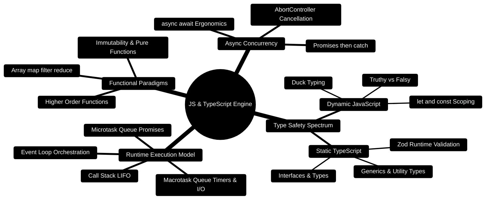

# 05 — JavaScript + TypeScript Essentials (Day 2, Part 1) [Total: 2 hrs]

> Telugu: *JavaScript = web ki bhasha* = JavaScript is the LANGUAGE of the web.
> Every browser on earth speaks it. React, Node — all of them are JS.

---

> [!TIP]
> **Hands-On Project Architecture & Implementation:**  
> To see how these concepts are realized in production code, consult the [**Master Developer Handbook: Building on This Project**](../docs/BUILDING_ON_THIS_PROJECT.md).

## 0. JavaScript & TypeScript Architecture Mindmap



---

## 0.1 The JavaScript Event Loop & Concurrency Model

```
┌─────────────────────────────────────────────────────────────────────────────┐
│                    JAVASCRIPT EVENT LOOP ARCHITECTURE                       │
├─────────────────────────────────────────────────────────────────────────────┤
│                                                                             │
│   ┌────────────────────┐                     ┌───────────────────────────┐  │
│   │     CALL STACK     │                     │     WEB / NODE APIS       │  │
│   │  (Single Threaded) │                     │  (Timers, Fetch, I/O)     │  │
│   │                    │                     │                           │  │
│   │  fnA()             │─── Async Task ────► │  setTimeout(..., 100)     │  │
│   │  main()            │                     │  fetch("http://:3000")    │  │
│   └─────────┬──────────┘                     └─────────────┬─────────────┘  │
│             │                                              │                │
│             │ Empty?                                       ▼ When complete  │
│             ▼                                ┌───────────────────────────┐  │
│   ┌────────────────────┐                     │     MICROTASK QUEUE       │  │
│   │     EVENT LOOP     │◄─── Highest Prio ───│  (Promise callbacks)      │  │
│   │  (Pushes to stack) │                     └───────────────────────────┘  │
│   └────────────────────┘                     ┌───────────────────────────┐  │
│                                              │     MACROTASK QUEUE       │  │
│                                              │  (setTimeout, setInterval)│  │
│                                              └───────────────────────────┘  │
└─────────────────────────────────────────────────────────────────────────────┘
```

---

## 0.2 Production TypeScript Data Contract Blueprint

```typescript
// Production Code Snippet: Type-safe financial transaction model with Zod
import { z } from 'zod';

export const TransactionSchema = z.object({
  id: z.string().uuid(),
  amount: z.number().positive(),
  category: z.enum(['Income', 'Investment', 'Housing', 'Food', 'Utilities']),
  type: z.enum(['income', 'expense']),
  date: z.string().datetime(),
  orgId: z.string().min(1),
  tags: z.array(z.string()).default([]),
});

export type Transaction = z.infer<typeof TransactionSchema>;

export function calculateNetBalance(transactions: readonly Transaction[]): number {
  return transactions.reduce((acc, txn) => {
    return txn.type === 'income' ? acc + txn.amount : acc - txn.amount;
  }, 0);
}
```

---

## 1. What is JS and where does it run? [10 min]

- **JavaScript (JS)** = the only language browsers understand natively.
- **Node.js** = a program that runs JS on your computer (outside browser),
  so you can write servers in JS too. Same language, two homes.

```
JS CODE  -->  Browser (frontend, React)      BOTH run the same JS!
JS CODE  -->  Node.js  (backend, Express)
```

**C++ analogy:** C++ code compiles to machine code. JS is interpreted directly
by the browser/Node. No compile step — you save the file, refresh, done.

## 2. Variables & types — the difference from C++ [20 min]

```javascript
// ============================================================
// 1. Variables: let / const (NEVER use var in new code)
// ============================================================

let age = 20;          // "let" = can change later (like normal C++ var)
const name = "Ganesh"; // "const" = never changes (like #define / final)
age = 21;              // OK: let can be reassigned
// name = "Ravi";      // ERROR: const cannot be reassigned

// ============================================================
// 2. JS is DYNAMIC: a variable can hold ANY type, anytime
// ============================================================

let x = 5;        // x is a number
x = "hello";      // now x is a string! C++ would never allow this
x = true;         // now a boolean
```

**Key difference from C++:** C++ says "int x = 5" (type fixed forever).
JS lets variables change type freely. Powerful but dangerous —
**TypeScript fixes this** (see section 7).

```javascript
// ============================================================
// 3. Truthy / Falsy — the weird part beginners trip on
// ============================================================

// These are all "falsy" (act like false):  0, "", null, undefined, NaN, false
// Everything else is "truthy" (act like true)

if (0)        { console.log("never runs"); }  // 0 is falsy
if ("hello")  { console.log("runs!"); }       // non-empty string = truthy
if ([])       { console.log("runs!"); }       // empty ARRAY is truthy! (surprise)
```

## 3. Functions — everything is a function [20 min]

```javascript
// ============================================================
// 4. Arrow functions: the modern way (you'll see these EVERYWHERE)
// ============================================================

// Normal way (like C++):
function add(a, b) { return a + b; }

// Arrow way (same thing, shorter):
const addArrow = (a, b) => a + b;   // no braces = implicit return

// Arrow with body:
const multiply = (a, b) => {
  const result = a * b;
  return result;
};

console.log(add(2, 3));      // 5
console.log(addArrow(2, 3)); // 5
```

**Why arrows matter:** React components, Express routes, Promise callbacks —
ALL use arrow functions. If you only learn one JS thing, learn arrows.

## 4. Arrays — map/filter/reduce (the DSA power trio) [25 min]

This is where your competitive programming brain will feel at home!

```javascript
const prices = [100, 250, 75, 400, 50];

// ============================================================
// 5. map()   = transform every element  (like a for loop that returns)
// ============================================================
const withTax = prices.map(p => p * 1.18);  // add 18% GST to each
// withTax = [118, 295, 88.5, 472, 59]

// C++ equivalent:
// vector<double> withTax; for (auto p : prices) withTax.push_back(p*1.18);

// ============================================================
// 6. filter() = keep only elements that pass the test
// ============================================================
const big = prices.filter(p => p > 100);   // keep > 100
// big = [250, 400]

// ============================================================
// 7. reduce() = boil array down to ONE value
// ============================================================
const total = prices.reduce((sum, p) => sum + p, 0);  // start sum at 0
// total = 875

// ============================================================
// 8. forEach() = do something for each (no return)
// ============================================================
prices.forEach(p => console.log(`Rs. ${p}`));
// Rs. 100, Rs. 250, ...

// ============================================================
// 9. find / some / sort
// ============================================================
const firstOver300 = prices.find(p => p > 300);  // 400 (first match)
const anyBelow60   = prices.some(p => p < 60);   // true
prices.sort((a, b) => a - b);                    // ascending: [50,75,100,250,400]
```

**Memory aid:** `map` transforms, `filter` selects, `reduce` summarizes.

## 5. Objects & destructuring — JSON's cousin [20 min]

```javascript
// Objects are like C++ structs (but with methods inside)

const user = {
  name: "Ganesh",
  cgpa: 8.35,
  greet: function () { console.log(`Hi, I'm ${this.name}`); }
};

// Dot access:
console.log(user.name);       // Ganesh

// Bracket access (useful when key is dynamic):
const key = "cgpa";
console.log(user[key]);       // 8.35

// ============================================================
// 10. DESTRUCTURING = pull fields out in one line (VERY common)
// ============================================================
const { name, cgpa } = user;   // creates: name, cgpa variables!
console.log(name);             // Ganesh

// Same for arrays:
const [first, second] = [100, 200, 300];  // first=100, second=200
```

## 6. async/await — dealing with slow network calls [25 min]

**The problem:** calling an API takes 200ms. If JS waited, the whole app
would freeze. JS is single-threaded — it can't do two things at once.

**The solution:** async/await — "start the request, do other stuff,
come back when it's done."

```javascript
// ============================================================
// 11. async function + await: the ONLY pattern you need
// ============================================================

// fetch() = built-in JS function that makes HTTP requests
async function loadTransactions() {
  // "await" = pause here until the network responds (doesn't freeze app)
  const response = await fetch("https://jsonplaceholder.typicode.com/todos/1");
  const data = await response.json();   // convert JSON text to object
  console.log(data);
  return data;
}

loadTransactions();  // call it; result arrives later
```

**Sequence diagram:**

```
JS THREAD:  loadTransactions() starts
   |       fetch(...)  --------------->  (network, 200ms)
   |       await -> JS free to do other work
   |       (renders buttons, handles clicks...)   
   |       <------------------------------- response arrives
   v       execution continues, prints data
```

**C++ analogy:** like `std::async`/threads, but way simpler — `await` is
basically "block this function, not the whole program".

**Error handling (must learn):**

```javascript
async function safeLoad() {
  try {
    const res = await fetch("https://api.example.com/transactions");
    if (!res.ok) throw new Error(`HTTP error: ${res.status}`);
    const data = await res.json();
    return data;
  } catch (err) {
    console.error("Failed to load:", err.message);
    return null;   // graceful fallback
  }
}
```

## 7. TypeScript — JavaScript with training wheels that SAVE you [20 min]

**Problem:** JS lets you do `age = "hello"` and only crashes at runtime.
TypeScript (TS) = JS + types checked BEFORE running. Same language, extra safety.

```
JavaScript:     let age = 20;  age = "oops";   // no error until runtime 💥
TypeScript:     let age: number = 20; age = "oops";  // ERROR at save time ✅
```

```typescript
// ============================================================
// 12. TypeScript basics (React + Node use TS a lot)
// ============================================================

// 1. Annotate types (like C++!)
let count: number = 0;
let userName: string = "Ganesh";
let isPaid: boolean = false;

// 2. Interfaces = contracts for object shapes (like C++ struct + type safety)
interface Transaction {
  id: string;
  amount: number;      // MUST be a number — TS enforces this
  category: string;
}

// 3. Using the interface — wrong types become editor errors
const t1: Transaction = { id: "a1", amount: 500, category: "food" };  // ✅
// const t2: Transaction = { id: "a2", amount: "five", category: "x" };// ❌ error

// 4. Function types
function totalAmount(transactions: Transaction[]): number {
  return transactions.reduce((sum, t) => sum + t.amount, 0);
}
```

**Why 35% of real projects use TS:** errors caught at write-time, not runtime.
Your resume already lists TypeScript — this is why interviewers ask about it.

## 8. Mini-Project: Expense calculator [15 min]

```javascript
// Create transactions.js and run with:  node transactions.js

interface Transaction {
  amount: number;
  category: string;
}

// Sample data — like what your budget API would return
const transactions: Transaction[] = [
  { amount: 1200, category: "food" },
  { amount: 3500, category: "rent" },
  { amount: 300, category: "food" },
  { amount: 800, category: "travel" },
];

// 1. Total spent (reduce)
const total = transactions.reduce((s, t) => s + t.amount, 0);

// 2. Only food expenses (filter) + their sum
const food = transactions.filter(t => t.category === "food");
const foodTotal = food.reduce((s, t) => s + t.amount, 0);

// 3. Group by category — the classic interview question!
const byCategory = transactions.reduce((groups, t) => {
  (groups[t.category] ??= []).push(t.amount);  // ??= = "if empty, make []"
  return groups;
}, {} as Record<string, number[]>);

console.log("Total:", total);
console.log("Food:", foodTotal);
console.log("Groups:", byCategory);
```

**Stretch challenges:**
1. Add a `date` field and find the total for today only.
2. Write a TypeScript interface for a `User` and validate a fake API response.
3. Convert the reduce for `byCategory` into a `Map` version.

## 9. ❌ Mistakes to avoid

1. Using `var` (ancient) instead of `let`/`const`.
2. Forgetting `await` inside async functions → you get a Promise, not data.
3. Using `==` (loose) instead of `===` (strict) — `"5" == 5` is true, `"5" === 5` is false!
4. Mutating arrays inside map/filter — map should never change the original.
5. Putting business logic in the browser — sensitive stuff must be server-side.

## 10. Glossary

1. **Node.js** = JS runtime outside the browser (lets JS be a server language).
2. **Arrow function** = `(a, b) => a + b` short function syntax.
3. **Promise** = a placeholder for a future value (what `await` waits on).
4. **async/await** = syntax to handle slow operations without freezing the app.
5. **Destructuring** = `const {a, b} = obj` unpacking in one line.
6. **TypeScript** (Telugu: *raksha kavacham* = protective armor) = JS + type checking.
7. **Interface** = TS contract describing an object's shape.
8. **Falsy** = values that act like false: `0, "", null, undefined, NaN, false`.

---

## MCQ — JavaScript & TypeScript

**1. (L1)** What does `map()` return?
- a) A boolean  b) A new array of the same length  c) The original array  d) A single value

**2. (L1)** `const name = "Ganesh"; name = "Ravi";` →
- a) name becomes "Ravi"  b) Throws an error  c) Silent no-op  d) Creates a copy

**3. (L2)** You wrote `const data = fetch(url);` and `data` is a weird Promise object, not your JSON. What's wrong?
- a) fetch is broken  b) Missing `await`  c) Wrong URL  d) Need TypeScript

**4. (L3)** What does this print?
```javascript
console.log([1, 2, 3].filter(n => n > 1).map(n => n * 10).reduce((a, b) => a + b, 0));
```
- a) 60  b) 50  c) [20, 30]  d) 6

**5. (L3)** In TypeScript, why does `const t: Transaction = {id:"1", amount:"500", category:"x"}` fail (if amount: number)?
- a) id is a string  b) TS checks types before runtime  c) Missing semicolon  d) Interfaces can't be assigned

**6. (L4)** Using filter + map + reduce, write one line to get the TOTAL of
only food transactions: `[{amount:100, category:"food"}, {amount:200, category:"rent"}]`.

---

## MCQ ANSWERS

1. **b** — map transforms each element, returns new array (same length).
2. **b** — `const` cannot be reassigned (throws TypeError).
3. **b** — fetch returns a Promise; you need `await` to unwrap it.
4. **b** — filter → [2,3], map → [20,30], reduce → 50.
5. **b** — TS's whole point: catch type errors at write time.
6. `data.filter(t => t.category === "food").reduce((s, t) => s + t.amount, 0)` → 100
