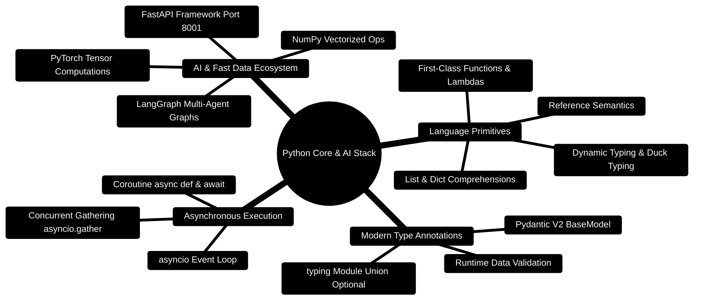

# 06 — Python Essentials (Day 2, Part 2) [Total: 2 hrs]

> Telugu: *Python = "cheppindhi cheyandi"* = Python does EXACTLY what you say,
> in plain English-like words. The least surprising language ever.

---

> [!TIP]
> **Hands-On Project Architecture & Implementation:**  
> To see how these concepts are realized in production code, consult the [**Master Developer Handbook: Building on This Project**](../docs/BUILDING_ON_THIS_PROJECT.md).

## 0. Python Architecture & AI Stack Mindmap



---

## 0.1 Python Memory & Generator Stream Pipeline

```
┌─────────────────────────────────────────────────────────────────────────────┐
│                   PYTHON GENERATOR & ASYNC STREAM ENGINE                    │
├─────────────────────────────────────────────────────────────────────────────┤
│                                                                             │
│  [Caller: FastAPI Endpoint] ─── Calls stream_tokens() ────► [Generator]    │
│            │                                                    │           │
│            │                                                    ▼           │
│            │ ◄─── yield Chunk 1 ("Analyzing...") ──────── [LLM Context]     │
│            │                                                    │           │
│            │                                                    ▼           │
│            │ ◄─── yield Chunk 2 ("Spending is up 12%") ── [Inference Engine]│
│            │                                                    │           │
│            │                                                    ▼           │
│            │ ◄─── yield Chunk 3 ("Recommendation: ...")─ [Grounding Verify]│
│            ▼                                                    │           │
│  [SSE HTTP Stream] ─────────────────────────────────────────────┘           │
│                                                                             │
└─────────────────────────────────────────────────────────────────────────────┘
```

---

## 0.2 Production Python Financial Analytics Blueprint

```python
# Production Code Snippet: Type-annotated financial analysis model with Pydantic V2
from pydantic import BaseModel, Field
from typing import List, Dict
import asyncio

class FinancialCategorySummary(BaseModel):
    category: str
    total_spent: float = Field(ge=0.0)
    transaction_count: int = Field(ge=0)

class MonthlyBudgetHealth(BaseModel):
    org_id: str
    month: str
    total_income: float
    total_expenses: float
    net_savings: float
    breakdown: List[FinancialCategorySummary]

    @property
    def savings_rate_percentage(self) -> float:
        if self.total_income <= 0:
            return 0.0
        return round((self.net_savings / self.total_income) * 100, 2)

async def calculate_health_metrics(income: float, expenses: float) -> MonthlyBudgetHealth:
    await asyncio.sleep(0.01) # Simulate non-blocking I/O query
    net = income - expenses
    return MonthlyBudgetHealth(
        org_id="org_default",
        month="2026-10",
        total_income=income,
        total_expenses=expenses,
        net_savings=net,
        breakdown=[]
    )
```

---

## 1. Why Python? (your resume is 80% Python) [5 min]

- Data Science & AI world speaks Python (PyTorch, LangChain, FastAPI).
- It's C++ with the ceremony removed: no `;`, no `{}`, no type declarations.
- Same logic as C++ — just cleaner clothes.

**C++ vs Python quick map:**

| C++ | Python |
|-----|--------|
| `int x = 5;` | `x = 5` |
| `vector<int> v;` | `v = []` (a list) |
| `cout << x;` | `print(x)` |
| `for (int i = 0; i < n; i++)` | `for i in range(n):` |
| `class Foo { public: ... };` | `class Foo:` + indent |
| braces `{ }` | **indentation** (spaces = blocks!) |

## 2. Types, lists, dicts [20 min]

```python
# ============================================================
# 1. Variables — no type needed, no semicolons
# ============================================================
age = 20                    # int
name = "Ganesh"             # str  (single or double quotes both OK)
cgpa = 8.35                 # float
is_student = True           # bool (capital T! lowercase 'true' breaks)
nothing = None              # like C++ nullptr

# ============================================================
# 2. Lists — like C++ vectors, but flexible
# ============================================================
skills = ["Python", "C++", "React"]
skills.append("FastAPI")    # push_back
skills[0]                   # "Python"
len(skills)                 # 4 (size)

# Slicing — Python's superpower (C++ has no direct equivalent)
nums = [10, 20, 30, 40, 50]
nums[1:4]                   # [20, 30, 40]  (start:end, end EXCLUDED)
nums[:3]                    # [10, 20, 30]  (from start)
nums[::2]                   # [10, 30, 50]  (every 2nd element)

# ============================================================
# 3. Dicts — like std::map / unordered_map (or a JSON object!)
# ============================================================
user = {"name": "Ganesh", "cgpa": 8.35, "skills": skills}
user["name"]                # "Ganesh"
user.get("email", "no email")  # safe access with default
"cgpa" in user              # True (key exists check)

# Looping a dict:
for key, value in user.items():
    print(key, "=", value)
```

## 3. Functions & control flow [15 min]

```python
# ============================================================
# 4. Functions — def instead of type + name
# ============================================================
def total_with_gst(amount, gst_rate=0.18):   # default arg like C++
    return amount + amount * gst_rate

print(total_with_gst(500))          # 590.0  (uses default 0.18)
print(total_with_gst(500, 0.05))    # 525.0

# ============================================================
# 5. for / if / while — blocks by INDENTATION (no braces!)
# ============================================================
prices = [100, 250, 75]

for p in prices:              # "for each p in prices"
    if p > 100:               # indentation defines the block
        print("big:", p)
    else:
        print("small:", p)

# range() = the classic C++ loop:
for i in range(3):            # 0, 1, 2  (start at 0, end exclusive)
    print(i)

# enumerate = index + value together (very common in interviews)
for index, p in enumerate(prices):
    print(index, p)
```

## 4. List comprehensions — the one-liner superpower [15 min]

```python
# C++ way: build result in a loop
# Python way: ONE line

prices = [100, 250, 75, 400, 50]

# map  ->  [result for x in list]
with_tax = [p * 1.18 for p in prices]

# filter ->  [x for x in list if condition]
big = [p for p in prices if p > 100]

# filter + map together:
big_with_tax = [p * 1.18 for p in prices if p > 100]

# total:
total = sum(p for p in prices)          # sum of generator
```

**Read it like English:** "give me `p * 1.18` for each `p` in `prices` if `p > 100`".

## 5. Functions are objects — passing them around [15 min]

Python treats functions like values (important for frameworks like
FastAPI/LangChain that ask you to "pass a function"):

```python
# ============================================================
# 6. Higher-order functions (like JS map/filter)
# ============================================================
prices = [100, 250, 75]

double = lambda p: p * 2     # lambda = tiny anonymous function
print(list(map(double, prices)))     # [200, 500, 150]
print(list(filter(lambda p: p > 100, prices)))  # [250]
print(list(map(lambda p: p * 2, filter(lambda p: p > 100, prices))))
```

**C++ analogy:** like `std::transform` with a lambda — same idea!

## 6. Classes — the AI world uses them a lot [15 min]

```python
# ============================================================
# 7. Classes: __init__ = constructor, self = this
# ============================================================
class Transaction:
    # __init__ is called automatically when you create an object
    def __init__(self, amount, category):
        self.amount = amount          # self.xxx = member variable
        self.category = category
        self.tax = amount * 0.18

    # a method (like a C++ member function)
    def total_cost(self):
        return self.amount + self.tax

t = Transaction(500, "food")   # calls __init__ automatically
print(t.total_cost())          # 590.0
```

**Python quirk:** every method gets `self` as the FIRST argument — that's
how the function knows which object it belongs to (C++ hides this as `this`).

## 7. Modules & imports [10 min]

```python
# ============================================================
# 8. import = using other people's code (this is 80% of real Python)
# ============================================================
import math
import json
from datetime import date

print(math.sqrt(16))          # 4.0
print(date.today())           # 2026-08-02

# JSON — Python ↔ data (same idea as JS):
data = json.loads('{"name": "Ganesh", "cgpa": 8.35}')  # text -> dict
print(data["name"])
text = json.dumps(data)       # dict -> text
```

**Why this matters for frameworks:** `import fastapi` or `import torch`
just means "pull in that framework's code". That's all a framework is —
someone else's code you import.

## 8. try/except — the Python try/catch [10 min]

```python
# ============================================================
# 9. try/except = do risky thing, handle failure gracefully
# ============================================================
try:
    number = int("not a number")   # this raises ValueError
except ValueError as e:
    print("Bad number:", e)
except Exception as e:             # catch-all (like catch(...))
    print("Something else:", e)
else:
    print("No error happened!")
```

## 9. Mini-Project: Budget analysis (like your real project!) [15 min]

```python
# budget.py — run with:  python budget.py
from collections import defaultdict

transactions = [
    {"amount": 1200, "category": "food",   "day": "Mon"},
    {"amount": 3500, "category": "rent",   "day": "Mon"},
    {"amount": 300,  "category": "food",   "day": "Tue"},
    {"amount": 800,  "category": "travel", "day": "Tue"},
]

# 1. Total spent (sum + comprehension)
total = sum(t["amount"] for t in transactions)
print(f"Total spent: Rs.{total}")

# 2. Spending per category (defaultdict = dict that auto-creates keys)
by_cat = defaultdict(float)
for t in transactions:
    by_cat[t["category"]] += t["amount"]
print("By category:", dict(by_cat))

# 3. Top category (max by value — classic interview question)
top = max(by_cat, key=by_cat.get)
print(f"Top spending: {top} (Rs.{by_cat[top]})")

# 4. Alert if overspending
if by_cat["food"] > 1000:
    print("ALERT: Food budget exceeded!")
```

**Stretch challenges:**
1. Add a `Month` field and compute monthly totals.
2. Write a `class Budget` with `add_transaction()` and `summary()` methods.
3. Export the summary to JSON with `json.dumps(..., indent=2)`.

## 10. ❌ Mistakes to avoid

1. Forgetting colons at the end of `if`/`for`/`def` lines.
2. Mixing tabs and spaces for indentation (choose 4 spaces, always).
3. Using `True`/`False` (capital) — lowercase `true` is a NameError in Python.
4. Mutating a list while iterating over it (use a copy: `for x in lst[:]`).
5. Comparing with `is` instead of `==` (use `==` for values, `is` for identity).

## 11. Glossary

1. **List** (Telugu: *jabita* = list) = ordered collection, like C++ vector.
2. **Dict** = key-value store, like std::map / JSON object.
3. **Tuple** = immutable list: `(1, 2, 3)` — can't change it.
4. **Comprehension** = one-line loop that builds a list.
5. **Lambda** = tiny anonymous function.
6. **`self`** = "this" object reference in methods.
7. **`__init__`** = the constructor method.
8. **PEP 8** = Python's official style guide (spaces, naming rules).

---

## MCQ — Python Essentials

**1. (L1)** What does `nums[1:4]` give for `nums = [10, 20, 30, 40, 50]`?
- a) [20, 30, 40]  b) [20, 30, 40, 50]  c) [10, 20, 30, 40]  d) [20, 30]

**2. (L1)** Which is valid Python?
- a) `if x > 5 { print(x) }`  b) `if x > 5: print(x)`  c) `if (x > 5) print(x);`  d) `if x > 5 then print`

**3. (L2)** `user.get("email", "none")` when `user = {"name": "Ganesh"}` returns:
- a) KeyError  b) "none"  c) None  d) "email"

**4. (L3)** What does this print?
```python
x = [n * 2 for n in range(4) if n % 2 == 0]
print(x)
```
- a) [0, 2, 4, 6]  b) [0, 4]  c) [0, 4, 8]  d) [2, 6]

**5. (L3)** You wrote `int("abc")` inside try/except. Which exception fires?
- a) TypeError  b) ValueError  c) KeyError  d) NameError

**6. (L4)** Write a one-liner to get the sum of amounts where category == "food"
from a list of dicts `txns` (each with keys "amount" and "category").

---

## MCQ ANSWERS

1. **a** — slice end index is EXCLUDED: indexes 1,2,3 → [20,30,40].
2. **b** — Python blocks need a colon + indentation, no braces.
3. **b** — `.get(key, default)` returns default when key is missing (no crash).
4. **b** — range(4)=0,1,2,3; even n: 0,2 → 0*2, 2*2 → [0, 4].
5. **b** — ValueError ("invalid literal for int()").
6. `sum(t["amount"] for t in txns if t["category"] == "food")`
