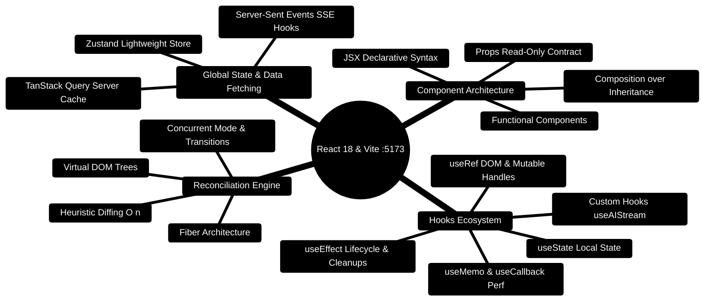

# 07 — React (Day 3-4) [Total: 4 hrs]

> Telugu: *React = screen ni "re-act" cheyyinchadam* = React RE-ACTS to changes.
> You tell it the final look, and it updates the screen automatically.
> No manual DOM surgery ever again.

---

> [!TIP]
> **Hands-On Project Architecture & Implementation:**  
> To see how these concepts are realized in production code, consult the [**Master Developer Handbook: Building on This Project**](../docs/BUILDING_ON_THIS_PROJECT.md).

## 0. React Architecture & Component Lifecycle Mindmap



---

## 0.1 React Component Hierarchy & Unidirectional Data Flow

```
┌─────────────────────────────────────────────────────────────────────────────┐
│                   REACT COMPONENT HIERARCHY & STATE FLOW                    │
├─────────────────────────────────────────────────────────────────────────────┤
│                                                                             │
│                            [AppShell Layout]                                │
│                                    │                                        │
│          ┌─────────────────────────┴─────────────────────────┐              │
│          ▼                                                   ▼              │
│     [Sidebar Nav]                                     [Dashboard Page]      │
│                                                              │              │
│                    ┌─────────────────────────────────────────┼───────────┐  │
│                    ▼                                         ▼           ▼  │
│          [FinancialVitals]                          [SpendingAnalysis] [AI] │
│          - Net Balance ($)                          - Pie / Bar Charts      │
│          - Monthly Burn Rate                        - Category Aggregation  │
│                    │                                                        │
│                    ▼ Props Down / Events Up                                 │
│          [BudgetHealthCard]                                                 │
│          - Progress Bar Indicator                                           │
│          - Realtime Alert Pill                                              │
│                                                                             │
└─────────────────────────────────────────────────────────────────────────────┘
```

---

## 0.2 Production React 18 TypeScript Component Blueprint

```tsx
// Production Code Snippet: Interactive Budget Health Card Component
import React from 'react';
import { ShieldCheck, AlertTriangle } from 'lucide-react';

interface BudgetHealthCardProps {
  spent: number;
  allocated: number;
  category: string;
}

export const BudgetHealthCard: React.FC<BudgetHealthCardProps> = ({ spent, allocated, category }) => {
  const ratio = allocated > 0 ? spent / allocated : 0;
  const isOverspent = ratio > 1.0;
  const percentage = Math.min(Math.round(ratio * 100), 100);

  return (
    <div className="p-4 rounded-xl border border-slate-800 bg-slate-900/60 shadow-lg backdrop-blur">
      <div className="flex items-center justify-between mb-2">
        <span className="text-sm font-semibold text-slate-300">{category}</span>
        {isOverspent ? (
          <span className="flex items-center gap-1 text-xs font-bold text-rose-400 bg-rose-950/60 px-2 py-0.5 rounded-full border border-rose-800">
            <AlertTriangle className="w-3.5 h-3.5" /> Overspent
          </span>
        ) : (
          <span className="flex items-center gap-1 text-xs font-bold text-emerald-400 bg-emerald-950/60 px-2 py-0.5 rounded-full border border-emerald-800">
            <ShieldCheck className="w-3.5 h-3.5" /> Healthy
          </span>
        )}
      </div>
      <div className="w-full bg-slate-800 h-2.5 rounded-full overflow-hidden">
        <div
          className={`h-full transition-all duration-500 rounded-full ${
            isOverspent ? 'bg-rose-500' : ratio > 0.85 ? 'bg-amber-400' : 'bg-emerald-500'
          }`}
          style={{ width: `${percentage}%` }}
        />
      </div>
      <div className="flex justify-between text-xs text-slate-400 mt-2">
        <span>₹{spent.toLocaleString()} spent</span>
        <span>₹{allocated.toLocaleString()} cap</span>
      </div>
    </div>
  );
};
```

---

## 1. The problem React solves [10 min]

**Vanilla JS way (old):** you must manually find an element and change it:

```javascript
// Without React — every update = manual "find + change" steps
const button = document.getElementById("btn");
button.addEventListener("click", () => {
  document.getElementById("counter").innerText = "1";  // hand-written update
  document.getElementById("box").style.display = "block";  // more manual work
});
```

With 50 elements to update, this becomes a mess of tangled code.

**React way:** you describe WHAT the screen should look like based on data.
When data changes, React figures out WHAT changed and updates ONLY that part.

```
VANILLA JS:      data change -> YOU tell browser exactly what to edit (easy 1 time, nightmare at scale)
REACT:           data change -> you say "screen should look like this" -> React diffs & updates (scales forever)
```

**C++ analogy:** vanilla JS = manual memory management (`new`/`delete` everywhere).
React = automatic memory management — you describe, the system manages.

## 2. Core mental model: Components = functions [20 min]

A **component** is just a function that returns what to draw (JSX).

```jsx
// App.jsx — React components are functions that return JSX
function App() {
  return <h1>Hello Ganesh</h1>;   // JSX = looks like HTML, but it's JS
}

export default App;   // let other files import this component
```

**The mind map of React (your 35%) :**

```
                        REACT (learn only these!)
                  ┌──────────────┬───────────────┐
            Components        State (useState)   Props (inputs)
               │                    │                 │
   [function returns JSX]  [data that CHANGES]  [data passed IN]
   [reuse like a function] [change -> re-render] [parent -> child]
                  └──────────────┬───────────────┘
                          Effects (useEffect)
                     [runs after render: fetch data,
                      timers, subscriptions]
```

That's it. **Components + Props + State + Effects** = 85% of daily React.

## 3. JSX — HTML inside JavaScript [20 min]

```jsx
// JSX rules: className (not class!), { } for JS expressions
function Greeting() {
  const name = "Ganesh";
  return (
    <div className="card">                 {/* className = CSS class */}
      <h2>Hello {name}</h2>                {/* {name} injects a variable */}
      <p>Your rank: {1000 + 7}</p>         {/* any JS expression works */}
      <button onClick={() => alert("hi")}>Click</button>
    </div>
  );
}
```

**Key rule:** `{ }` inside JSX = "switch to JavaScript mode here".
Everything else is literally HTML-looking text.

## 4. State with useState — the heart of React [30 min]

**Problem:** a variable like `let count = 0` doesn't update the screen.
React needs a special tracking variable = **state**.

```jsx
import { useState } from "react";

function Counter() {
  // useState(0) returns: [current value, function to change it]
  const [count, setCount] = useState(0);

  // When setCount is called, React re-runs this component with new value
  function increase() {
    setCount(count + 1);   // IMPORTANT: we never do count = count + 1
  }

  return (
    <div>
      <p>Count: {count}</p>
      <button onClick={increase}>+1</button>
    </div>
  );
}
```

**Flow diagram:**

```
Click "+1" button
     │
     ▼
setCount(count + 1)      <- we tell React "value should be 2 now"
     │
     ▼
React re-runs Counter()  <- fresh call, count = 2
     │
     ▼
React compares old screen vs new → updates ONLY the <p>Count: 2</p>
```

**The rules of state (memorize these 3):**
1. **Never modify state directly** (`count = count + 1` is FORBIDDEN —
   use `setCount`).
2. State updates are **async** — `setCount(count + 1)` doesn't change
   `count` instantly (it's scheduled).
3. Each state belongs to ONE component; to share, lift it up via props.

```jsx
// Pattern for updating with PREVIOUS value (avoid bugs with async updates):
setCount(prev => prev + 1);   // "give me latest value, add 1"
```

## 5. Props — passing data between components [25 min]

```jsx
// Props = arguments to your component function

function TransactionRow({ description, amount }) {
  // Props come as ONE object; destructuring pulls them out
  return (
    <div className="row">
      <span>{description}</span>
      <span>Rs. {amount}</span>
    </div>
  );
}

function TransactionList() {
  const transactions = [
    { description: "Swiggy order", amount: 300 },
    { description: "Bus pass", amount: 500 },
  ];
  return (
    <div>
      {/* Pass props like HTML attributes */}
      <TransactionRow description="Swiggy order" amount={300} />
      {/* Better: map over data (like Python comprehension!) */}
      {transactions.map(t => (
        <TransactionRow
          key={t.description}          // key = REQUIRED unique id for lists
          description={t.description}
          amount={t.amount}
        />
      ))}
    </div>
  );
}
```

**Data flow direction: PARENT → CHILD (one way).**
This one-way flow is what makes React predictable — like a pure function
in C++: same props in = same output out.

## 6. useEffect — doing things after render [30 min]

```jsx
import { useState, useEffect } from "react";

function Transactions() {
  const [transactions, setTransactions] = useState([]); // start empty
  const [loading, setLoading] = useState(true);

  // useEffect(run this, [when these change])
  // Empty [] = run ONCE when component first appears (mount)
  useEffect(() => {
    // Real-world pattern: fetch data from your Express/FastAPI backend!
    fetch("http://localhost:3000/api/transactions")
      .then(res => res.json())
      .then(data => {
        setTransactions(data);   // trigger re-render with data
        setLoading(false);
      })
      .catch(err => console.error("Fetch failed:", err));
  }, []);                        // [] = run only once, not on re-renders

  if (loading) return <p>Loading...</p>;

  return (
    <ul>
      {transactions.map(t => (
        <li key={t.id}>
          {t.category}: Rs.{t.amount}
        </li>
      ))}
    </ul>
  );
}
```

**The effect lifecycle (sequence diagram):**

```
Component mounts
     │
     ▼
useEffect(fn, [])  ──► fn runs ──► fetch API ──► data arrives
     │                                              │
     │                                              ▼
     │                                   setTransactions(data)
     │                                              │
     │                                              ▼
     │                                   React re-renders with list
     │
     └── [] dependency = fn does NOT run again on re-renders
```

**Dependency rules (the 35% version):**
- `useEffect(fn)` = runs after EVERY render (rarely want this).
- `useEffect(fn, [])` = runs once (mount). ← most common for data fetching.
- `useEffect(fn, [count])` = runs only when `count` changes.
- Always include every variable from outside that you use inside.

## 7. Conditional rendering & forms [20 min]

```jsx
function LoginButton({ isLoggedIn }) {
  // Option 1: ternary (like C++ ? :)
  return isLoggedIn ? <h2>Welcome back, Ganesh!</h2> : <button>Login</button>;
}

// Option 2: short-circuit && ("if true, show this")
function Alert({ danger }) {
  return (
    <div>
      {danger && <p className="danger">Budget exceeded!</p>}
    </div>
  );
}

// Forms: the "controlled input" pattern
function AddTransaction() {
  const [amount, setAmount] = useState("");

  return (
    <form onSubmit={e => { e.preventDefault();   // stop page refresh!
                           console.log("saving", amount); }}>
      <input
        value={amount}                                   // bound to state
        onChange={e => setAmount(e.target.value)}        // state on change
        placeholder="Enter amount"
        type="number"
      />
      <button type="submit">Save</button>
    </form>
  );
}
```

## 8. Practical workflow + common errors [15 min]

```
npx create-vite@latest my-app -- --template react-ts   # create project (Vite = fast)
cd my-app
npm install          # install dependencies
npm run dev          # start dev server -> http://localhost:5173
   │
   ├── edit src/App.jsx  -> save -> browser auto-refreshes (HMR)
   └── npm run build     -> make production files (later, with Docker)
```

| Error | Meaning | Fix |
|---|---|---|
| `Each child needs a key` | list items missing unique `key` | add `key={item.id}` |
| Blank page, no errors | component crashed silently | open DevTools console |
| `Cannot read properties of undefined` | you accessed `data.x` before data loaded | add `loading` check |
| Component not updating | you mutated state directly | use `setState` always |
| `Module not found` | wrong import path | check the file name/case |

## 9. Mini-Project: Budget Tracker (your finance app, simplified!) [45 min]

```jsx
// App.jsx — a complete working budget tracker (one file, fully commented)
import { useState, useEffect } from "react";

// ---------- Child component: one row ----------
function TransactionRow({ t, onDelete }) {
  return (
    <li>
      {t.category}: Rs.{t.amount}  {"  "}
      <button onClick={() => onDelete(t.id)}>Delete</button>
    </li>
  );
}

// ---------- Main component ----------
export default function App() {
  const [transactions, setTransactions] = useState([]);   // data list
  const [amount, setAmount] = useState("");               // form field
  const [category, setCategory] = useState("food");       // form field

  // Load saved data from localStorage when app opens (browser storage)
  useEffect(() => {
    const saved = localStorage.getItem("txns");
    if (saved) setTransactions(JSON.parse(saved));   // text -> array
  }, []);

  // Save to localStorage whenever transactions change
  useEffect(() => {
    localStorage.setItem("txns", JSON.stringify(transactions));
  }, [transactions]);

  function addTransaction() {
    const newTxn = { id: Date.now(), amount: Number(amount), category };
    setTransactions([...transactions, newTxn]);   // new array, don't mutate!
    setAmount("");                                 // clear the form
  }

  function deleteTransaction(id) {
    setTransactions(transactions.filter(t => t.id !== id));
  }

  const total = transactions.reduce((s, t) => s + t.amount, 0);

  return (
    <div style={{ maxWidth: 400, margin: "auto", fontFamily: "sans-serif" }}>
      <h1>Budget Tracker</h1>

      <input type="number" value={amount} placeholder="Amount"
             onChange={e => setAmount(e.target.value)} />
      <select value={category} onChange={e => setCategory(e.target.value)}>
        <option value="food">Food</option>
        <option value="rent">Rent</option>
        <option value="travel">Travel</option>
      </select>
      <button onClick={addTransaction}>Add</button>

      <h2>Total: Rs.{total}</h2>

      <ul>
        {transactions.map(t => (
          <TransactionRow key={t.id} t={t} onDelete={deleteTransaction} />
        ))}
      </ul>
    </div>
  );
}
```

**Stretch challenges:**
1. Add a `filter by category` dropdown.
2. Add an "overspent" red alert when total > 5000.
3. Fetch from a real backend (your Express API from file 08) instead of localStorage.

## 10. ❌ Mistakes to avoid

1. Mutating state directly (`transactions.push()` — NEVER; always spread or filter).
2. Calling `useState`/`useEffect` inside `if` or loops (hooks must be top-level).
3. Forgetting `key` on list items.
4. Fetching inside the component body instead of `useEffect` (infinite loops!).
5. Not using `[...transactions]` spread → React doesn't detect mutation → no re-render.

## 11. Glossary

1. **Component** (Telugu: *bhagam* = part) = a function returning JSX.
2. **JSX** = HTML-like syntax inside JavaScript.
3. **Props** = inputs passed from parent to child.
4. **State** = data React tracks; changing it re-renders the component.
5. **Hook** = function starting with `use` that plugs into React behavior.
6. **useState** = hook that gives [value, setter].
7. **useEffect** = hook that runs side-effects after render.
8. **Re-render** = React re-running your component because state changed.
9. **HMR (Hot Module Reload)** = browser updates instantly when you save.
10. **Vite** = fast build tool that creates & serves React apps.

---

## MCQ — React

**1. (L1)** What does `useState(0)` return?
- a) Just a number  b) An object  c) An array `[value, setter]`  d) A component

**2. (L1)** Which is the CORRECT way to update state?
- a) `count = count + 1`  b) `setCount(count + 1)`  c) `count++`  d) `this.count += 1`

**3. (L2)** Your list shows an error `Each child needs a unique key`. What's missing?
- a) `key` prop on each mapped element  b) `id` CSS class  c) `useEffect`  d) `type="button"`

**4. (L2)** You fetch data in `useEffect` but the effect runs FOREVER. Why?
- a) The API is slow  b) Missing dependency array `[]`  c) Wrong URL  d) fetch is buggy

**5. (L3)** A child component shows old data after the parent's state changed.
The child receives `amount` as a prop. Most likely cause?
- a) The child ignores the prop  b) Props are one-way and update automatically
- c) You need context API  d) localStorage

**6. (L4)** Write JSX that renders "Too much!" if `total > 5000`, else "OK".

---

## MCQ ANSWERS

1. **c** — useState returns `[currentValue, setterFunction]`.
2. **b** — always go through the setter; direct mutation won't re-render.
3. **a** — mapped JSX needs a unique `key`.
4. **b** — no dependency array means run after every render → fetch → setState → re-render → loop.
5. **a** — the child was reading its own copy; props flow automatically. (Check: did
   the child destructure the prop / is parent passing it?)
6. `{total > 5000 ? <p>Too much!</p> : <p>OK</p>}`
---

## 12. FinWise Production Architecture Blueprint

In the real FinWise repository, React 18 is paired with TanStack Query v5, Zustand, and scoped private session providers:

### Production Pattern 1: Scoped QueryClient & Private Workspace Isolation (`client/src/app/providers/ScopedDataProvider.tsx`)

```tsx
import { useEffect, useLayoutEffect, useState, useSyncExternalStore, type ReactNode } from "react";
import { QueryClientProvider } from "@tanstack/react-query";
import { useAuth } from "@/hooks/useAuth";
import { createQueryClient } from "@/lib/queryClient";
import { getActiveOrgId, subscribeActiveOrgId } from "@/lib/orgContext";
import { useChatStore } from "@/stores/chatStore";

function PrivateQueryProvider({ children }: { children: ReactNode }) {
  const [client] = useState(createQueryClient);
  useEffect(() => () => {
    void client.cancelQueries();
    client.clear();
  }, [client]);
  return <QueryClientProvider client={client}>{children}</QueryClientProvider>;
}

export function ScopedDataProvider({ children }: { children: ReactNode }) {
  const { user, loading } = useAuth();
  const orgId = useSyncExternalStore(subscribeActiveOrgId, getActiveOrgId, () => null);
  const scope = user ? JSON.stringify([user.id, orgId]) : null;

  useLayoutEffect(() => {
    if (loading || useChatStore.getState().dataScope === scope) return;
    useChatStore.getState().bindDataScope(scope);
  }, [scope, loading]);

  return (
    <PrivateQueryProvider key={scope || "signed-out"}>
      {children}
    </PrivateQueryProvider>
  );
}
```

### Production Pattern 2: Financial Command Center Cockpit (`client/src/components/CommandCenter.tsx`)

```tsx
import React from "react";
import { useQuery } from "@tanstack/react-query";

export const CommandCenter: React.FC = () => {
  const { data, isLoading } = useQuery({
    queryKey: ["/api/v1/command-center/today"],
  });

  if (isLoading || !data) return <div className="p-4 animate-pulse">Loading daily vitals...</div>;

  return (
    <div className="p-6 bg-slate-900 border border-slate-800 rounded-2xl">
      <h2 className="text-xl font-bold text-white">{data.greeting}</h2>
      <div className="text-3xl font-extrabold text-sky-400 mt-2">{data.runwayDays} Days Runway</div>
    </div>
  );
};
```
