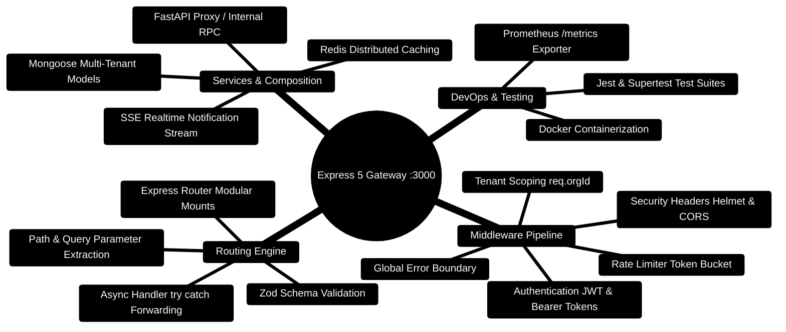

# 08 — Node.js + Express (Day 5-6) [Total: 4 hrs]

> Telugu: *Express = server ni "express" ga rasukovadam* = Express lets you
> write a server QUICKLY (expressly). 5 lines = a working API.

---

> [!TIP]
> **Hands-On Project Architecture & Implementation:**  
> To see how these concepts are realized in production code, consult the [**Master Developer Handbook: Building on This Project**](../docs/BUILDING_ON_THIS_PROJECT.md).

## 0. Node.js & Express 5 Architecture Mindmap



---

## 0.1 Express Middleware Onion Architecture

```
┌─────────────────────────────────────────────────────────────────────────────┐
│                    EXPRESS 5 MIDDLEWARE ONION PIPELINE                      │
├─────────────────────────────────────────────────────────────────────────────┤
│                                                                             │
│  [Incoming HTTP Request (Port 3000)]                                        │
│          │                                                                  │
│          ▼                                                                  │
│  ┌───────────────────────────────────────────────────────────────────────┐  │
│  │ 1. helmet() & cors({ origin: 'http://localhost:5173' })               │  │
│  │ 2. express.json({ limit: '10mb' })                                    │  │
│  │ 3. rateLimitMiddleware (Redis backed, 100 req / min)                  │  │
│  │ 4. authMiddleware (Verify JWT -> attach req.user)                     │  │
│  │ 5. tenantScopeMiddleware (Extract orgId -> attach req.orgId)          │  │
│  │ 6. zodValidate(CreateTransactionSchema)                               │  │
│  │    │                                                                  │  │
│  │    ▼                                                                  │  │
│  │  [CONTROLLER: transactionController.create]                           │  │
│  │    │ (Executes Mongoose save with { orgId })                          │  │
│  │    ▼                                                                  │  │
│  │ 7. Global Error Handler (Transforms to RFC 7807 Problem Details)      │  │
│  └───────────────────────────────────┬───────────────────────────────────┘  │
│                                      │                                      │
│                                      ▼                                      │
│  [HTTP/1.1 201 Created Response to Client :5173]                            │
│                                                                             │
└─────────────────────────────────────────────────────────────────────────────┘
```

---

## 0.2 Production Express 5 TypeScript Controller Blueprint

```typescript
// Production Code Snippet: Type-safe, tenant-isolated Express 5 controller
import { Request, Response, NextFunction } from 'express';
import { z } from 'zod';

export const TransactionInputSchema = z.object({
  amount: z.number().positive(),
  category: z.string().min(1),
  type: z.enum(['income', 'expense']),
  notes: z.string().optional(),
});

export async function createTransactionHandler(
  req: Request & { orgId?: string },
  res: Response,
  next: NextFunction
): Promise<void> {
  try {
    const validated = TransactionInputSchema.parse(req.body);
    const orgId = req.orgId || 'org_default';

    // Simulated tenant-scoped persistence
    const savedRecord = {
      id: `txn_${Date.now()}`,
      ...validated,
      orgId,
      createdAt: new Date().toISOString(),
    };

    res.status(201).json({ success: true, data: savedRecord });
  } catch (error) {
    next(error); // Forward to global error boundary middleware
  }
}
```

---

## 1. The problem: what is a server? [10 min]

A **server** = a program that listens for requests and sends responses.
Your React app asks for data → the server answers.

```
YOUR BROWSER / REACT APP                SERVER (Express)
       │  GET /api/transactions               │
       │──────────────────────────────────────►  listens on port 3000
       │                                       │  looks up transactions
       │  HTTP 200 + JSON array               │
       │◄──────────────────────────────────────┘
```

**C++ analogy:** a server is like an infinite loop that reads input (requests)
and prints output (responses) — except the "input" arrives over the network.

## 2. Why Express? [10 min]

Writing a server in raw Node.js = 50 lines of plumbing. In Express = 5 lines:

```javascript
// The COMPLETE Express server (compare with raw Node's boilerplate)
const express = require("express");   // pull in the framework
const app = express();                // create the app object

app.get("/", (req, res) => res.send("Hello from Express!"));

app.listen(3000, () => console.log("Server running on http://localhost:3000"));
```

## 3. Setup — first Express app [15 min]

```bash
mkdir budget-api && cd budget-api
npm init -y                 # creates package.json (project ID card)
npm install express         # installs Express into node_modules/
npm install nodemon --save-dev   # auto-restart server on file save
```

```json
// package.json — add this line (under "scripts"):
"scripts": { "dev": "nodemon server.js" }
```

Then create `server.js` and run with `npm run dev`.

## 4. Routes, params, middleware — the 3 pillars [40 min]

```javascript
// server.js — Budget API, line by line
const express = require("express");

const app = express();

// ============================================================
// MIDDLEWARE 1: express.json() — REQUIRED to read JSON bodies
// Without this, req.body is undefined on POST requests
// ============================================================
app.use(express.json());

// ============================================================
// In-memory database (a real app uses MongoDB — file 10!)
// ============================================================
let transactions = [
  { id: 1, amount: 300, category: "food" },
  { id: 2, amount: 3500, category: "rent" },
];
let nextId = 3;

// ============================================================
// ROUTE 1: GET all — the "Read" of CRUD
// ============================================================
app.get("/api/transactions", (req, res) => {
  // req = the request (has params, body, headers)
  // res = the response (you send back data with it)
  res.json(transactions);          // sends array as JSON + status 200
});

// ============================================================
// ROUTE 2: GET one by id — uses a PATH PARAMETER
// :id = a placeholder; Express fills it from the URL
// ============================================================
app.get("/api/transactions/:id", (req, res) => {
  const id = Number(req.params.id);          // params.id is a STRING, convert!
  const txn = transactions.find(t => t.id === id);
  if (!txn) {
    return res.status(404).json({ message: "Transaction not found" });
  }
  res.json(txn);
});

// ============================================================
// ROUTE 3: POST create — the "Create" of CRUD
// ============================================================
app.post("/api/transactions", (req, res) => {
  const { amount, category } = req.body;     // data sent by the client
  if (amount === undefined || !category) {
    return res.status(400).json({ message: "amount and category required" });
  }
  const newTxn = { id: nextId++, amount, category };
  transactions.push(newTxn);
  res.status(201).json(newTxn);              // 201 = Created
});

// ============================================================
// ROUTE 4: DELETE — the "Delete" of CRUD
// ============================================================
app.delete("/api/transactions/:id", (req, res) => {
  const id = Number(req.params.id);
  transactions = transactions.filter(t => t.id !== id);
  res.json({ message: `Deleted transaction ${id}` });
});

// ============================================================
// MIDDLEWARE 2: 404 catch-all — runs for any unmatched URL
// ============================================================
app.use((req, res) => {
  res.status(404).json({ message: "Route not found" });
});

// ============================================================
// START the server
// ============================================================
app.listen(3000, () => {
  console.log("Budget API running at http://localhost:3000");
});
```

**The request journey (sequence diagram):**

```
Client (Postman/React)
  │  DELETE /api/transactions/2
  ▼
Express matches route  DELETE /api/transactions/:id   (id="2")
  │
  ▼
handler runs: filter out id 2  →  transactions now has 1 item
  │
  ▼
res.json({message: "Deleted transaction 2"})  →  200 OK + JSON
```

## 5. Middleware — the pipeline concept [25 min]

**Middleware** = functions that run BETWEEN the request arriving and the
route handler. Like airport security — every passenger (request) passes
through checkpoints before reaching the gate (route).

```
Request ──► [middleware 1: logger] ──► [middleware 2: auth] ──► [route handler] ──► Response
                │ log every request         │ check login token
                │ then next()               │ if bad: return 401 (blocked)
```

```javascript
// Custom middleware: logs every request with timestamp
app.use((req, res, next) => {
  console.log(`${new Date().toISOString()} ${req.method} ${req.url}`);
  next();   // CRITICAL: next() passes control to the next step!
});

// Auth middleware (the pattern every real app uses):
function requireAuth(req, res, next) {
  const token = req.headers.authorization;   // "Bearer abc123"
  if (!token || token !== "Bearer secret-token-123") {
    return res.status(401).json({ message: "Unauthorized" });
  }
  next();                                    // token OK -> continue
}

// Use it on specific routes only:
app.get("/api/transactions", requireAuth, (req, res) => {
  res.json(transactions);
});
```

## 6. REST structure + project layout [20 min]

```
budget-api/
├── package.json        # project info + dependencies
├── node_modules/       # installed packages (NEVER commit to git!)
├── server.js           # entry point (starts the server)
└── routes/             # (later, when app grows)
    └── transactions.js
```

**Growing pattern (real projects):** as apps grow, routes go in separate files
using `express.Router()`:

```javascript
// routes/transactions.js
const router = require("express").Router();

router.get("/", (req, res) => { ... });
router.post("/", (req, res) => { ... });

module.exports = router;

// server.js
app.use("/api/transactions", require("./routes/transactions"));
```

## 7. Connecting React to Express [15 min]

```javascript
// In your React app (file 07's Budget Tracker), replace localStorage:
const res = await fetch("http://localhost:3000/api/transactions");
const data = await res.json();
setTransactions(data);

// POST a new one:
await fetch("http://localhost:3000/api/transactions", {
  method: "POST",
  headers: { "Content-Type": "application/json" },
  body: JSON.stringify({ amount: 500, category: "food" }),
});
```

**CORS reminder:** the browser blocks `localhost:5173 → localhost:3000`
by default. Fix on the SERVER:

```bash
npm install cors
```

```javascript
const cors = require("cors");
app.use(cors());   // allow browser apps on other ports to call this API
```

## 8. Common errors table [10 min]

| Error | Meaning | Fix |
|---|---|---|
| `Cannot GET /api/...` | route doesn't exist | check path + method spelling |
| `req.body is undefined` | forgot `app.use(express.json())` | add the middleware |
| `EADDRINUSE: 3000` | port already used | kill old process or change port |
| `CORS error` | cross-port blocked | install + use `cors` |
| `Cannot read properties of undefined (reading 'params')` | wrong route syntax | use `:id` correctly |
| `node_modules not found` | someone deleted deps | `npm install` |

## 9. Mini-Project: Complete Budget API [45 min]

```javascript
// server.js — extend with validation + update route (PUT)
const express = require("express");
const cors = require("cors");

const app = express();
app.use(cors());                 // allow React app to call us
app.use(express.json());         // read JSON bodies

let transactions = [];
let nextId = 1;

// Utility: find by id (used by multiple routes)
function findTxn(id) {
  return transactions.find(t => t.id === id);
}

// GET all (optional ?category=filter)
app.get("/api/transactions", (req, res) => {
  const { category } = req.query;              // query = ?key=value
  const result = category
    ? transactions.filter(t => t.category === category)
    : transactions;
  res.json(result);
});

// GET one
app.get("/api/transactions/:id", (req, res) => {
  const txn = findTxn(Number(req.params.id));
  if (!txn) return res.status(404).json({ message: "Not found" });
  res.json(txn);
});

// POST create
app.post("/api/transactions", (req, res) => {
  const { amount, category } = req.body || {};
  if (typeof amount !== "number" || amount <= 0 || !category) {
    return res.status(400).json({ message: "Invalid amount or category" });
  }
  const newTxn = { id: nextId++, amount, category };
  transactions.push(newTxn);
  res.status(201).json(newTxn);
});

// PUT update (full replace)
app.put("/api/transactions/:id", (req, res) => {
  const txn = findTxn(Number(req.params.id));
  if (!txn) return res.status(404).json({ message: "Not found" });
  const { amount, category } = req.body || {};
  if (amount !== undefined) txn.amount = amount;
  if (category) txn.category = category;
  res.json(txn);
});

// DELETE
app.delete("/api/transactions/:id", (req, res) => {
  const id = Number(req.params.id);
  transactions = transactions.filter(t => t.id !== id);
  res.json({ message: `Deleted ${id}` });
});

// 404 catch-all
app.use((req, res) => res.status(404).json({ message: "Route not found" }));

app.listen(3000, () => console.log("Budget API on :3000"));
```

Test with Postman: GET `http://localhost:3000/api/transactions` etc.

**Stretch challenges:**
1. Add `GET /api/transactions/summary` returning `{total, byCategory}`.
2. Add a `PATCH` route that updates only given fields.
3. Wire this API into your React Budget Tracker (replace localStorage).

## 10. ❌ Mistakes to avoid

1. Forgetting `express.json()` → `req.body` is `undefined`.
2. `req.params.id` is a string — always `Number()` it before comparing.
3. Blocking in route handlers with `while(true)` — servers must be fast/async.
4. Forgetting `next()` in middleware → request hangs forever.
5. Sending response twice (`res.json()` then `res.send()`) → error.

## 11. Glossary

1. **Server** = program that listens for and answers requests.
2. **Route** = a URL + method that maps to a handler function.
3. **Handler** = the function that processes a request and sends a response.
4. **Middleware** (Telugu: *madhyastham* = intermediary) = functions in the request pipeline.
5. **`req`/`res`** = request / response objects.
6. **`req.params`** = URL parts from `:placeholders`.
7. **`req.query`** = `?key=value` parameters.
8. **`req.body`** = JSON data sent by client (needs `express.json()`).
9. **Port** = numbered door on your computer (3000, 5173, 8001...).
10. **CORS** = browser rule; server must allow other origins to call it.
11. **`npm`** = Node package manager (installs libraries).
12. **`node_modules/`** = folder of installed packages (git-ignore it!).

---

## MCQ — Node + Express

**1. (L1)** What is `app.use(express.json())` for?
- a) Starting the server  b) Parsing JSON request bodies
- c) Enabling HTTPS  d) Connecting MongoDB

**2. (L1)** In `GET /api/transactions/:id`, how do you get the id in the handler?
- a) `req.query.id`  b) `req.params.id`  c) `req.body.id`  d) `req.url.id`

**3. (L2)** `req.params.id` is `"5"` (string). You compare `t.id === "5"` where
`t.id = 5` (number) and nothing matches. Why?
- a) Types differ: `"5" === 5` is false  b) The find is buggy  c) id is null  d) Route doesn't match

**4. (L2)** Your request to Express from React fails with a CORS error.
- a) Fix in React  b) Fix with `app.use(cors())` on the server
- c) Restart the browser  d) Use localStorage instead

**5. (L3)** A middleware returns `res.status(401).json(...)` but forgot `next()`.
For requests WITHOUT a token, what happens?
- a) Request proceeds to the route  b) Request hangs forever
- c) 401 is sent (correct behavior)  d) Server crashes

**6. (L4)** Write the Express route: POST `/api/transactions` that validates
`amount` is a positive number and returns 201 + the created object.

---

## MCQ ANSWERS

1. **b** — it parses JSON bodies into `req.body` (must be added before routes).
2. **b** — `:id` placeholders live in `req.params`.
3. **a** — strict `===` compares type too: `"5"` (string) ≠ `5` (number).
4. **b** — CORS is enforced server-side; the server must allow the origin.
5. **c** — the 401 response was already sent; the request never reaches the route.
6.
```javascript
app.post("/api/transactions", (req, res) => {
  const { amount, category } = req.body;
  if (typeof amount !== "number" || amount <= 0 || !category)
    return res.status(400).json({ message: "Invalid" });
  const txn = { id: nextId++, amount, category };
  transactions.push(txn);
  res.status(201).json(txn);
});
```
---

## 12. FinWise Production Architecture Blueprint

In the production repository, Express 5 handles multi-tenancy, rate limiting, and BullMQ background task processing:

### Production Pattern 1: Redis Sliding-Window Rate Limiter (`server/src/middleware/rateLimiter.ts`)

```typescript
import { Request, Response, NextFunction } from "express";
import { redisClient } from "../config/redis";

export function rateLimiter(options: { windowMs: number; max: number }) {
  return async (req: Request, res: Response, next: NextFunction) => {
    const key = `ratelimit:${req.ip}:${req.orgId || "anonymous"}`;
    const current = await redisClient.incr(key);
    if (current === 1) {
      await redisClient.pexpire(key, options.windowMs);
    }
    if (current > options.max) {
      return res.status(429).json({ error: "Too many requests. Please slow down." });
    }
    next();
  };
}
```

### Production Pattern 2: BullMQ Dead Letter Queue Quarantining (`server/src/services/deadLetterQueue.ts`)

```typescript
import { Queue, Job } from "bullmq";
import { redisClient } from "../config/redis";

export const deadLetterQueue = new Queue("bull:finwise-dlq", { connection: redisClient });

export async function quarantineFailedJob(job: Job, error: Error, sourceQueue: string) {
  await deadLetterQueue.add(`quarantine:${sourceQueue}:${job.name}`, {
    originalJobId: job.id,
    originalQueue: sourceQueue,
    failedReason: error.message,
    data: job.data,
    quarantinedAt: new Date().toISOString()
  });
}
```
