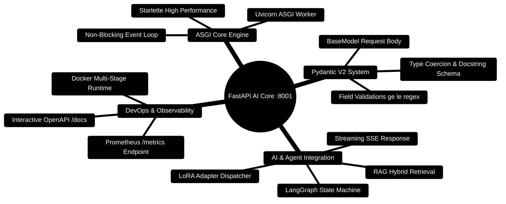

# 09 — FastAPI (Day 7) [Total: 3 hrs]

> Telugu: *FastAPI = python server, "fast" ga* = FastAPI is Python's fast,
> modern server framework. Your resume's #1 backend — so go deep here.

---

> [!TIP]
> **Hands-On Project Architecture & Implementation:**  
> To see how these concepts are realized in production code, consult the [**Master Developer Handbook: Building on This Project**](../docs/BUILDING_ON_THIS_PROJECT.md).

## 0. FastAPI & AI Inference Engine Mindmap



---

## 0.1 FastAPI Request Flow Architecture

```
┌─────────────────────────────────────────────────────────────────────────────┐
│                     FASTAPI AI CORE PROCESSING PIPELINE                     │
├─────────────────────────────────────────────────────────────────────────────┤
│                                                                             │
│  [Gateway :3000 / Client :5173] ──── POST /ai/analyze ────► [FastAPI :8001] │
│                                                                   │         │
│         ┌─────────────────────────────────────────────────────────┘         │
│         ▼                                                                   │
│  [Pydantic V2 Request Validation]                                           │
│         │                                                                   │
│         ▼                                                                   │
│  [LangGraph Workflow Agent Node]                                            │
│         │                                                                   │
│         ├─► [Hybrid Document Chunks Retrieval (RAG)]                        │
│         │                                                                   │
│         └─► [LLM Inference Engine (OpenAI / Gemini / LoRA)]                 │
│                   │                                                         │
│                   ▼                                                         │
│  [Streaming Token Pipeline / JSON Envelope] ──► [HTTP 200 OK / SSE]         │
│                                                                             │
└─────────────────────────────────────────────────────────────────────────────┘
```

---

## 0.2 Production FastAPI Router Blueprint

```python
# Production Code Snippet: Type-safe, validated FastAPI analytics endpoint
from fastapi import FastAPI, HTTPException, status
from pydantic import BaseModel, Field
from typing import List, Optional

app = FastAPI(title="Personal Finance AI Core", version="2.0.0")

class SpendingAnalysisRequest(BaseModel):
    org_id: str = Field(min_length=1, description="Tenant organization ID")
    month: str = Field(pattern=r"^\d{4}-\d{2}$", description="YYYY-MM format")
    income: float = Field(gt=0, description="Total monthly income")
    expenses: float = Field(ge=0, description="Total monthly expenses")

class AnalysisResult(BaseModel):
    org_id: str
    month: str
    savings_rate: float
    health_status: str
    recommendation: str

@app.post("/api/v1/analyze", response_model=AnalysisResult, status_code=status.HTTP_200_OK)
async def analyze_budget(payload: SpendingAnalysisRequest) -> AnalysisResult:
    savings = payload.income - payload.expenses
    rate = round((savings / payload.income) * 100, 2)
    health = "Excellent" if rate >= 30 else "Moderate" if rate >= 15 else "Critical"
    recommendation = "Maintain current savings rate." if rate >= 30 else "Review discretionary categories."

    return AnalysisResult(
        org_id=payload.org_id,
        month=payload.month,
        savings_rate=rate,
        health_status=health,
        recommendation=recommendation
    )
```

---

## 1. Why FastAPI (when you already know Express)? [10 min]

You can write the SAME API in both. Choose based on your team's language:

```
Express (JS):   huge JS ecosystem, same language as React
FastAPI (Python): automatic documentation, built-in validation,
                 native typing, perfect for ML/AI services
```

**FastAPI's superpowers (learn these 3):**
1. **Auto docs** — visit `/docs` and get a clickable Swagger UI for free.
2. **Auto validation** — declare types, invalid requests get rejected automatically.
3. **Pydantic models** — JSON validation with Python classes (like TS interfaces!).

## 2. Setup [10 min]

```bash
mkdir budget-api-py && cd budget-api-py
pip install fastapi uvicorn
# uvicorn = the server that RUNS FastAPI apps (like nodemon's big brother)
```

## 3. First FastAPI app — 6 lines [15 min]

```python
# main.py
from fastapi import FastAPI

app = FastAPI()                      # create the app object

@app.get("/")                        # decorator = "when GET / is called..."
def home():
    return {"message": "Hello Ganesh!"}   # dict -> JSON automatically
```

Run it:
```bash
uvicorn main:app --reload --port 8001
#   main   = file name (main.py)
#   :app   = the FastAPI object inside
#   --reload = auto-restart on save (like nodemon)
```

Open `http://localhost:8001` → `{"message": "Hello Ganesh!"}`
Open `http://localhost:8001/docs` → **free interactive documentation!** 🎉

## 4. Path params & query params [20 min]

```python
from fastapi import FastAPI

app = FastAPI()

# ============================================================
# Path parameter: comes from the URL itself  (/api/transactions/5)
# FastAPI reads the TYPE you declare (int) and converts/validates
# ============================================================
@app.get("/api/transactions/{txn_id}")
def get_transaction(txn_id: int):          # : int = validation + auto-convert
    return {"id": txn_id, "note": "looked up transaction"}

# If client sends /api/transactions/abc  -> FastAPI replies 422 (validation error)
# automatically. In Express you'd write that check yourself!

# ============================================================
# Query parameter: ?category=food&limit=10
# ============================================================
@app.get("/api/transactions")
def list_transactions(category: str | None = None, limit: int = 10):
    # "str | None = None" means: optional, defaults to None
    return {"category": category, "limit": limit}
```

**FastAPI vs Express for the same job:**

| Concern | Express | FastAPI |
|---|---|---|
| Read URL param | `Number(req.params.id)` | `txn_id: int` (automatic) |
| Validate body | write `if` checks | Pydantic model |
| Docs | install Swagger manually | `/docs` for free |
| Wrong type sent | crashes or you check | auto 422 response |

## 5. Pydantic models — the star of the show [30 min]

```python
from fastapi import FastAPI, HTTPException
from pydantic import BaseModel, Field

app = FastAPI()

# ============================================================
# Pydantic model = "the shape the request body must have"
# (like a TypeScript interface, but it VALIDATES at runtime too)
# ============================================================
class Transaction(BaseModel):
    amount: float = Field(gt=0, description="Must be positive")
    category: str = Field(min_length=1)
    note: str | None = None            # optional field

# ============================================================
# POST with automatic validation
# ============================================================
transactions_db = []                   # in-memory storage (MongoDB in file 10)

@app.post("/api/transactions", status_code=201)   # default response code
def create_transaction(txn: Transaction):        # FastAPI parses+validates body
    # If client sends {"amount": -5} -> FastAPI auto-replies 422!
    # If client sends {"category": 123} -> auto 422!
    transactions_db.append(txn)
    return txn        # Pydantic model -> JSON automatically

# ============================================================
# Lookup + proper error handling
# ============================================================
@app.get("/api/transactions/{index}")
def get_one(index: int):
    if index >= len(transactions_db) or index < 0:
        raise HTTPException(status_code=404, detail="Transaction not found")
    return transactions_db[index]
```

**Pydantic = the "validation brain":**

```
Client sends: {"amount": -5, "category": "food"}
        │
        ▼
Pydantic checks amount: float, must be > 0  ──► FAIL ──► 422 response:
{ "detail": [ { "loc": ["body","amount"],
                "msg": "greater than 0" } ] }
```

That single error message tells the client EXACTLY what's wrong — in
Express you'd build this yourself. This is why teams love FastAPI.

## 6. In-memory data + CORS + run flow [20 min]

```python
from fastapi import FastAPI
from fastapi.middleware.cors import CORSMiddleware   # allow React calls

app = FastAPI()

# Allow your React app (port 5173) to call this API:
app.add_middleware(
    CORSMiddleware,
    allow_origins=["http://localhost:5173"],
    allow_methods=["*"],        # GET, POST, PUT, DELETE...
    allow_headers=["*"],
)

@app.get("/")
def root():
    return {"status": "ok"}
```

**Practical flow (your full stack):**

```
React (5173) ──fetch──► FastAPI (8001) ──queries──► MongoDB (27017)
     ▲                                                │
     └────────────── JSON back up the chain ◄──────────┘
```

## 7. Common errors table [10 min]

| Error | Meaning | Fix |
|---|---|---|
| `ModuleNotFoundError: No module named 'fastapi'` | not installed | `pip install fastapi uvicorn` |
| `422 Unprocessable Entity` | body didn't match the Pydantic model | check field names/types |
| `Command 'uvicorn' not recognized` | Python Scripts not in PATH | `python -m uvicorn main:app --reload` |
| `CORS` error from browser | origin not allowed | add CORSMiddleware |
| Port already in use (8001) | another process | change port: `--port 8001` |

## 8. Mini-Project: Budget API in FastAPI [45 min]

```python
# main.py — the complete API (run: uvicorn main:app --reload)
from fastapi import FastAPI, HTTPException
from fastapi.middleware.cors import CORSMiddleware
from pydantic import BaseModel, Field
from typing import Optional

app = FastAPI(title="Budget API", version="1.0")   # shows in /docs

app.add_middleware(
    CORSMiddleware,
    allow_origins=["http://localhost:5173"],
    allow_methods=["*"],
    allow_headers=["*"],
)

# ---------- Data model (validation contract) ----------
class TransactionIn(BaseModel):                    # for creating
    amount: float = Field(gt=0)
    category: str = Field(min_length=1)
    note: Optional[str] = None

class TransactionOut(TransactionIn):               # for reading (adds id)
    id: int

# ---------- Fake database (MongoDB in the real project) ----------
transactions: list[TransactionOut] = []
next_id = 1

# ---------- CRUD routes ----------
@app.get("/api/transactions", response_model=list[TransactionOut])
def list_transactions(category: Optional[str] = None):
    if category:
        return [t for t in transactions if t.category == category]
    return transactions

@app.post("/api/transactions", response_model=TransactionOut, status_code=201)
def create_transaction(txn: TransactionIn):
    global next_id
    new_txn = TransactionOut(id=next_id, **txn.model_dump())
    # txn.model_dump() converts the model to a dict; ** spreads it
    next_id += 1
    transactions.append(new_txn)
    return new_txn

@app.get("/api/transactions/{txn_id}", response_model=TransactionOut)
def get_transaction(txn_id: int):
    txn = next((t for t in transactions if t.id == txn_id), None)
    if not txn:
        raise HTTPException(status_code=404, detail="Not found")
    return txn

@app.put("/api/transactions/{txn_id}", response_model=TransactionOut)
def update_transaction(txn_id: int, txn: TransactionIn):
    for i, t in enumerate(transactions):
        if t.id == txn_id:
            transactions[i] = TransactionOut(id=txn_id, **txn.model_dump())
            return transactions[i]
    raise HTTPException(status_code=404, detail="Not found")

@app.delete("/api/transactions/{txn_id}", status_code=204)
def delete_transaction(txn_id: int):
    global transactions
    transactions = [t for t in transactions if t.id != txn_id]
    # 204 = "No Content" — nothing to return, just success
```

**Test it:** open `http://localhost:8001/docs`, click POST, try it live!
This is the "wow" moment every FastAPI beginner gets.

**Stretch challenges:**
1. Add `GET /api/transactions/summary` returning total + per-category sums.
2. Add a `limit` and `skip` query param (pagination).
3. Move the code to proper folders: `models.py`, `routes/transactions.py`.

## 9. ❌ Mistakes to avoid

1. Forgetting `--reload` on uvicorn → changes don't apply.
2. Returning a Pydantic model directly in `create_transaction` — fine — but
   NEVER returning invalid types (use `response_model` to guarantee shape).
3. Raising plain Python errors instead of `HTTPException` → client gets 500.
4. Ignoring the 422: it's FastAPI telling you the exact field that's wrong.
5. Mixing sync (`def`) and async (`async def`) without reason — use `def` for
   simple DB work, `async def` only for truly concurrent I/O.

## 10. Glossary

1. **FastAPI** = modern Python web framework with auto-validation + auto-docs.
2. **Uvicorn** = the ASGI server that runs FastAPI.
3. **Pydantic** = the validation library FastAPI is built on.
4. **`BaseModel`** = Pydantic class = the contract for your data.
5. **Decorator `@app.get("/")`** = registers a route on the app.
6. **`response_model`** = declare the exact shape FastAPI must return.
7. **`status_code`** = the default HTTP status for this route.
8. **`HTTPException`** = the proper way to return error responses.
9. **ASGI** = the async interface uvicorn implements (like WSGI's successor).
10. **`model_dump()`** = converts a Pydantic model to a dict (JSON-ready).

---

## MCQ — FastAPI

**1. (L1)** How do you start a FastAPI app for development with auto-reload?
- a) `python app.py`  b) `uvicorn main:app --reload`  c) `npm run dev`  d) `flask run`

**2. (L1)** Where is the free interactive documentation?
- a) `/api`  b) `/docs`  c) `/admin`  d) `/swagger-js`

**3. (L2)** Client POSTs `{"amount": -50, "category": "food"}` to a route with
`txn: Transaction` where `amount: float = Field(gt=0)`. What happens?
- a) Stored happily  b) Crash with 500  c) Auto 422 with a clear message  d) 404

**4. (L2)** `txn_id: int` in `@app.get("/api/t/{txn_id}")` — client calls
`/api/t/abc`. What does FastAPI do?
- a) Treats "abc" as id  b) 422 auto-validation error  c) 500  d) Ignores it

**5. (L3)** Your React app gets a CORS error calling FastAPI on port 8001.
- a) Add `allow_origins` via CORSMiddleware on the server
- b) It's a React bug  c) Restart uvicorn  d) Change the port

**6. (L4)** Write a Pydantic model `User` with `name: str`, `age: int` (must be
> 0), and an optional `email` — then a POST route that receives it.

---

## MCQ ANSWERS

1. **b** — uvicorn runs it; `--reload` = auto-restart on save.
2. **b** — FastAPI auto-generates `/docs` (Swagger UI).
3. **c** — Pydantic's `gt=0` rejects it with a 422 + field details.
4. **b** — type mismatch on a declared path param → 422 validation error.
5. **a** — the SERVER must allow the React origin (CORS is server-side).
6.
```python
class User(BaseModel):
    name: str
    age: int = Field(gt=0)
    email: Optional[str] = None

@app.post("/users")
def create_user(user: User):
    return user
```
---

## 12. FinWise Production Architecture Blueprint

In the real AI Core (`server/AI_Core/`), FastAPI orchestrates multi-agent tasks using Kahn's topological sort and Pydantic V2:

### Production Pattern: Kahn's Subagent Topological Wave Scheduler (`server/AI_Core/agents/sub_agent_manager.py`)

```python
from collections import defaultdict, deque
from typing import List, Dict, Any

class SubAgentManager:
    def _topological_sort(self, subtasks: List[Dict[str, Any]]) -> List[List[Dict[str, Any]]]:
        task_map = {s["id"]: s for s in subtasks}
        in_degree = {s["id"]: 0 for s in subtasks}
        graph = defaultdict(list)

        for s in subtasks:
            for dep in s.get("dependencies", []):
                if dep in task_map:
                    graph[dep].append(s["id"])
                    in_degree[s["id"]] += 1

        queue = deque([sid for sid, deg in in_degree.items() if deg == 0])
        levels = []

        while queue:
            current_level = []
            for _ in range(len(queue)):
                sid = queue.popleft()
                current_level.append(task_map[sid])
                for dependent in graph[sid]:
                    in_degree[dependent] -= 1
                    if in_degree[dependent] == 0:
                        queue.append(dependent)
            levels.append(current_level)

        return levels
```
