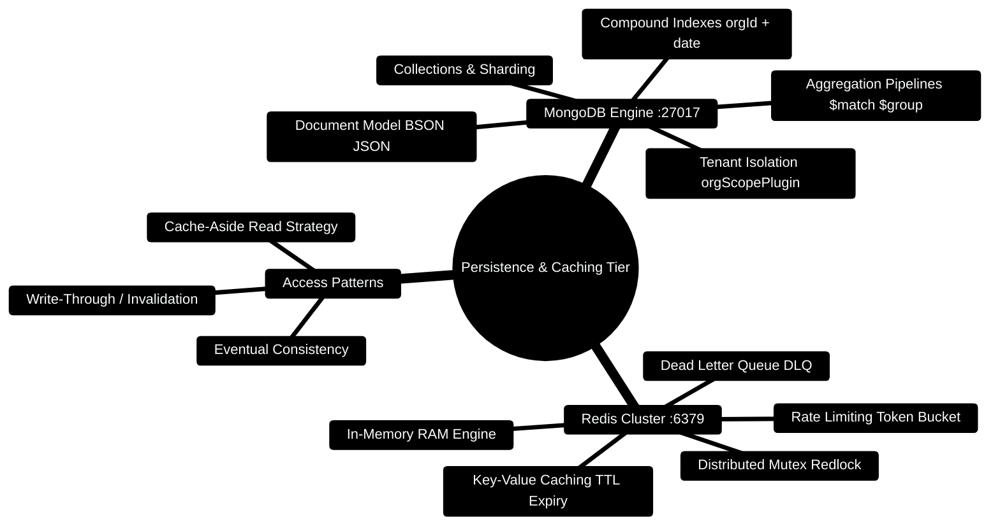

# 10 — MongoDB + Redis (Day 8) [Total: 3 hrs]

> Telugu: *MongoDB = e data ni "jabita" lo pettukodam* = MongoDB stores data
> like a LIST of JSON documents. *Redis = "vegam"* = Redis is SPEED.

---

> [!TIP]
> **Hands-On Project Architecture & Implementation:**  
> To see how these concepts are realized in production code, consult the [**Master Developer Handbook: Building on This Project**](../docs/BUILDING_ON_THIS_PROJECT.md).

## 0. Database & Caching Topology Mindmap



---

## 0.1 Cache-Aside Database Architecture Flow

```
┌─────────────────────────────────────────────────────────────────────────────┐
│                 CACHE-ASIDE PATTERN: REDIS & MONGODB TIER                   │
├─────────────────────────────────────────────────────────────────────────────┤
│                                                                             │
│  [API Gateway: Express :3000] ── 1. GET /transactions?org=org_1 ──────────┐  │
│               │                                                           │  │
│               ▼                                                           │  │
│  ┌─────────────────────────┐                                              │  │
│  │ Check Redis Cache :6379 │ ── 2. Cache Hit? ──► Return Cached JSON ────►│  │
│  └────────────┬────────────┘                                              │  │
│               │                                                           │  │
│               │ 3. Cache Miss (TTL Expired / First Read)                  │  │
│               ▼                                                           │  │
│  ┌─────────────────────────┐                                              │  │
│  │ Query MongoDB :27017    │                                              │  │
│  │ db.transactions.find({ │                                              │  │
│  │   orgId: "org_1"        │                                              │  │
│  │ }).sort({ date: -1 })   │                                              │  │
│  └────────────┬────────────┘                                              │  │
│               │                                                           │  │
│               ▼                                                           │  │
│  ┌─────────────────────────┐                                              │  │
│  │ Set Redis Key (TTL 60s) │ ── 4. Populate Cache & Return ──────────────►│  │
│  └─────────────────────────┘                                                 │
│                                                                              │
└─────────────────────────────────────────────────────────────────────────────┘
```

---

## 0.2 Production Mongoose Model & Redis Cache Blueprint

```typescript
// Production Code Snippet: Multi-tenant Mongoose model with Redis cache-aside
import mongoose, { Schema, Document } from 'mongoose';
import Redis from 'ioredis';

const redis = new Redis('redis://localhost:6379/0');

export interface ITransactionDoc extends Document {
  orgId: string;
  amount: number;
  category: string;
  date: Date;
}

const TransactionSchema = new Schema<ITransactionDoc>({
  orgId: { type: String, required: true, index: true },
  amount: { type: Number, required: true },
  category: { type: String, required: true },
  date: { type: Date, default: Date.now },
});

// Compound index for lightning-fast multi-tenant time-range queries
TransactionSchema.index({ orgId: 1, date: -1 });

export const TransactionModel = mongoose.model<ITransactionDoc>('Transaction', TransactionSchema);

export async function getCachedTransactions(orgId: string): Promise<ITransactionDoc[]> {
  const cacheKey = `cache:txns:${orgId}`;
  const cached = await redis.get(cacheKey);

  if (cached) {
    return JSON.parse(cached);
  }

  const fresh = await TransactionModel.find({ orgId }).sort({ date: -1 }).limit(100).lean();
  await redis.set(cacheKey, JSON.stringify(fresh), 'EX', 60); // 60s TTL
  return fresh as unknown as ITransactionDoc[];
}
```

---

# PART A: MongoDB

## 1. Why MongoDB? (SQL vs NoSQL) [10 min]

**The problem:** Express/Python servers are stateless — they forget everything
when they restart. You need a DATABASE (permanent storage).

**Two families of databases:**

```
SQL (PostgreSQL, MySQL)                NoSQL (MongoDB)
+--------+--------+                    +-----------------------+
| id|name|amount |                    | {"id":1,"name":"Ganesh",  |
+--------+--------+                    |  "amount":300,"tags":[...]}|
| 1 |a   |100    |                    | {"id":2,"name":"Ravi",    |
| 2 |b   |200    |                    |  "amount":500}            |
+--------+--------+                    +-----------------------+
fixed columns, strict                flexible, JSON-like documents
Excel spreadsheet  ->                folder of JSON files ->
```

**MongoDB** stores **documents** (like JSON objects) in **collections**
(like arrays). No fixed schema — each document can have different fields.
This matches JavaScript/Python objects perfectly.

**C++ analogy:** a collection is like `vector<unordered_map<string, any>>`,
and a document is one `unordered_map`.

## 2. Core vocabulary (learn these 4 words) [10 min]

```
Database  (budget_db)
  └── Collection  (transactions)     ~ a JS array
        └── Document                 ~ a JS object / JSON
              └── Field              ~ a key-value pair
```

## 3. Setup [15 min]

```bash
# Install MongoDB Community Server from mongodb.com (Windows installer)
# It runs as a background service on port 27017 automatically.

# Test it: open MongoDB Compass (GUI tool) or run:
mongosh            # MongoDB shell
```

Then in your Node project:

```bash
npm install mongodb
# or for Python:
pip install pymongo motor
```

## 4. CRUD with MongoDB driver [30 min]

```javascript
// db.js — a helper module to connect (Node version)
const { MongoClient } = require("mongodb");

// Connection string: mongodb://localhost:27017
// database name: budget_db (created automatically on first use!)
const client = new MongoClient("mongodb://localhost:27017");

async function connect() {
  await client.connect();
  console.log("Connected to MongoDB");
  return client.db("budget_db");   // get (or create) the database
}

module.exports = { connect };

// ============================================================
// CRUD operations (compare with Express file 08!)
// ============================================================
// In your route handlers:

// CREATE — insertOne
const result = await db.collection("transactions").insertOne({
  amount: 300, category: "food", date: new Date()
});
// result.insertedId -> the auto-generated _id (ObjectId)

// READ — find all (returns a cursor = lazy list)
const all = await db.collection("transactions").find().toArray();

// READ — with filter (like a WHERE clause)
const food = await db.collection("transactions")
  .find({ category: "food" }).toArray();

// READ — one by id (id is an ObjectId, not a string!)
const { ObjectId } = require("mongodb");
const one = await db.collection("transactions")
  .findOne({ _id: new ObjectId("67a1b2c3d4e5f6a7b8c9d0e1") });

// UPDATE — updateOne(filter, update)
await db.collection("transactions").updateOne(
  { _id: new ObjectId(id) },          // WHICH document
  { $set: { amount: 450 } }           // WHAT to change ($set = set fields)
);

// DELETE
await db.collection("transactions").deleteOne({ _id: new ObjectId(id) });
```

## 5. Wiring MongoDB into Express (real flow) [25 min]

```javascript
// server.js — Express + MongoDB (the REAL production pattern)
const express = require("express");
const { MongoClient, ObjectId } = require("mongodb");

const app = express();
app.use(express.json());

const client = new MongoClient("mongodb://localhost:27017");
let db;                                   // shared db handle

// connect ONCE at startup, then start the server
async function start() {
  await client.connect();
  db = client.db("budget_db");
  app.listen(3000, () => console.log("API + MongoDB running :3000"));
}
start().catch(console.error);             // fail fast if no MongoDB

// ---- CRUD routes ----
app.get("/api/transactions", async (req, res) => {
  const txns = await db.collection("transactions").find().toArray();
  res.json(txns);
});

app.post("/api/transactions", async (req, res) => {
  const { amount, category } = req.body;
  const result = await db.collection("transactions")
    .insertOne({ amount, category, createdAt: new Date() });
  const created = await db.collection("transactions")
    .findOne({ _id: result.insertedId });
  res.status(201).json(created);
});

app.delete("/api/transactions/:id", async (req, res) => {
  await db.collection("transactions")
    .deleteOne({ _id: new ObjectId(req.params.id) });
  res.json({ message: "deleted" });
});
```

**The 3-tier flow (mind map):**

```
REACT (5173)  -->  EXPRESS (3000)  -->  MONGODB (27017)
   UI                business logic       permanent storage
     │                   │                    │
     │  fetch GET        │  find()            │  returns documents
     │◄──────────────JSON◄────────────────────┘
```

## 6. Common MongoDB errors [10 min]

| Error | Meaning | Fix |
|---|---|---|
| `MongoNetworkError: connect ECONNREFUSED` | MongoDB isn't running | start the service (Services app) |
| `CastError: ObjectId failed for value "abc"` | invalid id format | validate id before querying |
| `cannot be flattened` | wrong query structure | check operator names (`$set`) |
| Data vanishes on restart | using in-memory array | use a real DB! |

---

# PART B: Redis

## 7. Why Redis? The caching problem [15 min]

**The problem:** Some data is read 1000x more than it's written (e.g., popular
news feed). Querying MongoDB every time is slow. 

**The solution:** store a COPY of the result in Redis (in-RAM, super fast).
Next request reads from RAM instead of the database.

```
WITHOUT Redis:  1000 requests ──► MongoDB (each takes ~10ms + load) = 10s total
WITH Redis:     1st request ──► MongoDB ──► save copy in Redis
                999 requests ──► Redis RAM (each ~0.1ms) = 0.1s total
```

**C++ analogy:** Redis is like a global `std::map` shared across all your
requests — but it survives server restarts and lives on a different port.

## 8. Setup + basic commands [15 min]

```bash
# 1. Download Redis for Windows (or use WSL / Docker — we'll use Docker in file 11)
docker run -d --name redis -p 6379:6379 redis:alpine

# 2. Node package:
npm install redis
```

```javascript
// redis.js — connect once, reuse everywhere
const { createClient } = require("redis");
const redis = createClient({ url: "redis://localhost:6379" });

// BASIC COMMANDS (key-value store, like a global map):
await redis.set("greeting", "namaste");     // SET key value
const val = await redis.get("greeting");    // GET key -> "namaste"
await redis.set("user:42", JSON.stringify({ name: "Ganesh" }));  // store objects as JSON strings
await redis.del("greeting");                // DELETE key
await redis.expire("user:42", 60);          // auto-delete after 60 seconds!
```

## 9. The caching pattern (memorize this!) [25 min]

```javascript
// The classic cache-aside pattern — 85% of Redis usage in the wild:

app.get("/api/transactions", async (req, res) => {
  const cacheKey = "transactions:all";        // unique key per query

  // STEP 1: try cache first (super fast)
  const cached = await redis.get(cacheKey);
  if (cached) {
    return res.json(JSON.parse(cached));      // HIT! return instantly
  }

  // STEP 2: cache miss -> go to the slow database
  const txns = await db.collection("transactions").find().toArray();

  // STEP 3: store a copy in Redis for next time (with 60s expiry)
  await redis.set(cacheKey, JSON.stringify(txns), { EX: 60 });

  return res.json(txns);
});

// When data CHANGES, invalidate the cache (or it serves stale data):
app.post("/api/transactions", async (req, res) => {
  // ...insert into MongoDB...
  await redis.del("transactions:all");        // clear the cache!
  res.status(201).json(created);
});
```

```
GET request arrives
   │
   ├─► redis.get(key)? ─── HIT ──► return instantly ✅
   │
   └─► MISS ──► query MongoDB ──► save to redis (EX 60) ──► return
```

## 10. Other Redis use cases (the 35%) [10 min]

```javascript
// 1. Rate limiting — stop abuse (per IP, max 10 req/min):
const count = await redis.incr("rate:" + ip);
if (count === 1) await redis.expire("rate:" + ip, 60);
if (count > 10) return res.status(429).json({ message: "Too many requests" });

// 2. Message queue — background jobs (your finance app used this!):
await redis.lPush("email-queue", JSON.stringify({ to: "user@x.com", subject: "Budget alert" }));
const job = await redis.rPop("email-queue");   // a worker takes it later

// 3. Session store — "who is logged in":
await redis.set("session:" + token, JSON.stringify({ userId: 42 }), { EX: 3600 });
```

## 11. Mini-Project: Budget API with caching [30 min]

Extend the Express API from section 5 with:
1. Cache `GET /api/transactions` for 60s.
2. Invalidate on POST/DELETE.
3. Rate-limit every request to 30/min per IP.

Test: open Postman, hit GET twice fast — the second response returns instantly
from Redis (watch your server logs — MongoDB query only on first!).

**Stretch challenges:**
1. Add caching to FastAPI too (`pip install redis`, same pattern).
2. Use `EX: 10` and watch the data go stale after 10 seconds (correct behavior).
3. Build a small queue: POST /jobs pushes to Redis, a worker script pops and "processes".

## 12. ❌ Mistakes to avoid

1. Forgetting `toArray()` on `find()` — you get a cursor, not the data.
2. Comparing `_id` with a plain string — must wrap in `new ObjectId(id)`.
3. Serving stale cache after writes — always invalidate on POST/PUT/DELETE.
4. Storing sensitive data in Redis keys that should expire — always set `EX`.
5. Using MongoDB for high-frequency counters — that's Redis's job.

## 13. Glossary

1. **Database** = permanent structured storage.
2. **Collection** = MongoDB's list of documents (≈ SQL table).
3. **Document** = one JSON-like record (≈ SQL row).
4. **ObjectId** = MongoDB's auto-generated 24-char id.
5. **Cursor** = lazy pointer to query results (call `.toArray()`).
6. **`$set`** = MongoDB operator to update specific fields.
7. **Redis** (Telugu: *vega nirvaaham* = fast management) = in-memory key-value store.
8. **Cache** = fast copy of slow data.
9. **Cache-aside** = the check-cache→query-DB→fill-cache pattern.
10. **TTL / EX** = time-to-live: how long a key survives.
11. **In-memory** = data lives in RAM (fast, but lost on restart).

---

## MCQ — MongoDB & Redis

**1. (L1)** In MongoDB, `db.collection("transactions").find()` returns:
- a) An array  b) A cursor (lazy)  c) One document  d) A promise of string

**2. (L1)** To get a document by its `_id`, you must wrap the id in:
- a) `ObjectId(id)`  b) `Number(id)`  c) `String(id)`  d) `new Date(id)`

**3. (L2)** You restart your server and ALL transactions are gone. Why?
- a) MongoDB is broken  b) You stored them in an in-memory JS array
- c) Redis expired them  d) CORS block

**4. (L2)** In cache-aside, when do you invalidate (delete) the cache key?
- a) On every GET  b) After POST/PUT/DELETE (data changed)
- c) Every hour  d) Never — it's self-cleaning

**5. (L3)** A user complains data is 10 minutes old even after they added a
new transaction. Your cache has `EX: 60`. Most likely bug?
- a) Cache too long  b) POST didn't call `redis.del(key)`
- c) MongoDB slow  d) Wrong key name

**6. (L4)** Write the cache-aside GET handler (check cache → DB → fill cache
with 30s expiry) in Express pseudocode.

---

## MCQ ANSWERS

1. **b** — a cursor; call `.toArray()` to get the array.
2. **a** — `_id` is an ObjectId type; string comparison fails.
3. **b** — in-memory arrays die with the server process.
4. **b** — invalidate whenever the underlying data changes.
5. **b** — the cache never got cleared, so it keeps serving the old snapshot.
6.
```javascript
const cached = await redis.get("transactions:all");
if (cached) return res.json(JSON.parse(cached));
const data = await db.collection("transactions").find().toArray();
await redis.set("transactions:all", JSON.stringify(data), { EX: 30 });
return res.json(data);
```
---

## 12. FinWise Production Architecture Blueprint

In the real codebase, MongoDB and Redis power multi-tenant isolation, compound B-tree indexing, and RAG knowledge chunking:

### Production Pattern 1: RAG Bounded-Window Knowledge Chunk Schema (`server/src/models/workspaceKnowledgeChunkModel.ts`)

```typescript
import { Schema, model, Types } from "mongoose";

const chunkSchema = new Schema({
  orgId: { type: Schema.Types.ObjectId, ref: "Organization", required: true, index: true },
  userId: { type: Schema.Types.ObjectId, ref: "User", required: true, index: true },
  workspaceFileId: { type: Schema.Types.ObjectId, ref: "WorkspaceFile", required: true, index: true },
  chunkIndex: { type: Number, required: true },
  pageNumber: { type: Number },
  text: { type: String, required: true },
  tokenCountEstimate: { type: Number, required: true }
}, { timestamps: true });

chunkSchema.index({ orgId: 1, userId: 1, workspaceFileId: 1, chunkIndex: 1 }, { unique: true });
chunkSchema.index({ orgId: 1, userId: 1, updatedAt: -1 });

export const WorkspaceKnowledgeChunkModel = model("WorkspaceKnowledgeChunk", chunkSchema);
```

### Production Pattern 2: Zero-Downtime Compound Index Startup Migration (`server/src/services/transactionIndexes.ts`)

```typescript
import TransactionModel from "../models/transactionModel";

export async function ensureTransactionExternalIdIndex(): Promise<void> {
  await TransactionModel.collection.createIndex(
    { orgId: 1, externalId: 1 },
    {
      name: "org_external_id_unique",
      unique: true,
      partialFilterExpression: { externalId: { $type: "string" } },
      background: true
    }
  );
}
```
