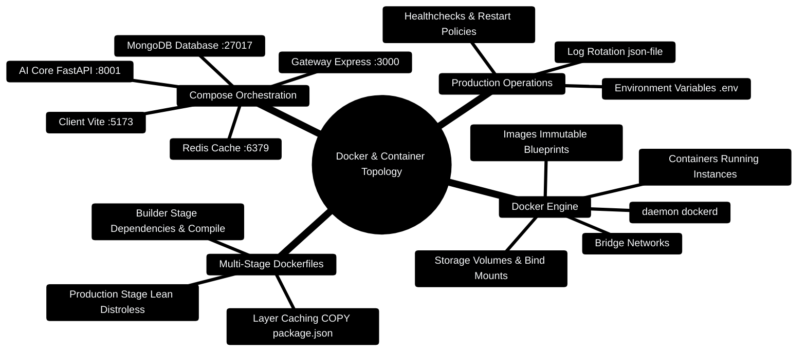

# 11 — Docker (Day 9) [Total: 2.5 hrs]

> Telugu: *Docker = nee app ni "potlam" lo kattadam* = Docker packs your app
> into a box (container) that runs THE SAME on any machine.
> "Works on my machine" problem — solved forever.

---

> [!TIP]
> **Hands-On Project Architecture & Implementation:**  
> To see how these concepts are realized in production code, consult the [**Master Developer Handbook: Building on This Project**](../docs/BUILDING_ON_THIS_PROJECT.md).

## 0. Containerization & Docker Compose Mindmap



---

## 0.1 Multi-Container Compose Network Architecture

```
┌─────────────────────────────────────────────────────────────────────────────┐
│                 PERSONAL FINANCE DOCKER COMPOSE TOPOLOGY                    │
├─────────────────────────────────────────────────────────────────────────────┤
│                                                                             │
│  [Host Machine Browser]                                                     │
│         │                                                                   │
│         ├─► http://localhost:5173 ────► [client container: Vite]            │
│         ├─► http://localhost:3000 ────► [server container: Express 5]      │
│         └─► http://localhost:8001 ────► [ai-core container: FastAPI]        │
│                                               │                             │
│  ┌────────────────────── internal bridge network ────────────────────────┐  │
│  │                                            │                          │  │
│  │   [server] ─── http://ai-core:8001 ────────┘                          │  │
│  │      │                                                                │  │
│  │      ├─► mongodb://mongo:27017/finance ──► [mongo container]          │  │
│  │      │                                                                │  │
│  │      └─► redis://redis:6379 ─────────────► [redis container]          │  │
│  │                                                                       │  │
│  └───────────────────────────────────────────────────────────────────────┘  │
└─────────────────────────────────────────────────────────────────────────────┘
```

---

## 0.2 Production Multi-Service Compose Blueprint

```yaml
# Production Code Snippet: Unified compose configuration
services:
  client:
    build:
      context: ./client
      dockerfile: Dockerfile
    ports:
      - "5173:5173"
    environment:
      - VITE_API_BASE=http://localhost:3000
    depends_on:
      - server

  server:
    build:
      context: ./server
      dockerfile: Dockerfile
    ports:
      - "3000:3000"
    environment:
      - PORT=3000
      - MONGO_URI=mongodb://mongo:27017/personal_finance
      - REDIS_URL=redis://redis:6379/0
      - PYTHON_API_URL=http://ai-core:8001
    depends_on:
      - mongo
      - redis
      - ai-core

  ai-core:
    build:
      context: ./server/AI_Core
      dockerfile: Dockerfile
    ports:
      - "8001:8001"
    environment:
      - PORT=8001
      - WORKERS=2

  mongo:
    image: mongo:7.0
    ports:
      - "27017:27017"
    volumes:
      - mongo_data:/data/db

  redis:
    image: redis:7-alpine
    ports:
      - "6379:6379"

volumes:
  mongo_data:
```

---

## 1. The problem [10 min]

Your app works on YOUR laptop but crashes on your friend's laptop:
different Node version, missing Python package, different MongoDB...

**The old fix:** a giant README: "step 1 install Node 20, step 2 install MongoDB,
step 3 ..." — and it still breaks.

**The Docker fix:** pack the app + its runtime + its libraries into one box
called an **IMAGE**. Any machine with Docker runs that box identically.

```
WITHOUT Docker:
  App needs Node 20 + Python 3.12 + MongoDB 7.2
  -> install all manually everywhere -> version hell

WITH Docker:
  One image contains EVERYTHING:  app + Node + Python + configs
  -> docker run image  -> identical behavior on ANY machine
```

**C++ analogy:** an image is like a compiled `.exe` — it carries everything it
needs inside itself. But better: it also carries the OS libraries, so it runs
on Windows/Mac/Linux identically.

## 2. Image vs Container (the two words) [10 min]

```
IMAGE (the blueprint / recipe)           CONTAINER (the running thing)
+----------------------------+           +----------------------------+
|  App code                   |           |  Running app               |
|  Runtime (Node 20)          |   docker run   |  Live processes          |
|  Libraries                  |  ───────────►  |  Network ports open       |
|  Config, dependencies       |           |  Has its own file system    |
|  READ-ONLY template         |           |  READ-WRITE, temporary      |
+----------------------------+           +----------------------------+
       like a .iso file                       like a running VM (lighter!)
```

**One image can spawn many containers** (like a class → many objects).

## 3. Core commands (the 10 you'll use daily) [20 min]

```bash
# Lifecycle commands:
docker pull node:20           # download a ready-made image from Docker Hub
docker run -d -p 3000:3000 myapp   # create + start a container
docker ps                     # list RUNNING containers
docker ps -a                  # list ALL containers (incl. stopped)
docker stop <id>              # stop a container
docker rm <id>                # delete a container (permanent)
docker images                 # list downloaded images
docker exec -it <id> bash     # open a shell INSIDE the container (debugging!)

# Build commands:
docker build -t myapp:1.0 .   # build an image from a Dockerfile ("." = this folder)
docker logs <id>              # see the app's output (like a terminal)

# Compose commands (see section 7):
docker compose up -d          # start the whole stack (app + DB + cache)
docker compose down           # stop and remove the stack
```

**Port mapping `-p 3000:3000` explained:**

```
HOST (your computer)             CONTAINER
      │ 3000                          │ 3000
      │◄───────── tunnel ◄────────────│
     Your browser hits :3000    ->    Your app inside listens on :3000
```

Left = host port, right = container port. You can do `-p 8080:3000` to
access the container's 3000 through your computer's 8080.

## 4. The Dockerfile — the recipe [30 min]

```dockerfile
# Dockerfile — build instructions for your Node app, line by line

# STEP 1: start from an existing base image (official Node 20 with Linux)
FROM node:20-alpine

# STEP 2: choose the working directory inside the container
WORKDIR /app

# STEP 3: copy ONLY package.json first (Docker caches layers —
#         dependencies don't re-install on every code change!)
COPY package*.json ./

# STEP 4: install dependencies
RUN npm install

# STEP 5: copy the rest of the code
COPY . .

# STEP 6: expose the port the app listens on (documentation + network)
EXPOSE 3000

# STEP 7: the command that runs when the container starts
CMD ["node", "server.js"]
```

**The layer system (why order matters):**

```
FROM node:20-alpine            layer 1  (base)
WORKDIR /app                   layer 2  (tiny)
COPY package*.json ./          layer 3  (small)   <- changes rarely
RUN npm install                layer 4  (BIG!)    <- cached if layer 3 unchanged
COPY . .                       layer 5  (changes every build!)
CMD ["node","server.js"]       layer 6  (tiny)
```

Docker reuses unchanged layers → after the first build, rebuilds take
seconds, not minutes. If you put `COPY . .` BEFORE `npm install`, every
code change re-downloads all dependencies (slow!). Order = performance.

## 5. .dockerignore + running it [10 min]

```dockerignore
# .dockerignore — things Docker should NOT copy into the image
node_modules
.git
*.log
```

```bash
docker build -t budget-api .     # build the image
docker run -d -p 3000:3000 budget-api   # run it in background (-d)
docker logs <id>                 # see "Server running on :3000"
```

## 6. Docker for databases (super useful!) [15 min]

No need to install MongoDB/Redis on your machine — run them in containers:

```bash
docker run -d --name mongodb -p 27017:27017 mongo:7
docker run -d --name redis -p 6379:6379 redis:alpine

# now your apps connect to localhost:27017 and localhost:6379
# stop them when not needed:  docker stop mongodb redis
```

**This is why your resume lists Docker** — one command gives you any database
version, cleanly, without polluting your machine.

## 7. Docker Compose — the whole stack in one file [30 min]

**The problem:** your app needs MongoDB + Redis + itself = 3 containers to
manage manually. Compose = one YAML file describing ALL of them.

```yaml
# docker-compose.yml — describe the entire app stack
version: "3.9"

services:
  api:                            # your backend (Express/FastAPI)
    build: .                      # build from this folder's Dockerfile
    ports:
      - "3000:3000"               # host:container
    environment:
      - MONGO_URL=mongodb://mongodb:27017/budget_db   # service name = hostname!
      - REDIS_URL=redis://redis:6379
    depends_on:                   # start these first
      - mongodb
      - redis

  mongodb:
    image: mongo:7
    volumes:
      - mongo-data:/data/db       # PERSIST data across restarts! (see below)

  redis:
    image: redis:alpine

volumes:
  mongo-data:                     # named volume = durable storage
```

```bash
docker compose up -d        # build + start everything (3 containers)
docker compose down         # stop everything
```

**Mind map of the running stack:**

```
              docker compose up -d
                      │
       ┌──────────────┼───────────────┐
       ▼              ▼               ▼
   [api:3000]    [mongodb:27017]   [redis:6379]
    your app         database          cache
       └──────────────┴───────────────┘
      They talk via service names (api -> mongodb) over Docker's network
```

**IMPORTANT:** containers are wiped on `docker compose down -v`... no wait,
only with `-v` flag. The `volumes: mongo-data` line keeps database files
in a named volume that SURVIVES container restarts. Never lose data again.

## 8. Common errors table [15 min]

| Error | Meaning | Fix |
|---|---|---|
| `Unable to find image` | wrong image name | check Docker Hub name |
| `port is already allocated` | port busy on host | change left side: `-p 3001:3000` |
| `EADDRINUSE` inside container | app tried to bind taken port | use `0.0.0.0` in app config |
| `Cannot connect to MongoDB` | container hostname wrong | use service name (`mongodb`), not `localhost` |
| Container exits immediately | app crashed on start | `docker logs <id>` to see the error |
| `permission denied` on Windows | Docker Desktop not running | start Docker Desktop app |

## 9. Mini-Project: Containerize your Budget API [40 min]

1. Take your Express Budget API (file 08) — add the Dockerfile from section 4.
2. Add `.dockerignore` with `node_modules`.
3. Create `docker-compose.yml` from section 7 (api + mongodb + redis).
4. Update `server.js` to read `process.env.MONGO_URL` (default to localhost).
5. Run `docker compose up -d` and test with Postman.
6. Run `docker compose down`, then `docker compose up -d` again — data still
   there (volumes work!).

**Stretch challenges:**
1. Add your React app as a fourth service (build it with `npm run build` and
   serve the static files).
2. Dockerize your FastAPI app (`FROM python:3.12-slim`, `pip install -r requirements.txt`).
3. Use `docker compose logs api` to watch live logs of just the API.

## 10. ❌ Mistakes to avoid

1. `COPY . .` before `RUN npm install` — kills Docker's caching superpower.
2. Forgetting volumes → database data vanishes with the container.
3. Using `localhost` inside the app to reach other containers — use service names.
4. Not having `.dockerignore` → `node_modules` (500MB) copied into the image.
5. Running `docker compose down -v` on production data — the `-v` deletes volumes!

## 11. Glossary

1. **Docker** = tool to package apps into portable containers.
2. **Image** = read-only blueprint/recipe for containers.
3. **Container** = a running instance of an image.
4. **Dockerfile** = text recipe file that builds an image.
5. **Docker Hub** = public registry of images (mongo, node, redis...).
6. **Port mapping** = connecting host port ↔ container port.
7. **Volume** = durable storage that survives container restarts.
8. **Docker Compose** (Telugu: *anni kalipi* = everything together) = YAML that runs multi-container stacks.
9. **Layer** = one cached build step in a Dockerfile.
10. **Daemon** = Docker's background engine that manages containers.

---

## MCQ — Docker

**1. (L1)** What's the difference between image and container?
- a) No difference  b) Image = blueprint, container = running instance
- c) Container = blueprint  d) Images are for Windows only

**2. (L1)** Which file defines how to build your image?
- a) package.json  b) docker-compose.yml  c) Dockerfile  d) .env

**3. (L2)** Your container's MongoDB client can't connect. The app inside
tries `localhost:27017`. Why does it fail?
- a) MongoDB is broken  b) `localhost` inside the container = the container itself, not the host
- c) Port blocked  d) Wrong image

**4. (L2)** `docker run -p 8080:3000 myapp` — how do you reach the app?
- a) `http://localhost:3000`  b) `http://localhost:8080`  c) both  d) `http://localhost:8080:3000`

**5. (L3)** After `docker compose down && docker compose up -d`, your MongoDB
data is GONE. What was missing from your compose file?
- a) ports  b) a named volume for mongodb  c) depends_on  d) image tag

**6. (L4)** Write a minimal Dockerfile for a Python FastAPI app (base:
`python:3.12-slim`, workdir `/app`, copy code, install `requirements.txt`,
run `uvicorn main:app --host 0.0.0.0 --port 8001`).

---

## MCQ ANSWERS

1. **b** — image = recipe/template (read-only); container = running copy.
2. **c** — the Dockerfile is the build recipe.
3. **b** — inside the container, `localhost` is the container itself;
   other containers are reached via their SERVICE NAME (`mongodb`).
4. **b** — left side (8080) is the host port you open in your browser.
5. **b** — without a named volume, container files are deleted with it.
6.
```dockerfile
FROM python:3.12-slim
WORKDIR /app
COPY requirements.txt .
RUN pip install -r requirements.txt
COPY . .
CMD ["uvicorn", "main:app", "--host", "0.0.0.0", "--port", "8001"]
```
---

## 12. FinWise Production Architecture Blueprint

In production, FinWise uses a multi-service Docker Compose layout targeting Node 24 and Python 3.11:

```yaml
# compose.yaml
version: "3.9"

services:
  mongo:
    image: mongo:7.0
    command: ["--replSet", "rs0", "--bind_ip_all"]
    volumes:
      - mongo-data:/data/db
    ports:
      - "27017:27017"

  redis:
    image: redis:7.0-alpine
    command: ["redis-server", "--appendonly", "yes"]
    ports:
      - "6379:6379"

  server:
    build: ./server
    ports:
      - "3000:3000"
    environment:
      NODE_ENV: production
      MONGO_URI: mongodb://mongo:27017/finwise?replicaSet=rs0
      REDIS_URL: redis://redis:6379

  ai-core:
    build: ./server/AI_Core
    ports:
      - "8001:8001"

volumes:
  mongo-data:
```
