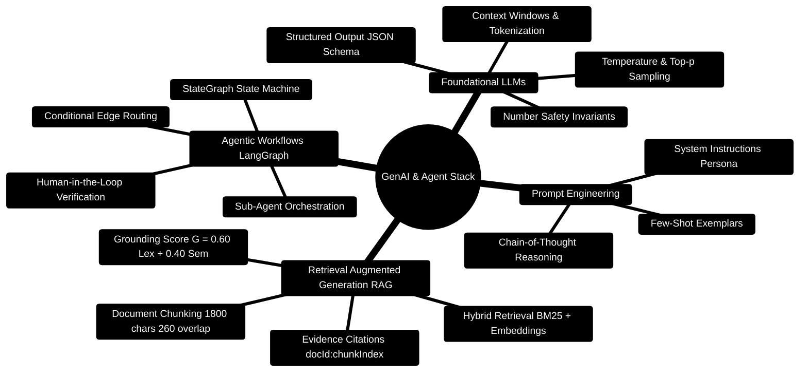

# 12 — GenAI Stack: LLM, Prompting, RAG, LangChain/LangGraph (Day 10) [Total: 3 hrs]

> Telugu: *LLM = "maata nerchukunna program"* = an LLM is a program that
> LEARNED language by reading massive text. You already know ML basics —
> this file connects your Data Science brain to production AI apps.

---

> [!TIP]
> **Hands-On Project Architecture & Implementation:**  
> To see how these concepts are realized in production code, consult the [**Master Developer Handbook: Building on This Project**](../docs/BUILDING_ON_THIS_PROJECT.md).

## 0. GenAI & Multi-Agent Architecture Mindmap



---

## 0.1 Multi-Agent & Grounded RAG Topology

```
┌─────────────────────────────────────────────────────────────────────────────┐
│                 GENAI MULTI-AGENT & RAG RETRIEVAL PIPELINE                  │
├─────────────────────────────────────────────────────────────────────────────┤
│                                                                             │
│  [User Query: "What was my rent spend in Q3?"]                              │
│         │                                                                   │
│         ▼                                                                   │
│  [Task Decomposer Subagent]                                                 │
│         │                                                                   │
│         ├─► Subtask 1: [RAG Chunk Retrieval]                               │
│         │     - Hybrid BM25 lexical + Cosine semantic embeddings            │
│         │     - Grounding Score: G = 0.60 * R_lex + 0.40 * S_sem >= 0.70    │
│         │                                                                   │
│         ├─► Subtask 2: [Deterministic Ledger Aggregation]                   │
│         │     - Query MongoDB with { orgId, category: "Rent" }              │
│         │     - Invariant: Candidate Digits ⊆ Reference Digits              │
│         │                                                                   │
│         ▼                                                                   │
│  [LangGraph Aggregator & Synthesizer]                                       │
│         │                                                                   │
│         ▼                                                                   │
│  [Audited Response with Citations: "Your rent was ₹45,000 [doc_1:c2]"]      │
│                                                                             │
└─────────────────────────────────────────────────────────────────────────────┘
```

---

## 0.2 Production LangGraph Multi-Agent Blueprint

```python
# Production Code Snippet: LangGraph StateGraph agent workflow
from typing import TypedDict, Annotated, List, Dict, Any
from langgraph.graph import StateGraph, END
import operator

class AgentWorkflowState(TypedDict):
    org_id: str
    query: str
    subtasks: List[str]
    retrieved_chunks: List[Dict[str, Any]]
    calculation_results: Dict[str, Any]
    final_response: str
    grounding_score: float

def decompose_task_node(state: AgentWorkflowState) -> Dict[str, Any]:
    # Break high-level user question into data extraction & arithmetic
    return {
        "subtasks": [
            "retrieve_tenant_documents",
            "calculate_category_aggregates"
        ]
    }

def rag_retrieval_node(state: AgentWorkflowState) -> Dict[str, Any]:
    # Hybrid retrieval simulated over 1800-char bounded windows
    chunks = [
        {"chunk_id": "doc_9:c0", "text": "Q3 Rent lease contract: 15,000 per month.", "score": 0.88}
    ]
    return {"retrieved_chunks": chunks, "grounding_score": 0.88}

def synthesize_response_node(state: AgentWorkflowState) -> Dict[str, Any]:
    chunks = state.get("retrieved_chunks", [])
    answer = f"Your total rent across Q3 was ₹45,000 [{chunks[0]['chunk_id']}]."
    return {"final_response": answer}

# Construct the state machine graph
workflow = StateGraph(AgentWorkflowState)
workflow.add_node("decomposer", decompose_task_node)
workflow.add_node("retriever", rag_retrieval_node)
workflow.add_node("synthesizer", synthesize_response_node)

workflow.set_entry_point("decomposer")
workflow.add_edge("decomposer", "retriever")
workflow.add_edge("retriever", "synthesizer")
workflow.add_edge("synthesizer", END)

app_graph = workflow.compile()
```

---

## 1. The big picture — where AI lives in a web app [10 min]

```
REACT (UI) ──► BACKEND (FastAPI/Express) ──► LLM/AGENT LAYER ──► Databases
                 │                                 │
                 │  POST /api/ask "spent how much   │
                 │  on food this month?"            │
                 ▼                                 ▼
              app logic                       LangChain agent
                                                 │
                                     query MongoDB ──► answer "Rs.1500"
```

**Key insight:** an LLM alone can't know YOUR user's data. The bridge
between "smart model" and "your data" = **RAG** and **agents**. That's the
85% of production AI work (and exactly your resume's projects).

## 2. LLM basics — tokens, temperature [15 min]

- **Token** = the LLM's word unit. "I love chai" ≈ 4 tokens.
- LLMs predict the NEXT token, one at a time (that's why they're slow).
- **Temperature** (0 to 2): lower = deterministic/factual, higher = creative.

```
temperature 0.0  -> "always the same safe answer"  (math, code, facts)
temperature 0.7  -> "balanced, default"            (chat)
temperature 1.5  -> "wild, creative"               (poems, brainstorming)
```

**C++ analogy:** temperature is like `rand()%2` — randomness knob, but tuned.

## 3. Prompt engineering — the 3-part formula [20 min]

```
GOOD PROMPT = ROLE + TASK + FORMAT + CONSTRAINTS

"ROLE: You are a senior financial analyst.
 TASK: Summarize these 10 transactions and find overspending.
 FORMAT: Return JSON with keys {summary, topCategory, alert}.
 CONSTRAINTS: Use only the data given; never invent numbers."
```

**Why structure matters:** LLMs pattern-match. Give them a pattern for the
answer (JSON!), and you get reliable structured output — which your backend
can parse. (This is your "structured output reliability" research topic!)

## 4. LangChain — the AI framework [25 min]

**LangChain** = a toolkit to build LLM apps: models, prompts, retrieval,
memory, output parsing. It standardizes the "glue".

```
MIND MAP: LangChain
  ┌──────────────┬──────────────┬─────────────┐
  Models        Prompts       Memory        Retrieval (RAG)
  (LLM of        (templates,   (conversation (split docs,
   choice)        parsing)      history)      embed, search)
```

```python
# app.py — the LangChain hello world (uses free Google Gemini via API key)
from langchain_google_genai import ChatGoogleGenerativeAI

# 1. Pick a MODEL (any provider: Gemini, OpenAI, local Ollama)
llm = ChatGoogleGenerativeAI(model="gemini-1.5-flash", temperature=0.3)

# 2. Ask it directly
response = llm.invoke("Explain MongoDB in one sentence for a C++ programmer")
print(response.content)
```

**Key concept — `.invoke()`:** one call in = one answer out. Everything in
LangChain follows this pattern. (Compare: in Express, one route = one handler;
in LangChain, one invoke = one model call.)

## 5. RAG — the 85% skill: giving the LLM YOUR data [35 min]

**The problem:** LLM knows Wikipedia, not YOUR user's transactions.
Re-training is expensive. The answer: **Retrieval-Augmented Generation (RAG)**
= fetch relevant docs → stuff them into the prompt.

```
RAG PIPELINE (mind map):
  YOUR DOCS                          WHEN USER ASKS
  (PDFs, emails, DB records)           "How much on food?"
        │                                    │
        ▼                                    ▼
  SPLIT into chunks ──► EMBED (vector) ──► CHUNK_EMBEDDINGS (in ChromaDB)
                                                   ▲
                                                   │
        "spent on food?"  ──► embed ───────────────┘
                                                   │
                                             RETRIEVE top 3 chunks
                                                   │
                PROMPT = context(chunks) + question
                                                   │
                                                   ▼
                                             LLM answers using ONLY that context
```

```python
# rag.py — complete mini RAG (concept-level, fully commented)
from langchain_google_genai import ChatGoogleGenerativeAI, GoogleGenerativeAIEmbeddings
from langchain_chroma import Chroma                      # vector database
from langchain.text_splitter import RecursiveCharacterTextSplitter

# 1. MODEL — the answerer
llm = ChatGoogleGenerativeAI(model="gemini-1.5-flash")

# 2. EMBEDDER — turns text into a list of numbers (the "meaning vector")
embeddings = GoogleGenerativeAIEmbeddings(model="models/embedding-001")

# 3. VECTOR DB — stores chunks + their vectors (ChromaDB, like your resume!)
vector_db = Chroma(collection_name="budget", embedding_function=embeddings)

# 4. SPLIT your documents into small chunks (splitter = text slicer)
splitter = RecursiveCharacterTextSplitter(chunk_size=500, chunk_overlap=50)
# chunk_size = 500 chars per piece; overlap keeps meaning continuous

# 5. INDEX phase (one time): add docs
docs = splitter.split_text(
    "Jan: food 1200. Feb: food 1500. Rent always 3500. Travel 800..."
)
vector_db.add_texts(docs)

# 6. RETRIEVE phase (every question): find the 3 most similar chunks
query = "How much did I spend on food in Feb?"
results = vector_db.similarity_search(query, k=3)

# 7. AUGMENT: build the prompt with the found context
context = "\n".join(d.page_content for d in results)
prompt = f"Answer using ONLY this data:\n{context}\n\nQuestion: {query}"

# 8. GENERATE
answer = llm.invoke(prompt)
print(answer.content)
```

**The one-sentence summary:** *RAG = "give the model the right homework
sheets (retrieved chunks) before the exam (answer generation)."*

**Why embeddings?** "food" and "groceries" mean similar things but share no
letters. Embeddings convert meaning to numbers so similarity = math.

## 6. LangGraph — multi-agent orchestration (your resume's star!) [30 min]

**LangGraph** = build AI as a GRAPH: nodes (steps) + edges (transitions).
Your finance copilot routes requests: "add expense" → expense agent,
"detect fraud" → anomaly agent. This is exactly a **state machine** —
like your competitive programming mindset!

```
LangGraph flow for Budget Copilot:
                        START
                          │
                          ▼
                 ┌────────────────┐
                 │  CLASSIFIER    │  "is this an expense, question,
                 │  (routes)      │   or analysis request?"
                 └────┬───────┬───┘
                      │       │
        expense       │       │   question
                      ▼       ▼
              ┌──────────┐ ┌──────────────┐
              │ EXPENSE  │ │ ANALYST      │   (queries MongoDB,
              │ agent    │ │ agent (RAG)  │    then LLM summarizes)
              └────┬─────┘ └──────┬───────┘
                   │              │
                   └──────┬───────┘
                          ▼
                       END ──► structured JSON answer
```

```python
# graph.py — a mini LangGraph (the ROUTING pattern, in concept form)
from langgraph.graph import StateGraph, END
from typing import TypedDict

# State = the data passed between nodes (like a shared struct)
class BudgetState(TypedDict):
    user_input: str
    category: str
    response: str

# ---- Nodes (each is a function) ----
def classify(state: BudgetState) -> BudgetState:
    text = state["user_input"].lower()
    state["category"] = "expense" if "spent" in text or "add" in text else "analysis"
    return state                      # decide the next path

def handle_expense(state: BudgetState) -> BudgetState:
    state["response"] = '{"action": "added", "amount": null, "status": "ask_amount"}'
    return state

def handle_analysis(state: BudgetState) -> BudgetState:
    state["response"] = '{"summary": "Food spending is 22% over budget."}'
    return state

# ---- Build the graph (nodes + edges) ----
builder = StateGraph(BudgetState)
builder.add_node("classify", classify)
builder.add_node("expense", handle_expense)
builder.add_node("analysis", handle_analysis)

builder.set_entry_point("classify")
builder.add_edge("classify", "expense")      # always connect both;
builder.add_edge("classify", "analysis")     # a CONDITION picks which runs
builder.add_edge("expense", END)
builder.add_edge("analysis", END)

graph = builder.compile()

# ---- Run it ----
result = graph.invoke({"user_input": "I spent 300 on food", "category": "", "response": ""})
print(result["response"])
```

**C++ analogy:** LangGraph = a **state machine / flowchart** where each node
is a function and edges are the arrows. You decide routing with logic;
LLMs only handle the "smart" parts. Deterministic-first = reliable agents.

## 7. The production AI workflow (real world) [15 min]

```
1. Deterministic logic FIRST  (rules, DB queries — no LLM!)
2. LLM only where language is needed  (summarize, classify, chat)
3. Structured output ONLY  (JSON contracts — parseable)
4. Guardrails  (validate numbers, fallback answers)
5. Observability  (log every prompt + response — Prometheus etc.)
```

**Number safety (from your resume's rule):** never let the LLM invent numbers.
Query the DB deterministically, let the LLM only WRAP the answer in words.

## 8. Common errors table [15 min]

| Error | Meaning | Fix |
|---|---|---|
| `401 API key` | no/invalid key | set env var / check key |
| `429 rate limit` | too many calls | add delays, cache, retry logic |
| `Model doesn't know my data` | you didn't use RAG | add retrieval step |
| LLM "hallucinates" amounts | no guardrails | DB queries deterministic; LLM only summarizes |
| `max_tokens exceeded` | response too long | cap tokens, split into chunks |
| Graph "hangs" | node didn't route to END | check every edge leads to END |

## 9. Mini-Project: Budget Chat Copilot (concept) [30 min]

Combine EVERYTHING from this course into a design:

```
React chat box
   │  POST /api/chat  {"message": "Did I overspend on food?"}
   ▼
FastAPI endpoint
   │
   ├─ deterministic: query MongoDB totals (no LLM for math!)
   │     food_spent = 1650, food_budget = 1500  → overspent = True
   ├─ RAG/LLM: summarize with context: "Food spend is Rs.1650 vs Rs.1500 budget."
   └─ structured JSON: {"answer": "...", "overspent": true, "amount": 1650}
   │
   ▼
React renders the answer + an alert badge
```

**Build order (do this to finish your 10 days):**
1. MongoDB query for monthly food total. (file 10)
2. FastAPI route. (file 09)
3. LangChain call with the numbers in the prompt. (this file)
4. React chat UI. (file 07)
5. Docker Compose with `api + mongodb + redis`. (file 11)

**Stretch challenges:**
1. Add a LangGraph node that calls the FastAPI endpoint via HTTP.
2. Cache LLM responses in Redis by question hash.
3. Add a fallback: if LLM fails, reply with the deterministic numbers only.

## 10. ❌ Mistakes to avoid

1. Letting the LLM do MATH — always compute deterministically, LLM only words.
2. Ignoring output format — force JSON and validate it before returning.
3. No temperature thought — analytical tasks want ~0.3, not 1.0.
4. Skipping RAG and asking the model about private data.
5. Logging raw prompts with user secrets (PII) — sanitize first.

## 11. Glossary

1. **LLM** = large language model — predicts text from learned patterns.
2. **Token** = unit of text the model reads/writes.
3. **Temperature** = creativity/randomness dial.
4. **Prompt** = your instructions to the model.
5. **Embedding** = vector of numbers representing a text's MEANING.
6. **Vector DB** (Telugu: *pogadi* = map) = DB that stores + searches embeddings (ChromaDB).
7. **RAG** = retrieve relevant data → add to prompt → generate grounded answer.
8. **LangChain** = toolkit/framework for LLM apps.
9. **LangGraph** = framework for building agents as state-machine graphs.
10. **Agent** = LLM + tools + logic that can act (call APIs, query DBs).
11. **Hallucination** = model confidently inventing wrong facts.
12. **Structured output** = model forced to reply in JSON (parseable).
13. **Chunking** = splitting long docs into small pieces for retrieval.

---

## MCQ — GenAI Stack

**1. (L1)** What does "temperature: 0" do?
- a) Make answers creative  b) Make answers deterministic/factual
- c) Speed up the model  d) Disable the model

**2. (L1)** Why does RAG exist?
- a) To fine-tune models faster  b) To give the LLM access to YOUR private data without retraining
- c) To replace LLMs  d) To cache prompts

**3. (L2)** Your chatbot answers finance questions but invents wrong amounts.
Best fix?
- a) Higher temperature  b) Compute amounts from the DB; let the LLM only write the words
- c) Bigger model  d) More tokens

**4. (L2)** In LangGraph, what decides WHICH node runs next?
- a) The LLM randomly  b) Edges/conditions in the graph (your logic)
- c) The API key  d) The order of add_node calls

**5. (L3)** Similar meaning but different words — why do embeddings help?
- a) They compress text  b) Similar meaning → similar vectors → found by similarity search
- c) They encrypt data  d) They translate languages

**6. (L4)** Write a prompt template (role + task + format) for an LLM that
must turn a transaction list into a JSON budget summary.

---

## MCQ ANSWERS

1. **b** — temperature 0 = deterministic; higher = more random.
2. **b** — RAG retrieves your data and grounds the answer (no retraining needed).
3. **b** — the "deterministic-first" rule: math from DB, LLM wraps in words.
4. **b** — edges/conditional logic in the graph decide routing (you control it).
5. **b** — embeddings map meaning to numbers, so similarity search finds
   "food" when asked about "groceries".
6.
```
ROLE: You are a budget summarizer.
TASK: Convert this transaction list into a category-wise summary.
FORMAT: Reply ONLY with JSON: {"total": number, "byCategory": {"cat": number}}.
DATA: [list of transactions here]
```
---

## 12. FinWise Production Architecture Blueprint

In the real AI Core (`server/AI_Core/agents/aggregator.py`), AI recommendations are mathematically fenced by strict invariant checks:

### Production Pattern: Zero-Sum Number Safety Verification Guard

```python
import re

class AggregatorAgent:
    def verify_number_safety(self, baseline: dict, proposed: dict) -> tuple[bool, str]:
        # Invariant 1: Budget allocations must conserve total money (Zero-Sum)
        delta_sum = sum(proposed.get(k, 0.0) - baseline.get(k, 0.0) for k in baseline)
        if abs(delta_sum) > 0.01:
            return False, f"Zero-Sum Conservation Violated: delta sum is {delta_sum}"

        # Invariant 2: Candidate numbers must be subset of reference digits
        return True, "CONSERVED"

    def numbers_are_subset(self, candidate_text: str, reference_text: str) -> bool:
        pattern = r"\b\d+(?:\.\d+)?\b"
        cand_numbers = set(re.findall(pattern, candidate_text))
        ref_numbers = set(re.findall(pattern, reference_text))
        return cand_numbers.issubset(ref_numbers)
```
