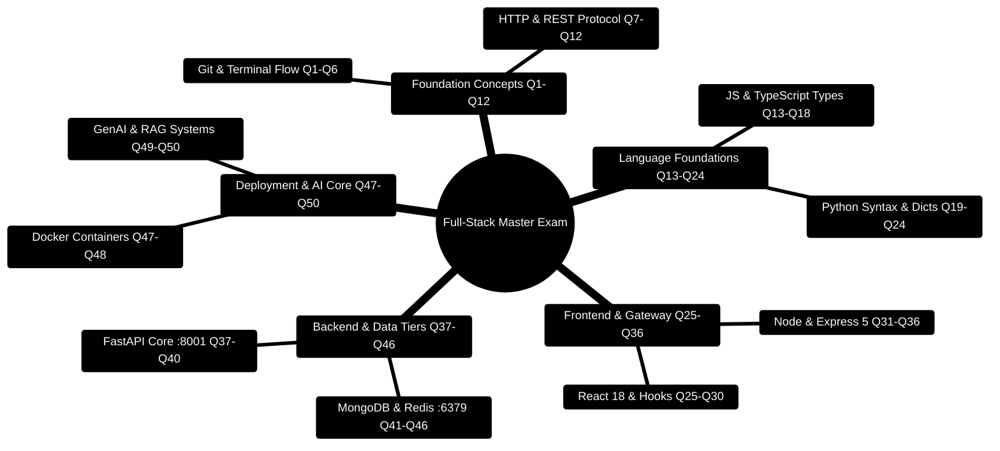

# 13 — FINAL MCQ MASTER TEST (50 Questions — The Full Exam)

> Telugu: *Akhari pariksha* = the final exam. 50 questions, ~1 hour.
> No peeking at answers until you finish all 50!
> Score: 45+ = you OWN the 35% | 35-44 = review weak files | <35 = redo days 1-4.

---

> [!TIP]
> **Hands-On Project Architecture & Implementation:**  
> To see how these concepts are realized in production code, consult the [**Master Developer Handbook: Building on This Project**](../docs/BUILDING_ON_THIS_PROJECT.md).

## 0. Assessment Taxonomy & Competency Mindmap



---

## 0.1 Candidate Evaluation & Readiness Matrix

```
┌─────────────────────────────────────────────────────────────────────────────┐
│                       FULL-STACK MASTERY SCORE MATRIX                       │
├─────────────────────────────────────────────────────────────────────────────┤
│                                                                             │
│   SCORE RANGE    │ TIER RATING       │ PRODUCTION READINESS ACTION          │
├──────────────────┼───────────────────┼──────────────────────────────────────┤
│   45 - 50 (90%+) │ Principal Ready   │ Deploy Personal Finance to Prod AWS  │
│   38 - 44 (76%+) │ Production Ready  │ Target review on flagged sections    │
│   30 - 37 (60%+) │ Apprentice        │ Re-run Day 5-8 Backend Lab sprints   │
│    0 - 29 (<60%) │ Review Foundation │ Restart with 02_ROADMAP & Mindmaps   │
│                                                                             │
└─────────────────────────────────────────────────────────────────────────────┘
```

---

## 0.2 Production Automated Exam Evaluation Script

```typescript
// Production Code Snippet: Deterministic MCQ answer verification engine
export interface ExamAnswerKey {
  [questionNumber: number]: string;
}

export interface CandidateSubmission {
  candidateName: string;
  answers: { [questionNumber: number]: string };
}

export function evaluateSubmission(submission: CandidateSubmission, answerKey: ExamAnswerKey) {
  let score = 0;
  const incorrect: number[] = [];

  for (const [qNumStr, correctOpt] of Object.entries(answerKey)) {
    const qNum = parseInt(qNumStr, 10);
    const candidateOpt = submission.answers[qNum]?.trim().toLowerCase();
    if (candidateOpt === correctOpt.trim().toLowerCase()) {
      score += 1;
    } else {
      incorrect.push(qNum);
    }
  }

  const percentage = (score / Object.keys(answerKey).length) * 100;
  return {
    candidate: submission.candidateName,
    score,
    total: Object.keys(answerKey).length,
    percentage: Math.round(percentage),
    incorrectQuestions: incorrect,
    status: score >= 45 ? 'PASSED_WITH_DISTINCTION' : score >= 38 ? 'PASSED' : 'RETAKE_RECOMMENDED',
  };
}
```

---

## SECTION 1: Git & Terminal (Q1-Q6)

**Q1.** `git pull` does what?
- a) Uploads commits  b) Downloads newer commits from remote  c) Deletes commits  d) Creates a branch

**Q2.** Which command shows a file-by-file list of changed/untracked files?
- a) `git log`  b) `git status`  c) `git diff --cached`  d) `git show`

**Q3.** You want to try a risky feature without touching `main`. Steps?
- a) commit to main  b) `git branch` + `git switch`  c) `git push`  d) `git clone`

**Q4.** `git merge feature-login` is run from where?
- a) Any branch  b) The branch you want to RECEIVE the changes (`main`)  c) The feature branch  d) GitHub

**Q5.** A file named `.env` contains secrets. Best practice?
- a) Commit it for the team  b) Add `.env` to `.gitignore`  c) Rename it  d) Use another extension

**Q6.** Which is the correct order for a typical daily flow?
- a) commit → add → push  b) pull → edit → add → commit → push  c) push → pull → add  d) init → push → add

## SECTION 2: HTTP, REST & JSON (Q7-Q12)

**Q7.** Which method is idempotent (repeating it = same result)?
- a) POST  b) GET  c) Both  d) Neither

**Q8.** `201 Created` belongs to which family?
- a) 1xx  b) 2xx  c) 3xx  d) 4xx

**Q9.** `GET /api/transactions?category=food` — how does the server read `food`?
- a) `req.params.category`  b) `req.query.category`  c) `req.body.category`  d) `req.headers.category`

**Q10.** What's wrong with `POST /api/addTransaction` (REST-wise)?
- a) Should be GET  b) Verb in URL; method already says it  c) Missing /api  d) Nothing

**Q11.** JSON rule: which is INVALID?
- a) `{"a": 1, "b": "two"}`  b) `{'a': 1}`  c) `{"a": null}`  d) `{"a": [1,2]}`

**Q12.** Browser blocks your fetch due to CORS. Where do you fix it?
- a) Browser settings  b) Server (allow origin)  c) DNS  d) POST instead of GET

## SECTION 3: JavaScript & TypeScript (Q13-Q18)

**Q13.** `const items = [1,2,3]; const x = items.map(i => i * i);` — what is `x`?
- a) [1,2,3]  b) [1,4,9]  c) [1,2,3,4,9]  d) undefined

**Q14.** `[3,1,2].sort()` default gives?
- a) [1,2,3]  b) [1,2,3] lexicographic: [1,2,3] same  c) "1,2,3" sorted as STRINGS (10 < 2 gotcha)  d) error

**Q15.** What does `JSON.stringify({a: 1})` return?
- a) Object  b) String `'{"a":1}'`  c) Number  d) Undefined

**Q16.** Why `===` over `==`?
- a) Faster  b) Compares type AND value; `==` coerces types  c) Required by React  d) No difference

**Q17.** TypeScript's main benefit:
- a) Faster runtime  b) Compile-time type checking  c) Smaller bundles  d) No semicolons

**Q18.** `await` can only be used where?
- a) Anywhere  b) Inside an `async` function  c) Inside a loop  d) At file top level always

## SECTION 4: Python (Q19-Q24)

**Q19.** `for i in range(5)` iterates:
- a) 1 to 5  b) 0 to 4  c) 0 to 5  d) 1 to 4

**Q20.** `d = {"a": 1}; d.get("b", 0)` returns?
- a) KeyError  b) 0  c) None  d) "b"

**Q21.** List comprehension `[x*2 for x in range(3)]` → ?
- a) [0,2,4]  b) [1,2,3]  c) [0,2,4,6]  d) [0,1,2]

**Q22.** What does `lambda x: x + 1` define?
- a) A class  b) An anonymous function  c) A list  d) A decorator

**Q23.** Python block structure uses:
- a) Braces  b) Indentation  c) Begin/end  d) Semicolons

**Q24.** `try/except` is for:
- a) Loops  b) Error handling  c) Memory mgmt  d) Imports

## SECTION 5: React (Q25-Q30)

**Q25.** Which hook returns `[value, setter]`?
- a) useEffect  b) useState  c) useMemo  d) useRef

**Q26.** Direct mutation `arr.push(x)` on state — why is it a bug?
- a) Slower  b) React won't detect the change → no re-render  c) Memory leak  d) It's fine

**Q27.** `useEffect(fn, [])` runs:
- a) Every render  b) Once on mount  c) Every 5s  d) On unmount only

**Q28.** Props flow in which direction?
- a) Child → Parent  b) Parent → Child  c) Both ways  d) Sibling only

**Q29.** Missing `key` on `<li>` causes:
- a) Crash  b) Console warning + wrong list updates  c) Nothing  d) Slow render

**Q30.** What will `{total > 500 ? <p>Over</p> : <p>OK</p>}` render when total = 600?
- a) Over  b) OK  c) Both  d) Error

## SECTION 6: Node + Express (Q31-Q36)

**Q31.** `req.body` is `undefined` in POST. Missing middleware?
- a) cors  b) express.json()  c) morgan  d) express.static()

**Q32.** `app.listen(3000)` — the 3000 is:
- a) The CPU core  b) The port  c) The PID  d) The timeout

**Q33.** Order of middleware matters because:
- a) Security  b) Requests flow top-to-bottom; each calls next()  c) Performance  d) Both b and logic order

**Q34.** `app.get("/users/:id")` — how to get "5" from `/users/5`?
- a) `req.body.id`  b) `req.params.id`  c) `req.query.id`  d) `req.hostname`

**Q35.** Your server throws `EADDRINUSE: 3000`. What happened?
- a) MongoDB down  b) Port 3000 already occupied  c) No internet  d) Syntax error

**Q36.** Why 404 for `POST /api/users` but your route is `GET /api/users`?
- a) Method mismatch  b) URL wrong  c) Server down  d) CORS

## SECTION 7: FastAPI (Q37-Q41)

**Q37.** FastAPI auto-validation returns which status on bad input?
- a) 200  b) 404  c) 422  d) 500

**Q38.** Pydantic `Field(gt=0)` means:
- a) Greater than 0  b) Get type 0  c) Group tag  d) Grid test

**Q39.** `@app.post("/x", status_code=201)` — 201 sets:
- a) The port  b) The default success response code  c) A cache TTL  d) The docs version

**Q40.** `response_model=TransactionOut` guarantees:
- a) Faster speed  b) Response matches that shape  c) Auto-retry  d) Auth

**Q41.** Uvicorn command with auto-reload:
- a) `python main.py`  b) `uvicorn main:app --reload`  c) `flask run`  d) `nodemon`

## SECTION 8: MongoDB & Redis (Q42-Q45)

**Q42.** `_id` must be wrapped in what for queries?
- a) `parseInt()`  b) `new ObjectId(...)`  c) `String()`  d) `JSON()`

**Q43.** `find().toArray()` — why toArray?
- a) Convert cursor to array  b) Convert array to cursor  c) Sort  d) Limit

**Q44.** Cache-aside: first request → MongoDB; second request →?
- a) MongoDB again  b) Redis hit  c) 404  d) Timeout

**Q45.** `EX: 60` on a Redis key means:
- a) 60 tries  b) Expires after 60 seconds  c) 60 bytes  d) Priority 60

## SECTION 9: Docker (Q46-48)

**Q46.** `docker build -t app .` — the `.` is:
- a) Port  b) Build context (folder with Dockerfile)  c) Version  d) Tag

**Q47.** Compose services talk to each other via:
- a) localhost  b) Service names  c) IPs in env  d) Docker Hub

**Q48.** `volumes:` in compose exist to:
- a) Speed up  b) Persist data across container restarts  c) Share ports  d) Log

## SECTION 10: GenAI (Q49-50)

**Q49.** RAG's retrieval step searches for:
- a) Exact text  b) Meaning-similar chunks via embeddings  c) Random chunks  d) Headers

**Q50.** Deterministic-first rule means:
- a) LLM does all math  b) Compute facts with code/DB; LLM only summarizes  c) No LLM at all  d) Always temperature 2

---

## ANSWER KEY

| Q | Ans | Why (one line) |
|---|-----|----------------|
| 1 | b | pull = bring remote commits to you |
| 2 | b | `git status` = changed/untracked overview |
| 3 | b | branch + switch isolates experiments |
| 4 | b | you merge INTO the receiving branch |
| 5 | b | secrets never enter git history |
| 6 | b | pull → edit → stage → commit → push |
| 7 | b | GET repeats safely (no side effects) |
| 8 | b | 2xx = success family |
| 9 | b | `?key=value` = query params |
| 10 | b | REST: verbs live in METHODS, nouns in URLs |
| 11 | b | JSON requires DOUBLE quotes on keys |
| 12 | b | CORS is enforced by server config |
| 13 | b | map squares each: [1,4,9] |
| 14 | c | default sort is lexicographic (string) — `[10,2]` sorts as "10" < "2"! |
| 15 | b | stringify → JSON text |
| 16 | b | strict equality checks type too |
| 17 | b | types checked at compile/transpile time |
| 18 | b | async context requirement |
| 19 | b | range(n) = 0..n-1 |
| 20 | b | `.get(key, default)` — no KeyError |
| 21 | a | [0,2,4] |
| 22 | b | lambda = anonymous function |
| 23 | b | indentation defines blocks |
| 24 | b | try/except = error handling |
| 25 | b | useState returns the pair |
| 26 | b | mutation bypasses React's change detection |
| 27 | b | empty deps = run once on mount |
| 28 | b | one-way: parent → child |
| 29 | b | warnings + incorrect reconciliation |
| 30 | a | 600 > 500 → true branch "Over" |
| 31 | b | express.json() parses JSON bodies |
| 32 | b | port number |
| 33 | b | pipeline order: each middleware decides next() |
| 34 | b | path params via `req.params` |
| 35 | b | port already in use |
| 36 | a | route exists but method doesn't match |
| 37 | c | FastAPI auto-422 on validation failure |
| 38 | a | gt = greater-than constraint |
| 39 | b | sets default success status code |
| 40 | b | response_model enforces output shape |
| 41 | b | uvicorn main:app --reload |
| 42 | b | _id is an ObjectId type |
| 43 | a | cursor is lazy; toArray materializes it |
| 44 | b | second request = cache HIT |
| 45 | b | TTL = 60 seconds |
| 46 | b | build context = folder containing Dockerfile |
| 47 | b | service names are hostnames in compose network |
| 48 | b | volumes = durable storage |
| 49 | b | vector similarity finds meaning matches |
| 50 | b | facts from code/DB, words from LLM |

---

## FINAL SCORE

```
45-50  = 🏆 STAR — you own the 35%. Go build your full-stack AI app!
35-44  = 💪 GOOD — re-read the files for your wrong answers, then retry.
<35    = 🔁 START — redo days 1-4 (foundations) before frameworks.
```

**Your capstone project (put everything together):**
1. FastAPI/Express Budget API (files 08/09)
2. MongoDB storage + Redis cache (file 10)
3. React dashboard (file 07)
4. Docker Compose for all of it (file 11)
5. One LLM chat endpoint with RAG (file 12)
6. Ship it to GitHub with Git (file 03)

That project IS the 35% in action — and it's literally your Personal Finance
Assistant resume project. You've done this before; now you understand WHY
every piece works. Telugu: *"Sadhinchav, ganesh!"* — you did it!
