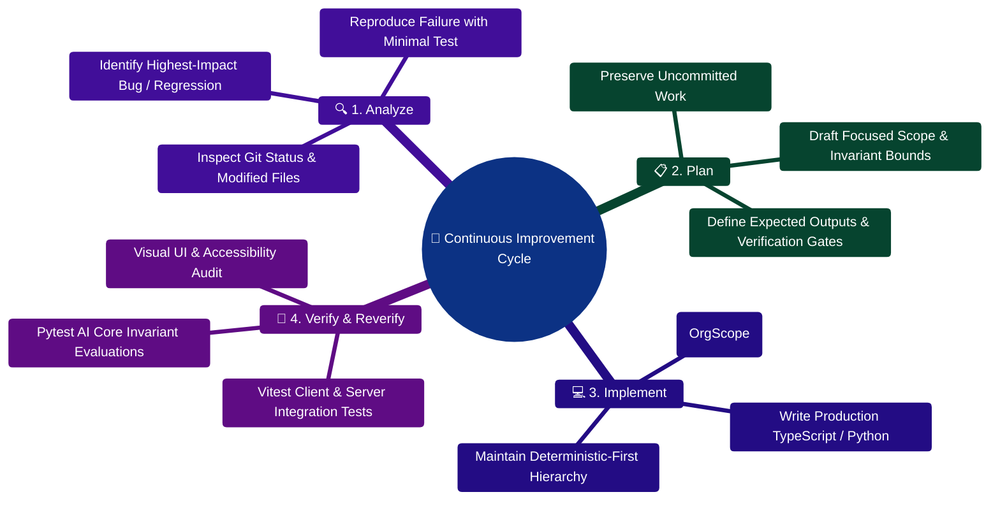

# FinWise project review for repeated improvement work

Reviewed: 29 October 2026. Workspace: `C:/Users/RAVIPRAKASH/personal-finance`.

This review maps the local implementation, critical paths, test configuration, deployment files, and existing improvement records to a reusable prompt. It does not claim every source line was audited. No application tests, builds, provider requests, or live browser checks were run during this review. Existing QA reports describe earlier runs and must be revalidated when relevant.

> [!TIP]
> **Developer Extension Guide:**  
> For full-stack feature recipes and blueprints, consult the [**Master Developer Handbook: Building on This Project**](../../docs/BUILDING_ON_THIS_PROJECT.md).

## Current project structure

| Area | Implementation inspected | Consequence for future improvement runs |
| --- | --- | --- |
| Browser application | React 18, TypeScript, Vite, Wouter routes, TanStack Query, Zustand, Tailwind/Radix, PWA configuration | Exercise actual navigation, forms, cache invalidation, session changes, responsive layouts, and offline behavior. |
| API | Express 5/TypeScript, Mongoose, cookie authentication, CSRF, API keys, organization context, feature flags | Verify request validation, permission boundaries, response contracts, and environment-dependent behavior. |
| AI Core | FastAPI, LangGraph, specialist routing, subtask execution, deterministic calculators, provider adapters, scoped session memory | Preserve numerical correctness and targeted execution; measure fallback behavior, latency, retries, and evidence handling. |
| Files and grounding | GridFS-backed files, bounded extraction, page-aware chunks, lexical retrieval, saved citations, chat-generated PDFs | Test upload → question → quotation → exact physical page → return to saved chat, including failure and deletion paths. |
| Jobs | Inline workflow execution or a dedicated MongoDB-backed worker, controlled by ASYNC_JOBS_ENABLED | Verify both execution modes, recovery, idempotency, scheduler ownership, and shutdown. Redis/BullMQ code also exists; trace its actual use before changing queue architecture. |
| Contracts and delivery | Shared TypeScript/OpenAPI files, three Dockerfiles, Compose, GitHub Actions | Keep routes and contracts aligned; validate containers and external dependencies separately from local builds. |
| Additional workspace | prime-agent has its own packages, runtime, README, and AGENTS.md | No FinWise source reference to prime-agent was found in the scoped search. Treat it as a separate workspace unless a relevant dependency is demonstrated. Its command restrictions differ from FinWise's. |

The server manifest requires Node >=24.14.1 and <25, and npm >=11. CI targets Node 24 and Python 3.11. Run commands from the relevant tier; the repository has no root package.json.

## Confirmed documentation mismatches

1. **API prefix:** README and several guides describe canonical /api/v1 endpoints. The actual route registry mounts /api/*, and the client URL builder normalizes requests to /api/*. Names such as v1Routes.ts and contracts/openapi/v1 do not establish a live /api/v1 mount.
2. **Retrieval algorithm:** README describes BM25 plus semantic scoring. retrievalService.ts implements bounded candidates ranked by phrase matches, term occurrences, and a numeric-match bonus. Capability status correctly leaves embeddings and semantic retrieval as future work.
3. **Queue architecture:** Some overview text describes BullMQ as the background execution owner. The dedicated worker claims workflow, integration, and export jobs from MongoDB. A BullMQ module exists, but its existence alone does not establish that it handles these active paths.
4. **Organization scoping:** CLAUDE.md describes all models as scoped via orgScopePlugin; broader overview text implies automatic filter injection. The plugin checks selected reads and aggregates on schemas where it is installed. It does not inject the requesting organization into every operation. Callers, ownership checks, and negative tests remain essential.
5. **Test commands:** docs/TESTING.md calls server npm test a single run, but the manifest runs vitest without the run flag. Use npm run test:ci for a bounded server run.
6. **Evaluation command:** README suggests python -m evals.runner. That module defines a harness without a CLI invocation at its end. The CI command pytest evals/ -v --tb=short -m "not latency" actually executes the evaluation test files.

These are source/documentation findings, not newly reproduced user-facing failures. Several old issue registers contain items already repaired elsewhere; reproduce before treating a historical issue as open.

## Existing verification assets

The current file inventory contains 22 client test files, 46 server test files, and 32 Python test/evaluation files. These are file counts, not executed or passing test counts. Existing reports list earlier successful suites and browser sessions; they should be used as context, not copied into a new run's results.

| Working directory | Available checks |
| --- | --- |
| client | npm test; npm run lint; npm run build |
| server | npm run check; npm run test:ci; npm run build |
| server/AI_Core, with its environment activated | python -m pytest tests/ -v --tb=short; python -m pytest evals/ -v --tb=short -m "not latency"; python -m ruff check . |

Choose focused regression tests first, then applicable broader checks before declaring a batch complete. Mark checks that could not run separately from failures. Latency evaluations can be selected when relevant and reported with their environment.

The server test helper starts MongoMemoryServer directly. A configured MONGO_URI or a CI MongoDB service does not, by itself, redirect tests that call that helper to the external database. Diagnose binary/cache/runtime failures without switching tests onto personal financial records.

The existing CI pipeline covers tier tests, builds, client lint, server type checking, and Python lint/evaluations. The inspected workflow does not run browser journey automation. Unit/integration coverage therefore does not establish visual correctness.

## Suggested order for future runs

This is a verification queue, not a list of confirmed application bugs.

1. Read git status, applicable instructions, capability status, and the latest progress entries. The initial snapshot contained 261 tracked changes and 160 untracked entries; preserve existing work and inspect the diff before editing.
2. Establish a fresh baseline for the affected area. Reproduce one high-impact problem and state its expected behavior, affected layers, and acceptance checks.
3. Prioritize records and access: transaction precision and duplicate imports, currency/date boundaries, budgets and debt percentages, CSRF/session handling, and organization/user isolation across reads, mutations, files, chat, and exports.
4. Exercise the main product loop with synthetic data: sign in → create/edit a transaction → verify dashboard/budget updates → upload or create a PDF → ask a focused question → open its cited page → reload and return to the saved conversation.
5. Check degraded modes: missing extraction, unavailable AI service/provider, exhausted retry budget, broken stream/reconnect, stale caches, delayed jobs, and worker recovery. Preserve the one-step deterministic paths for focused document and activity questions.
6. Review relevant UI at desktop and phone widths, in both themes, with keyboard navigation. Inspect loading, empty, error, and retry states plus browser errors and failed requests.
7. Validate runtime/container behavior and real integrations when the required environment is available. Current records leave final-domain OAuth, SMTP, Stripe/webhooks, real bank integrations, OCR quality, provider access, and separate-worker/container execution with unresolved staging checks.
8. Update the existing progress/capability documents with fresh evidence and one next priority. Keep completed, reproduced, suspected, and environment-blocked items distinguishable.

Compose currently defines web, server, and AI Core services plus persistent AI memory. It does not provision MongoDB, Redis, or a dedicated worker; those dependencies/processes need an explicit deployment arrangement when selected features require them. The configured provider/model is a requested setting, not evidence of current account access.

For repeatability, complete one small reviewable batch per invocation. Continue useful independent work around unavailable infrastructure, but checkpoint the remaining dependency rather than expanding scope indefinitely.

## Sources used

- README.md and CLAUDE.md
- client/package.json, client/vite.config.ts, client/src/routes/routeDefinitions.tsx
- client/src/lib/api/core.ts, client/src/lib/apiBase.ts, client/src/hooks/useRealtimeEvents.ts
- server/package.json, server/src/app.ts, server/src/routes/routeRegistry.ts, server/src/routes/v1Routes.ts
- server/src/server.ts, server/src/worker/worker.ts, server/src/services/workflows.ts
- server/src/utils/orgScopePlugin.ts, server/src/middleware/orgContext.ts
- server/src/models/transactionModel.ts, server/src/services/transactionIndexes.ts
- server/src/services/retrievalService.ts, server/src/connectors/registry.ts
- server/AI_Core/api_service.py, graph/workflow.py, agents/sub_agent_manager.py, utils/llm_wrapper.py
- server/AI_Core/pyproject.toml, evals/runner.py, and test/evaluation inventories
- server/vitest.config.ts, server/src/test/setup.ts, server/src/test/testDb.ts
- .github/workflows/test.yml and compose.yaml
- docs/PRODUCT_CAPABILITY_STATUS.md, docs/IMPROVEMENT_PROGRESS.md, docs/KNOWN_ISSUES_AND_DRIFT.md
- docs/RUN_MODE_MATRIX.md, docs/TESTING.md, docs/DEPLOYMENT_READINESS.md
- docs/AI_RAG_SUBAGENT_PDF_IMPROVEMENT_PLAN.md and COMPREHENSIVE_IMPROVEMENT_PLAN.md
- prime-agent/README.md, prime-agent/package.json, prime-agent/AGENTS.md


---

## Continuous Improvement Cycle Mindmap



---

## Continuous Improvement Execution ASCII Flow

```text
┌────────────────────────────────────────────────────────────────────────┐
│ 🔍 STEP 1: ANALYZE & ISOLATE HIGHEST-IMPACT ISSUE                      │
│    Inspect git diff, reproducer failures, and test suite logs          │
└───────────────────────────────────┬────────────────────────────────────┘
                                    │
                                    ▼
┌────────────────────────────────────────────────────────────────────────┐
│ 📋 STEP 2: SCOPE DEFINITION & MATHEMATICAL INVARIANT GUARDS            │
│    Define regression bounds: sum(Delta B_i) = 0 and OrgScopePlugin      │
└───────────────────────────────────┬────────────────────────────────────┘
                                    │
                                    ▼
┌────────────────────────────────────────────────────────────────────────┐
│ 💻 STEP 3: CODE MODIFICATION & REGRESSION TEST AUTHORING               │
│    Apply atomic fix to controller/service/agent + write Vitest test    │
└───────────────────────────────────┬────────────────────────────────────┘
                                    │
                                    ▼
┌────────────────────────────────────────────────────────────────────────┐
│ 🧪 STEP 4: MULTI-TIER AUTOMATED VERIFICATION PASS                      │
│    $ npm test --workspace=server ──► 100% green 🟢                     │
│    $ cd server/AI_Core && pytest tests/ evals/ ──► Invariants pass 🟢  │
│    $ npm run typecheck ──► Zero TypeScript errors 🟢                   │
└────────────────────────────────────────────────────────────────────────┘
```

---

## Automated Verification Runner Script (`scripts/run_verification.py`)

```python
import subprocess
import sys

def run_suite(name: str, cmd: list[str]) -> bool:
    print(f"=== Running {name} ===")
    res = subprocess.run(cmd)
    if res.returncode != 0:
        print(f"FAILED: {name}")
        return False
    print(f"PASSED: {name}\n")
    return True

def main():
    checks = [
        ("Server Integration Tests", ["npm", "run", "test:ci", "--prefix", "server"]),
        ("Client Production Build", ["npm", "run", "build", "--prefix", "client"]),
        ("AI Core Pytest Invariants", [sys.executable, "-m", "pytest", "server/AI_Core/tests"]),
    ]
    all_ok = all(run_suite(name, cmd) for name, cmd in checks)
    sys.exit(0 if all_ok else 1)

if __name__ == "__main__":
    main()
```
