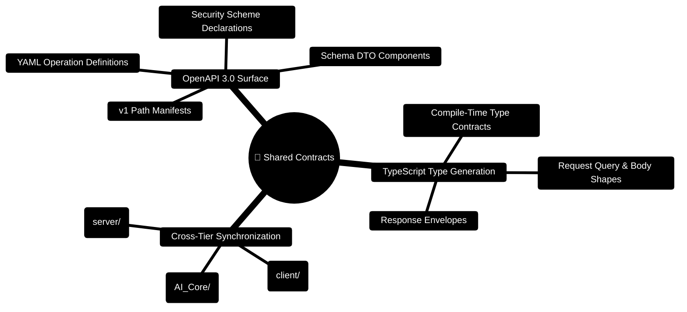

# FinWise Contracts — Shared OpenAPI & TypeScript Specifications

> **Single Source of Truth for API Contracts, Data Transfer Objects (DTOs), and Endpoint Manifests**  
> *OpenAPI 3.0 YAML Specs, Type-Safe TypeScript Interfaces, and Cross-Tier Contract Verification*

---

> [!TIP]
> **Developer Guide: Building on FinWise**  
> For complete end-to-end full-stack feature recipes, Mongoose models, Zod schemas, Express controllers, and Python LangGraph subagents, consult the [**Master Developer Handbook: Building on This Project**](../../docs/BUILDING_ON_THIS_PROJECT.md).

## 1. Contracts Architecture Mindmap



---

## 2. Cross-Tier Contract Synchronization ASCII Flow

```text
┌─────────────────────────────────────────────────────────────────────────────┐
│ 📜 OPENAPI 3.0 SCHEMA CANONICAL SOURCE                                       │
│    packages/contracts/openapi/v1/paths/index.yaml                           │
└──────────────────────────────────────┬──────────────────────────────────────┘
                                       │
                                       ▼
┌─────────────────────────────────────────────────────────────────────────────┐
│ ⚙️ CODE GENERATION & VERIFICATION PIPELINE                                   │
│    npm run generate:openapi (Server) ──► Validates all active routes         │
│    TypeScript DTO Compiler ────────────► Emits packages/contracts/typescript│
└───────────────────────┬─────────────────────────────────────┬───────────────┘
                        │                                     │
                        ▼ Import Shared Types                 ▼ Import Shared Types
┌───────────────────────────────────────────────┐ ┌───────────────────────────┐
│ 🖥️ CLIENT TIERS (client/)                    │ │ 🔷 SERVER TIERS (server/) │
│    import type { TransactionDTO } from '...'; │ │    import { ... } from '..│
└───────────────────────────────────────────────┘ └───────────────────────────┘
```

---

## 3. Developer Guide: Updating Contracts

When introducing or modifying API routes:

1. Update the route handler and Zod schemas in `server/src/schemas/`.
2. Run the OpenAPI path generator:
   ```bash
   cd server
   npm run generate:openapi
   ```
3. Verify that `packages/contracts/openapi/v1/paths/index.yaml` reflects the updated endpoint signatures.
4. Consume the generated types in client API services (`client/src/lib/api/`).


---

## 4. Production DTO & Schema Specifications

### 4.1 Canonical Transaction Data Transfer Object (`packages/contracts/typescript/transaction.ts`)

```typescript
export interface TransactionDTO {
  id: string;
  orgId: string;
  userId: string;
  date: string; // ISO 8601 YYYY-MM-DD
  amount: number;
  category: string;
  type: 'income' | 'expense' | 'investment';
  description?: string;
  source: 'manual' | 'csv' | 'bank_sync';
  externalId?: string;
  splits?: Array<{
    category: string;
    amount: number;
  }>;
  createdAt: string;
  updatedAt: string;
}
```

### 4.2 Financial Health Score Response Envelope (`packages/contracts/typescript/healthScore.ts`)

```typescript
export interface HealthScoreDTO {
  score: number; // 0 - 100
  pillars: {
    savingsRateScore: number; // 0 - 25
    debtToIncomeScore: number; // 0 - 25
    emergencyRunwayScore: number; // 0 - 25
    budgetAdherenceScore: number; // 0 - 25
  };
  metrics: {
    monthlySavingsRate: number; // e.g. 0.22 (22%)
    debtToIncomeRatio: number; // e.g. 0.12 (12%)
    emergencyRunwayMonths: number; // e.g. 5.4 months
    envelopeAdherenceRate: number; // e.g. 0.94 (94%)
  };
  trend: 'improving' | 'stable' | 'declining';
  computedAt: string;
}
```

### 4.3 OpenAPI 3.0 Canonical Path Definition (`packages/contracts/openapi/v1/paths/health-score.yaml`)

```yaml
/api/v1/health-score:
  get:
    summary: Retrieve multi-pillar composite financial health score
    operationId: getHealthScore
    security:
      - bearerAuth: []
      - apiKeyAuth: []
    parameters:
      - name: x-org-id
        in: header
        required: true
        schema:
          type: string
    responses:
      '200':
        description: Health score evaluated across 4 pillars
        content:
          application/json:
            schema:
              type: object
              properties:
                success:
                  type: boolean
                  example: true
                data:
                  $ref: '#/components/schemas/HealthScoreDTO'
```
