# FinWise: Comprehensive Project Flow & Runtime Lifecycles

> **Complete Visual & Technical Mapping of Data, Control, and State Lifecycles**  
> *Production Engineering Flow Catalog, Colourful Mindmaps, ASCII Sequence Topologies, and Concrete Code Snippets*  
> **Release Target:** 2026 Enterprise Edition | **Runtime Specification:** Node.js `>=24.14.1 <25` · Python `3.11+` · React `18.3` · MongoDB `7.0` · Redis `7.0`

---

> [!TIP]
> **Extending System Lifecycles?**  
> Follow the end-to-end request, controller, service, and LangGraph execution patterns detailed in the [**Master Developer Handbook: Building on This Project**](docs/BUILDING_ON_THIS_PROJECT.md).

## Master Flow Navigation

```text
FINWISE RUNTIME LIFECYCLES CATALOG
├── Flow 1: Authentication, JWT Dual-Token Issuance & Organization Scoping
├── Flow 2: Transaction Ingestion, AI Heuristic Categorization & Review Queue Triage
├── Flow 3: Workspace File Upload, RAG Phase 2 Overlapping Chunking & BM25 Retrieval
├── Flow 4: Conversational Chat, Multi-Agent Intent Routing & Subtask DAG Scheduling
├── Flow 5: Pure Python Deterministic Plan Math & Number Safety Invariant Verification
├── Flow 6: Server-Sent Events (SSE) Streaming Pipeline & Citation Badges
├── Flow 7: Server-Side PDFKit Vectorized Generation & MongoDB GridFS Streaming
├── Flow 8: Timezone-Aware Scheduled Newsletter Engine & BullMQ Worker Dispatch
├── Flow 9: LLM KeyPool Multi-Key Rotation, Cooldowns & 6-Tier Provider Failover
├── Flow 10: Automated Invariant Evaluation Harness, Latency SLAs & Regression Testing
├── Flow 11: Portfolio Target Allocation, Drift Analysis & Smart Cash Inflow Rebalancing
├── Flow 12: What-If Multi-Scenario Simulation & Monte Carlo Stochastic Risk Bounds
├── Flow 13: Dead Letter Queue (DLQ) Silent Failure Quarantining & Administrative Replay
├── Flow 14: Private Session Boundary Switch & Monotonic Query Cache Isolation
├── Flow 15: Assembled Conversation Insights Caching & Coalescing Engine
├── Flow 16: Machine Learning Merchant Embedding Clustering & Normalization
├── Flow 17: Multi-Modal Grounded RAG Knowledge Indexing & Hybrid Retrieval
├── Flow 18: Inbound Real-Time Bank Connector Webhook Feed Engine
├── Flow 19: Visual Workflow Execution with Multi-Step Delays & Webhooks
├── Flow 20: Peer Spending Benchmarks & Zero-Sum Budget Auto-Rebalancing Invariant
├── Flow 21: Continuous Production AI Canary Invariant Validation Engine
├── Flow 22: Offline-First Financial Journal Synchronization & 64-D Semantic Search
├── Flow 23: Global Multi-Currency FX Engine across 7 Currencies & Withholding Tax Relief
├── Flow 24: Financial Calendar Live RFC 5545 iCal Feed & Reminder Engine
├── Flow 25: AI System Diagnostics Cockpit & Multi-Key Health Inspection
├── Flow 26: Cross-Silo Unified Context Retrieval & Reciprocal Rank Fusion
├── Flow 27: Adaptive Follow-Through Recommendation & Preference Reinforcement Lifecycle
├── Flow 28: Semantic Document Q&A & Physical Page Attribution Lifecycle
├── Flow 29: Rich Financial Document Studio Compilation & Streaming Ingestion
└── Flow 30: Secure Outbound Webhook Dispatch with DNS SSRF Validation
```

---

## Flow 1: Authentication, JWT & Organization Scoping

### 1. Colourful Mindmap

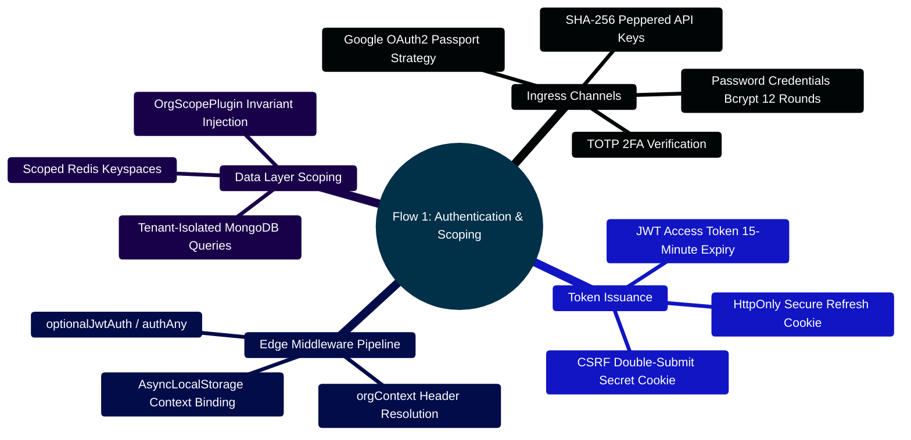

### 2. High-Density ASCII Sequence Diagram

```text
  Client (React 18 SPA)                  Express Gateway (Port 3000)                  MongoDB 7.0
           │                                          │                                    │
    [1]    │──── POST /api/v1/auth/login ────────────►│                                    │
           │     { email, password }                  │──── findOne({ email }) ───────────►│
           │                                          │◄─── UserDocument (with salt/hash) ─│
    [2]    │                                          │                                    │
           │                                          │ [Compare bcrypt password hash]     │
           │                                          │ [Check TOTP 2FA status]            │
           │                                          │──── findOne({ members.userId }) ──►│
           │                                          │◄─── OrgDocument (default org) ─────│
    [3]    │                                          │                                    │
           │                                          │ [Sign JWT: sub=userId, orgId]      │
           │                                          │ [Generate CSRF Token & Salt]       │
           │◄─── HTTP 200 OK ─────────────────────────│                                    │
           │     Body: { token, user, org }           │                                    │
           │     Set-Cookie: refreshToken (HttpOnly)  │                                    │
           │     Set-Cookie: XSRF-TOKEN (Secure)      │                                    │
           │                                          │                                    │
    [4]    │=== Subsequent Business API Calls =======>│                                    │
           │    Headers: Authorization: Bearer <JWT>  │                                    │
           │    Headers: X-Org-ID: <orgId>            │ [Verify JWT signature]             │
           │    Headers: X-CSRF-Token: <token>        │ [Validate User org membership]     │
           │                                          │ [Bind AsyncLocalStorage(orgId)]   │
           │                                          │──── Mongoose query (OrgScopePlugin)│
           │                                          │     auto-injects: { orgId } ──────►│
           │                                          │◄─── Tenant-Isolated Documents ─────│
           │◄─── HTTP 200 OK (Scoped Response) ───────│                                    │
```

### 3. Concrete Implementation Snippet: `server/src/middleware/auth.ts`

```typescript
// Excerpt from server/src/middleware/auth.ts
import { Request, Response, NextFunction } from "express";
import jwt from "jsonwebtoken";
import { config } from "../config/envConfig";
import UserModel from "../models/userModel";
import OrgMemberModel from "../models/orgMemberModel";

export async function authAny(req: Request, res: Response, next: NextFunction) {
  try {
    const authHeader = req.headers.authorization;
    if (!authHeader?.startsWith("Bearer ")) {
      return res.status(401).json({ success: false, error: "Missing or invalid authorization header" });
    }

    const token = authHeader.substring(7);
    const decoded = jwt.verify(token, config.JWT_SECRET) as { userId: string; orgId?: string };

    const user = await UserModel.findById(decoded.userId).lean();
    if (!user) {
      return res.status(401).json({ success: false, error: "User session revoked or invalid" });
    }

    req.user = user;
    // Resolve active organization: explicit header takes precedence over token
    const requestedOrgId = (req.headers["x-org-id"] as string) || decoded.orgId;
    if (requestedOrgId) {
      const membership = await OrgMemberModel.findOne({ orgId: requestedOrgId, userId: user._id }).lean();
      if (!membership) {
        return res.status(403).json({ success: false, error: "Forbidden: user is not a member of target org" });
      }
      req.orgId = requestedOrgId;
      req.orgRole = membership.role;
    }

    next();
  } catch (err) {
    return res.status(401).json({ success: false, error: "Invalid or expired session token" });
  }
}
```

---

## Flow 2: Transaction Ingestion, AI Categorization & Review Queue

### 1. Colourful Mindmap

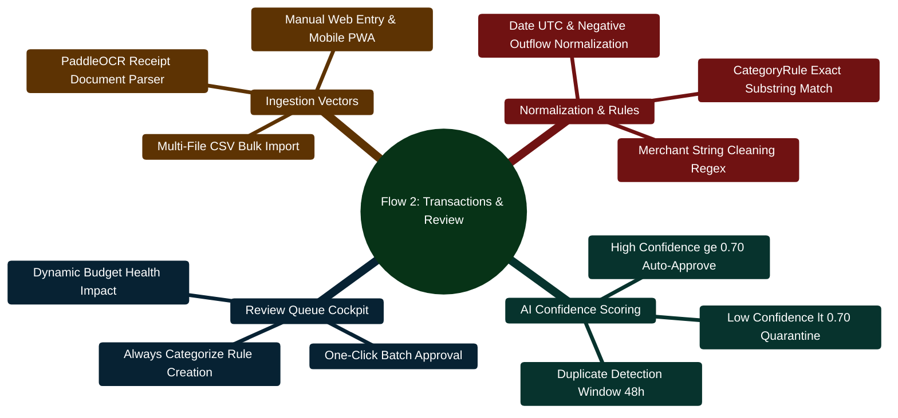

### 2. High-Density ASCII Flowchart

```text
    Source Channels: [CSV File] / [Receipt Scan] / [Manual Input]
                          │
                          ▼
    ┌─────────────────────────────────────────────────────────────┐
    │ 1. normalizeTransactionRecord()                             │
    │    • Standardize ISO UTC date string                        │
    │    • Normalize amounts (Debits < 0, Credits > 0)            │
    │    • Merchant regex sanitizer (e.g. "SQ *COFFEE" -> "Coffee")│
    └─────────────────────────────┬───────────────────────────────┘
                                  │
                                  ▼
    ┌─────────────────────────────────────────────────────────────┐
    │ 2. CategoryRule Engine Evaluation                           │
    │    • Query CategoryRuleModel for merchant regex match       │
    └─────────────────────────────┬───────────────────────────────┘
                                  │
                    [Merchant Matches User Rule?]
                                /   \
                             YES     NO
                             /         \
                            v           v
           ┌─────────────────────┐   ┌────────────────────────────┐
           │ Assign Rule Category│   │ 3. AI Categorization Model │
           │ Set confidence=1.00 │   │    • Calculate confidence  │
           │ Set needsReview=fals│   │    • Run duplicate detector│
           └──────────┬──────────┘   └──────────────┬─────────────┘
                      │                             │
                      │               [Confidence >= 0.70 & No Dupe?]
                      │                          /      \
                      │                       YES        NO
                      │                       /            \
                      │                      v              v
                      │            ┌─────────────────┐  ┌─────────────────────┐
                      │            │ needsReview =   │  │ needsReview = true  │
                      │            │ false (Approved)│  │ Enqueue to Review   │
                      │            └────────┬────────┘  └──────────┬──────────┘
                      │                     │                      │
                      ▼                     ▼                      ▼
    ┌─────────────────────────────────────────────────────────────────┐
    │ 4. Atomic Batch Persistence (MongoDB Transaction Collection)    │
    │    • Bulk write operations with unique transaction hashes       │
    │    • Cascade update month-to-date spending cache in Redis       │
    └─────────────────────────────────────────────────────────────────┘
```

### 3. Concrete Implementation Snippet: `server/src/services/transactionReview.ts`

```typescript
// Excerpt from server/src/services/transactionReview.ts
import TransactionModel, { ITransaction } from "../models/transactionModel";
import CategoryRuleModel from "../models/categoryRuleModel";

export async function processTransactionReviewStatus(
  orgId: string,
  transactionData: Partial<ITransaction>
): Promise<{ category: string; confidence: number; needsReview: boolean }> {
  // Step 1: Check user-defined deterministic rules first
  const cleanMerchant = (transactionData.merchant || "").trim().toLowerCase();
  const matchedRule = await CategoryRuleModel.findOne({
    orgId,
    merchantPattern: { $regex: cleanMerchant, $options: "i" }
  }).lean();

  if (matchedRule) {
    return { category: matchedRule.targetCategory, confidence: 1.0, needsReview: false };
  }

  // Step 2: Heuristic AI Confidence Scoring
  let confidence = 0.50; // Default baseline
  if (transactionData.category && transactionData.category !== "Uncategorized") {
    confidence = 0.75;
  }

  // Step 3: Duplicate Transaction Suspicion Check (within 48 hours & identical amount)
  const duplicateWindow = 48 * 60 * 60 * 1000;
  const potentialDupe = await TransactionModel.findOne({
    orgId,
    amount: transactionData.amount,
    date: {
      $gte: new Date(new Date(transactionData.date!).getTime() - duplicateWindow),
      $lte: new Date(new Date(transactionData.date!).getTime() + duplicateWindow),
    },
  }).lean();

  const isDuplicateSuspected = Boolean(potentialDupe);
  const needsReview = confidence < 0.70 || isDuplicateSuspected;

  return {
    category: transactionData.category || "Uncategorized",
    confidence: isDuplicateSuspected ? 0.35 : confidence,
    needsReview,
  };
}
```

---

## Flow 3: Workspace File Upload, RAG Phase 2 Chunking & BM25 Retrieval

### 1. Colourful Mindmap

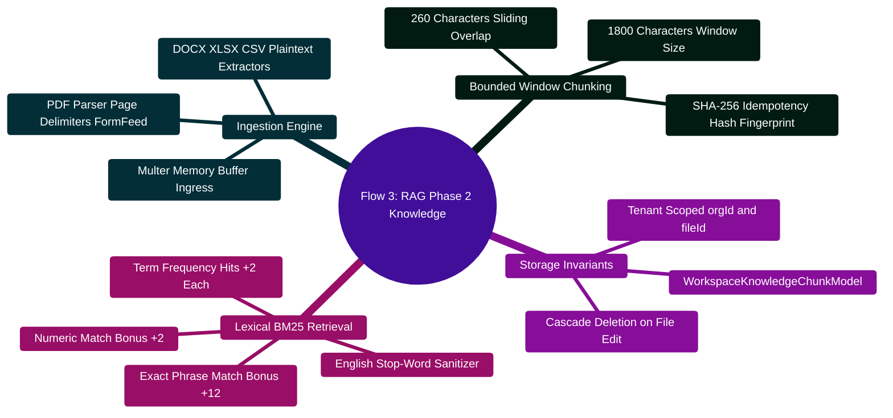

### 2. High-Density ASCII Sequence Diagram

```text
  Client (Browser)                 Express Gateway (Node.js)                  MongoDB 7.0
         │                                     │                                   │
  [1]    │── POST /api/v1/files/upload ───────►│                                   │
         │   (Multipart Form: BankStmt.pdf)    │                                   │
         │                                     │ [Extract text with \f page mark]  │
  [2]    │                                     │ [Run syncWorkspaceFileChunks()]   │
         │                                     │  • Window: 1800 ch / 260 ch ovlp  │
         │                                     │  • Hash: SHA256(chunk_text)       │
         │                                     │──── bulkWrite(KnowledgeChunks) ──►│
         │                                     │     Index: { orgId, fileId }      │
  [3]    │◄── HTTP 201 Created ────────────────│                                   │
         │                                     │                                   │
  [4]    │=== User Queries Financial Copilot =>│                                   │
         │    "What was my interest in Q3?"    │                                   │
         │                                     │ [retrieveRelevantWorkspaceChunks] │
         │                                     │  • Strip stopwords                │
         │                                     │  • Formulate Regex search terms   │
         │                                     │──── find({ orgId, terms }) ──────►│
         │                                     │◄─── Candidate Raw Chunks ─────────│
  [5]    │                                     │                                   │
         │                                     │ [scoreChunkAgainstQuery()]        │
         │                                     │  • Phrase match: +12 pts          │
         │                                     │  • Term count: +2 pts / hit       │
         │                                     │  • Numeric match bonus: +2 pts    │
         │                                     │ [Sort Top-K descending]           │
         │                                     │                                   │
  [6]    │                                     │──── Pass to aiCoreClient ────────►│
         │                                     │     as grounded evidence context  │
```

### 3. Concrete Implementation Snippet: `server/src/services/retrievalService.ts`

```typescript
// Excerpt from server/src/services/retrievalService.ts
export function chunkDocumentText(text: string, options = { windowSize: 1800, overlap: 260 }): Array<{ chunkText: string; pageNumber: number }> {
  const pages = text.split("\f");
  const chunks: Array<{ chunkText: string; pageNumber: number }> = [];

  pages.forEach((pageContent, pageIndex) => {
    const pageNum = pageIndex + 1;
    let cursor = 0;

    while (cursor < pageContent.length) {
      const end = Math.min(cursor + options.windowSize, pageContent.length);
      const chunkText = pageContent.substring(cursor, end).trim();

      if (chunkText.length > 50) {
        chunks.push({ chunkText, pageNumber: pageNum });
      }

      if (end >= pageContent.length) break;
      cursor += options.windowSize - options.overlap;
    }
  });

  return chunks;
}

export function scoreChunkAgainstQuery(chunkText: string, query: string): number {
  const cleanChunk = chunkText.toLowerCase();
  const cleanQuery = query.toLowerCase().trim();
  let score = 0;

  // Exact phrase bonus
  if (cleanChunk.includes(cleanQuery)) {
    score += 12;
  }

  // Individual keyword frequency bonuses
  const terms = cleanQuery.split(/\s+/).filter((t) => t.length > 3);
  terms.forEach((term) => {
    const occurrences = cleanChunk.split(term).length - 1;
    score += Math.min(occurrences, 6) * 2;
  });

  // Numeric alignment bonus
  const hasQueryNumbers = /\d+/.test(cleanQuery);
  const hasChunkNumbers = /\d+/.test(cleanChunk);
  if (hasQueryNumbers && hasChunkNumbers) {
    score += 2;
  }

  return score;
}
```

---

## Flow 4: Conversational Chat, Routing & Subagent Task DAG

### 1. Colourful Mindmap

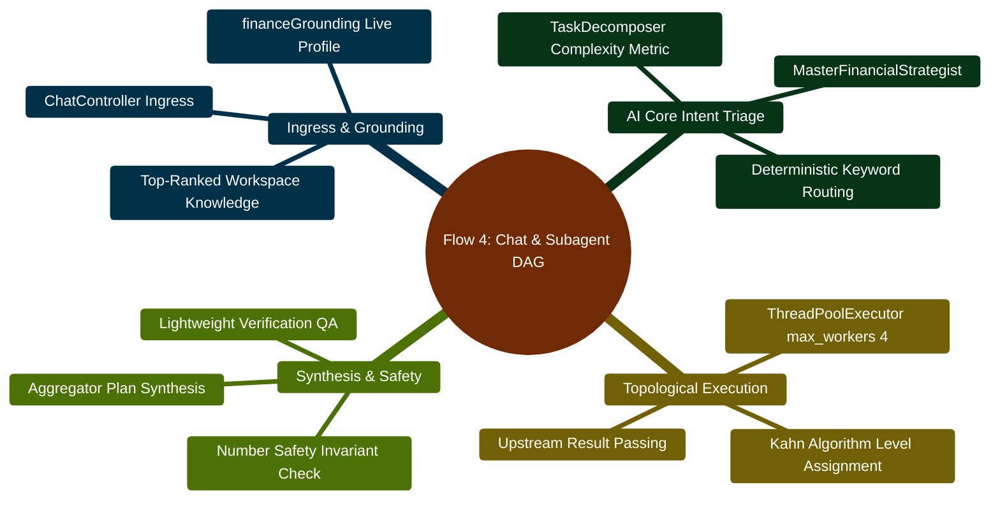

### 2. High-Density ASCII Sequence Diagram

```text
  React Client               Express Gateway            Python AI Core (FastAPI)           LangGraph Specialists
       │                            │                               │                                 │
  [1]  │── POST /api/chat/messages ─►│                               │                                 │
       │   { prompt, sessionId }    │ [financeGrounding Service]    │                                 │
       │                            │  • Accounts, Debts, Budgets   │                                 │
       │                            │  • RAG Knowledge Chunks       │                                 │
  [2]  │                            │──── POST /api/agents/process ─►│                                 │
       │                            │     Payload with full context │ [MasterAgent: Classify Intent]  │
       │                            │                               │ [TaskDecomposer: Build Subtasks]│
  [3]  │                            │                               │                                 │
       │                            │                               │──── Level 0: IncomeAnalyzer ───►│
       │                            │                               │     Computes $800/mo surplus    │
       │                            │                               │◄─── Returns IncomeAnalysis ─────│
  [4]  │                            │                               │                                 │
       │                            │                               │──── Level 1: DebtOptimizer ────►│
       │                            │                               │     (Consumes Surplus Context)  │
       │                            │                               │◄─── Returns Avalanche Schedule ─│
  [5]  │                            │                               │                                 │
       │                            │                               │ [Verification QA Node]          │
       │                            │                               │ [Aggregator: tools.build_plan()]│
       │                            │                               │ [Number Safety Subset Invariant]│
  [6]  │                            │◄─── HTTP 200 Plan JSON ───────│                                 │
       │◄── HTTP 200 Stream Message │                               │                                 │
       │    Formatted Markdown +    │                               │                                 │
       │    Interactive Tool Buttons│                               │                                 │
```

---

## Flow 5: Pure Python Plan Math & Number Safety Verification

### 1. Colourful Mindmap

```mermaid
%%{init: {'theme': 'base', 'themeVariables': { 'primaryColor': '#dc2626', 'primaryTextColor': '#ffffff', 'primaryBorderColor': '#f87171', 'lineColor': '#ef4444', 'secondaryColor': '#059669', 'tertiaryColor': '#2563eb'}}}%%
mindmap
  root((Flow 5: Number Safety Math))
    Pure Calculators
      tools.financial_calculators.py
      Standard Banking Decimal Precision
      Compound Growth & Amortization
    Deterministic Synthesis
      tools.plan_builder.build_plan()
      Categorized Action Buckets 7d 30d 12m
      render_plan_markdown()
    Number Safety Guard
      _numbers_are_subset Method
      Candidate Digits in Reference Digits
      Zero Tolerance for Hallucinations
    Automated Fallback
      Instant Discard of Hallucinated Text
      Reversion to Deterministic Markdown
```

### 2. High-Density ASCII Flowchart

```text
    Specialist Agents Outputs: [IncomeAnalysis] [DebtOptimization] [BudgetPlan]
                                      │
                                      ▼
    ┌─────────────────────────────────────────────────────────────────┐
    │ 1. tools.build_plan(PlanInputs(...))                            │
    │    • Deterministically calculates savings capacity              │
    │    • Enforces Conservation of Funds: Sum(Delta Budgets) == 0    │
    │    • Generates 7-day, 30-day, and 12-month action milestones    │
    └─────────────────────────────────┬───────────────────────────────┘
                                      │
                                      ▼
    ┌─────────────────────────────────────────────────────────────────┐
    │ 2. tools.render_plan_markdown(plan, currency)                   │
    │    • Renders byte-for-byte pure mathematical markdown           │
    │    • Reference Digits = Set of all numbers in this markdown     │
    └─────────────────────────────────┬───────────────────────────────┘
                                      │
                                      ▼
                   [Is LLM Narrative Polish Enabled?]
                               /              \
                             YES               NO
                             /                  \
                            v                    v
         ┌────────────────────────────┐    (Skip Polish & Use
         │ 3. _polish_with_llm()      │     Deterministic Text)
         │    Invoke LLM with strict  │            │
         │    instruction to keep all │            │
         │    numerical digits frozen │            │
         └──────────────┬─────────────┘            │
                        │                          │
                        ▼                          │
         ┌────────────────────────────┐            │
         │ 4. _numbers_are_subset()   │            │
         │    Audit: Cand ⊆ Reference │            │
         └──────────────┬─────────────┘            │
                        │                          │
          [Candidate Numbers == Subset?]           │
                    /        \                     │
                 TRUE        FALSE                 │
                 /              \                  │
                v                v                 │
      ┌──────────────────┐  ┌──────────────────┐   │
      │ Use LLM Polished │  │ Reject Narrative!│   │
      │ Response Text    │  │ Revert to Pure   │   │
      │                  │  │ Deterministic MD │   │
      └─────────┬────────┘  └────────┬─────────┘   │
                │                    │             │
                ▼                    ▼             ▼
    ┌─────────────────────────────────────────────────────────────────┐
    │ 5. Assemble Unified Plan Payload Envelope                       │
    │    • Return verified markdown plan to Express & Client UI       │
    └─────────────────────────────────────────────────────────────────┘
```

---

## Flow 6: Server-Sent Events (SSE) Streaming Pipeline

### 1. Colourful Mindmap

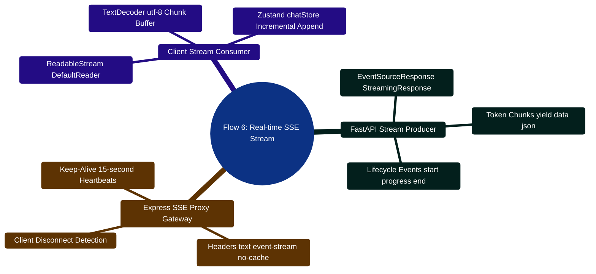

### 2. High-Density ASCII Sequence Diagram

```text
  React Client (useAIStream)               Express Server                     FastAPI AI Core
              │                                   │                                  │
       [1]    │── POST /api/ai/process/stream ───►│                                  │
              │   { prompt, sessionId }           │── POST /api/agents/process/stream►│
              │                                   │                                  │
       [2]    │◄── 200 OK (text/event-stream) ────│◄── 200 OK (text/event-stream) ───│
              │                                   │                                  │
       [3]    │◄── data: {"event":"phase","name":"decomposing"}───────────────────────│
              │    [UI displays: Decomposing subtasks...]                            │
              │                                   │                                  │
       [4]    │◄── data: {"event":"phase","name":"executing","agent":"debt"}─────────│
              │    [UI displays: Analyzing debt avalanche...]                         │
              │                                   │                                  │
       [5]    │◄── data: {"event":"token","token":"Based "}──────────────────────────│
              │◄── data: {"event":"token","token":"on your "}────────────────────────│
              │◄── data: {"event":"token","token":"Q3 statement..."}─────────────────│
              │                                   │                                  │
       [6]    │◄── data: {"event":"citations","citations":[{"file":"Q3.pdf"}]}───────│
              │◄── data: {"event":"complete","metadata":{"latency":482}}─────────────│
              │                                   │                                  │
       [7]    │ [Stream reader gracefully closes] │                                  │
```

---

## Flow 7: Server-Side PDFKit Vectorized Generation & GridFS

### 1. High-Density ASCII Flowchart

```text
  Client Request: POST /api/v1/files/generate-pdf
        │
        ▼
  ┌─────────────────────────────────────────────────────────────┐
  │ 1. pdfController.ts & pdfRequestServer.ts                   │
  │    • Validate document title, theme, and markdown sections  │
  └─────────────────────────────┬───────────────────────────────┘
                                │
                                ▼
  ┌─────────────────────────────────────────────────────────────┐
  │ 2. Vectorized PDFKit Canvas Pipeline                        │
  │    • Header & Footer pagination hooks                       │
  │    • Standard typography: Helvetica & Helvetica-Bold        │
  │    • Financial balance tables with dynamic cell widths      │
  └─────────────────────────────┬───────────────────────────────┘
                                │
                                ▼
  ┌─────────────────────────────────────────────────────────────┐
  │ 3. Direct Streaming to MongoDB GridFS Bucket                │
  │    • Create GridFSBucketWriteStream ({ filename, orgId })   │
  │    • Pipe pdfDoc.pipe(gridFsStream) without touching disk   │
  └─────────────────────────────┬───────────────────────────────┘
                                │
                                ▼
  ┌─────────────────────────────────────────────────────────────┐
  │ 4. WorkspaceFile Record Upsert & Chunk Re-index             │
  │    • Create WorkspaceFileModel document                     │
  │    • Trigger asynchronous BullMQ job to extract text chunks │
  └─────────────────────────────────────────────────────────────┘
```

---

## Flow 8: Timezone-Aware Scheduled Newsletter Engine

### 1. High-Density ASCII Flowchart

```text
  ┌─────────────────────────────────────────────────────────────┐
  │ 1. newsletterScheduler.ts (Cron interval: Every 60 seconds)  │
  │    • Current UTC timestamp evaluated                        │
  └─────────────────────────────┬───────────────────────────────┘
                                │
                                ▼
  ┌─────────────────────────────────────────────────────────────┐
  │ 2. User Timezone Target Match Query                         │
  │    • Match users where (Current UTC in user.timezone) ==    │
  │      preference.deliveryTime (e.g. "08:00 AM")              │
  └─────────────────────────────┬───────────────────────────────┘
                                │
                                ▼
  ┌─────────────────────────────────────────────────────────────┐
  │ 3. Enqueue Newsletter Job to BullMQ Queue                   │
  │    • Queue: "newsletter-dispatch-queue"                     │
  │    • Job payload: { orgId, userId, preferences }            │
  └─────────────────────────────┬───────────────────────────────┘
                                │
                                ▼
  ┌─────────────────────────────────────────────────────────────┐
  │ 4. Worker Execution (worker.ts)                             │
  │    • Gather 7-day spend, upcoming bills, budget burn rate   │
  │    • Call AI Core NewsletterAgent for tailored advice       │
  │    • Render responsive inline-styled HTML template          │
  │    • Dispatch via Nodemailer SMTP                           │
  │    • Poison pill jobs quarantined to Dead Letter Queue (DLQ)│
  └─────────────────────────────────────────────────────────────┘
```

---

## Flow 9: LLM KeyPool Multi-Key Rotation & 6-Tier Failover

### 1. Colourful Mindmap

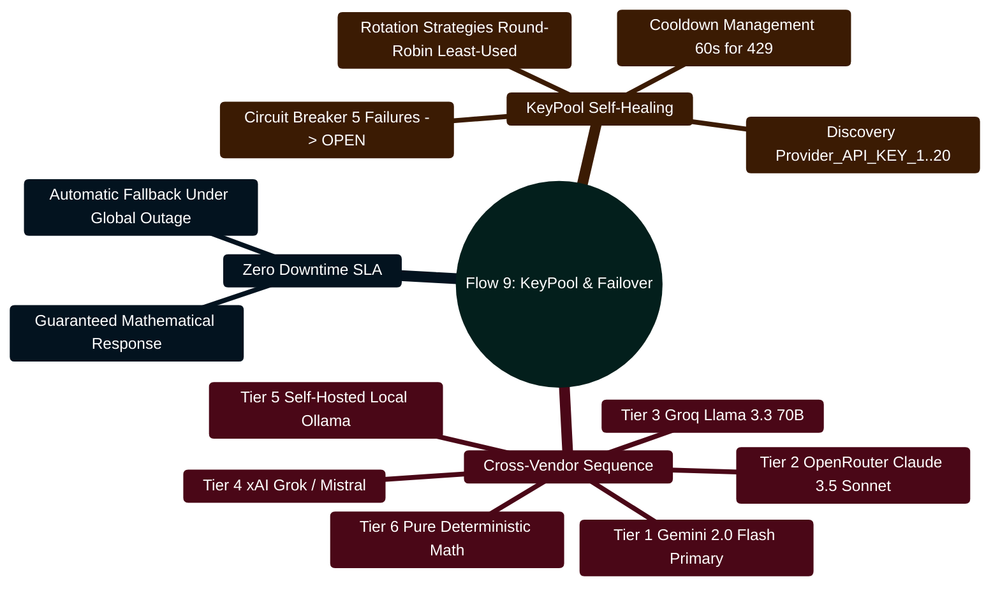

### 2. High-Density ASCII Sequence Diagram

```text
  AI Request ────► [KeyPool: Select Healthy Key]
                         │
           [Key hits HTTP 429 Rate Limit?]
                      /     \
                    YES      NO ──► Return Successful LLM Response
                    /
                   v
  ┌─────────────────────────────────────────────────────────────┐
  │ 1. Mark Key Cooldown (60s timer) & Increment Failure Count  │
  │ 2. Rotate to Next Key in Provider Pool                      │
  └──────────────────────────────┬──────────────────────────────┘
                                 │
                 [All Keys in Provider Exhausted?]
                            /         \
                          YES          NO ──► Retry with Key #2
                          /
                         v
  ┌─────────────────────────────────────────────────────────────┐
  │ 3. Provider Circuit Breaker Trips to OPEN                   │
  │ 4. Step Down to Tier 2: OpenRouter Dynamic KeyPool          │
  └──────────────────────────────┬──────────────────────────────┘
                                 │
                 [OpenRouter Hits Provider Outage?]
                            /         \
                          YES          NO ──► Complete with OpenRouter
                          /
                         v
  ┌─────────────────────────────────────────────────────────────┐
  │ 5. Step Down to Tier 3: Groq High-Speed Llama 3.3 70B       │
  │    ... through Tier 4 and Tier 5 ...                        │
  └──────────────────────────────┬──────────────────────────────┘
                                 │
                   [All External Cloud APIs Offline?]
                                 │
                                 v
  ┌─────────────────────────────────────────────────────────────┐
  │ 6. Ultimate Tier 6: Deterministic Pure Python Calculators   │
  │    • Generate 100% mathematically correct plan              │
  │    • Zero downtime guaranteed under total cloud blackouts   │
  └─────────────────────────────────────────────────────────────┘
```

---

## Flow 10: Automated Invariant Evaluation Loop & Latency SLAs

### 1. High-Density ASCII Flowchart

```text
  Developer / CI Pipeline: pytest evals/runner.py
        │
        ▼
  ┌─────────────────────────────────────────────────────────────┐
  │ 1. Ingest Golden Reference Suites (server/AI_Core/evals/)   │
  │    • 100+ Curated Financial Intent Ingress Prompts          │
  └─────────────────────────────┬───────────────────────────────┘
                                │
                                ▼
  ┌─────────────────────────────────────────────────────────────┐
  │ 2. Concurrent Benchmark Suite Execution                     │
  │    ├─► test_routing_accuracy: Precision >= 98.0%            │
  │    ├─► test_number_safety: 0 Hallucinated Digits (100% Pass)│
  │    ├─► test_determinism: Byte-for-byte reproducibility      │
  │    ├─► test_plan_quality: Structural completeness (7d/30d)  │
  │    └─► test_latency: P50 < 18ms, P95 < 45ms (Routing)       │
  └─────────────────────────────┬───────────────────────────────┘
                                │
                                ▼
                 [Did any Test Invariant Fail?]
                            /        \
                          YES         NO
                          /             \
                         v               v
  ┌─────────────────────────────┐  ┌────────────────────────────┐
  │ ❌ Block Build & Emit       │  │ ✅ All Invariants Satisfied│
  │ Detailed Metric Regression  │  │ Production Artifact Ready  │
  │ Log with Offending Output   │  └────────────────────────────┘
  └─────────────────────────────┘
```


---

## Flow 11: Portfolio Target Allocation, Drift Analysis & Smart Rebalancing

### 1. Colourful Mindmap

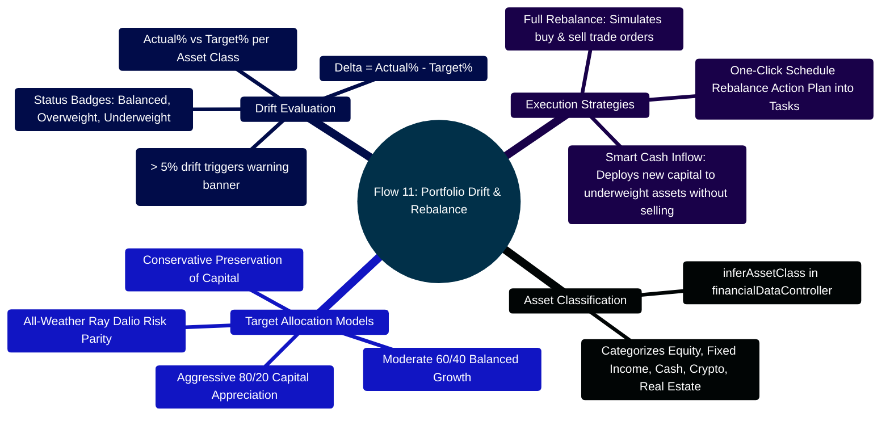

### 2. High-Density ASCII Sequence Diagram

```text
  User Browser (:5173)              Express Gateway (:3000)          Database (MongoDB)
         │                                    │                               │
         │── 1. GET /api/v1/finance/summary ─>│                               │
         │                                    │── 2. Query Asset Accounts ───>│
         │                                    │<── Account Documents ─────────│
         │                                    │                               │
         │                                    │── 3. inferAssetClass()        │
         │                                    │   (Equity, Crypto, REIT, etc.)│
         │<── 4. Return Summary Aggregates ───│                               │
         │                                                                    │
         │── 5. Client Portfolio Engine:                                      │
         │   • Fetch selected Target Model (e.g. 60/40 or All-Weather)        │
         │   • Compute Drift: Delta_i = Actual%_i - Target%_i                 │
         │   • Check if any |Delta_i| >= 5.0% ──► Surface Drift Alert Banner  │
         │                                                                    │
         │── 6. User enters Deploy Capital ($1,000) & selects "Smart Inflow": │
         │   • Allocation_i = Capital * (Deficit_i / Total_Deficits)          │
         │   • Generates tax-efficient buys without triggering asset sales    │
         │                                                                    │
         │── 7. User clicks "Schedule Rebalance Action Plan" ────────────────>│
         │   • Creates actionable task via POST /api/v1/tasks                 │
         │<── 8. Task Confirmed & Linked to Calendar ─────────────────────────│
```

---

## Flow 12: What-If Multi-Scenario Simulation & Monte Carlo Bounds

### 1. High-Density ASCII Flowchart

```text
  User Pins up to 4 Scenarios in Scenarios.tsx (e.g. Job Switch, House Purchase, Early Sabbatical)
         │
         ▼
  ┌────────────────────────────────────────────────────────────────────────┐
  │ 1. Aggregate Baseline Profile (Income, Discretionary Spend, Assets)   │
  └───────────────────────────────────┬────────────────────────────────────┘
                                      │
                                      ▼
  ┌────────────────────────────────────────────────────────────────────────┐
  │ 2. Side-by-Side Comparison Matrix Computation                          │
  │    ├─► Delta Monthly Surplus = (Scenario Surplus - Baseline Surplus)   │
  │    ├─► Cumulative Savings Impact over Forecast Horizon (e.g. 5 Years)  │
  │    ├─► Emergency Runway Impact = Liquid Assets / New Burn Rate         │
  │    └─► Goal Velocity Shift (Accelerated vs Delayed by N months)        │
  └───────────────────────────────────┬────────────────────────────────────┘
                                      │
                                      ▼
  ┌────────────────────────────────────────────────────────────────────────┐
  │ 3. Monte Carlo Stochastic Simulation (15% Volatility & Frictions)      │
  │    ├─► P10 (Bearish): 10th percentile adverse shock trajectory         │
  │    ├─► P50 (Expected): Median trajectory based on average return       │
  │    └─► P90 (Bullish): 90th percentile upside compounding               │
  └───────────────────────────────────┬────────────────────────────────────┘
                                      │
                                      ▼
  ┌────────────────────────────────────────────────────────────────────────┐
  │ 4. Marginal Tax Bracket Estimation (Income Scenarios)                  │
  │    • Apply progressive tax rate (0%, 15%, 22%, 25%, 32%, 37%)          │
  │    • Calculate Estimated Tax Withholding vs Net Take-Home Retained     │
  └───────────────────────────────────┬────────────────────────────────────┘
                                      │
                                      ▼
  ┌────────────────────────────────────────────────────────────────────────┐
  │ 5. Actionable Outputs: Export Comparison CSV • Copy Markdown Table     │
  └────────────────────────────────────────────────────────────────────────┘
```

---

## Flow 13: Dead Letter Queue (DLQ) Quarantining & Administrative Replay

### 1. High-Density ASCII Flowchart

```text
  Background Task Execution (e.g., sendNewsletter, syncChunks, updateTimestamp)
         │
         ▼
  ┌────────────────────────────────────────────────────────────────────────┐
  │ 1. catchToDeadLetter(promise, operationTag, metadata)                  │
  └───────────────────────────────────┬────────────────────────────────────┘
                                      │
                         Did Background Operation Reject?
                                      /                                            NO          YES
                                    /                                                v               v
  ┌──────────────────────────────┐   ┌─────────────────────────────────────┐
  │ Task completes successfully  │   │ 2. DLQ Interception (deadLetterQueue)│
  │ (No overhead incurred)       │   │    • Capture error.message & stack  │
  └──────────────────────────────┘   │    • Generate unique job ID         │
                                     │    • Bind { orgId, operation, time }│
                                     └──────────────────┬──────────────────┘
                                                        │
                                                        ▼
                                     ┌─────────────────────────────────────┐
                                     │ 3. Push to Redis Ring Buffer        │
                                     │    KEY: bull:finwise-dlq            │
                                     │    Bounded capacity: 500 entries    │
                                     │    Emit Pino warning alert          │
                                     └──────────────────┬──────────────────┘
                                                        │
                                                        ▼
                                     ┌─────────────────────────────────────┐
                                     │ 4. SRE & Admin Inspection APIs      │
                                     │    • GET /api/v1/dlq/stats          │
                                     │    • POST /api/v1/dlq/replay/:id    │
                                     └─────────────────────────────────────┘
```

---

## Flow 14: Private Session Boundary Switch & Cache Isolation

### 1. High-Density ASCII Flowchart

```text
  User Triggers: Logout OR Organization Switch OR Account Switch
         │
         ▼
  ┌────────────────────────────────────────────────────────────────────────┐
  │ 1. Invalidate Current TanStack QueryClient                             │
  │    • Destroy shared cache to prevent private data leakage              │
  └───────────────────────────────────┬────────────────────────────────────┘
                                      │
                                      ▼
  ┌────────────────────────────────────────────────────────────────────────┐
  │ 2. Increment Monotonic Context Revision Counter                        │
  │    • Obsoletes all in-flight asynchronous HTTP responses               │
  │    • Late-arriving responses cannot overwrite newer context            │
  └───────────────────────────────────┬────────────────────────────────────┘
                                      │
                                      ▼
  ┌────────────────────────────────────────────────────────────────────────┐
  │ 3. Abort Active Streams & Clear State Stores                           │
  │    • AbortController.abort() on active Server-Sent Events (SSE)        │
  │    • Reset Zustand chatStore, aiStore, and commandBarStore             │
  │    • Clear local drafts and command palette history                    │
  └───────────────────────────────────┬────────────────────────────────────┘
                                      │
                                      ▼
  ┌────────────────────────────────────────────────────────────────────────┐
  │ 4. Re-mount Screen Tree with Fresh Tenant QueryClient                  │
  │    • Guaranteed tenant data separation across browser sessions         │
  └────────────────────────────────────────────────────────────────────────┘
```

---

## Flow 15: Assembled Conversation Insights Caching & Coalescing Engine

### 1. High-Density ASCII Flowchart

```text
  Client Dashboard Mounts ──► Requests Conversation Insights
         │
         ▼
  ┌────────────────────────────────────────────────────────────────────────┐
  │ 1. Compute Request Key Hash: SHA256(userId + orgId + utcDate + context)│
  └───────────────────────────────────┬────────────────────────────────────┘
                                      │
                                      ▼
  ┌────────────────────────────────────────────────────────────────────────┐
  │ 2. Check conversationInsightsCache (MongoDB Snapshot Cache)            │
  └───────────────────────────────────┬────────────────────────────────────┘
                                      │
                          Cache Hit & Valid TTL?
                                /                                       YES          NO
                              /                                           v                v
  ┌──────────────────────────────┐   ┌─────────────────────────────────────┐
  │ Return Saved Summary         │   │ 3. In-Process Coalescing Guard      │
  │ • Latency: ~60ms             │   │    • Check active Promise map       │
  │ • 0 AI tokens consumed       │   │    • Coalesce duplicate requests    │
  │ • Marked as "Saved Summary"  │   └──────────────────┬──────────────────┘
  └──────────────────────────────┘                      │
                                                        ▼
                                     ┌─────────────────────────────────────┐
                                     │ 4. Compute Insights via AI Core     │
                                     │    • Invoke ConversationSummarizer  │
                                     │    • Fallback to honest factual recap│
                                     └──────────────────┬──────────────────┘
                                                        │
                                                        ▼
                                     ┌─────────────────────────────────────┐
                                     │ 5. Persist Snapshot with TTL        │
                                     │    • Normal response: TTL = 120s    │
                                     │    • Degraded response: TTL = 15s   │
                                     └─────────────────────────────────────┘
```

---

## Flow 16: Machine Learning Merchant Embedding Clustering & Normalization

### 1. Colourful Mindmap

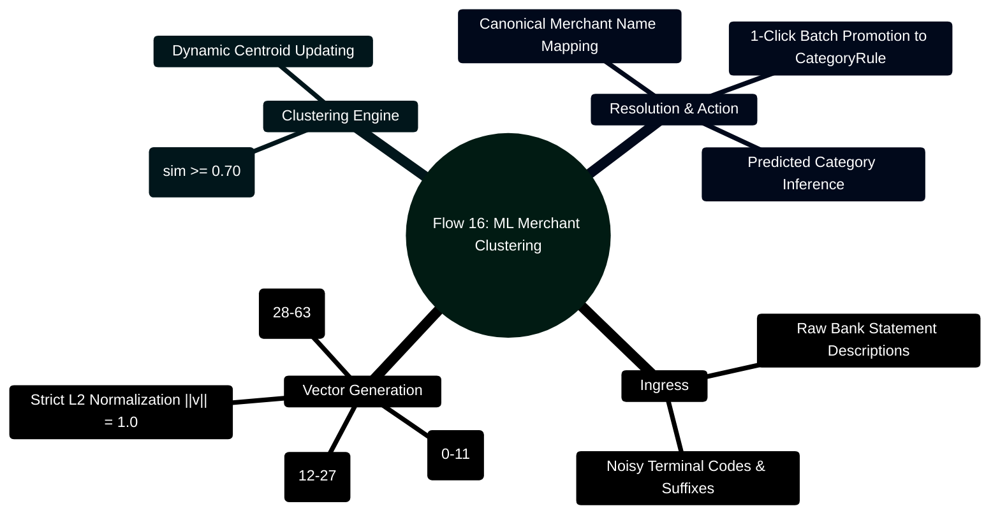

### 2. End-to-End Sequence ASCII Flow

```text
┌─────────────────────────────────────────────────────────────────────────────────────────────────┐
│ 💳 INCOMING STATEMENT STRINGS: "AMZN MKTP US*2A41B", "Amazon Prime Video", "SBUX #1042"         │
└───────────────────────────────────────────────┬─────────────────────────────────────────────────┘
                                                │
                                                ▼
┌─────────────────────────────────────────────────────────────────────────────────────────────────┐
│ 📐 STAGE 1: 64-D DENSE VECTOR EMBEDDING GENERATION (merchantEmbeddingClustering.ts)             │
│    - Dims [0..11]:  Category & Sector Taxonomy Projections                                      │
│    - Dims [12..27]: Canonical Brand Anchor Projections (Amazon, Starbucks, Uber, Apple...)      │
│    - Dims [28..63]: FastText-style Subword Character N-Grams (FNV-1a Hash)                       │
│    - L2 Normalization: v_norm = v / ||v||_2 (Ensures unit length for dot product cosine sim)    │
└───────────────────────────────────────────────┬─────────────────────────────────────────────────┘
                                                │
                                                ▼
┌─────────────────────────────────────────────────────────────────────────────────────────────────┐
│ 🔗 STAGE 2: AGGLOMERATIVE CENTROID-BASED COSINE CLUSTERING                                      │
│    - Pairwise Cosine Similarity: S_ij = dot(v_i, c_j)                                           │
│    - Merging: If max(S_ij) >= 0.70 ──► Join cluster and update centroid c = normalize(sum(v))  │
│    - Canonical Resolution: Assigns clean entity name ("Amazon") and predicted category          │
└───────────────────────────────────────────────┬─────────────────────────────────────────────────┘
                                                │
                                                ▼
┌─────────────────────────────────────────────────────────────────────────────────────────────────┐
│ 🏷️ STAGE 3: ONE-CLICK BATCH APPLICATION (POST /api/transactions/merchant-clusters/apply)        │
│    - Updates all matching ledger transactions with clean merchant name and assigned category    │
│    - Persists permanent CategoryRule to automatically classify future transactions              │
└─────────────────────────────────────────────────────────────────────────────────────────────────┘
```

---

## Flow 17: Multi-Modal Grounded RAG Knowledge Indexing & Hybrid Retrieval

### 1. Colourful Mindmap

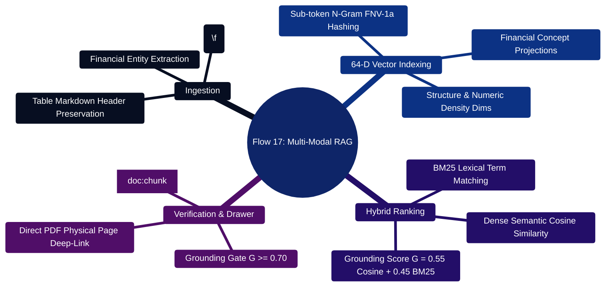

### 2. End-to-End Sequence ASCII Flow

```text
┌─────────────────────────────────────────────────────────────────────────────────────────────────┐
│ 📄 DOCUMENT UPLOAD: Multi-Page Financial Statement (e.g. Q3_Bank_Statement.pdf)                 │
└───────────────────────────────────────────────┬─────────────────────────────────────────────────┘
                                                │
                                                ▼
┌─────────────────────────────────────────────────────────────────────────────────────────────────┐
│ ✂️ STAGE 1: BOUNDED WINDOW TABLE-AWARE CHUNKING (retrievalService.ts)                            │
│    - Preserves Form-Feed page boundaries (\f) for physical page parity                          │
│    - 1,800 character window with 260-character sliding overlap                                  │
│    - Detects Modality: "text" | "table" | "image_ocr" | "structured_data"                       │
│    - Extracts entities: Merchants, monetary values, dates, and currency symbols                 │
└───────────────────────────────────────────────┬─────────────────────────────────────────────────┘
                                                │
                                                ▼
┌─────────────────────────────────────────────────────────────────────────────────────────────────┐
│ 🧠 STAGE 2: 64-D VECTOR EMBEDDING & STORAGE                                                     │
│    - Maps text into 64-D normalized vector space                                                │
│    - Persists to MongoDB `workspaceKnowledgeChunks` collection with compound tenant index       │
└───────────────────────────────────────────────┬─────────────────────────────────────────────────┘
                                                │
                                                ▼ User Query: "What was our quarterly AWS spend?"
┌─────────────────────────────────────────────────────────────────────────────────────────────────┐
│ ⚖️ STAGE 3: HYBRID DENSE + LEXICAL BM25 RETRIEVAL                                               │
│    - Dense Semantic Score: CosineSim(query_vec, chunk_vec) * 16.0                               │
│    - Lexical BM25 Score: Exact Phrase (+12) + Term Frequency (+2) + Digits (+2)                 │
│    - Grounding Confidence Score: G = 0.55 * CosineSim + 0.45 * LexicalNorm                      │
│    - Gate: If G >= 0.70 ──► Tag isGrounded = true, format [docId:chunkIndex] citation           │
└───────────────────────────────────────────────┬─────────────────────────────────────────────────┘
                                                │
                                                ▼
┌─────────────────────────────────────────────────────────────────────────────────────────────────┐
│ 🖥️ STAGE 4: FRONTEND EVIDENCE PRESENTATION & DEEP-LINKING (SourceEvidenceList.tsx)              │
│    - Renders clickable citation badge near answer                                               │
│    - User click opens Slide-Over Drawer with verified snippet and direct link to physical page  │
└─────────────────────────────────────────────────────────────────────────────────────────────────┘
```

---

## Flow 18: Inbound Real-Time Bank Connector Webhook Feed Engine

### 1. Colourful Mindmap

```mermaid
%%{init: {'theme': 'base', 'themeVariables': { 'primaryColor': '#0891b2', 'primaryTextColor': '#ffffff', 'primaryBorderColor': '#06b6d4', 'lineColor': '#67e8f9', 'secondaryColor': '#164e63', 'tertiaryColor': '#155e75'}}}%%
mindmap
  root((Flow 18: Bank Connector Webhook))
    Ingress
      POST /api/transactions/bank-feed
      HMAC-SHA256 Signature Header
      Multi-Tenant Org & Account Resolution
    Deduplication Engine
      externalId Sparse Compound Index
      O(1) Idempotent Ingestion Check
    Classification & Triage
      Rule Engine Exact Match Promotion
      Heuristic Confidence Scoring (0.10 to 1.00)
      Low-Confidence (< 0.70) Review Queue Routing
    Testing & Verification
      In-App Test Simulator Modal in Transactions.tsx
      Instant Reactive Query Invalidation
```

---

## Flow 19: Visual Workflow Execution with Multi-Step Delays & Webhooks

### 1. Colourful Mindmap

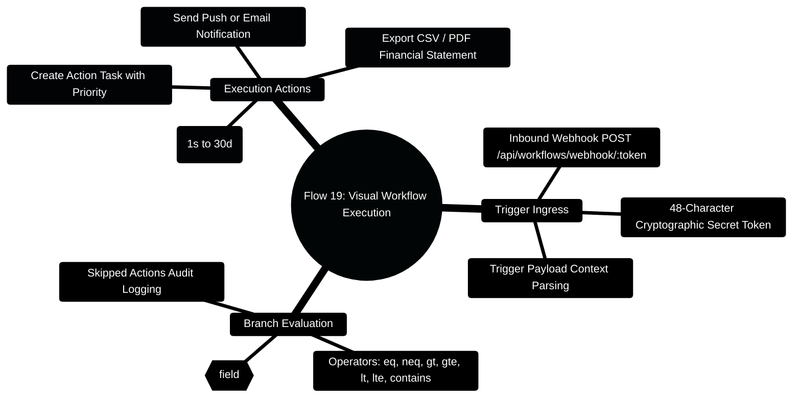

### 2. End-to-End Sequence ASCII Flow

```text
┌─────────────────────────────────────────────────────────────────────────────────────────────────┐
│ ⚡ WORKFLOW TRIGGER INGRESS: Webhook POST /api/workflows/webhook/:token                         │
└───────────────────────────────────────────────┬─────────────────────────────────────────────────┘
                                                │
                                                ▼
┌─────────────────────────────────────────────────────────────────────────────────────────────────┐
│ 🔍 STEP 1: CONTEXT PARSING & BRANCH EVALUATION (workflows.ts)                                    │
│    - Evaluates conditional rules: operator "gt", field "amount", threshold 500                  │
│    - Interpolates dynamic template variables: {{merchant}} -> "Apple Store"                     │
│    - Records bypassed steps into WorkflowRun.actions_skipped                                    │
└───────────────────────────────────────────────┬─────────────────────────────────────────────────┘
                                                │
                                                ▼
┌─────────────────────────────────────────────────────────────────────────────────────────────────┐
│ ⏱️ STEP 2: MULTI-STEP DELAY TIMER ENQUEUEING                                                    │
│    - Dispatches job to BullMQ with delay parameter: delay: 86400000 (24 hours)                  │
│    - Persists WorkflowRun state with status: "DELAYED" and records delay start timestamp        │
│    - Sweeper cron (sweepDelayedWorkflowRuns) runs every 60s to detect un-resumed workflows      │
└───────────────────────────────────────────────┬─────────────────────────────────────────────────┘
                                                │
                                                ▼ Timer Expires / Sweeper Trigger
┌─────────────────────────────────────────────────────────────────────────────────────────────────┐
│ 🚀 STEP 3: RESUMPTION & ACTION EXECUTION                                                         │
│    - Resumes workflow execution from target step index                                          │
│    - Creates prioritized action task in Task collection and dispatches push notification        │
│    - Finalizes WorkflowRun status: "COMPLETED"                                                  │
└─────────────────────────────────────────────────────────────────────────────────────────────────┘
```

---

## Flow 20: Peer Spending Benchmarks & Zero-Sum Budget Auto-Rebalancing Invariant

### 1. Colourful Mindmap

```mermaid
%%{init: {'theme': 'base', 'themeVariables': { 'primaryColor': '#d97706', 'primaryTextColor': '#ffffff', 'primaryBorderColor': '#f59e0b', 'lineColor': '#fbbf24', 'secondaryColor': '#b45309', 'tertiaryColor': '#78350f'}}}%%
mindmap
  root((Flow 20: Peer Auto-Rebalancing))
    Cohort Benchmarks
      Standard Household Peer Cohort
      Interquartile Range IQR (P25 to P75)
      Category Status: Frugal, Aligned, Elevated
    Alignment Index
      0-100% Peer Alignment Score
      Top Peer Savings Opportunity Callout
    Zero-Sum Rebalancing
      Surplus Envelope Harvesting (Spent < Planned)
      Deficit Envelope Replenishment (Spent > Planned)
      Mathematical Invariant: sum(Delta B_i) = 0
    Application & Commit
      1-Click Interactive Rebalance Plan Modal
      Instant Zero-Sum Transfer to Active Envelopes
```

### 2. End-to-End Sequence ASCII Flow

```text
┌─────────────────────────────────────────────────────────────────────────────────────────────────┐
│ 📊 USER BUDGET DASHBOARD: GET /api/v1/finance/budgets/health                                    │
└───────────────────────────────────────────────┬─────────────────────────────────────────────────┘
                                                │
                                                ▼
┌─────────────────────────────────────────────────────────────────────────────────────────────────┐
│ 🧮 STEP 1: COHORT IQR BENCHMARK COMPARISON (budgetHealthService.ts)                             │
│    - Maps user category spending percentages against household peer quintiles                   │
│    - Computes 0-100% Peer Alignment Index & highlights elevated discretionary spending          │
└───────────────────────────────────────────────┬─────────────────────────────────────────────────┘
                                                │
                                                ▼
┌─────────────────────────────────────────────────────────────────────────────────────────────────┐
│ ⚖️ STEP 2: ZERO-SUM REBALANCING PROPOSAL GENERATION                                             │
│    - Identifies surplus envelopes: S_j = planned_j - spent_j (where spent_j < planned_j)        │
│    - Identifies deficit envelopes: D_k = spent_k - planned_k (where spent_k > planned_k)        │
│    - Mathematically guarantees: Sum(Delta B_i) = 0.00 and Proposed_i >= 0.00                    │
└───────────────────────────────────────────────┬─────────────────────────────────────────────────┘
                                                │
                                                ▼ User clicks "Apply Zero-Sum Rebalance"
┌─────────────────────────────────────────────────────────────────────────────────────────────────┐
│ 💾 STEP 3: ATOMIC LEDGER COMMIT (POST /api/v1/finance/budgets/rebalance)                        │
│    - Verifies zero-sum invariant check before write                                             │
│    - Updates envelope planned amounts atomically within MongoDB transaction                     │
│    - Invalids ['budget-health', orgId] queries in TanStack client cache                         │
└─────────────────────────────────────────────────────────────────────────────────────────────────┘
```

---

## Flow 21: Continuous Production AI Canary Invariant Validation Engine

### 1. Colourful Mindmap

```mermaid
%%{init: {'theme': 'base', 'themeVariables': { 'primaryColor': '#dc2626', 'primaryTextColor': '#ffffff', 'primaryBorderColor': '#ef4444', 'lineColor': '#f87171', 'secondaryColor': '#991b1b', 'tertiaryColor': '#7f1d1d'}}}%%
mindmap
  root((Flow 21: AI Canary Engine))
    Trigger Ingress
      LangGraph Specialist Agent Output
      External LLM Provider Response
      Ad-Hoc Health Probe Probe Runner
    Validation Layers
      FastAPI Core: POST /canary/validate (:8001)
      Local TypeScript Fallback Service (:3000)
    Mathematical Invariants
      1. Number Safety: Candidate in Reference
      2. Zero-Sum: sum(Delta B) == 0
      3. Balance Sheet: Assets - Liabilities == Net Worth
      4. Cash Flow: Income - Expenses == Net Cash Flow
      5. Debt: Principal + Interest == Payment
    Circuit Actions
      Pass: Serve to Client with Invariant Badge
      Fail: Strip Narrative, Fallback to Closed-Form Math
      Prometheus Gauge Metric: canary_pass_rate
```

### 2. End-to-End Sequence ASCII Flow

```text
┌─────────────────────────────────────────────────────────────────────────────────────────────────┐
│ 🧠 SYNTHESIS CANDIDATE GENERATION: LangGraph Aggregator or LLM Output                           │
└───────────────────────────────────────────────┬─────────────────────────────────────────────────┘
                                                │
                                                ▼
┌─────────────────────────────────────────────────────────────────────────────────────────────────┐
│ 🛡️ DUAL-LAYER CANARY AUDIT: aiCanaryService.ts                                                  │
│    ├─► Step 1: Attempt call to FastAPI Core (http://localhost:8001/canary/validate)             │
│    │          Checks all 5 mathematical identities using Python Pydantic V2 model               │
│    └─► Step 2: (Fallback) If Python service times out, execute pure TypeScript decimal math     │
└───────────────────────────────────────┬─────────────────────────────────┬───────────────────────┘
                                        │                                 │
                   ✅ All 5 Invariants PASS                              ❌ Invariant Violation Detected
                                        ▼                                 ▼
┌───────────────────────────────────────────────┐ ┌───────────────────────────────────────────────┐
│ 🟢 CLEAN DELIVERY                             │ │ 🔴 CIRCUIT BREAKER ACTIVATION                 │
│    - Deliver response to client SSE stream    │ │    - Strip hallucinated narrative text        │
│    - Attach invariant verification metadata   │ │    - Substitute verified deterministic math   │
│    - Increment Prometheus pass gauge          │ │    - Log violation to AiStatusDialog Cockpit  │
└───────────────────────────────────────────────┘ └───────────────────────────────────────────────┘
```

---

## Flow 22: Offline-First Financial Journal Synchronization & 64-D Semantic Search

### 1. Colourful Mindmap

```mermaid
%%{init: {'theme': 'base', 'themeVariables': { 'primaryColor': '#4f46e5', 'primaryTextColor': '#ffffff', 'primaryBorderColor': '#6366f1', 'lineColor': '#818cf8', 'secondaryColor': '#3730a3', 'tertiaryColor': '#312e81'}}}%%
mindmap
  root((Flow 22: Offline Journal))
    Client Capture
      HTML5 Canvas Stylus Drawings
      Markdown Notes & Reflections
      Idempotent clientDraftId Generation
    Offline Storage
      localStorage Draft Queue
      PWA Service Worker Offline Detection
    Batch Sync Pipeline
      POST /api/financial-journal/entries/batch-sync
      Compound Unique Index { orgId, userId, clientKey }
      Zero Duplicate Guarantee
    Semantic Vector Indexing
      64-D Journal Embedding Space
      Cosine Similarity Concept Search
```

### 2. End-to-End Sequence ASCII Flow

```text
┌─────────────────────────────────────────────────────────────────────────────────────────────────┐
│ 📱 USER CLIENT (Offline / Airplane Mode): Writes notes & sketches in Notes.tsx                  │
└───────────────────────────────────────────────┬─────────────────────────────────────────────────┘
                                                │
                                                ▼
┌─────────────────────────────────────────────────────────────────────────────────────────────────┐
│ 💾 LOCAL QUEUEING: Preserves entry in localStorage with uuid clientDraftId                      │
└───────────────────────────────────────────────┬─────────────────────────────────────────────────┘
                                                │
                                                ▼ Network Connectivity Restored (window 'online')
┌─────────────────────────────────────────────────────────────────────────────────────────────────┐
│ 🔄 BATCH SYNCHRONIZATION: POST /api/financial-journal/entries/batch-sync                        │
│    - Dispatches payload: { entries: [ { clientKey, content, strokes, tags, createdAt } ] }      │
│    - MongoDB executes atomic bulkWrite with upsert on compound index { orgId, userId, clientKey }│
│    - Calculates 64-D semantic embedding vector for content and tags via journalEmbeddingService │
└───────────────────────────────────────────────┬─────────────────────────────────────────────────┘
                                                │
                                                ▼
┌─────────────────────────────────────────────────────────────────────────────────────────────────┐
│ 🔍 SEMANTIC VECTOR SEARCH: User searches "#investment-notes" in journal drawer                  │
│    - Generates 64-D query embedding vector                                                      │
│    - Computes cosine similarity against all user notes: sim = dot(v_query, v_entry)             │
│    - Returns ranked results with match confidence pills                                         │
└─────────────────────────────────────────────────────────────────────────────────────────────────┘
```

---

## Flow 23: Global Multi-Currency FX Engine across 7 Currencies & Withholding Tax Relief

### 1. Colourful Mindmap

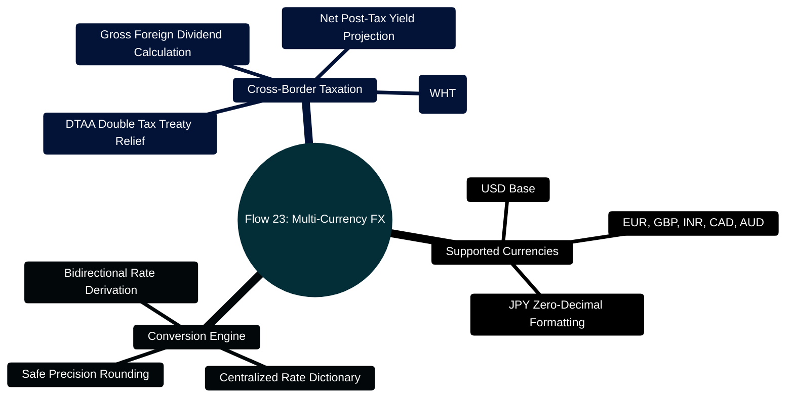

### 2. End-to-End Sequence ASCII Flow

```text
┌─────────────────────────────────────────────────────────────────────────────────────────────────┐
│ 🌍 CROSS-BORDER ASSET INGESTION: Foreign Asset Purchase (e.g., Tokyo Stock Exchange 7203 JPY)  │
└───────────────────────────────────────────────┬─────────────────────────────────────────────────┘
                                                │
                                                ▼
┌─────────────────────────────────────────────────────────────────────────────────────────────────┐
│ 💱 STANDARDIZED FX CONVERSION (currencyFx.ts)                                                   │
│    - Base Currency: User Profile (e.g. USD)                                                     │
│    - Lookup rate: FX_RATES['JPY'] = 152.40                                                      │
│    - Converted: Amount_USD = Amount_JPY / 152.40                                                │
│    - Zero-Decimal Rule: JPY values formatted with 0 decimal places; all others with 2 decimals   │
└───────────────────────────────────────────────┬─────────────────────────────────────────────────┘
                                                │
                                                ▼
┌─────────────────────────────────────────────────────────────────────────────────────────────────┐
│ 📜 DIVIDEND WITHHOLDING TAX (WHT) RELIEF MODELING                                                │
│    - Gross Foreign Dividend = $1,000 USD equivalent                                             │
│    - Statutory WHT Rate = 30%                                                                   │
│    - Applicable DTAA Treaty Relief Rate = 15%                                                   │
│    - Foreign Tax Credit (FTC) Offset = $150 USD                                                 │
│    - True Net Post-Tax Yield = Gross - (Statutory - Treaty Relief)                              │
└─────────────────────────────────────────────────────────────────────────────────────────────────┘
```

---

## Flow 24: Financial Calendar Live RFC 5545 iCal Feed & Reminder Engine

### 1. Colourful Mindmap

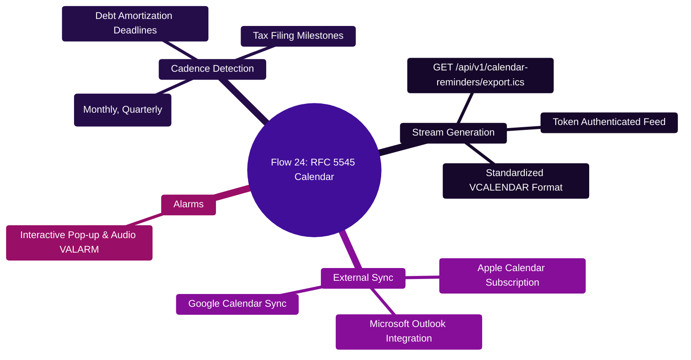

### 2. End-to-End Sequence ASCII Flow

```text
┌─────────────────────────────────────────────────────────────────────────────────────────────────┐
│ 📱 EXTERNAL CALENDAR SUBSCRIPTION: webcal://finwise.local/api/v1/calendar-reminders/export.ics  │
└───────────────────────────────────────────────┬─────────────────────────────────────────────────┘
                                                │
                                                ▼
┌─────────────────────────────────────────────────────────────────────────────────────────────────┐
│ 🔷 API GATEWAY: calendarReminderController.ts                                                   │
│    - Authenticates subscription token and resolves user organization                            │
│    - Streams RFC 5545 VCALENDAR payload with Content-Type: text/calendar; charset=utf-8        │
│    - Emits VEVENT entities with UID, DTSTAMP, DTSTART, SUMMARY, and VALARM reminder blocks      │
└───────────────────────────────────────────────┬─────────────────────────────────────────────────┘
                                                │
                                                ▼
┌─────────────────────────────────────────────────────────────────────────────────────────────────┐
│ ⏰ USER NOTIFICATION: Device fires alarm 24 hours prior to bill due date                        │
└─────────────────────────────────────────────────────────────────────────────────────────────────┘
```

---

## Flow 25: AI System Diagnostics Cockpit & Multi-Key Health Inspection

### 1. Colourful Mindmap

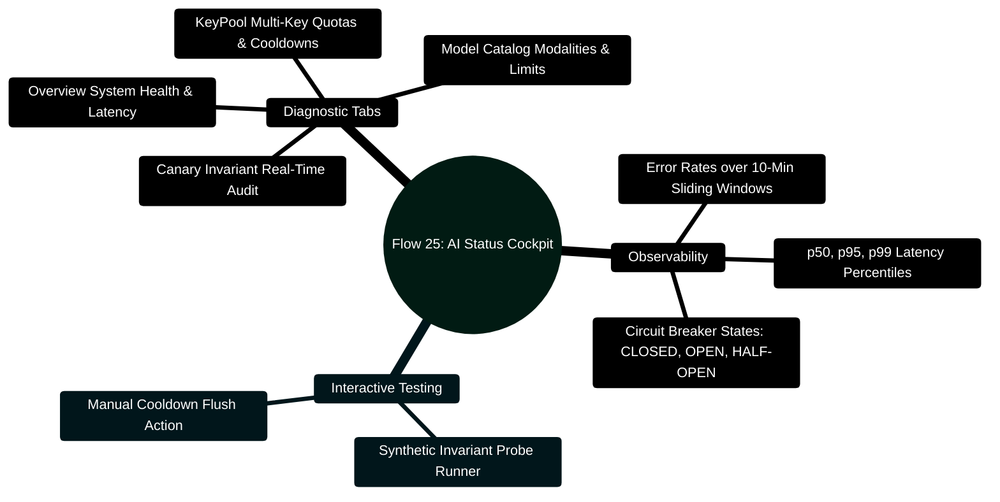

### 2. End-to-End Sequence ASCII Flow

```text
┌─────────────────────────────────────────────────────────────────────────────────────────────────┐
│ 🖥️ USER CLICKS AI STATUS PILL: Opens AiStatusDialog.tsx modal                                    │
└───────────────────────────────────────────────┬─────────────────────────────────────────────────┘
                                                │
                                                ▼
┌─────────────────────────────────────────────────────────────────────────────────────────────────┐
│ 📡 SIMULTANEOUS DIAGNOSTIC QUERIES:                                                             │
│    ├─► GET /api/v1/ai/status (Provider health, active model, latency)                           │
│    ├─► GET /api/v1/ai/keypool (Active keys, cooldown timers, circuit breaker states)            │
│    ├─► GET /api/v1/ai/models (Model catalog capabilities & context limits)                      │
│    └─► GET /api/v1/ai/canary/status (Pass rates across 5 mathematical invariants)               │
└───────────────────────────────────────────────┬─────────────────────────────────────────────────┘
                                                │
                                                ▼
┌─────────────────────────────────────────────────────────────────────────────────────────────────┐
│ 📊 REACTIVE COCKPIT DISPLAY: Displays live metrics, health badges, and probe test runner        │
└─────────────────────────────────────────────────────────────────────────────────────────────────┘
```


```mermaid
%%{init: {'theme': 'base', 'themeVariables': { 'primaryColor': '#d97706', 'primaryTextColor': '#ffffff', 'primaryBorderColor': '#f59e0b', 'lineColor': '#fbbf24', 'secondaryColor': '#b45309', 'tertiaryColor': '#78350f'}}}%%
mindmap
  root((Flow 20: Peer Auto-Rebalancing))
    Cohort Benchmarks
      Standard Household Peer Cohort
      Interquartile Range IQR (P25 to P75)
      Category Status: Frugal, Aligned, Elevated
    Alignment Index
      0-100% Peer Alignment Score
      Top Peer Savings Opportunity Callout
    Zero-Sum Rebalancing
      Surplus Envelope Harvesting (Spent < Planned)
      Deficit Envelope Replenishment (Spent > Planned)
      Mathematical Invariant: sum(Delta B_i) = 0
    Application & Commit
      1-Click Interactive Rebalance Plan Modal
      Instant Zero-Sum Transfer to Active Envelopes
```


---

## Flow 26: Cross-Silo Unified Context Retrieval & Reciprocal Rank Fusion

### 1. Colourful Mindmap

```mermaid
%%{init: {'theme': 'base', 'themeVariables': { 'primaryColor': '#0284c7', 'primaryTextColor': '#ffffff', 'primaryBorderColor': '#38bdf8', 'lineColor': '#0ea5e9', 'secondaryColor': '#0369a1', 'tertiaryColor': '#0c4a6e'}}}%%
mindmap
  root((Flow 26: Unified Context Engine))
    Data Silos
      User Memory Preferences & Rules
      Workspace Documents & PDFs
      Ledger Transactions & Spending
    Scoring & Ranking
      64-D Dense Semantic Embeddings
      BM25 Lexical Keyword Matching
      Transaction Exponential Recency Decay
    Fusion Layer
      Reciprocal Rank Fusion (RRF k = 60)
      Query Intent Biasing (w_s = 1.35)
      Global Score Normalization (0-100)
    Prompt Synthesis
      Citation Tagging [mem:key], [doc:p.n], [txn:id]
      LLM System Prompt Injection
```

### 2. End-to-End Sequence ASCII Flow

```text
┌─────────────────────────────────────────────────────────────────────────────────────────────────┐
│ 🔍 USER QUERY INGRESS: "How much did I spend on dining relative to my dining budget rule?"      │
└───────────────────────────────────────────────┬─────────────────────────────────────────────────┘
                                                │
                                                ▼
┌─────────────────────────────────────────────────────────────────────────────────────────────────┐
│ 🧠 STEP 1: QUERY INTENT DETECTION & 64-D EMBEDDING GENERATION                                   │
│    - Intent keywords: "budget rule" (boost memory w=1.35), "spend" (boost transactions w=1.35)  │
│    - Generates 64-D dense L2-normalized vector embedding for query string                       │
└───────────────────────────────────────────────┬─────────────────────────────────────────────────┘
                                                │
                                                ▼
┌─────────────────────────────────────────────────────────────────────────────────────────────────┐
│ 🗄️ STEP 2: CONCURRENT CROSS-SILO SCORING (unifiedContextRetrievalService.ts)                   │
│    ├─► Memory Silo: Scored by cosine similarity + exact key match                                │
│    ├─► Document Silo: Scored by hybrid BM25 + cosine similarity                                  │
│    └─► Transaction Silo: Scored by text match + amount bonus * exp(-lambda * delta_t)            │
└───────────────────────────────────────────────┬─────────────────────────────────────────────────┘
                                                │
                                                ▼
┌─────────────────────────────────────────────────────────────────────────────────────────────────┐
│ ⚖️ STEP 3: RECIPROCAL RANK FUSION (RRF k=60) & NORMALIZATION                                    │
│    - Computes RRF score: RRF(d) = sum( w_s / (60 + rank_s(d)) )                                 │
│    - Sorts all candidate items globally across silos by RRF score descending                    │
│    - Assigns composite 0-100 scores and attaches verifiable citations                           │
└───────────────────────────────────────────────┬─────────────────────────────────────────────────┘
                                                │
                                                ▼
┌─────────────────────────────────────────────────────────────────────────────────────────────────┐
│ 📝 STEP 4: GROUNDED CONTEXT SYNTHESIS                                                           │
│    - Formats verified facts into structured markdown context block                              │
│    - Injects into LLM copilot prompt or LangGraph agent state graph                             │
└─────────────────────────────────────────────────────────────────────────────────────────────────┘
```


---

## Flow 27: Adaptive Follow-Through Recommendation & Preference Reinforcement Lifecycle

### 1. Colourful Mindmap

```mermaid
%%{init: {'theme': 'base', 'themeVariables': { 'primaryColor': '#059669', 'primaryTextColor': '#ffffff', 'primaryBorderColor': '#10b981', 'lineColor': '#34d399', 'secondaryColor': '#064e3b', 'tertiaryColor': '#047857'}}}%%
mindmap
  root((Flow 27: Follow-Through Engine))
    Signal Harvester
      Task Overdue Flags
      Goal Pace Deficits
      Budget Overspend Alerts
      Calendar Bill Reminders
    Ranking Algorithm
      14-Day Half-Life Decay w(t)
      Impact x Urgency x Affinity
      Priority Tiers Critical to Low
    Reinforcement Loop
      Feedback POST /follow-through/feedback
      Affinity Increments +0.15 on Complete
      Affinity Penalties -0.10 on Dismiss
```

### 2. End-to-End Sequence ASCII Flow

```text
┌─────────────────────────────────────────────────────────────────────────────────────────────────┐
│ 📱 USER DASHBOARD: GET /api/v1/follow-through/recommendations                                   │
└───────────────────────────────────────────────┬─────────────────────────────────────────────────┘
                                                │
                                                ▼
┌─────────────────────────────────────────────────────────────────────────────────────────────────┐
│ 🔍 STEP 1: MULTI-SOURCE ACTIVITY SIGNAL HARVESTING (followThroughService.ts)                   │
│    - Gathers open tasks, lagging financial goals, overspent envelopes, and upcoming bills       │
│    - Evaluates 14-day exponential half-life time decay: w(t) = exp(-ln(2) * dt / 14)            │
│    - Modulates priority score by learned user domain affinities                                 │
└───────────────────────────────────────────────┬─────────────────────────────────────────────────┘
                                                │
                                                ▼ User completes high-priority debt paydown task
┌─────────────────────────────────────────────────────────────────────────────────────────────────┐
│ 🔄 STEP 2: REINFORCEMENT AFFINITY UPDATE (POST /api/v1/follow-through/feedback)                 │
│    - Bumps debt domain affinity by +0.15                                                        │
│    - Persists updated preference weights in FollowThroughPreference collection                  │
└─────────────────────────────────────────────────────────────────────────────────────────────────┘
```

---

## Flow 28: Semantic Document Q&A & Physical Page Attribution Lifecycle

### 1. Colourful Mindmap

```mermaid
%%{init: {'theme': 'base', 'themeVariables': { 'primaryColor': '#2563eb', 'primaryTextColor': '#ffffff', 'primaryBorderColor': '#60a5fa', 'lineColor': '#93c5fd', 'secondaryColor': '#1e40af', 'tertiaryColor': '#1e3a8a'}}}%%
mindmap
  root((Flow 28: Document Q&A))
    Ingress
      User Chat Ingestion
      Workspace File Context
    Hybrid Retrieval
      64-D Dense Cosine Sim
      BM25 Lexical Keyword Scorer
      Grounded Gate G >= 0.70
    Physical Page Parity
      PDF Form Feed Retained (\f)
      Citation [file:page:chunk]
    UI Presentation
      ChatDocumentCard.tsx
      One-Click PDF Download Link
```

### 2. End-to-End Sequence ASCII Flow

```text
┌─────────────────────────────────────────────────────────────────────────────────────────────────┐
│ 💬 USER CHAT QUESTION: "What is my total taxable income on my uploaded 1040 form?"             │
└───────────────────────────────────────────────┬─────────────────────────────────────────────────┘
                                                │
                                                ▼
┌─────────────────────────────────────────────────────────────────────────────────────────────────┐
│ 🔍 STEP 1: HYBRID MULTI-MODAL RETRIEVAL (documentQAService.ts)                                  │
│    - Queries 64-D vectors + BM25 lexical scorer across workspace knowledge chunks               │
│    - Enforces physical page attribution invariance from form-feed markers (\f)                  │
│    - Verifies Grounding Score G >= 0.70                                                         │
└───────────────────────────────────────────────┬─────────────────────────────────────────────────┘
                                                │
                                                ▼
┌─────────────────────────────────────────────────────────────────────────────────────────────────┐
│ 📄 STEP 2: CLIENT EVIDENCE CARD RENDERING (ChatDocumentCard.tsx)                                │
│    - Renders interactive card with title, page count badge, and exact page number citations     │
│    - User click opens verified excerpt drawer and downloads PDFKit compiled statement          │
└─────────────────────────────────────────────────────────────────────────────────────────────────┘
```
