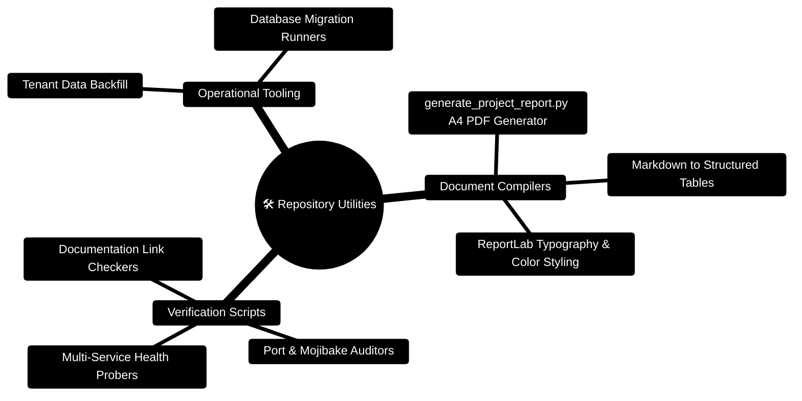

# FinWise Scripts — Repository Automation & Report Utilities

> **Automated PDF Report Generators, Documentation Compilers, and Operational Utilities**  
> *ReportLab A4 Multi-Page Layouts, Markdown-to-PDF Transformation, and Continuous Verification Tooling*

---

> [!TIP]
> **Developer Guide: Building on FinWise**  
> For complete end-to-end full-stack feature recipes, Mongoose models, Zod schemas, Express controllers, and Python LangGraph subagents, consult the [**Master Developer Handbook: Building on This Project**](../docs/BUILDING_ON_THIS_PROJECT.md).

## 1. Scripts & Utilities Mindmap



---

## 2. PDF Report Generation ASCII Flow

```text
┌─────────────────────────────────────────────────────────────────────────────┐
│ 📄 INPUT SOURCE DOCUMENTATION                                               │
│    docs/DEPLOYMENT_READINESS.md • Markdown Headings, Paragraphs, Tables     │
└──────────────────────────────────────┬──────────────────────────────────────┘
                                       │
                                       ▼
┌─────────────────────────────────────────────────────────────────────────────┐
│ ⚙️ REPORTLAB TRANSFORMATION ENGINE (scripts/generate_project_report.py)      │
│    1. Markdown Parsing ──► 2. Style Token Application ──► 3. Flowable Story │
│    Typography: Helvetica-Bold Headers, Two-Tone Table Rows, Clean Margins   │
└──────────────────────────────────────┬──────────────────────────────────────┘
                                       │
                                       ▼
┌─────────────────────────────────────────────────────────────────────────────┐
│ 📑 GENERATED ENTERPRISE PDF ARTIFACT                                        │
│    output/pdf/personal-finance-project-report.pdf                           │
└─────────────────────────────────────────────────────────────────────────────┘
```

---

## 3. Developer Guide: Running and Adding Utility Scripts

### Running the Project Report Generator
```bash
# Ensure Python dependencies are installed
pip install reportlab

# Execute the generator
python scripts/generate_project_report.py
```

### Script Development Conventions
- Use standard library or explicitly declare dependencies in root comments.
- Resolve repository root dynamically via `Path(__file__).resolve().parents[1]`.
- Output generated artifacts to `output/` directory (gitignored).


---

## 4. ReportLab PDF Compiler Blueprint (`scripts/generate_project_report.py`)

```python
from pathlib import Path
from reportlab.lib import colors
from reportlab.lib.pagesizes import A4
from reportlab.lib.styles import ParagraphStyle
from reportlab.platypus import Paragraph, Spacer, Table, TableStyle

ROOT = Path(__file__).resolve().parents[1]
SOURCE = ROOT / "docs" / "DEPLOYMENT_READINESS.md"
OUTPUT = ROOT / "output" / "pdf" / "personal-finance-project-report.pdf"

def build_pdf_story(markdown_text: str):
    body_style = ParagraphStyle(
        "body",
        fontName="Helvetica",
        fontSize=9.5,
        leading=13.0,
        textColor=colors.HexColor("#202b3c")
    )
    title_style = ParagraphStyle(
        "title",
        parent=body_style,
        fontName="Helvetica-Bold",
        fontSize=15.0,
        leading=18.0,
        textColor=colors.HexColor("#172b4d")
    )

    story = []
    # Parse Markdown blocks into Flowable elements
    for line in markdown_text.splitlines():
        if line.startswith("# "):
            story.append(Paragraph(line[2:], title_style))
            story.append(Spacer(1, 10))
        elif line.strip():
            story.append(Paragraph(line, body_style))
            story.append(Spacer(1, 6))

    return story
```

### 4.1 Automated Operational Scripts Inventory

| Script | Runtime | Purpose |
| :--- | :--- | :--- |
| `scripts/generate_project_report.py` | Python 3.11+ | Compiles deployment readiness markdown into a 6-page A4 executive PDF |
| `server/scripts/build.mjs` | Node 24 | Compiles Express 5 and BullMQ worker into standalone ESM bundles |
| `server/src/scripts/generateSOPPdf.ts` | Node 24 / tsx | Renders the official Statement of Purpose framework PDF |
| `server/src/scripts/generateSOPSamplePdf.ts` | Node 24 / tsx | Renders the sample reference SOP template PDF |
| `server/src/scripts/backfillWorkspaceChunks.ts` | Node 24 / tsx | Backfills legacy documents into `WorkspaceKnowledgeChunk` records |
