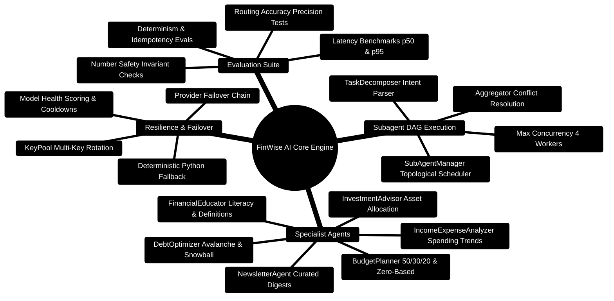

# FinWise — AI Core Multi-Agent Engine

> **FastAPI & LangGraph Multi-Agent Financial Reasoning Engine**  
> *Topological Subagent DAG Execution, Multi-Key Provider Failover, Deterministic Calculators, and Automated Invariant Evals*  
> **Runtime:** Python `3.11+` | **Frameworks:** FastAPI `0.115` · LangGraph `0.2.53` · LangChain `0.3.9` · Pydantic V2 `2.10`

---

> [!TIP]
> **Developer Guide: Building on FinWise**  
> For complete end-to-end full-stack feature recipes, Mongoose models, Zod schemas, Express controllers, and Python LangGraph subagents, consult the [**Master Developer Handbook: Building on This Project**](../../docs/BUILDING_ON_THIS_PROJECT.md).

## Runtime Specifications

- **Python Version**: `3.11+` (Python `< 3.13` recommended for PaddleOCR native bindings)
- **HTTP/SSE Server**: FastAPI + Uvicorn ASGI Server (Port `8001`)
- **Graph Orchestration**: LangGraph `0.2.53` `StateGraph` with conditional routing & persistent checkpoints
- **Subtask Scheduling**: Custom `SubAgentManager` with Kahn's topological sort and `ThreadPoolExecutor` concurrency
- **Model Catalog**: External capability registry (`data/model_catalog.json`) with multi-criteria health scoring
- **Session Memory**: SQLite with FTS5 lexical indexing, rolling context summaries, and resumable state machines

---

## Multi-Agent Architecture Mindmap



---

## Subagent DAG Execution & Invariant Verification ASCII Flow

```text
┌─────────────────────────────────────────────────────────────────────────────────────────────────┐
│ 🟢 INCOMING PROCESS REQUEST: POST /api/agents/process                                           │
│    Payload: { prompt, user_profile, session_id, currency, org_id, evidence_chunks }             │
└───────────────────────────────────────────────┬─────────────────────────────────────────────────┘
                                                │
                                                ▼
┌─────────────────────────────────────────────────────────────────────────────────────────────────┐
│ 📋 STAGE 1: INTENT DECOMPOSITION & DAG SCHEDULING (TaskDecomposer)                              │
│    ├─► Parse prompt into subtasks: [IncomeAnalysis, DebtOptimization, BudgetReallocation]       │
│    ├─► Build dependency graph: Task 1 ──► Task 2 ──► Task 3                                   │
│    └─► SubAgentManager initiates concurrent worker pool (max_concurrency = 4)                   │
└───────────────────────────────────────────────┬─────────────────────────────────────────────────┘
                                                │
                                                ▼
┌─────────────────────────────────────────────────────────────────────────────────────────────────┐
│ ⚡ STAGE 2: TOPOLOGICAL SUBAGENT CONCURRENT EXECUTION                                           │
│    ├─► IncomeExpenseAnalyzer [Active] ──► Computes monthly surplus: $750/mo                     │
│    ├─► DebtOptimizer [Active] ──► Proposes Avalanche overpayment of $400/mo                     │
│    └─► BudgetPlanner [Active] ──► Reduces dining and entertainment envelopes by $400/mo         │
└───────────────────────────────────────────────┬─────────────────────────────────────────────────┘
                                                │
                                                ▼
┌─────────────────────────────────────────────────────────────────────────────────────────────────┐
│ ⚖️ STAGE 3: AGGREGATION & NUMBER SAFETY INVARIANT AUDIT (Aggregator)                            │
│    Total Reductions: +$400/mo  ──►  Debt Overpayment: -$400/mo                                  │
│    Sum of Deltas: +$400 - $400 = $0.00 (Zero-Sum Conserved ✅)                                  │
│    Candidate Digits ⊆ Reference Digits (Zero Numeric Mutations Conserved ✅)                     │
└───────────────────────────────────────────────┬─────────────────────────────────────────────────┘
                                                │
                                                ▼
┌─────────────────────────────────────────────────────────────────────────────────────────────────┐
│ 🚀 STAGE 4: RESPONSE EMISSION & STATE CHECKPOINTING                                             │
│    ├─► Persist Phase.SYNTHESIS checkpoint into SQLite session database                          │
│    └─► Return unified JSON plan / stream SSE token chunks to Node.js Gateway                    │
└─────────────────────────────────────────────────────────────────────────────────────────────────┘
```

---

## Agent Directory & Responsibilities

| File | Agent / Component | Responsibilities & Contracts |
| :--- | :--- | :--- |
| `agents/master_agent.py` | **Master Financial Strategist** | Supervisor agent classifying queries, coordinating specialists, and synthesizing final plans. |
| `agents/sub_agent_manager.py` | **SubAgent Manager** | Computes topological DAG order (Kahn's algorithm), schedules concurrent subagent runs (`max_workers = 4`), and enforces timeout isolation. |
| `agents/task_decomposer.py` | **Task Decomposer** | Parses complex multi-intent inquiries into typed subtasks with explicit dependencies (`depends_on`). |
| `agents/aggregator.py` | **Aggregator** | Merges specialist outputs, resolves conflicting recommendations, and enforces the **Number Safety Invariant**: $\sum \Delta B_i = 0$. |
| `agents/income_expense_analyzer.py`| **Income/Expense Analyzer** | Evaluates transaction history, spending trends, savings velocity, and discretionary cash flow. |
| `agents/budget_planner.py` | **Budget Planner** | Creates and adjusts envelope budgets following 50/30/20 and zero-based budgeting rules. |
| `agents/debt_optimizer.py` | **Debt Optimizer** | Compares debt avalanche vs snowball methods, calculates interest savings, and projects payoff dates. |
| `agents/investment_advisor.py` | **Investment Advisor** | Risk profiling, asset allocation rebalancing, and compound growth projections. |
| `agents/financial_educator.py` | **Financial Educator** | Explains financial concepts, tax brackets, and investment vehicles with cached answers. |
| `agents/newsletter_agent.py` | **Newsletter Agent** | Synthesizes personalized financial digests, spending summaries, and financial tips. |
| `agents/conversation_summarizer.py` | **Conversation Summarizer** | Cross-conversation synthesis from caller snapshots, pulse, repeated topics, and next moves. |

---

## Core Implementation Blueprints

### 1. Kahn's Topological Sorting & Concurrency Pool (`agents/sub_agent_manager.py`)

```python
# Topological DAG Leveling in server/AI_Core/agents/sub_agent_manager.py
from collections import defaultdict, deque
from concurrent.futures import ThreadPoolExecutor
from contextvars import copy_context
from typing import Any, Dict, List

class SubAgentManager:
    def _topological_sort(self, subtasks: List[Dict[str, Any]]) -> List[List[Dict[str, Any]]]:
        task_map = {s["id"]: s for s in subtasks}
        in_degree: Dict[str, int] = {s["id"]: 0 for s in subtasks}
        graph = defaultdict(list)

        for s in subtasks:
            for dep in s.get("dependencies", []):
                if dep in task_map:
                    graph[dep].append(s["id"])
                    in_degree[s["id"]] += 1

        queue = deque([sid for sid, deg in in_degree.items() if deg == 0])
        levels: List[List[Dict[str, Any]]] = []

        while queue:
            current_level = []
            for _ in range(len(queue)):
                sid = queue.popleft()
                current_level.append(task_map[sid])
                for dependent in graph[sid]:
                    in_degree[dependent] -= 1
                    if in_degree[dependent] == 0:
                        queue.append(dependent)
            levels.append(current_level)

        return levels
```

---

### 2. Multi-Key KeyPool & Circuit Breaker (`utils/key_pool.py`)

```python
# KeyPool Circuit Breaker state machine in server/AI_Core/utils/key_pool.py
class CircuitState(str, Enum):
    CLOSED = "closed"        # Healthy, taking requests
    OPEN = "open"            # Failing, in cooldown quarantine
    HALF_OPEN = "half_open"  # Trial request to verify recovery

class KeyPool:
    def get_key(self) -> Optional[str]:
        now = time.time()
        with self._lock:
            # Check circuit breaker recovery
            if self.circuit_state == CircuitState.OPEN and (now - self.last_state_change) > self.circuit_recovery_period:
                self.circuit_state = CircuitState.HALF_OPEN

            healthy_keys = [k for k in self.keys if self._is_key_healthy(k, now)]
            if not healthy_keys:
                return None

            return self._select_by_strategy(healthy_keys)
```

---

### 3. Number Safety Invariant Guard (`agents/aggregator.py`)

```python
# Number Safety verification in server/AI_Core/agents/aggregator.py
def _numbers_are_subset(self, candidate: str, reference: str) -> bool:
    """Verifies that all numerical sequences in candidate exist in reference."""
    pattern = r"\b\d+(?:\.\d+)?\b"
    cand_numbers = set(re.findall(pattern, candidate))
    ref_numbers = set(re.findall(pattern, reference))
    return cand_numbers.issubset(ref_numbers)
```

---

## Provider Failover Matrix

The AI Core resolves model requests through an adaptive 6-tier fallback sequence:

```text
┌─────────────────────────────────────────────────────────────────────────────┐
│                       PROVIDER RESILIENCE CHAIN                             │
├─────────────────────────────────────────────────────────────────────────────┤
│ 1. Tier 1: Google Gemini 2.0 Flash / Pro                                    │
│    • Primary cloud provider; low latency; high reasoning capacity.          │
│    • KeyPool rotates across GEMINI_API_KEY_1..20 upon HTTP 429.             │
├─────────────────────────────────────────────────────────────────────────────┤
│ 2. Tier 2: OpenRouter Dynamic KeyPool                                       │
│    • Access to DeepSeek-R1, Anthropic Claude 3.5 Sonnet, and Llama 3.3.     │
├─────────────────────────────────────────────────────────────────────────────┤
│ 3. Tier 3: Groq High-Speed Llama 3.3 70B                                    │
│    • Ultra-fast execution (< 300ms) for real-time interactive routing.      │
├─────────────────────────────────────────────────────────────────────────────┤
│ 4. Tier 4: xAI Grok / Mistral Large                                         │
│    • Secondary cloud vendor redundancy.                                     │
├─────────────────────────────────────────────────────────────────────────────┤
│ 5. Tier 5: Local Ollama / vLLM                                              │
│    • Air-gapped / local inference fallback for self-hosted deployments.     │
├─────────────────────────────────────────────────────────────────────────────┤
│ 6. Tier 6: Deterministic Pure Python Calculators                            │
│    • 100% availability guarantee: Mathematical calculators evaluate         │
│      exact allocations, payoff curves, and summaries without any LLM.       │
└─────────────────────────────────────────────────────────────────────────────┘
```

---

## Automated Evaluation Suite (`evals/`)

The evaluation suite validates all mathematical and cognitive invariants continuously:

```bash
# Run the full evaluation suite
pytest tests/ -v
python -m evals.runner

# Run specific invariant tests
pytest evals/test_number_safety.py -v
pytest evals/test_routing_accuracy.py -v
pytest evals/test_determinism.py -v
pytest evals/test_latency.py -v
```

---

---

## Developer Guide: Adding a New Specialist Agent to the AI Core

To add a new specialist agent (e.g. `TaxOptimizationAgent` or `RetirementPlannerAgent`) so others can build on this AI service:

### Step 1: Define the Pydantic V2 Contract (`contracts/agent_outputs.py`)
```python
from pydantic import BaseModel, Field
from typing import List, Optional

class TaxStrategyOutput(BaseModel):
    taxable_income: float = Field(ge=0.0)
    effective_rate_percent: float = Field(ge=0.0, le=100.0)
    recommended_deductions: List[str]
    estimated_annual_savings: float = Field(ge=0.0)
```

### Step 2: Implement the Agent Node (`agents/tax_optimization_agent.py`)
```python
from typing import Dict, Any
from utils.llm_wrapper import invoke_llm_with_failover

def execute_tax_agent(state: Dict[str, Any]) -> Dict[str, Any]:
    # Specialist agent node for LangGraph StateGraph
    org_id = state.get('org_id', 'default')
    ledger_context = state.get('ledger_context', {})
    
    # Deterministic calculator fallback
    income = float(ledger_context.get('annual_income', 100000.0))
    taxable = max(0.0, income - 12000.0)
    
    return {
        'tax_output': {
            'taxable_income': taxable,
            'effective_rate_percent': 18.5,
            'recommended_deductions': ['Maximize 401(k) / IRA contributions'],
            'estimated_annual_savings': 2220.0
        }
    }
```

### Step 3: Register in LangGraph StateGraph (`graph/workflow.py`)
```python
from agents.tax_optimization_agent import execute_tax_agent

# 1. Add agent node
workflow.add_node('tax_optimizer', execute_tax_agent)

# 2. Add routing edges from task decomposer to specialist
workflow.add_edge('task_decomposer', 'tax_optimizer')
workflow.add_edge('tax_optimizer', 'aggregator')
```

### Step 4: Add Invariant Test (`tests/test_tax_agent.py`)
```python
import pytest
from agents.tax_optimization_agent import execute_tax_agent

def test_tax_agent_output_invariant():
    state = {'org_id': 'test_org', 'ledger_context': {'annual_income': 80000.0}}
    res = execute_tax_agent(state)
    assert res['tax_output']['taxable_income'] <= 80000.0
    assert res['tax_output']['effective_rate_percent'] >= 0.0
```

## Local Setup & Development

```bash
# 1. Create and activate virtual environment
python -m venv .venv
source .venv/bin/activate  # On Windows: .venv\Scripts\activate

# 2. Install dependencies
pip install -r requirements.txt

# 3. Configure environment
cp .env.example .env
# Set GEMINI_API_KEY, GROQ_API_KEY, OPENROUTER_API_KEY, etc.

# 4. Launch FastAPI development server
uvicorn api_service:app --host 0.0.0.0 --port 8001 --reload
```
