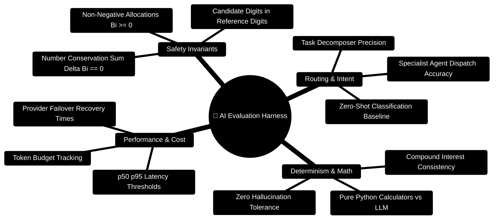

# FinWise AI Core — Evaluation & Invariant Verification Harness

> **Automated Quality Gates, Invariant Verification, and Benchmarking Suite for Multi-Agent Financial Reasoning**  
> *Number Safety Invariants ($\text{Candidate Digits} \subseteq \text{Reference Digits}$), Task Routing Accuracy, Deterministic Calculator Verification, and Latency Profiling*  
> **Execution Commands:** `pytest evals/ -v` · `python -m evals.runner`

---

> [!TIP]
> **Developer Guide: Building on FinWise**  
> For complete end-to-end full-stack feature recipes, Mongoose models, Zod schemas, Express controllers, and Python LangGraph subagents, consult the [**Master Developer Handbook: Building on This Project**](../../../docs/BUILDING_ON_THIS_PROJECT.md).

## 1. Evaluation Taxonomy Mindmap



---

## 2. Invariant Evaluation Pipeline ASCII Flow

```text
┌─────────────────────────────────────────────────────────────────────────────┐
│ 🧪 EVALUATION RUNNER (python -m evals.runner)                               │
│    Loads Test Suites • Configures Mock Providers • Sets Deterministic Seeds │
└──────────────────────────────────────┬──────────────────────────────────────┘
                                       │
                                       ▼
┌─────────────────────────────────────────────────────────────────────────────┐
│ 🔍 INVARIANT VERIFICATION GATES                                              │
│    ├─► 1. test_number_safety.py: Asserts no hallucinated dollar figures      │
│    │      Invariant: Every number in output must trace to ledger inputs     │
│    ├─► 2. test_routing_accuracy.py: Verifies TaskDecomposer dispatches      │
│    ├─► 3. test_determinism.py: Asserts repeat queries yield exact math      │
│    └─► 4. test_latency.py: Enforces SLA response deadlines (< 3.0s p95)     │
└──────────────────────────────────────┬──────────────────────────────────────┘
                                       │
                                       ▼
┌─────────────────────────────────────────────────────────────────────────────┐
│ 📊 OUTPUT METRICS & REPORT                                                  │
│    Console Summary • JSON Artifacts in evals/reports/ • CI Exit Code 0/1    │
└─────────────────────────────────────────────────────────────────────────────┘
```

---

## 3. Developer Guide: How to Add an Evaluation for a New Agent

When you build a new specialist agent (e.g. `TaxOptimizationAgent`), add an evaluation test to ensure it meets production invariants.

Create `server/AI_Core/evals/test_tax_agent_eval.py`:

```python
import pytest
from agents.tax_optimization_agent import execute_tax_agent
from evals.metrics import assert_number_safety

def test_tax_agent_math_safety():
    """
    Ensures that tax savings calculations do not exceed allowable deductions
    and only use numbers grounded in the input ledger.
    """
    input_ledger = {
        "annual_income": 95000.0,
        "retirement_contributions": 10000.0,
        "standard_deduction": 14600.0
    }
    
    state = {
        "org_id": "eval_tenant",
        "user_query": "How can I reduce my tax liability?",
        "ledger_context": input_ledger
    }
    
    result = execute_tax_agent(state)
    tax_output = result.get("tax_output", {})
    
    # 1. Invariant: Taxable income cannot be negative
    assert tax_output["taxable_income"] >= 0.0
    
    # 2. Invariant: Taxable income cannot exceed gross income
    assert tax_output["taxable_income"] <= input_ledger["annual_income"]
    
    # 3. Invariant: Candidate Digits must be grounded in reference input
    reference_corpus = f"{input_ledger['annual_income']} {input_ledger['retirement_contributions']} {input_ledger['standard_deduction']}"
    assert_number_safety(candidate=str(tax_output), reference=reference_corpus)
```

---

## 4. Evaluation CLI Reference

```bash
# Run all evaluation suites with verbose output
pytest evals/ -v

# Run the automated benchmark runner
python -m evals.runner

# Run specific invariant tests
pytest evals/test_number_safety.py -v
pytest evals/test_routing_accuracy.py -v
pytest evals/test_determinism.py -v
pytest evals/test_latency.py -v
```
