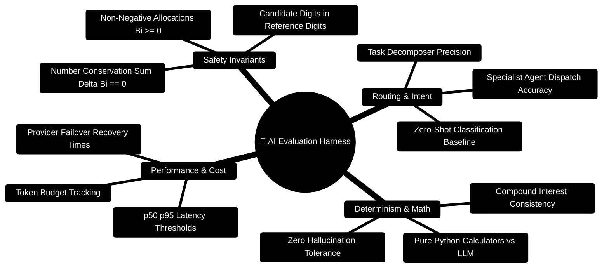

# FinWise AI Core — Evaluation & Invariant Verification Harness

> **Automated Quality Gates, Invariant Verification, and Benchmarking Suite for Multi-Agent Financial Reasoning**  
> *Number Safety Invariants ($\text{Candidate Digits} \subseteq \text{Reference Digits}$), Task Routing Accuracy, Deterministic Calculator Verification, and Latency Profiling*  
> **Execution Commands:** `pytest evals/ -v` · `python -m evals.runner`

---

> [!TIP]
> **Developer Guide: Building on FinWise**  
> For complete end-to-end full-stack feature recipes, Mongoose models, Zod schemas, Express controllers, and Python LangGraph subagents, consult the [**Master Developer Handbook: Building on This Project**](../../../docs/BUILDING_ON_THIS_PROJECT.md).

## 1. Evaluation Taxonomy Mindmap



---

## 2. Invariant Evaluation Pipeline ASCII Flow

```text
┌─────────────────────────────────────────────────────────────────────────────┐
│ 🧪 EVALUATION RUNNER (python -m evals.runner)                               │
│    Loads Test Suites • Configures Mock Providers • Sets Deterministic Seeds │
└──────────────────────────────────────┬──────────────────────────────────────┘
                                       │
                                       ▼
┌─────────────────────────────────────────────────────────────────────────────┐
│ 🔍 INVARIANT VERIFICATION GATES                                              │
│    ├─► 1. test_number_safety.py: Asserts no hallucinated dollar figures      │
│    │      Invariant: Every number in output must trace to ledger inputs     │
│    ├─► 2. test_routing_accuracy.py: Verifies TaskDecomposer dispatches      │
│    ├─► 3. test_determinism.py: Asserts repeat queries yield exact math      │
│    └─► 4. test_latency.py: Enforces SLA response deadlines (< 3.0s p95)     │
└──────────────────────────────────────┬──────────────────────────────────────┘
                                       │
                                       ▼
┌─────────────────────────────────────────────────────────────────────────────┐
│ 📊 OUTPUT METRICS & REPORT                                                  │
│    Console Summary • JSON Artifacts in evals/reports/ • CI Exit Code 0/1    │
└─────────────────────────────────────────────────────────────────────────────┘
```

---

## 3. Developer Guide: How to Add an Evaluation for a New Agent

When you build a new specialist agent (e.g. `TaxOptimizationAgent`), add an evaluation test to ensure it meets production invariants.

Create `server/AI_Core/evals/test_tax_agent_eval.py`:

```python
import pytest
from agents.tax_optimization_agent import execute_tax_agent
from evals.metrics import assert_number_safety

def test_tax_agent_math_safety():
    """
    Ensures that tax savings calculations do not exceed allowable deductions
    and only use numbers grounded in the input ledger.
    """
    input_ledger = {
        "annual_income": 95000.0,
        "retirement_contributions": 10000.0,
        "standard_deduction": 14600.0
    }
    
    state = {
        "org_id": "eval_tenant",
        "user_query": "How can I reduce my tax liability?",
        "ledger_context": input_ledger
    }
    
    result = execute_tax_agent(state)
    tax_output = result.get("tax_output", {})
    
    # 1. Invariant: Taxable income cannot be negative
    assert tax_output["taxable_income"] >= 0.0
    
    # 2. Invariant: Taxable income cannot exceed gross income
    assert tax_output["taxable_income"] <= input_ledger["annual_income"]
    
    # 3. Invariant: Candidate Digits must be grounded in reference input
    reference_corpus = f"{input_ledger['annual_income']} {input_ledger['retirement_contributions']} {input_ledger['standard_deduction']}"
    assert_number_safety(candidate=str(tax_output), reference=reference_corpus)
```

---

## 4. Evaluation CLI Reference

```bash
# Run all evaluation suites with verbose output
pytest evals/ -v

# Run the automated benchmark runner
python -m evals.runner

# Run specific invariant tests
pytest evals/test_number_safety.py -v
pytest evals/test_routing_accuracy.py -v
pytest evals/test_determinism.py -v
pytest evals/test_latency.py -v
```


---

## 5. Continuous Production AI Canary Invariant Validation Harness

The continuous canary validator (`server/AI_Core/evals/canary_validator.py`) enforces 5 mathematical identities across all LLM synthesis outputs:

```text
┌─────────────────────────────────────────────────────────────────────────────┐
│                   5 CORE MATHEMATICAL CANARY INVARIANTS                     │
├─────────────────────────────────────────────────────────────────────────────┤
│ 1. Number Safety: D_cand ⊆ D_ref ∪ {0, 1, 2, 3, 4, 5, 7, 10, 12, 14, 30, 365} │
│ 2. Zero-Sum Budget Conservation: ∑ ΔB_i = 0 and Proposed_i ≥ 0              │
│ 3. Balance Sheet Identity: |Assets - Liabilities - Net Worth| ≤ 0.01        │
│ 4. Cash Flow Identity: |Income - Expenses - Net Cash Flow| ≤ 0.01           │
│ 5. Debt Amortization Identity: |Principal + Interest - Payment| ≤ 0.01      │
└─────────────────────────────────────────────────────────────────────────────┘
```

### Execution Commands:
```bash
# Run Canary invariant validation unit tests
pytest tests/test_canary_validator.py -v

# Run full 175-eval suite
python -m evals.runner
```


---

## 6. Multi-Domain Follow-Through & Ranking Evaluator (`test_follow_through_eval.py`)

Verifies multi-domain signal extraction, priority score bounding ($S \in [0.0, 100.0]$), overdue precedence invariance, and adaptive preference learning with half-life exponential time decay across all 6 financial domains (`task`, `goal`, `budget`, `reminder`, `recurring`, `debt`).

```bash
# Execute Follow-Through Evaluator Suite
pytest evals/test_follow_through_eval.py -v
```

---

## 7. Conversation Summary & Narration Sign-Off Evaluator (`test_conversation_summary_eval.py`)

Validates multi-agent conversation recaps and narration outputs against 7 core sign-off criteria:
- **Number Safety Invariant**: $D_{\text{cand}} \subseteq D_{\text{ref}}$ (zero ungrounded numbers).
- **Four Canonical Sections**: `Conversation pulse`, `Repeated topics`, `Recommended next moves`, `Suggested next prompt`.
- **Word Count Bound**: $\le 240$ words.
- **Deterministic Factual Fallback**: Activates deterministic recap on any safety violation.

```bash
# Execute Conversation Summary Evaluator Suite
pytest evals/test_conversation_summary_eval.py -v
```

---

## 8. Financial Document Authorship & Rich Layout Evaluator (`test_document_creation_eval.py`)

Benchmarks automated PDFKit document synthesis across 6 structured formats (`standard`, `executive_brief`, `tax_prep_summary`, `cash_flow_audit`, `debt_payoff_schedule`, `net_worth_statement`):
- Verifies physical page boundaries and form-feed (`\f`) preservation.
- Verifies Balance Sheet ($A - L = NW$) and Cash Flow conservation identities.
- Validates side-by-side KPI cards, multi-column tables, and callouts.

```bash
# Execute Document Authorship Evaluator Suite
pytest evals/test_document_creation_eval.py -v
```

---

## 9. Multi-Modal Document Q&A Grounding Invariant Evaluator (`test_document_qa_eval.py`)

Audits semantic retrieval and question-answering fidelity across IRS Tax Forms (1040, W-2), Brokerage Statements, and OCR Receipts:
- **Zero Hallucination Invariant**: All asserted figures trace to source passages.
- **Physical Page Attribution**: Cited page numbers strictly match ground-truth source document pages.
- **Negative Case Handling**: Returns graceful non-hallucinated disclaimers on out-of-distribution questions.

```bash
# Execute Document Q&A Evaluator Suite
pytest evals/test_document_qa_eval.py -v
```

---

**Evidence:**
- `server/AI_Core/evals/` (`test_follow_through_eval.py`, `test_conversation_summary_eval.py`, `test_document_creation_eval.py`, `test_document_qa_eval.py`)