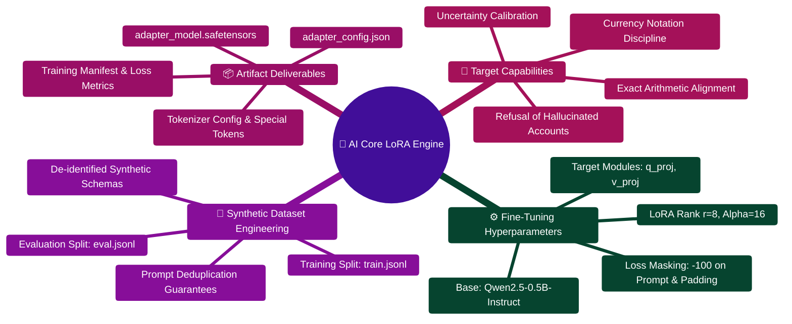

# FinWise — AI Core LoRA Training & Adaptation Engine

> **Domain Specialization, Parameter-Efficient Fine-Tuning (PEFT) & Synthetic Alignment**  
> *Low-Rank Adaptation (LoRA) for Financial Reasoning, Number Safety, and Exact Arithmetic Alignment*  
> **Target Base Model:** `Qwen/Qwen2.5-0.5B-Instruct` · **PEFT Targets:** `q_proj`, `v_proj` ($r=8, lpha=16$)

---

> [!TIP]
> **Developer Guide: Building on FinWise**  
> For complete end-to-end full-stack feature recipes, Mongoose models, Zod schemas, Express controllers, and Python LangGraph subagents, consult the [**Master Developer Handbook: Building on This Project**](../../../docs/BUILDING_ON_THIS_PROJECT.md).

## 1. LoRA Adaptation Architecture Mindmap



---

## 2. LoRA Training & Validation Pipeline ASCII Flow

```text
┌────────────────────────────────────────────────────────────────────────┐
│ 📥 SYNTHETIC DATASET INGESTION: train.jsonl & eval.jsonl                │
│    Format: {"messages": [system, user, assistant], "synthetic": true}  │
└───────────────────────────────────┬────────────────────────────────────┘
                                    │
                                    ▼
┌────────────────────────────────────────────────────────────────────────┐
│ 🛡️ STAGE 1: ZERO-DEPENDENCY DATASET VALIDATION (train.py)              │
│    ├─► Validates exact 3-role turn schema [system, user, assistant]    │
│    ├─► Asserts synthetic=true flag on every sample                     │
│    ├─► Validates zero duplicate prompts across train and eval splits   │
│    └─► Computes SHA-256 dataset integrity hash                         │
└───────────────────────────────────┬────────────────────────────────────┘
                                    │ (Passed)
                                    ▼
┌────────────────────────────────────────────────────────────────────────┐
│ ⚡ STAGE 2: PEFT LoRA FORWARD PASS & LOSS MASKING                       │
│    ├─► Inject Low-Rank Adapters: W' = W + (B · A) · (alpha / r)        │
│    ├─► Target Attention Layers: q_proj and v_proj                      │
│    ├─► Mask prompt tokens with label -100 (loss computed only on reply)│
│    └─► AdamW Optimizer with cosine decay & gradient clipping           │
└───────────────────────────────────┬────────────────────────────────────┘
                                    │
                                    ▼
┌────────────────────────────────────────────────────────────────────────┐
│ 📦 STAGE 3: ADAPTER ARTIFACT EXPORT & INVARIANT EVALUATION              │
│    ├─► Export adapter_model.safetensors & adapter_config.json          │
│    ├─► Write training manifest with dataset hashes and eval loss       │
│    └─► Run AI Core evals: test_number_safety.py & test_determinism.py 🟢│
└────────────────────────────────────────────────────────────────────────┘
```

---

## 3. Dataset Validation & Training Commands

### Fast Validation (Standard Library Only)
Validates dataset integrity, message schema, and prompt uniqueness without downloading model weights or requiring PyTorch:

```powershell
python train.py --validate-only
```

### Smoke Test Execution (Single Step)
Verifies CUDA or CPU tensor compilation and memory footprint:

```powershell
python -m venv .venv
.venv\Scripts\activate
pip install -r requirements.txt
python train.py --max-steps 1 --cpu
```

### Full Experiment Run
Executes complete PEFT LoRA training loop and emits serialized adapter weights:

```powershell
python train.py --output-dir ./models/finwise-lora-v1
```

---

## 4. Production Implementation Blueprint (`server/AI_Core/lora/train.py`)

```python
"""
FinWise AI Core — LoRA Training & PEFT Adapter Generation
Trains domain-aligned Low-Rank Adapters on Qwen2.5-0.5B-Instruct
"""
from __future__ import annotations

import argparse
import hashlib
import json
from pathlib import Path
from typing import List, Dict, Tuple

ROOT = Path(__file__).resolve().parent

def load_rows(path: Path) -> List[Dict]:
    rows = []
    for number, line in enumerate(path.read_text(encoding="utf-8").splitlines(), 1):
        if not line.strip():
            continue
        row = json.loads(line)
        messages = row.get("messages", [])
        if [item.get("role") for item in messages] != ["system", "user", "assistant"]:
            raise ValueError(f"{path.name}:{number}: expected system, user, assistant roles")
        if not all(isinstance(item.get("content"), str) and item["content"].strip() for item in messages):
            raise ValueError(f"{path.name}:{number}: empty or invalid message")
        if not row.get("synthetic"):
            raise ValueError(f"{path.name}:{number}: sample data must be marked synthetic")
        rows.append(row)
    if not rows:
        raise ValueError(f"Empty dataset: {path}")
    return rows

def validate(config: dict) -> Tuple[List[Dict], List[Dict]]:
    train = load_rows(ROOT / config["train_file"])
    evaluation = load_rows(ROOT / config["eval_file"])
    prompts = [row["messages"][1]["content"] for row in train + evaluation]
    if len(prompts) != len(set(prompts)):
        raise ValueError("Duplicate user prompts found across train/eval splits")
    return train, evaluation

def compute_dataset_hash(path: Path) -> str:
    hasher = hashlib.sha256()
    hasher.update(path.read_bytes())
    return hasher.hexdigest()
```

---

## 5. Pre-Deployment Adapter Quality Gates

Before activating an adapter within the runtime `LLMWrapper`:
1. **Number Safety Invariant**: Assert candidate response digits are a strict subset of reference data:
   $$\text{Digits}_{\text{candidate}} \subseteq \text{Digits}_{\text{reference}}$$
2. **Deterministic Fallback Gate**: Ensure the adapter defers to `financial_calculators.py` for all multi-period amortization projections.
3. **Zero Token Bleed**: Verify prompt masking correctly assigned label `-100` so loss is never backpropagated through user financial figures.
