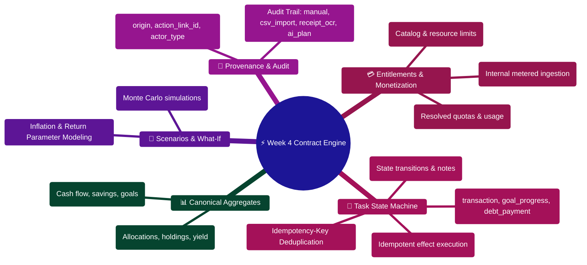

# Week 4 API Contract Updates & Runtime Specifications

> **Canonical API Contract Reference for FinWise Autonomous Personal Finance Platform**  
> *Task Engine Execution, Idempotent Effect Application, Aggregate Dashboards, Provenance Auditing, and Monetization Entitlements*  
> **Runtime Target:** Express 5 + TypeScript · Port `3000` · Node.js `>=24.14.1 <25` · Python AI Core `8001`

---

> [!TIP]
> **Developer Guide: Building & Extending API Contracts**  
> For full-stack implementation blueprints covering Zod schema validation, Express 5 controllers, and React Query hooks, consult the [**Master Developer Handbook: Building on This Project**](../../docs/BUILDING_ON_THIS_PROJECT.md).

## Architecture Mindmap



---

## Contract Execution & Idempotency Pipeline ASCII Flow

```text
┌────────────────────────────────────────────────────────────────────────┐
│ 🟢 CLIENT ACTION: POST /api/tasks/:id/apply                            │
│    Headers: Authorization: Bearer <jwt> • Idempotency-Key: <uuid>      │
└───────────────────────────────────┬────────────────────────────────────┘
                                    │
                                    ▼
┌────────────────────────────────────────────────────────────────────────┐
│ 🛡️ STAGE 1: IDEMPOTENCY CHECK & LEASE ACQUISITION (Redis 7.0)          │
│    ├─► Lookup idempotency_key in Redis key-space                       │
│    ├── Key Found (Cached Result)? ──► Return HTTP 200 Replay Payload 🟢│
│    └── Key In-Flight? ──► Return HTTP 409 Conflict (Lock contention) 🟡│
│    └─► Key Fresh? ──► Acquire distributed mutex (TTL: 60s)             │
└───────────────────────────────────┬────────────────────────────────────┘
                                    │ (Fresh Key)
                                    ▼
┌────────────────────────────────────────────────────────────────────────┐
│ ⚡ STAGE 2: ATOMIC MULTI-DOCUMENT EFFECT EXECUTION                     │
│    ├─► Start MongoDB ACID Session                                      │
│    ├─► Verify Task state: `status == "open"`                           │
│    ├─► Iterate task `effects` descriptors:                             │
│    │   ├─ Type "transaction": Append ledger entry with provenance      │
│    │   ├─ Type "goal_progress": Mutate goal current_amount             │
│    │   ├─ Type "debt_payment": Recalculate debt amortization balance   │
│    │   └─ Type "profile_update": Adjust category envelope limits       │
│    └─► Mark Task `status = "completed"`, `apply_status = "succeeded"`  │
└───────────────────────────────────┬────────────────────────────────────┘
                                    │
                                    ▼
┌────────────────────────────────────────────────────────────────────────┐
│ 📜 STAGE 3: PROVENANCE RECORDING & CACHE WRITE-BACK                    │
│    ├─► Attach `source.origin = "task_completion"` and `action_link_id` │
│    ├─► Store execution response in Redis idempotency cache (TTL: 24h)  │
│    ├─► Commit MongoDB ACID transaction                                 │
│    └─► Return HTTP 200 OK with applied_effects array 🟢                │
└────────────────────────────────────────────────────────────────────────┘
```

---

## 1. Tasks & Execution Engine

### `PATCH /api/tasks/:id`
Updates task metadata, status, or completion notes without executing financial side effects.

- **Request Headers:**
  - `Authorization: Bearer <jwt>`
  - `X-Org-Id: <orgId>`
- **Request Body:**
  ```json
  {
    "status": "completed",
    "completed_at": "2026-04-01T12:00:00.000Z",
    "note": "Reviewed with tax advisor and confirmed deduction applicability.",
    "completion_evidence": {
      "note": "Document ref #1098-C",
      "completed_at": "2026-04-01T12:00:00.000Z"
    },
    "apply_status": "succeeded"
  }
  ```
- **Response `200 OK`:**
  ```json
  {
    "success": true,
    "data": {
      "id": "task_65f8a1e2b",
      "orgId": "org_main",
      "title": "Allocate surplus to Roth IRA",
      "status": "completed",
      "completed_at": "2026-04-01T12:00:00.000Z",
      "note": "Reviewed with tax advisor and confirmed deduction applicability.",
      "updated_at": "2026-04-01T12:00:05.120Z"
    }
  }
  ```

---

### `POST /api/tasks/:id/apply`
Atomically executes the financial mutations described in the task's `effects` payload, updates ledger balances, and seals the task.

- **Request Headers:**
  - `Authorization: Bearer <jwt>`
  - `X-Org-Id: <orgId>`
  - `Idempotency-Key: <unique-uuid-v4>`
- **Request Body:**
  ```json
  {
    "idempotency_key": "9b1deb4d-3b7d-4bad-9bdd-2b0d7b3dcb6d",
    "completed_at": "2026-04-01T12:05:00.000Z",
    "note": "Applied via automated portfolio rebalancing cockpit",
    "effects": [
      {
        "type": "transaction",
        "parameters": {
          "account_id": "acc_checking_01",
          "amount": 250.00,
          "type": "expense",
          "category": "Investments",
          "description": "Monthly Roth IRA automated transfer"
        }
      },
      {
        "type": "goal_progress",
        "parameters": {
          "goal_id": "goal_roth_ira_2026",
          "incremental_amount": 250.00
        }
      }
    ]
  }
  ```
- **Response `200 OK`:**
  ```json
  {
    "success": true,
    "data": {
      "task_id": "task_65f8a1e2b",
      "status": "completed",
      "applied_effects": [
        {
          "type": "transaction",
          "status": "applied",
          "entity_id": "tx_88a91c201",
          "details": { "amount": 250.00, "balance_after": 4210.50 }
        },
        {
          "type": "goal_progress",
          "status": "applied",
          "entity_id": "goal_roth_ira_2026",
          "details": { "total_saved": 3250.00, "target": 7000.00 }
        }
      ],
      "links": {
        "action_link_id": "act_link_99014",
        "linked_entity_ids": ["tx_88a91c201", "goal_roth_ira_2026"]
      },
      "provenance": {
        "origin": "task_completion",
        "actor_type": "user",
        "actor_id": "usr_9912",
        "applied_at": "2026-04-01T12:05:01.402Z"
      },
      "idempotent_replay": false
    }
  }
  ```

---

## 2. Canonical Aggregates

### `GET /api/dashboard/summary`
Returns unified real-time telemetry across cash flow, savings envelopes, active goals, and pending review actions.

- **Response `200 OK`:**
  ```json
  {
    "cash_flow": {
      "monthly_inflow": 8450.00,
      "monthly_outflow": 5210.40,
      "net_burn_or_surplus": 3239.60,
      "currency": "USD"
    },
    "savings": {
      "emergency_fund_months": 5.8,
      "total_liquid_reserves": 30200.00
    },
    "goals": {
      "active_count": 4,
      "on_track_count": 3,
      "aggregate_target": 85000.00,
      "aggregate_current": 41200.00
    },
    "spending": {
      "top_categories": [
        { "category": "Housing", "amount": 2100.00, "budget": 2100.00 },
        { "category": "Groceries", "amount": 640.20, "budget": 750.00 },
        { "category": "Dining Out", "amount": 420.50, "budget": 350.00 }
      ]
    },
    "tasks": {
      "pending_review_count": 3,
      "urgent_recommendations": 1
    },
    "completeness": {
      "score": 0.94,
      "unmapped_transactions": 0
    }
  }
  ```

---

### `GET /api/portfolio/summary?months=12`
Calculates portfolio allocations, asset class diversification, unrealized capital gains, and trailing performance.

- **Query Parameters:**
  - `months` (integer, optional, default: 12): Analysis window
- **Response `200 OK`:**
  ```json
  {
    "summary": {
      "total_net_worth": 184500.00,
      "invested_capital": 142000.00,
      "unrealized_gain_loss": 42500.00,
      "unrealized_return_pct": 29.93,
      "trailing_twelve_month_yield_pct": 2.14
    },
    "allocations": {
      "equities_pct": 72.5,
      "fixed_income_pct": 18.0,
      "cash_equivalents_pct": 7.0,
      "commodities_pct": 2.5
    },
    "holdings": [
      {
        "ticker": "VTI",
        "name": "Vanguard Total Stock Market Index",
        "shares": 340.5,
        "current_price": 278.40,
        "market_value": 94795.20,
        "weight_pct": 51.38
      },
      {
        "ticker": "VXUS",
        "name": "Vanguard Total International Stock Index",
        "shares": 560.0,
        "current_price": 69.80,
        "market_value": 39088.00,
        "weight_pct": 21.18
      }
    ],
    "assumptions": {
      "months": 12,
      "benchmark": "S&P 500 (SPY)",
      "calculated_at": "2026-04-01T12:00:00.000Z"
    }
  }
  ```

---

## 3. Scenario & What-If Contract

### `POST /api/scenarios/what-if`
Executes forward-looking Monte Carlo or deterministic cash-flow projections under user-defined macroeconomic assumptions.

- **Request Body (Canonical Shape):**
  ```json
  {
    "parameters": {
      "scenario_type": "expense",
      "amount": 5000,
      "description": "HVAC System Replacement and Heat Pump Upgrade",
      "assumptions": {
        "months": 24,
        "expected_return_pct": 7.5,
        "inflation_pct": 3.2
      }
    }
  }
  ```
- **Response `200 OK`:**
  ```json
  {
    "scenario_id": "scen_908a1b2",
    "projected_impact": {
      "net_worth_delta": -5320.14,
      "emergency_fund_delta_months": -0.85,
      "goal_delay_months": 2.1,
      "recovery_timeline_months": 4.5
    },
    "recommendation": "Fund via high-yield savings cash reserves rather than liquidating equities to avoid capital gains taxable events.",
    "model_confidence": 0.96
  }
  ```

---

## 4. Provenance & Audit Ledger Envelope

Every transaction, profile modification, and budget adjustment records origin metadata for financial audibility and compliance:

```typescript
export interface ProvenanceEnvelope {
  origin: "manual" | "csv_import" | "receipt_ocr" | "journal" | "task_completion" | "ai_plan";
  action_link_id?: string;
  actor_type: "user" | "subagent" | "system_worker";
  actor_id: string;
  source_ref?: string;
  timestamp: string;
}
```

---

## 5. Monetization & Usage Metering

### `GET /api/entitlements/me`
Returns real-time plan status and usage quotas for the authenticated tenant:

```json
{
  "plan": "pro",
  "status": "active",
  "period_key": "2026-04",
  "limits": {
    "monthly_ai_queries": 1000,
    "receipt_scans": 250,
    "max_connected_institutions": 20
  },
  "usage": {
    "monthly_ai_queries": 142,
    "receipt_scans": 18,
    "max_connected_institutions": 4
  },
  "remaining": {
    "monthly_ai_queries": 858,
    "receipt_scans": 232,
    "max_connected_institutions": 16
  }
}
```

---

## 6. Implementation Blueprint: Idempotent Task Apply Controller

```typescript
import { Request, Response } from "express";
import mongoose from "mongoose";
import { Task } from "../models/Task";
import { Transaction } from "../models/Transaction";
import { redisClient } from "../config/redis";
import { logger } from "../utils/logger";

export async function applyTaskHandler(req: Request, res: Response): Promise<void> {
  const { id } = req.params;
  const orgId = req.orgId!;
  const userId = req.user!.id;
  const idempotencyKey = req.headers["idempotency-key"] as string || req.body.idempotency_key;

  if (!idempotencyKey) {
    res.status(400).json({ error: "MISSING_IDEMPOTENCY_KEY", message: "Idempotency-Key header is required" });
    return;
  }

  // 1. Check Redis idempotency cache
  const cacheKey = `idempotency:task:apply:${orgId}:${idempotencyKey}`;
  const cachedResponse = await redisClient.get(cacheKey);
  if (cachedResponse) {
    res.status(200).json({ ...JSON.parse(cachedResponse), idempotent_replay: true });
    return;
  }

  // 2. Start ACID Session
  const session = await mongoose.startSession();
  session.startTransaction();

  try {
    const task = await Task.findOne({ _id: id, orgId }).session(session);
    if (!task) {
      res.status(404).json({ error: "TASK_NOT_FOUND", message: `Task ${id} could not be located` });
      await session.abortTransaction();
      return;
    }

    if (task.status === "completed") {
      res.status(400).json({ error: "ALREADY_COMPLETED", message: "Task has already been completed" });
      await session.abortTransaction();
      return;
    }

    const appliedEffects: any[] = [];
    const effects = req.body.effects || task.effects || [];

    for (const effect of effects) {
      if (effect.type === "transaction") {
        const [tx] = await Transaction.create([{
          orgId,
          ...effect.parameters,
          source: {
            origin: "task_completion",
            action_link_id: task._id.toString(),
            actor_type: "user",
            actor_id: userId,
          }
        }], { session });
        appliedEffects.push({ type: "transaction", status: "applied", entity_id: tx._id });
      }
    }

    task.status = "completed";
    task.apply_status = "succeeded";
    task.completed_at = new Date();
    await task.save({ session });

    await session.commitTransaction();

    const responsePayload = {
      success: true,
      data: {
        task_id: task._id,
        status: "completed",
        applied_effects: appliedEffects,
        links: { action_link_id: task._id.toString() },
        provenance: { origin: "task_completion", actor_id: userId },
      }
    };

    // Cache idempotency payload for 24 hours
    await redisClient.set(cacheKey, JSON.stringify(responsePayload), "EX", 86400);

    res.status(200).json(responsePayload);
  } catch (err) {
    await session.abortTransaction();
    logger.error({ err, taskId: id }, "Failed to apply task effects");
    res.status(500).json({ error: "TASK_APPLY_FAILED", message: "Internal transaction failure" });
  } finally {
    session.endSession();
  }
}
```

---

## 7. Rollout Governance & Rollback Thresholds

| Endpoint | Feature Flag | Canary Stage | Rollback Trigger Threshold | Fallback Behavior |
| :--- | :--- | :--- | :--- | :--- |
| `POST /api/tasks/:id/apply` | `TASKS_ENABLED` | 10% Canary | Error rate `> 2.0%` | Read-only mode: mark task completed without mutating ledger |
| `GET /api/dashboard/summary` | None (Core) | Global | p95 latency `> 800ms` | Serve cached dashboard snapshot from Redis (TTL: 5m) |
| `POST /api/scenarios/what-if` | `SCENARIOS_ENABLED` | 20% Canary | Timeout rate `> 5.0%` | Deterministic local NPV/IRR math calculation engine |
| `POST /api/usage-events` | `METERING_ENABLED` | Global | DLQ count `> 500/hr` | Asynchronous buffer in Redis stream with batch ingestion |
