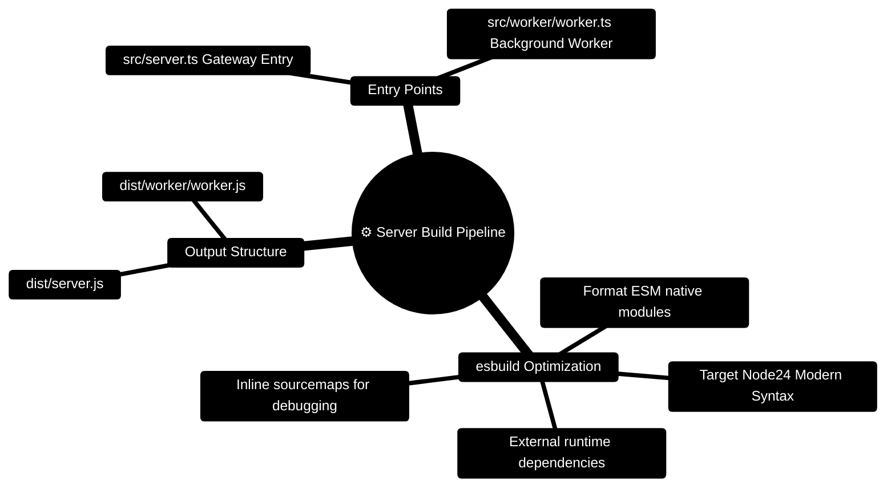

# FinWise Server Build Scripts — ESM Bundling & Packaging

> **Fast Production esbuild Pipeline for Express 5 Server & BullMQ Worker**  
> *Targeting Node.js 24 LTS, Native ESM Output, Source Maps, and External Package Preservations*

---

> [!TIP]
> **Developer Guide: Building on FinWise**  
> For complete end-to-end full-stack feature recipes, Mongoose models, Zod schemas, Express controllers, and Python LangGraph subagents, consult the [**Master Developer Handbook: Building on This Project**](../../docs/BUILDING_ON_THIS_PROJECT.md).

## 1. Build Pipeline Mindmap



---

## 2. Server Build & Packaging ASCII Flow

```text
┌─────────────────────────────────────────────────────────────────────────────┐
│ 📝 TYPESCRIPT SOURCE CODE (server/src/)                                     │
│    src/server.ts (Composition Root) • src/worker/worker.ts (Task Worker)    │
└──────────────────────────────────────┬──────────────────────────────────────┘
                                       │
                                       ▼
┌─────────────────────────────────────────────────────────────────────────────┐
│ ⚡ ESBUILD COMPILATION (node scripts/build.mjs)                              │
│    - Fast TypeScript Stripping & Inlining                                   │
│    - Bundles internal relative modules without loader flags                 │
│    - Externalizes npm packages (express, mongoose, ioredis, etc.)           │
└──────────────────────────────────────┬──────────────────────────────────────┘
                                       │
                                       ▼
┌─────────────────────────────────────────────────────────────────────────────┐
│ 📦 PRODUCTION DIST OUTPUT (server/dist/)                                    │
│    dist/server.js • dist/worker/worker.js • dist/*.map                      │
│    Execution: node dist/server.js                                           │
└─────────────────────────────────────────────────────────────────────────────┘
```

---

## 3. Developer Guide: Executing Production Builds

```bash
# Navigate to server directory
cd server

# Run build script
node scripts/build.mjs

# Launch compiled production bundle (Port 3000)
node dist/server.js
```


---

## 4. Production Build Script Blueprint (`server/scripts/build.mjs`)

```javascript
import { build } from 'esbuild';

// Bundle local modules so Node can run the ESM output without TypeScript loaders
// or extension-resolution flags. Runtime packages remain normal dependencies.
await build({
  entryPoints: { 
    server: 'src/server.ts', 
    'worker/worker': 'src/worker/worker.ts' 
  },
  outdir: 'dist',
  bundle: true,
  platform: 'node',
  target: 'node24',
  format: 'esm',
  packages: 'external',
  sourcemap: true,
  logLevel: 'info',
});
```

### 4.1 Compiler Flags Rationale

| Compiler Flag | Setting | Architectural Purpose |
| :--- | :--- | :--- |
| `platform` | `'node'` | Preserves built-in Node.js modules (`fs`, `path`, `crypto`, `stream`) |
| `target` | `'node24'` | Leverages native Node 24 V8 optimizations, top-level await, and ES2024 syntax |
| `format` | `'esm'` | Emits native ECMAScript Modules (`import` / `export`) with clean execution |
| `packages` | `'external'` | Excludes `node_modules` from bundle to keep dist lightweight and prevent binary conflicts |
| `sourcemap` | `true` | Preserves accurate line numbers in Sentry, Datadog, and OpenTelemetry stack traces |

### 4.2 Production Process Management (PM2 Recipe)

```javascript
// ecosystem.config.cjs
module.exports = {
  apps: [
    {
      name: 'finwise-api',
      script: 'dist/server.js',
      instances: 'max',
      exec_mode: 'cluster',
      env: {
        NODE_ENV: 'production',
        PORT: 3000,
      },
    },
    {
      name: 'finwise-worker',
      script: 'dist/worker/worker.js',
      instances: 1,
      env: {
        NODE_ENV: 'production',
      },
    },
  ],
};
```
