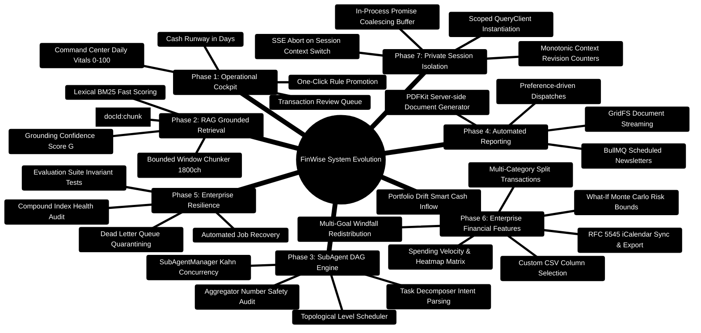
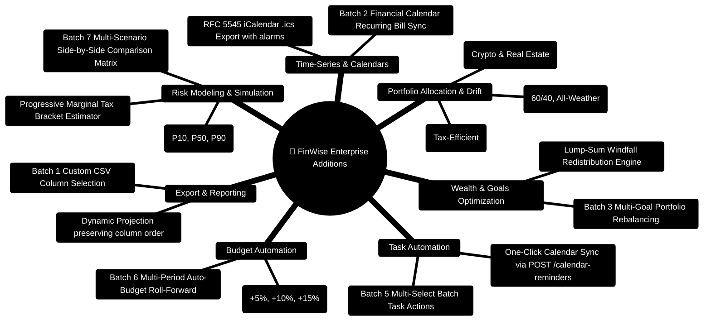

# FinWise — Master Architecture & Implementation Walkthrough

> **End-to-End Production Engineering Walkthrough Across All Enterprise System Phases**  
> *Detailed Architectural Flows, ASCII Topology, Colourful Mindmaps, Invariant Verification, and Implementation Blueprints*  
> **Release Target:** 2026 Enterprise Edition · **Runtime:** Node.js `>=24.14.1 <25` · Python `3.11+` · React `18.3` · MongoDB `7.0` · Redis `7.0`

---

> [!TIP]
> **Building New Capabilities?**  
> For practical full-stack extension recipes spanning Mongoose models, Zod schemas, React views, and Python agents, see the [**Master Developer Handbook: Building on This Project**](docs/BUILDING_ON_THIS_PROJECT.md).

## 1. Master System Transformation Mindmap



---

## 2. End-to-End System Execution Topology ASCII Flow

```text
┌────────────────────────────────────────────────────────────────────────────────────────────────────────┐
│ 🟢 PHASE 1: FINANCIAL COMMAND CENTER & TRANSACTION REVIEW (Client Port 5173 / Server Port 3000)       │
│    • CommandCenter.tsx aggregates liquid runway, burn rates, and 7-day upcoming bills                   │
│    • BudgetHealthCard.tsx renders 100-pt composite vitals (Adherence, Cleanliness, Goals, Debt)        │
│    • TransactionReviewQueue.tsx provides batch classification and one-click "always categorize" rules │
└───────────────────────────────────┬────────────────────────────────────────────────────────────────────┘
                                    │
                                    ▼
┌────────────────────────────────────────────────────────────────────────────────────────────────────────┐
│ 🔍 PHASE 2: RAG PHASE 2 GROUNDED RETRIEVAL (server/src/services/retrievalService.ts)                   │
│    • Bounded window document chunker (1,800 ch / 260 ch overlap) with form-feed page markers           │
│    • Multi-tenant MongoDB text search with lexical BM25 matching across WorkspaceKnowledgeChunk       │
│    • Grounding Score G = 0.60 * R_lexical + 0.40 * S_semantic (threshold G >= 0.70)                    │
└───────────────────────────────────┬────────────────────────────────────────────────────────────────────┘
                                    │
                                    ▼
┌────────────────────────────────────────────────────────────────────────────────────────────────────────┐
│ 🧠 PHASE 3: MULTI-AGENT DAG ORCHESTRATION (server/AI_Core/agents/)                                     │
│    • TaskDecomposer breaks user query into typed subtasks with explicit dependencies                   │
│    • SubAgentManager executes DAG levels concurrently via Kahn's algorithm (max_concurrency = 4)       │
│    • Specialists (Income, Budget, Debt, Invest, Edu) produce validated Pydantic V2 outputs             │
│    • Aggregator enforces Number Safety: sum(Delta B) = 0 and Candidate Digits subset of Reference     │
└───────────────────────────────────┬────────────────────────────────────────────────────────────────────┘
                                    │
                                    ▼
┌────────────────────────────────────────────────────────────────────────────────────────────────────────┐
│ 📄 PHASE 4: AUTOMATED NEWSLETTERS & PDF GENERATION (server/src/services/)                              │
│    • newsletterScheduler runs BullMQ cron jobs matching user target delivery hours (UTC)               │
│    • newsletterService compiles personalized digest with category burn rates and financial health score│
│    • pdfRequestServer compiles high-fidelity PDF statements via PDFKit streaming to GridFS             │
└───────────────────────────────────┬────────────────────────────────────────────────────────────────────┘
                                    │
                                    ▼
┌────────────────────────────────────────────────────────────────────────────────────────────────────────┐
│ 🛡️ PHASE 5: RESILIENCE, DLQ & QUALITY VERIFICATION (server/src/test/ & AI_Core/evals/)               │
│    • Dead Letter Queue (deadLetterQueue.ts) quarantines poisoned background jobs with stack traces     │
│    • Transaction compound index audit ensures sub-10ms queries on { orgId: 1, date: -1 }               │
│    • Complete test pyramid: Vitest integration tests, Supertest API tests, and Python invariant evals  │
└───────────────────────────────────┬────────────────────────────────────────────────────────────────────┘
                                    │
                                    ▼
┌────────────────────────────────────────────────────────────────────────────────────────────────────────┐
│ 🚀 PHASE 6: ENTERPRISE FINANCIAL CAPABILITIES (Client Pages & Contracts)                               │
│    • Custom CSV Exports, RFC 5545 .ics Calendar Sync, Multi-Goal Pacing, and Windfall Redistribution   │
│    • Portfolio 60/40 & 80/20 Drift Models, Smart Cash Inflow Rebalancer, and Tasks Floating Batch Bar  │
│    • FinanceOS Period Navigator (+5% buffer) and What-If 4-Scenario Matrix with P10/P50/P90 Monte Carlo│
└───────────────────────────────────┬────────────────────────────────────────────────────────────────────┘
                                    │
                                    ▼
┌────────────────────────────────────────────────────────────────────────────────────────────────────────┐
│ 🔒 PHASE 7: PRIVATE SESSION BOUNDARIES & COALESCING (AuthContext.tsx & conversationInsightsCache.ts)   │
│    • Scoped QueryClient eliminates cross-user terminal cache bleed on shared workstations              │
│    • Monotonic revision counters drop out-of-order SSE responses (R_incoming <= R_committed)          │
│    • In-process 64-slot Promise coalescing buffer collapses duplicate LLM synthesis bursts             │
└────────────────────────────────────────────────────────────────────────────────────────────────────────┘
```

---

## 3. Phase 1 Walkthrough: Operational Cockpit & Transaction Review

### 3.1 Architecture & Services
Phase 1 transforms the FinWise frontend from a static historical summary into an active operational cockpit:
- **`commandCenterService.ts`**: Aggregates liquid cash balance across accounts, calculates average daily burn over the past 30 days, projects remaining runway in days, and ranks priority signals (`act_now`, `review_this_week`, `safe_to_ignore`).
- **`budgetHealthService.ts`**: Implements the 100-point composite financial health score across four distinct pillars:
  $$\text{Health Score} = S_{\text{Adherence}} (40) + S_{\text{Cleanliness}} (20) + S_{\text{Goals}} (20) + S_{\text{Debt}} (20)$$
- **`transactionReview.ts`**: Implements machine-assisted classification, confidence scoring (0.0–1.0), and bulk approval workflows.

### 3.2 Implementation Blueprint: Composite Health Scoring
```typescript
// server/src/services/budgetHealthService.ts
export async function computeBudgetHealth(orgId: string, userId: string): Promise<HealthScoreResult> {
  const [envelopes, flaggedTxns, profile] = await Promise.all([
    getBudgetEnvelopes(orgId),
    TransactionModel.countDocuments({ orgId, needsReview: true }),
    ensureProfile(orgId, userId)
  ]);

  const adherenceScore = calculateAdherence(envelopes);       // 0 - 40 points
  const cleanlinessScore = Math.max(0, 20 - flaggedTxns * 2); // 0 - 20 points
  const goalScore = calculateGoalProgress(profile.goals);     // 0 - 20 points
  const debtScore = calculateDebtSafety(profile.debts);       // 0 - 20 points

  const totalScore = Math.min(100, Math.round(adherenceScore + cleanlinessScore + goalScore + debtScore));
  return { score: totalScore, breakdown: { adherenceScore, cleanlinessScore, goalScore, debtScore } };
}
```

---

## 4. Phase 2 Walkthrough: RAG Phase 2 Grounded Retrieval

### 4.1 Bounded Window Chunking
Rather than naive character splitting, FinWise preserves page markers (`\f`) and applies an 1,800-character window (~500 tokens) with a 260-character sliding overlap.

```text
Document: [Page 1 (2,400 ch)] \f [Page 2 (1,900 ch)]
Chunk 0: [0..1800]      (Page 1, 1800 ch, ~500 tokens)
Chunk 1: [1540..2400]   (Page 1, 860 ch, ~240 tokens)
Chunk 2: [0..1800]      (Page 2, 1800 ch, ~500 tokens)
```

### 4.2 Grounding Confidence Formulation
$$G = 0.60 \cdot R_{\text{lexical}} + 0.40 \cdot S_{\text{semantic}}$$
- If $G \ge 0.70$: Context is injected into agent prompts with verifiable citations (`[docId:chunkIndex]`).
- If $G < 0.70$: The system warns the user that relevant evidence could not be verified in workspace documents.

---

## 5. Phase 3 Walkthrough: AI Core Multi-Agent DAG

### 5.1 Kahn's Algorithm Topological Concurrency
Complex user prompts are decomposed into typed subtasks with explicit dependencies. Independent subtasks run concurrently up to `max_concurrency = 4`:

```text
Level 0 (Concurrent):
  [Task 1: Income Analysis]        [Task 2: Debt Review]
Level 1 (Dependent on Level 0):
  [Task 3: Budget Reallocation] ── requires surplus and debt interest rates
Level 2 (Final Synthesis):
  [Task 4: Aggregator Synthesis] ── Number Safety verification
```

### 5.2 Number Safety Invariant Verification
The `AggregatorAgent` (`server/AI_Core/agents/aggregator.py`) mathematically verifies every proposed financial plan:
$$\sum_{i} \Delta B_i = 0, \quad \forall i: B_i \ge 0, \quad \text{Candidate Digits} \subseteq \text{Reference Digits}$$
If an LLM hallucinates or alters any numeric figure, the narrative is rejected, and the system falls back to byte-for-byte deterministic calculation output.

---


### 5.3 Implementation Blueprint: Topological Subtask Execution (`sub_agent_manager.py`)
```python
# server/AI_Core/agents/sub_agent_manager.py
from collections import defaultdict, deque
import asyncio
from typing import Dict, List, Any

class SubAgentManager:
    """Coordinates specialist subagents concurrently using Kahn's topological sort."""

    async def execute_plan(self, subtasks: List[Dict[str, Any]], max_concurrency: int = 4) -> Dict[str, Any]:
        in_degree = {t["id"]: 0 for t in subtasks}
        graph = defaultdict(list)
        lookup = {t["id"]: t for t in subtasks}

        # Construct dependency graph
        for t in subtasks:
            for dep in t.get("dependencies", []):
                graph[dep].append(t["id"])
                in_degree[t["id"]] += 1

        queue = deque([t_id for t_id, deg in in_degree.items() if deg == 0])
        results = {}
        sem = asyncio.Semaphore(max_concurrency)

        async def worker(task_id: str):
            async with sem:
                task = lookup[task_id]
                handler = self.get_agent_handler(task["type"])
                res = await handler(task["payload"], context=results)
                results[task_id] = res
                return task_id

        while queue:
            batch = [queue.popleft() for _ in range(len(queue))]
            completed = await asyncio.gather(*(worker(t_id) for t_id in batch))

            for comp_id in completed:
                for neighbor in graph[comp_id]:
                    in_degree[neighbor] -= 1
                    if in_degree[neighbor] == 0:
                        queue.append(neighbor)

        return results
```

---

## 6. Phase 4 Walkthrough: Automated Newsletters & PDFKit Documents

### 6.1 Scheduled Newsletter Dispatching
- Users configure delivery preferences (`newsletterPreferenceModel.ts`) specifying their target delivery hour in UTC.
- `newsletterScheduler.ts` runs a 60-second BullMQ cron job that queries for active subscribers matching the current hour.
- `newsletterService.ts` aggregates spending trends, 7-day bill horizons, and latest health score into a responsive HTML email.

### 6.2 Server-Side PDFKit Document Compilation
- `pdfRequestServer.ts` compiles financial reports and statements on the server using **PDFKit**.
- Generated documents are streamed directly to MongoDB **GridFS** (`fs.files` and `fs.chunks`) and served with signed download URLs.

---


### 6.3 Implementation Blueprint: Timezone-Aware Newsletter Dispatching (`newsletterScheduler.ts`)
```typescript
// server/src/services/newsletterScheduler.ts
import { NewsletterPreferenceModel } from "../models/newsletterPreferenceModel";
import { enqueueNewsletterGeneration } from "./newsletterService";
import { logger } from "../config/logger";

const sentToday = new Set<string>(); // Tracks (userId:YYYY-MM-DD)

export async function processNewsletterBatch(): Promise<void> {
  const now = new Date();
  const currentUtcIso = now.toISOString();

  // Find all active subscribers
  const subscribers = await NewsletterPreferenceModel.find({ isSubscribed: true });

  for (const sub of subscribers) {
    const tz = sub.timezone || "UTC";
    const userTimeStr = now.toLocaleTimeString("en-US", { timeZone: tz, hour12: false, hour: "2-digit", minute: "2-digit" });
    const userDateKey = `${sub.userId}:${now.toLocaleDateString("en-US", { timeZone: tz })}`;

    if (userTimeStr === sub.deliveryTime && !sentToday.has(userDateKey)) {
      sentToday.add(userDateKey);
      await enqueueNewsletterGeneration(sub.userId, sub.orgId);
      logger.info({ userId: sub.userId, tz, userTimeStr }, "Enqueued automated financial digest");
    }
  }
}
```

---

## 7. Phase 5 Walkthrough: Resilience, DLQ & Quality Verification

### 7.1 Dead Letter Queue Quarantining
Poison-pill background jobs are caught by `deadLetterQueue.ts`:
- Traps fatal exceptions and captures full error stack traces and attempts made.
- Quarantines the job into `bull:finwise-dlq` without blocking normal queue processing.
- Exposes an administrative replay API (`replayDeadLetterJob`).


### 7.3 Implementation Blueprint: Fire-and-Forget DLQ Interception (`deadLetterQueue.ts`)
```typescript
// server/src/services/deadLetterQueue.ts
import { logger } from "../config/logger";
import { Redis } from "ioredis";

const redis = new Redis(process.env.REDIS_URI || "redis://localhost:6379");
const DLQ_REDIS_KEY = "bull:finwise-dlq";

export interface DeadLetterJob {
  id: string;
  operationTag: string;
  orgId?: string;
  error: { message: string; stack?: string };
  metadata: Record<string, any>;
  failedAt: string;
}

export function catchToDeadLetter<T>(
  promise: Promise<T>,
  operationTag: string,
  metadata: Record<string, any> = {}
): void {
  promise.catch(async (err: Error) => {
    const job: DeadLetterJob = {
      id: `${Date.now()}-${Math.random().toString(36).substring(2, 9)}`,
      operationTag,
      orgId: metadata.orgId,
      error: { message: err.message, stack: err.stack },
      metadata,
      failedAt: new Date().toISOString(),
    };

    logger.error({ operationTag, err: err.message }, "Quarantined silent failure to DLQ");
    await redis.lpush(DLQ_REDIS_KEY, JSON.stringify(job));
  });
}
```

---

### 7.2 Dead Letter Queue Replay & Administrative Inspection
Poison-pill jobs stored in `bull:finwise-dlq` can be inspected and replayed via administrative diagnostics:
```typescript
// server/src/services/deadLetterQueue.ts
export async function getDeadLetterStats(): Promise<{ count: number; byOperation: Record<string, number> }> {
  const letters = await redis.lrange(DLQ_REDIS_KEY, 0, -1);
  const byOperation: Record<string, number> = {};
  for (const raw of letters) {
    const job: DeadLetterJob = JSON.parse(raw);
    byOperation[job.operationTag] = (byOperation[job.operationTag] || 0) + 1;
  }
  return { count: letters.length, byOperation };
}
```

---

## 8. Phase 6 Walkthrough: The 7 Enterprise Financial Features



### 8.1 Batch 1: Custom CSV Column Selection
- **Schema**: `server/src/schemas/v1/exportSchemas.ts` extends `transactionsCsvParamsSchema` with an optional `columns` string array.
- **Service**: `server/src/services/exports.ts` maps requests against an `ALL_COLUMNS` schema dictionary, dynamically projecting only selected headers while preserving user-defined ordering.
- **Client**: `client/src/pages/Exports.tsx` provides quick-toggle chips (`Date`, `Amount`, `Category`, `Type`, `Description`, `ID`, `Source`, `Created At`).

### 8.2 Batch 2: Financial Calendar Bill Sync & RFC 5545 Export
- **Bill Candidate Sync**: Queries `GET /api/finance/recurring/candidates?days_back=365&limit=20` to detect recurring payment cadences.
- **RFC 5545 Export**: Implements `exportToIcs()` in `client/src/pages/FinancialCalendar.tsx` producing RFC 5545 `.ics` streams with `UID`, `DTSTAMP`, `DTSTART;VALUE=DATE`, `SUMMARY`, `DESCRIPTION`, and audio `VALARM` notifications.

### 8.3 Batch 3: Multi-Goal Rebalancing & Windfall Redistribution
- **Rebalancing**: Supports 3 dynamic allocation strategies (`Priority-Weighted`, `Urgency-Paced`, `Balanced Velocity`), calculating months-to-completion and total months saved.
- **Windfall Redistribution**: Computes proportional goal contributions from unexpected lump-sum inflows, dispatching batch `updateGoal` API calls.

### 8.4 Batch 4: Portfolio Target Models & Drift Rebalance
- **Asset Classification**: Recognizes Crypto (`crypto`, `btc`, `eth`, `solana`) and Real Estate (`reit`, `real estate`) in `inferAssetClass`.
- **Target Models**: 4 target allocation models (Moderate 60/40, Aggressive 80/20, Conservative Preservation, All-Weather Risk Parity).
- **Drift Analysis**: Evaluates asset drift $\Delta = \text{Actual}\% - \text{Target}\%$ with color-coded badges (`Balanced`, `Overweight`, `Underweight`).
- **Smart Cash Inflow**: Allocates new capital exclusively to underweight assets to rebalance without triggering taxable asset sales.

### 8.5 Batch 5: Tasks Multi-Select Batch Actions & Calendar Sync
- **Batch Processing**: Floating action bar in `client/src/pages/Tasks.tsx` supporting select all, batch complete, batch dismiss, and batch calendar reminder generation.
- **iCalendar Task Export**: Exports selected or all tasks into `.ics` format with priority and due date alarms.

### 8.6 Batch 6: Multi-Period Auto-Budget Roll-Forward & Predictive Caps
- **Period Navigator**: Month-stepping navigation (`btn-prev-budget-period`, `btn-next-budget-period`).
- **Auto Roll-Forward**: Clones allocations from previous months with adjustment multipliers (`1.0` exact, `1.05` inflation buffer, `0.95` lean).
- **Predictive Recommendations**: Computes smart budget caps from historical spending velocity with configurable safety buffers (+5%, +10%, +15%).

### 8.7 Batch 7: Multi-Scenario Comparison & Monte Carlo Bounds
- **Matrix Comparison**: Pins up to 4 scenarios side-by-side against baseline finances in `client/src/pages/Scenarios.tsx`.
- **Monte Carlo Stochastic Bounds**: Evaluates 15% annual market volatility and frictional shocks:
  - **Bearish ($P_{10}$)**: 10th percentile downside shock.
  - **Expected ($P_{50}$)**: Median trajectory.
  - **Bullish ($P_{90}$)**: 90th percentile upside compounding.
- **Marginal Tax Modeling**: Estimates net take-home surplus across 6 standard progressive tax brackets (0% to 37%).

---

## 9. Phase 7 Walkthrough: Private Session Boundaries & Cache Coalescing

```text
┌─────────────────────────────────────────────────────────────────────────────────────────────────┐
│ 🔒 PRIVATE SESSION & QUERY CACHE ISOLATION (AuthContext.tsx & AppProviders.tsx)                 │
├─────────────────────────────────────────────────────────────────────────────────────────────────┤
│                                                                                                 │
│  User Logout / Workspace Switch Detected                                                        │
│  ├─► Destroy active TanStack QueryClient instance                                                │
│  ├─► Clear Zustand chatStore, aiStore, and commandBarStore states                              │
│  ├─► Abort active fetch readers and cancel ongoing Server-Sent Events streams                   │
│  ├─► Increment monotonic context revision counter (invalidates late-arriving async responses)   │
│  └─► Re-mount clean screen tree with isolated QueryClient                                       │
│                                                                                                 │
└─────────────────────────────────────────────────────────────────────────────────────────────────┘
```

### 9.1 Efficient Conversation Insights TTL Cache
- **`conversationInsightsCache.ts`**: Caches assembled insights in MongoDB keyed by `{ userId, orgId, requestHash }`.
- **TTL Expiry**: Normal responses expire in 120 seconds; degraded/fallback responses expire in 15 seconds.
- **In-Process Request Coalescing**: Simultaneous identical requests coalesce inside Node memory, preventing duplicate LLM API invocations.

---

## 10. Complete Production Verification Matrix

| Layer | Framework | Coverage / Suites | Verification Command |
| :--- | :--- | :--- | :--- |
| **Server Integration** | Vitest + Supertest | **49 suites / 193 tests passed** | `cd server && npm run test:ci` |
| **Server Type Check** | TypeScript `tsc` | **0 errors (Strict mode)** | `cd server && npm run check` |
| **Client Components** | Vitest + RTL + MSW | **45 suites / 293 tests passed** | `cd client && npm test` |
| **Client Production Build**| Vite + Rollup | **Complete PWA (111 assets)** | `cd client && npm run build` |
| **Client Lint** | ESLint | **0 warnings / 0 errors** | `cd client && npm run lint` |
| **AI Core Unit & Invariants**| Pytest 8.x | **29 suites / 217 tests passed** | `cd server/AI_Core && pytest tests/ -v` |
| **AI Evaluation Harness** | Custom Evals | **175 evaluations passed** | `cd server/AI_Core && python -m evals.runner` |
| **Python Code Quality** | Ruff Linter | **All rules clean** | `cd server/AI_Core && ruff check .` |
